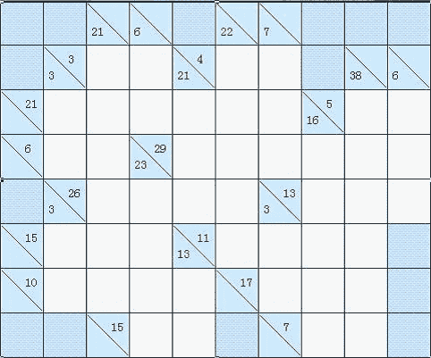

# 【作品提交】Kakuro 数独问题

> 原文：[`www.pediy.com/kssd/pediy10/67452.html`](https://www.pediy.com/kssd/pediy10/67452.html)

这是我参加数模的竞赛的作品。  
虽然这个竞赛是数模竞赛，但题目偏重于算法，想了想我就发上来了。以下是题目介绍：  
  
数独这个奇特的名字来源于日语 Sudoku，是十八世纪瑞士数学家欧拉发明的。  
后在美国发展，并在日本得以发扬光大。  
Sudoku 的规则十分简单，就是在 9×9 的九宫格里面填数字，每个方格中填人合适的数字以使得每行，每列以及每个九宫格都要包含从 1～9 的数字且互不相同．  
数独的玩法逻辑简单，数字排列方式千变万化．不少教育者认为数独是锻炼脑筋的好方法。  
谜题中会预先填入若干数字, 其它方格为空白, 玩家得依谜题中的数字分布状况, 逻辑推敲出剩下的空格里是什么数字。  
由于规则简单, 在推敲之中完全不必用到数学计算,   
只需运用逻辑推理能力, 所以无论男女老幼, 人人都可以玩, 而且容易上手、容易入迷。  
世界各地有很多数独俱乐部, 还有的国家如法国等专门举行过数独比赛, 其风靡程度可见一斑。目前网上流行一些经过变形的数独，其中 Kakuro 数独就是其中一种。  
图 1 就是一道难度级别较高的 Kakuro 数独问题。  
Kakuro 数独规则如下：  
1、在空格中填入数字 1-9；数字 0 不能出现。  
2、带斜线的方格，斜线上方的数字等于该方格右面对应的一组水平空格里的数字之和；斜线下方的数字，等于该方格下面对应一组垂直空格里的数字之和。  
3、同一数字在每组水平（垂直）空格里只能出现一次。  
针对 Kakuro 数独，完成以下问题：  
讨论求解模型或方法  
  
  
求解程序在附件中，c#写成，vs2005 编译。  
由于时间问题，就没写 I/O 接口了，数独地图的输入我采用下面三个矩阵：  
 

代码:

```
         
  Map = new int\[,\]
                   {
                       {-1,-1,-1,-1,-1,-1,-1,-1},
                       {-1,-1, 0, 0,-1 ,0, 0,-1},
                       {-1, 0, 0, 0, 0, 0, 0,-1},
                       {-1, 0, 0,-1, 0, 0, 0, 0},
                       {-1,-1, 0, 0, 0,-1, 0, 0},
                       {-1, 0, 0, 0, 0, 0,-1,-1},
                       {-1, 0, 0, 0,-1 ,0, 0,-1},
                       {-1,-1,-1, 0, 0, 0, 0, 0},
                       {-1,-1, 0, 0, 0, 0, 0, 0},
                       {-1,-1, 0, 0, 0,-1,-1,-1}
                    
                   };
            MapDown = new int\[,\]//向下的条件
                     {
                   { -1,-1,-1,-1,-1,-1,-1,-1},
                       { -1, 3,-1,-1, 3,-1,-1,-1},
                       { 21,-1,-1,-1,-1,-1,-1,-1},
                       {  6,-1,-1,23,-1,-1,-1,-1},
                       { -1,21,-1,-1,-1,13,-1,-1},
                       { 22,-1,-1,-1,-1,-1,-1,-1},
                       {  7,-1,-1,-1, 3,-1,-1,-1},
                       { -1,-1,16,-1,-1,-1,-1,-1},
                       { -1,38,-1,-1,-1,-1,-1,-1},
                       { -1, 6,-1,-1,-1,-1,-1,-1}
                     };
            MapRight = new int\[,\]//向右的条件
                    {
                   {-1,-1,21, 6,-1,15,10,-1},
                   {-1, 3,-1,-1,26,-1,-1,-1},
                   {-1,-1,-1,-1,-1,-1,-1,15},
                   {-1,-1,-1,29,-1,-1,-1,-1},
                   {-1, 4,-1,-1,-1,11,-1,-1},
                   {-1,-1,-1,-1,-1,-1,17,-1},
                   {-1,-1,-1,-1,13,-1,-1, 7},
                   {-1,-1, 5,-1,-1,-1,-1,-1},
                   {-1,-1,-1,-1,-1,-1,-1,-1},
                   {-1,-1,-1,-1,-1,-1,-1,-1}
                     };

```

Map  表示整个的条件，正如图所示，所有可填的地方为 0，不可填或表示条件的地方为-1。  
MapDown 表示向下的条件，如图中（0，2）的地方为 21，表示下面这一条相加之和为 21.  
同理 MapRight 向右的条件。  
  
程序运行即可得到解。如要修改图示中的条件，可自行修改 Map  MapDown MapRight  三个二维数组。大家也可改成 gui 形式，呵呵，这里我就不做了

上传的附件
|  || 作品.rar  
 |