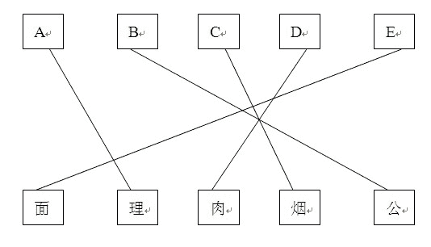
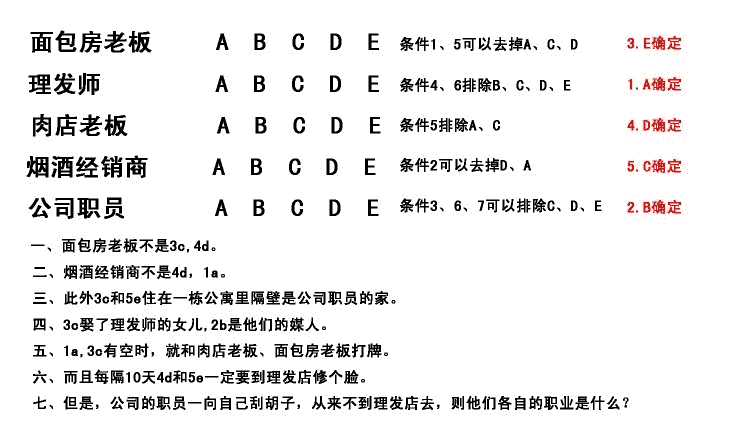

# 数学测试，金融危机时美国一家公司出的题目

> 原文：[`www.pediy.com/kssd/pediy11/122019.html`](https://www.pediy.com/kssd/pediy11/122019.html)

要求：完整公式  
      结构图  
1、一个糖果有一张糖果纸，一个糖果一元，现在商店在作促销，三张糖果纸可以换一个糖果，请问 15 元最多可以吃几个糖果?  
答：  
2、1、2、6、42、1806　“？”　请问“？”里应该填写多少？  
答：  
3、1a，2b,3c,4d,5e,是好朋友,如今张大成人,各自当上面包房老板\\理发师\\肉店老板\\烟酒经销商\\和公司职员.  
  如果:一、面包房老板不是 3c,4d。二、烟酒经销商不是 4d，1a。三、此外 3c 和 5e 住在一栋公寓里隔壁是公司职员的家。四、3c 娶了理发师的女儿,2b 是他们的媒人。五、1a,3c 有空时，就和肉店老板、面包房老板打牌。六、而且每隔 10 天 4d 和 5e 一定要到理发店修个脸。七、但是，公司的职员一向自己刮胡子，从来不到理发店去，则他们各自的职业是什么？  
答：  
  
这三道题是书上看到的。  
书上写明，这不是智力测验，而是三商行美廉社征求储备干杯时的数字测验，只有三道题目，然而，将近八十位大专以上学历且至少两年流通业经历的应试者，竟无一人三题全部答对。  
学习小组的有很多人一眼就看出答案来了。- -！我算了半天。不过最后还是总结出来了。。  
答案下面给出~~！ 

借用学习小组希腊神话与圆梦飞飞的答案：  
希腊神话  
第一题:15/3=5,5%3=2,借一个糖纸(2+1)/3=1,吃糖后还糖纸,一共吃糖:15+5+1+1=22 块糖  
第二题:1\*2=2,2\*3=6,6\*7=42  
 0\*(0+1)=1,1\*(1+1)=2,2\*(2+1)=6,6\*(6+1)=42,42\*(42+1)=1806,  
n\*(n+1)  
n=1806  
1806\*(1806+1)  
圆梦飞飞提供图  

我的第三题推理过程！！  

要求：完整公式  
      结构图  
  
1、一个糖果有一张糖果纸，一个糖果一元，现在商店在作促销，三张糖果纸可以换一个糖果，请问 15 元最多可以吃几个糖果?  
答： 15+5+1+1=22  
  
2、1、2、6、42、1806　“？”　请问“？”里应该填写多少？  
答：  
A\[0\]=1;A\[n\]=A\[n-1\]\*( A\[n-1\]+1);n=1,2,3,…  
    
3、1a，2b,3c,4d,5e,是好朋友,如今张大成人,各自当上面包房老板\\理发师\\肉店老板\\烟酒经销商\\和公司职员.  
  如果:  
一、  面包房老板不是 3c,4d。  
面：可能 ABE,    否 CD  
理：可能 ABCDE，否  
肉：可能 ABCDE，否  
烟：可能 ABCDE，否  
公：可能 ABCDE，否  
   
二、  烟酒经销商不是 4d，1a。  
面：可能 ABE,    否 CD  
理：可能 ABCDE，否  
肉：可能 ABCDE，否  
烟：可能 BCE，   否 AD  
公：可能 ABCDE，否  
   
三、  此外 3c 和 5e 住在一栋公寓里隔壁是公司职员的家。  
面：可能 ABE,    否 CD  
理：可能 ABCDE，否  
肉：可能 ABCDE，否  
烟：可能 BCE，   否 AD  
公：可能 ABD，  否 CE  
   
四、3c 娶了理发师的女儿,2b 是他们的媒人。  
面：可能 ABE,    否 CD  
理：可能 ADE，   否 BC  
肉：可能 ABCDE，否  
烟：可能 BCE，   否 AD  
公：可能 ABD，  否 CE  
   
五、1a,3c 有空时，就和肉店老板、面包房老板打牌。  
面：可能 BE,     否 ACD  
理：可能 ADE，   否 BC  
肉：可能 BDE，   否 AC  
烟：可能 BCE，   否 AD  
公：可能 ABD，  否 CE  
   
六、而且每隔 10 天 4d 和 5e 一定要到理发店修个脸。  
面：可能 BE,     否 ACD  
理：是 A，   否 BCDE  
肉：可能 BDE，   否 AC  
烟：可能 BCE，   否 AD  
公：可能 BD，   否 ACE  
   
七、但是，公司的职员一向自己刮胡子，从来不到理发店去，则他们各自的职业是什么？  
面：是 E,     否 ABCD  
理：是 A，   否 BCDE  
肉：是 D，   否 ABCE  
烟：是 C，   否 ABDE  
公：是 B，   否 ACDE