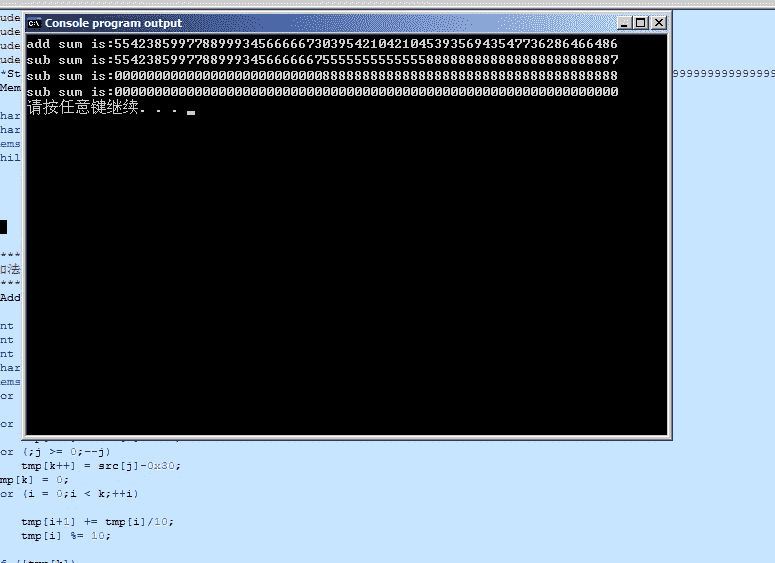

# 解析字符串大数加减法

> 原文：[`www.pediy.com/kssd/pediy12/142638.html`](https://www.pediy.com/kssd/pediy12/142638.html)

娱乐娱乐，很菜的代码，第一个加法代码百度来的，减法自己写的，让各位大牛笑话了。  

代码:

```
#include <stdio.h>
#include <string.h>
#include <stdlib.h>
#include <windows.h>
char \*String="你 54839865486548650468054658847397577599 他 554238599778899934566666666666666666666999999999999999999999999 我 8888888888888888888888888888888888888";
void Memcpy(void \*Str1,void \*Str2)
{
  char \*szTemp1=Str1;
  char \*szTemp2=Str2;
  memset(Str1,0,strlen(Str1));
  while(\*szTemp2>=0x30&&\*szTemp2<=0x39)
  {
    \*szTemp1=\*szTemp2;
    szTemp1++;
    szTemp2++;
  }
}
/\*\*\*\*\*\*\*\*\*\*\*\*\*\*\*\*\*\*\*\*\*\*\*\*\*\*\*\*\*\*\*\*\*\*\*\*
大数加法
\*\*\*\*\*\*\*\*\*\*\*\*\*\*\*\*\*\*\*\*\*\*\*\*\*\*\*\*\*\*\*\*\*\*\*\*/
void Add(char \*dst,char \*src)
{
    int i=0;
  int j=0;
  int k = 0;
  char tmp\[MAX\_PATH\];
  memset(tmp,0,MAX\_PATH);
    for (i = strlen(dst)-1,j = strlen(src)-1;i >= 0 && j >= 0;--i,--j)        
        tmp\[k++\] = dst\[i\]+src\[j\]-0x30-0x30;    
    for (;i >= 0;--i)        
        tmp\[k++\] = dst\[i\]-0x30;    
    for (;j >= 0;--j)        
        tmp\[k++\] = src\[j\]-0x30;
    tmp\[k\] = 0;    
    for (i = 0;i < k;++i)
  {
        tmp\[i+1\] += tmp\[i\]/10;        
        tmp\[i\] %= 10;    
    }
    if (!tmp\[k\])        
        --k;        
    for (i = 0;i <= k;++i)        
        dst\[i\] = tmp\[k-i\] + '0';    
    dst\[k+1\] = '\\0';     
}
/\*\*\*\*\*\*\*\*\*\*\*\*\*\*\*\*\*\*\*\*\*\*\*\*\*\*\*\*\*\*\*\*\*\*\*\*
大数减法
\*\*\*\*\*\*\*\*\*\*\*\*\*\*\*\*\*\*\*\*\*\*\*\*\*\*\*\*\*\*\*\*\*\*\*\*/
void Sub(char \*dst,char \*src)
{
  int dstLen=strlen(dst)-1;
  int srcLen=strlen(src)-1;
  int k=0;
  char temp\[MAX\_PATH\];
  memset(temp,0,MAX\_PATH);
  if(\*dst==0)
  {
    return;
  }
  for(;dstLen>=0&&srcLen>=0;--dstLen,--srcLen)
    {
      if(dst\[dstLen\]<src\[srcLen\])
    {
        temp\[k++\]=(0xA+(dst\[dstLen\]-src\[srcLen\]));
        dst\[dstLen-1\]-=1;
    }
      else{
            temp\[k++\]=dst\[dstLen\]-src\[srcLen\];
    }
  }
  for(;dstLen>=0;--dstLen)
  {
    temp\[k++\]=dst\[dstLen\]-0x30;
  }
  if(!temp\[k\])
    --k;
    for (dstLen = 0;dstLen <= k;++dstLen)        
        dst\[dstLen\] = temp\[k-dstLen\] + '0';    
    dst\[k+1\] = '\\0';  
}
int main(void)
{

  char szAddSum\[MAX\_PATH\];
  char szSubSum\[MAX\_PATH\];
    char szTemp\[MAX\_PATH\];
    memset(szAddSum,0,MAX\_PATH);
  memset(szSubSum,0,MAX\_PATH);
  memset(szTemp,0,MAX\_PATH);
  char \*stemp=String;
  while(\*stemp)
  {
    stemp++;
      while(\*stemp>=0x30&&\*stemp<=0x39)
      {
      Memcpy(szTemp,stemp);
      stemp+=lstrlen((char\*)szTemp)+1;
      Add(szAddSum,szTemp);
      }
  }
  printf("add sum is:%s\\n",szAddSum);
  while(\*String)
  {
    String++;
    while(\*String>=0x30&&\*String<=0x39)
    {
      Memcpy(szTemp,String);
      String+=lstrlen((char\*)szTemp)+1;
      Sub(szAddSum,szTemp);
      printf("sub sum is:%s\\n",szAddSum);
    }
  }
    system("pause");
    return 0;
}

```

