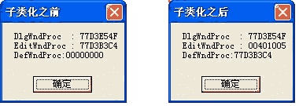

# 利用子类化技术拓展 EDIT 控（7.26 最近更新）

> 原文：[`www.pediy.com/kssd/pediy07/pediy7-729.htm`](https://www.pediy.com/kssd/pediy07/pediy7-729.htm)

利用子类化技术拓展 EDIT 控件功能  
  
前言：EDIT 控件提供的“Number”属性往往无法满足要求，它只能接受数字输入，而经常要需求只接受 16 进制输入。可以用多种方法（子类化技术，钩子函数，开辟新线程），这里选择子类化技术。  
  
一。认识子类化技术  
  
    把一个窗体子类化其实就是使用 SetWindowLong 为该窗体设计一个新的窗体过程,然后可以在该窗体函数中处理特定的消息，而那些不关心的消息可以通过 CallWindowProc 传递给系统默认的处理。（有关这方面的介绍网上很多，不过多介绍）  
  
    从功能上来说，子类化技术有点类似于钩子函数（SetWindowHookEx)，都可以对一些特定的消息自由处理。但在两者有着本质的区别，钩子函数是针对系统的消息传递机制，而子类化技术则是针对特定的窗体。利用钩子函数可以处理某一类或几类的消息，而利用子类化技术则能处理特定窗体的绝大部分消息。因而在使用时应区分被处理对象的范围，然后再选择采用哪种技术。  
  
二。体验子类化技术  
  
资源模板：一个对话框（IDD\_TEST\_SAMPLE)和一个 EDIT 控件（IDC\_TEST).  
  
  
测试程序 (程序简单，不作介绍）：  
#include "resource.h"  
#include <TChar.h>  
#include <windows.h>  
  
/\*\*\*\*\*\*\*\*\*\*\*\*\*\*\*\*\*\*\*\*\*\*\*\*\*\*\*\*\*\*\*\*\*\*  
\*  Global variable  
\*\*\*\*\*\*\*\*\*\*\*\*\*\*\*\*\*\*\*\*\*\*\*\*\*\*\*\*\*\*\*\*\*\*\*/  
  
LONG DefWndProc = NULL ;  
  
/\*\*\*\*\*\*\*\*\*\*\*\*\*\*\*\*\*\*\*\*\*\*\*\*\*\*\*\*\*\*\*\*\*\*  
\*  Sub function pre-definition  
\*\*\*\*\*\*\*\*\*\*\*\*\*\*\*\*\*\*\*\*\*\*\*\*\*\*\*\*\*\*\*\*\*\*\*/  
  
LRESULT CALLBACK EditNewProc ( HWND hEdit, UINT uMsg, WPARAM wParam, LPARAM lParam ) ;  
BOOL CALLBACK TestSampleProc ( HWND hDlg, UINT message, WPARAM wParam, LPARAM lParam ) ;  
  
  
/\*\*\*\*\*\*\*\*\*\*\*\*\*\*\*\*\*\*\*\*\*\*\*\*\*\*\*\*\*\*\*\*\*\*  
\*  main function  
\*\*\*\*\*\*\*\*\*\*\*\*\*\*\*\*\*\*\*\*\*\*\*\*\*\*\*\*\*\*\*\*\*\*\*/  
  
int APIENTRY WinMain(HINSTANCE hInstance,  
                     HINSTANCE hPrevInstance,  
                     LPSTR     lpCmdLine,  
                     int       nCmdShow)  
{  
   // TODO: Place code here.  
  DialogBox ( hInstance, MAKEINTRESOURCE(IDD\_TEST\_SAMPLE), 0, TestSampleProc ) ;  
  
  return 0;  
}  
  
/\*\*\*\*\*\*\*\*\*\*\*\*\*\*\*\*\*\*\*\*\*\*\*\*\*\*\*\*\*\*\*\*\*\*  
\*  Detail of sub function  
\*\*\*\*\*\*\*\*\*\*\*\*\*\*\*\*\*\*\*\*\*\*\*\*\*\*\*\*\*\*\*\*\*\*\*/  
  
LRESULT CALLBACK EditNewProc ( HWND hEdit, UINT uMsg, WPARAM wParam, LPARAM lParam )  
{  
  return CallWindowProc ( (WNDPROC)DefWndProc, hEdit, uMsg, wParam, lParam ) ;  
}  
  
  
  
BOOL CALLBACK TestSampleProc ( HWND hDlg, UINT message, WPARAM wParam, LPARAM lParam )  
{    
  LONG DlgWndProc, EditWndProc ;  
  TCHAR buf\[128\] ;  
  
  switch ( message )  
  {  
  case WM\_INITDIALOG:  
    DlgWndProc = GetWindowLong ( hDlg, GWL\_WNDPROC ) ;  
    EditWndProc = GetWindowLong ( GetDlgItem(hDlg,IDC\_TEST), GWL\_WNDPROC ) ;  
        
    wsprintf ( buf, \_TEXT("DlgWndProc  : %08X\\nEditWndProc : %08X\\nDefWndProc:%08X\\n"), \\  
      DlgWndProc, EditWndProc, DefWndProc ) ;  
    MessageBox ( hDlg, buf, \_TEXT("子类化之前"), 0 ) ;  
  
    DefWndProc = SetWindowLong (   
      GetDlgItem(hDlg,IDC\_TEST), GWL\_WNDPROC, (long)EditNewProc ) ;  
    return true ;  
  
  case WM\_COMMAND:  
    switch ( LOWORD(wParam) )  
    {  
    case IDCANCEL:  
      EndDialog ( hDlg, 0 ) ;  
      return true ;  
    }  
    break ;  
  
  case WM\_LBUTTONDOWN:  
    DlgWndProc = GetWindowLong ( hDlg, GWL\_WNDPROC ) ;  
    EditWndProc = GetWindowLong ( GetDlgItem(hDlg,IDC\_TEST), GWL\_WNDPROC ) ;  
        
    wsprintf ( buf, \_TEXT("DlgWndProc  : %08X\\nEditWndProc : %08X\\nDefWndProc:%08X\\n"), \\  
      DlgWndProc, EditWndProc, DefWndProc ) ;  
    MessageBox ( hDlg, buf, \_TEXT("子类化之后"), 0 ) ;  
  
    return false ;  
  }  
  
  return false ;  
}  
测试结果 :   
   
测试说明 ：左图==》DlgWndProc 和 EditWndProc 实际上就是系统默认的对话框处理函数体和  
                    编辑框处理函数体。DefWndProc 是用来保存编辑框的默认处理函数的入口，  
                          程序中把它初始化为 0。  
            右图==》DefWndProc 保存了系统默认的编辑框处理函数体；  
                    EditWndProc 即为新添加的函数的入口地址。  
三。进入主题--EDIT 功能拓展  
功能需求 ：1）。输入字符个数不大于 8  
           2）。可输入的合法字符（0--9，A--F，a--f）   
设计概要 ：   
1）。由于 EDIT 功能拓展需要处理是字符，所以选择处理的对象为  
WM\_CHAR :     TCHAR chCharCode = (TCHAR) wParam ; // character code   
2）。确保用户输入的字符的合法性  
if ( ( chCharCode >= 0X30 && chCharCode <= 0X39 ) || \\     ( chCharCode >= 0X41 && chCharCode <= 0X46 ) || \\     ( chCharCode >= 0X61 && chCharCode <= 0X66 )  ){              //合法            }  
3）。保证 EDIT 中的字符个数不大于 8  
TCHAR tEditText\[9\] ;  
int iCharacterNum = GetWindowText ( hEdit, tEditText, sizeof(tEditText)/sizeof(TCHAR) ) ;  
if ( iCharacterNum < 8 )  
{  
  //符合要求,继续接受字符  
}  
else  
{  
         //不符合要求，忽略键盘消息（不处理）}  
4）。必须保证退格键能够正常运行  
if ( chCharCode == \_TEXT(8) )  
  return CallWindowProc ( (WNDPROC)DefWndProc, hEdit, uMsg, wParam, lParam ) ;  
注：退格键的 ASCII 值为 8  
详细设计(源代码--VC）:  
#include "resource.h"  
#include <TChar.h>  
#include <windows.h>  
/\*\*\*\*\*\*\*\*\*\*\*\*\*\*\*\*\*\*\*\*\*\*\*\*\*\*\*\*\*\*\*\*\*\*  
\*  Global variable  
\*\*\*\*\*\*\*\*\*\*\*\*\*\*\*\*\*\*\*\*\*\*\*\*\*\*\*\*\*\*\*\*\*\*\*/  
  
LONG DefWndProc = NULL ;  
  
/\*\*\*\*\*\*\*\*\*\*\*\*\*\*\*\*\*\*\*\*\*\*\*\*\*\*\*\*\*\*\*\*\*\*  
\*  Sub function pre-definition  
\*\*\*\*\*\*\*\*\*\*\*\*\*\*\*\*\*\*\*\*\*\*\*\*\*\*\*\*\*\*\*\*\*\*\*/  
  
LRESULT CALLBACK EditNewProc ( HWND hEdit, UINT uMsg, WPARAM wParam, LPARAM lParam ) ;  
BOOL CALLBACK TestSampleProc ( HWND hDlg, UINT message, WPARAM wParam, LPARAM lParam ) ;  
  
  
/\*\*\*\*\*\*\*\*\*\*\*\*\*\*\*\*\*\*\*\*\*\*\*\*\*\*\*\*\*\*\*\*\*\*  
\*  main function  
\*\*\*\*\*\*\*\*\*\*\*\*\*\*\*\*\*\*\*\*\*\*\*\*\*\*\*\*\*\*\*\*\*\*\*/  
  
int APIENTRY WinMain(HINSTANCE hInstance,  
                     HINSTANCE hPrevInstance,  
                     LPSTR     lpCmdLine,  
                     int       nCmdShow)  
{  
  DialogBox ( hInstance, MAKEINTRESOURCE(IDD\_TEST\_SAMPLE), 0, TestSampleProc ) ;  
  
  return 0;  
}  
   
/\*\*\*\*\*\*\*\*\*\*\*\*\*\*\*\*\*\*\*\*\*\*\*\*\*\*\*\*\*\*\*\*\*\*  
\*  Detail of sub function  
\*\*\*\*\*\*\*\*\*\*\*\*\*\*\*\*\*\*\*\*\*\*\*\*\*\*\*\*\*\*\*\*\*\*\*/  
注：如果使用 EDIT 控件时不需要“窗体过程切换”，可以把下面这段 EditNewProc 直接使用，不然可以使用下一部分的 DLL 。  
  
LRESULT CALLBACK EditNewProc ( HWND hEdit, UINT uMsg, WPARAM wParam, LPARAM lParam )  
{  
  if ( uMsg == WM\_CHAR )  
  {  
    TCHAR chCharCode = (TCHAR) wParam ;  
  
    if ( ( chCharCode >= 0X30 && chCharCode <= 0X39 ) || \\  
         ( chCharCode >= 0X41 && chCharCode <= 0X46 ) || \\  
         ( chCharCode >= 0X61 && chCharCode <= 0X66 )  )  
    {  
      TCHAR tEditText\[9\] ;  
   
      int iCharacterNum = GetWindowText ( hEdit, tEditText, sizeof(tEditText)/sizeof(TCHAR) ) ;  
  
      if ( iCharacterNum < 8 )  
      {  
        MessageBeep ( MB\_OK ) ;  
      }  
      else  
        return NULL ;  
    }  
  
    else if ( chCharCode == \_TEXT(8) )  
      return CallWindowProc ( (WNDPROC)DefWndProc, hEdit, uMsg, wParam, lParam ) ;  
  
    else  
      return NULL ;  
  }  
  
  return CallWindowProc ( (WNDPROC)DefWndProc, hEdit, uMsg, wParam, lParam ) ;  
}  
  
  
BOOL CALLBACK TestSampleProc ( HWND hDlg, UINT message, WPARAM wParam, LPARAM lParam )  
{    
  switch ( message )  
  {  
  case WM\_INITDIALOG:  
    DefWndProc = SetWindowLong (   
      GetDlgItem(hDlg,IDC\_TEST), GWL\_WNDPROC, (long)EditNewProc ) ;  
    return true ;  
  
  case WM\_COMMAND:  
    switch ( LOWORD(wParam) )  
    {  
    case IDCANCEL:  
      EndDialog ( hDlg, 0 ) ;  
      return true ;  
    }  
    break ;  
  }  
  
  return false ;  
}   
说明：当用户按键有效时会产生系统提示音。  
四。DLL--功能封装  
  
接口函数 ：  
  
BOOL WINAPI SetExternEditFunction (  
        BOOL isSet,       //是否处于拓展状态（切换窗体过程）  
        HWND hParent,     //父窗口句柄  
        UINT dwEditId     //EDIT 控件 ID  
 ) ;  
  
最重要的功能实现 EditNewProc 与 EditDefWndProc 这两个 EDIT 窗体过程之间的切换。  
  
  
附：DLL 源码（ WINXPSP2，VC6.0，WIN32 DLL ）   
  
五：功能更新  
  
7.26 更新：支持 WM\_COPY, WM\_CUT, WM\_PASTE .  
  
说明：前两个功能比较简单，重点是 WM\_PASTE.  
  
WM\_PASTE 功能实现的简略介绍：  
  
1）。取得粘贴板中可复制的合法字串，  
  
2）。检测该字串的长度，若过长则截去多余部分  
  
3）。检测剩余字符串的合法性  
  
4）。模拟键盘消息实现：在鼠标所指向的位置增添字符。  
  
例：EDIT 中已有字符串“123Iabc"(‘I’表示鼠标位置）  
  
需要拷贝的字符串“defghijk"  
  
\===》 “123deabc"  
  
  
\----------------------------------------------------------------------------------                             
作者 ：北极星 2003  
邮箱 ：zhangjingsheng\_nbu@yahoo.com.cn  
  
  
注：转载请保持文章完整

 4dd466d0e1e0cc123afbe504da2462ca