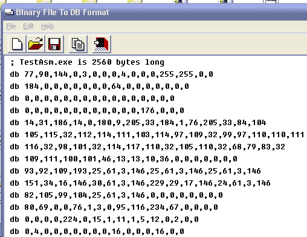
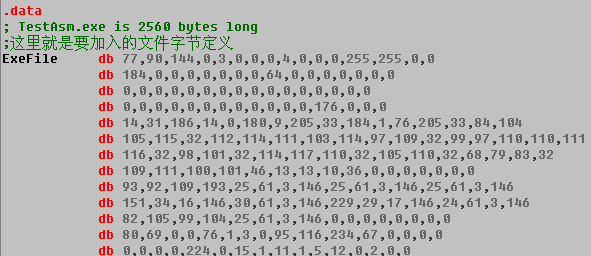

# 在源代码中插入另一个程序，然后再输出为 exe 文件（C/C++、Win32Asm）

> 原文：[`www.pediy.com/kssd/pediy09/pediy09-622.htm`](https://www.pediy.com/kssd/pediy09/pediy09-622.htm)

> 作者：jhkdiy  
>   
>  主页：[`jhkdiy.icpcn.com/`](http://jhkdiy.icpcn.com/)  
>   
> 邮件：jhkdiy\_gzb@21cn.net  
>   
> 日期：2007-07-09  
>   
>    
>   
> 毕业证拿到了，毕业聚餐也吃了，可是工作却不怎么如意，搞到现在要转行卖东西了···，但不管怎样，编程始终是我的兴趣所在，  
>   
> 所以我希望一直编程下去。  
>   
> 前些天看到有朋友说有没有不必操作资源就可以将一个程序加入到自己的程序中，我刚好想起 masm32 里有个 bintodb.exe 可以将一  
>   
> 整个程序转换为 byte 数组，但是自己也没实际试过，这几天有时间就研究了一下，发现原来操作很简单比起操作资源也来更容易理解，  
>   
> 所以用 win32asm 做了个示例，同时也在 Vc 中做了测试，都是一样简单。本来想在 VB 中也试试的，但发现没那么简单，当我将整个数  
>   
> 组定义为 VB 格式的数组时 VB 竟然崩溃了···，可能是因为 VB 编程环境容不下这么多的数据，因为我定义了一个有 2560 个字节元素的  
>   
> 字节数组，每当复制到 VB 代码编辑窗口中的时候就崩溃了，所以我没有在 VB 中实现，但这并不代表 VB 一定不能实现，因为可以将这  
>   
> 一个数组分成好几个数组，然后在写文件的时候在一一写入，但考虑到将原本好好的数组自己拆开来就已经很繁琐了，而又要在写文件  
>   
> 的时候重新组合也很麻烦，所以这里就留给 VB 高手解决了。我宣布投降···  
>   
>     整个操作过程很简单，打开 bintodb 程序，然后打开一个你要转换的程序，程序会自动将整个程序转换为字节数组，数组的大小对应  
>   
> 转换程序的文件大小。如下图就是我用来做测试用的程序，已经转换为字节数组格式了：  
>   
>    
>   
>   
>    
>   
>     我们只要稍微改一下就可以直接加到源代码的数据段中了，事实上只是加个数组名：  
>   
>    
>   
>   
>    
>   
>     之后的操作就简单了，我们只要创建一个写方式的文件，然后将这个数组作为 WriteFile 的写  
>   
> Buffer 就可以将这个字节数组还原为 exe 文件，如下所示： 代码:
> 
> ```
>             ;创建一个写文件，同名文件不提示直接覆盖
> 
>             invoke  CreateFile, addr szSaveFileName, GENERIC\_WRITE, FILE\_SHARE\_READ, 0, \\
> 
>             CREATE\_ALWAYS or FILE\_ATTRIBUTE\_NORMAL \\
> 
>             or FILE\_ATTRIBUTE\_SYSTEM, 0
> 
>             mov @hFile, eax
> 
>             ;真正将数据段的字节定义写为文件
> 
>             invoke  WriteFile, @hFile, addr ExeFile, ExeFileLength, addr dwBytesWritten, 0
> 
>             ;关闭文件句柄，提示成功写入。
> 
>             invoke  CloseHandle, @hFile 
>             
> ```
> 
>     当然，在我做的示例中加入了错误处理，因为毕竟是示例，不是想无声无息地将文件写入到 C:\\windows\\system32  
>   
> 下，然后 CreateProcess 运行进程。这里确实给病毒制作者开了另一条路，假如我加入的是一个真正有害程序，而这个  
>   
> 程序本身又是一个很正常的程序，用户在完全不知情的情况下就会中招，如病毒加上自删除、远程线程注入、双进程守  
>   
> 护等等。事实上程序可以做任何想做的事。  
>   
>         VC 中的操作也一样简单，只是将汇编格式的定义转换为 C/C++类型的定义可能会繁琐一点，其它的操作都是一样的  
>   
> 在示例中我将字节数组作为全局变量，因为考虑到在函数中定义如此大的一个数组在运行时可能会出现堆栈溢出。但实际  
>   
> 情况我没有测试过，有兴趣的朋友可以试试。  
>   
> 请使用下载工具下载，下载时引用页为：[`www.3326.com/`](http://www.3326.com/)  
>   
> 源代码下载(win32asm)：  
>          [`jhkdiy.go3.icpcn.com/code/download/InsertExeFile\_win32asm.rar`](http://jhkdiy.go3.icpcn.com/code/download/InsertExeFile_win32asm.rar)         
>   
>   
> 源代码下载(VC)：  
>          [`jhkdiy.go3.icpcn.com/code/download/InsertExeFileToApp\_VC.rar`](http://jhkdiy.go3.icpcn.com/code/download/InsertExeFileToApp_VC.rar)

> 代码:
> 
> * * *
> 
> `char filebuff[4] = {0x4d,0x5a,0x90,0x00}; // MZ ， exe 前 4 个字节   HANDLE file;   DWORD bWritten =0;      int main(int argc, char* argv[])   {     file = CreateFile("aa.exe",                 GENERIC_WRITE,                FILE_SHARE_READ,                0,                CREATE_ALWAYS,                FILE_ATTRIBUTE_NORMAL,                0);        WriteFile(file, filebuff, sizeof(filebuff), &bWritten, 0);     printf("%d bytes written\n",bWritten);     return 0;   }`
> 
> * * *
> 
> c++里是这样吧？用 UltraEdit 读取 exe 然后把整个 exe 的十六进制数据复制出来，放到 一个 char 数组里，然后用 writefile 写到新文件 

> 嗯，你这也是一种方法，都可以的。 

 4dd466d0e1e0cc123afbe504da2462ca