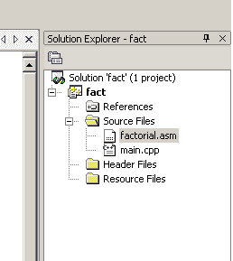
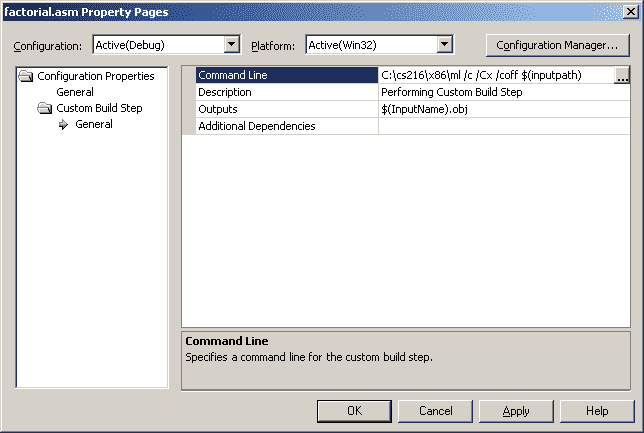

# 【翻译】在 VC.NET 中使用汇编文件 1:创建

> 原文：[`www.pediy.com/kssd/pediy10/77714.html`](https://www.pediy.com/kssd/pediy10/77714.html)

  
1.原文地址:http://www.cs.virginia.edu/~evans/cs216/guides/vsasm.html  
2.即兴翻译，虽短仍差，不足之处，恳求谅解。晚点更改之，然后贴上 2 部分调试（本贴只译了第一部分）  
3.本文本身讲解并不详细，也不深入，但是可以用来入门。  
  
  
**在 Visual Studio.NET 中使用汇编的指南 **  
  
这个教程讲解了如何在 Visual Studio.NET 项目中使用汇编代码。本文描述如何将汇编代码加入一个含有 main()函数的项目以及如何调试包含汇编代码的程序。  
  
**创建 C/Asm 程序**  
  
在本教程中,我们要创建的项目将包含一个使用 C 语言编写的 main 函数。这个函数会调用一个名为 clear 的汇编函数。因为 Visual Studio 并不能够认出汇编代码，我就必须得告知 Visual Studio 如何编译汇编代码。在这一节，我们将学习创建一个项目的基本步骤，往其中添加汇编代码，指定自定义生成的命令，以及生成整个项目。   
  
**第一步－创建工程**  
  
创建一个标准的 Visual Studio .NET 2003 C++ 项目。这和你平时创建解决方案是一样的：创建一个空白的解决方案，一个 Visual C++项目，然而向下滚动选择 Win32 控制台程序。在设置程序选项，一定要记得设置成空项目。   
  
添加一个包含 main 函数的 C 语言源程序。在本教程中，我们将创建一个 main 函数，该函数将调用一个 void 类型的，不需要任何参数的汇编函数 clear。我们将在一个单独的 clear.asm 文件当中定义 clear 函数的汇编代码。既然 clear 函数在一个单独文件当中，那么她就必须得在 C 语言源程序开始处进行申明。我们的 main 函数如下:  
  
  extern void clear();  
  
  int main() {   
     clear();   
     return 1;   
  }  
  
C++ 编译器特别注意: 如果你使用的是 C++编译器,她会对函数名进行处理。 为了防止其对函数名称的处理，你可以使用如下代码：    extern "C" {  
      void clear();  
   }  
  
(感谢 Gabriel Zabusek 的提醒)   
  
**第二步－添加汇编代码**  
通过右击解决方案，选择添加现存项来增加这两种文件(.asm 和.c)，添加完这两个文件之后，解决方案将如下所示：   
  
  
  
添加包含汇编代码的文件到项目当中。如果该文件还没有创建，你可在项目窗口中选择文件视图，右击项目名称然后选择“添加文件到项目...”，在对话框中输入你想该汇编的保存的名称（在本例中，我们使用 clear.asm)。VS 将会提出一个警告，说该文件并不存在，并问你是否想为其在项目中创建一个引用。选择是。在项目窗口中，展开树列表，然后找到刚刚创建的新文件。双击该文件名。VS 将会问你是否想以该名字创建一个新文件。选择是。一个新文件将会被创建，然后将会在编辑中显示出来。  
  
输入你的汇编代码。在本教程中，我们将对 EAX 和 EBX 清零。 为了达到这个目的，我们将使用如下代码：   
  
.586              ;目标处理器.我们将使用 Pentium 系统指令.  
.MODEL FLAT, C    ;使用平坦模式.C 语言调用规则.  
.STACK            ;定义一个 1KB 大小的堆栈段(在本例中并不需要)  
.DATA             ;创建一个数据段.数据可以在本指令后定义  
                  ;(本例并不需要)  
.CODE             ;表明代码的开始  
  
clear PROC  
   xor eax, eax   
   xor ebx, ebx   
   ret   
clear ENDP   
END   
  
**第三步-指定生成指令**  
  
现在我们开始学习使得 VS 可以编译汇编代码的指令。默认情况，VS 并不会编译汇编源代码。她必须调用一个名为 ml.exe 的外部程序来执行编译。因而必须在项目设置的定义生成选项中添加相应的命令行。右键单击项目窗口中汇编文件名（如下图所示，为 factorial.asm)。在弹出的窗口中选择属性...。  
  
选择定义生成步骤文件夹然后更改 a)命令行 和 b) 输出：   
  
命令行项. 这是指实际上为 factorial.asm 执行编译的命令。她要求汇编（使用汇编器）你输入的文件。 你必须得确保该项的前一部分为 ml.exe 所处的文件位置（不需要指定.exe 扩展名）。下列命令将会成功，如果 ml.exe 位于 C:\\cs216\\x86\\文件夹下。 (注意如果该文件路径包含空格，你就必需使用引号将其括起来。)   
  
输出项. 该项指明输出的文件名称。在这里我们使用，输入文件名称加上 obj 扩展名。   
  
设置完这两个选项后，你就能够生成该项目了。设置完后，点击确定，关闭对话框。   
  
  
**第四步－生成**  
  
现在这个工程就可以和其他工程一样使用 F7 来生成，Ctrl+F5 来运行了。