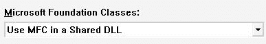

# 拿来就用,浅谈代码抽取技术在汇编中的应用

> 原文：[`www.pediy.com/kssd/pediy10/90784.html`](https://www.pediy.com/kssd/pediy10/90784.html)

在用 WIN32 汇编做软件开发的过程中不免要遇到一些麻烦,如想写个远程控制,写到远程屏幕传输的时候就看到 DELPHI 里面有人用库转换抓取的 BMP 图片为 JPG,这下可难到我了,自己写个 JPEG 处理模块,我做不到,到网上找了下,有 C 语言的,想了想,我可不可以把它弄到汇编中呢?我在实例包中有人用 C++写了实例,这下好办了,  
  在 VC 中新建 LIB 工程,导出 3 个函数,bmp2jpg24,bmp2jgp,jpg2bmp,在函数定义中直接调用实例中的代码,返回值中加上\_\_stdcall,这样就能在汇编中调用了,带着激动的心情来到 RADASM 中,编译,链接,晕,抱错了,无法找到 LIBCD.LIB,找到 VC98lib 目录,COPY 过来,接下来又是几个,以 COPY 过来,再后来搞不下去了,RADASM 干脆 CRASH 了,这个问题一直没解决,希望高手能给予解答,后来我直接把它做成了 dll,TMD 这样又可以!!  
  
  第一次的成功让我高兴不已,马上对一个免费的界面库进行"抽取"工作,现献上完整品!!  
本人菜鸟一只,高手莫笑!!

上传的附件
|  || USkin.rar\[请到看雪论坛下载：[`bbs.pediy.com/showthread.php?t=90784`](http://bbs.pediy.com/showthread.php?t=90784) \]  
 |
|  || jpeg.rar  
 |

lib 中，导出的函数应该这样定义：  
  
extern "C" void jpg2bmp(const char \*strSourceFileName, const char \*strDestFileName);  
  
然后在汇编文件中，这样定义：  
  
jpg2bmp proto c :dword,:dword  
  
另外，lib 工程中，要设置成图片显示的那样： 

