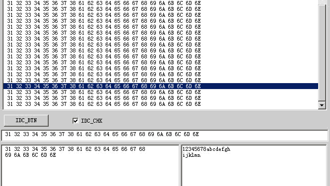

# 输出指定内存中的内存数据二 WIN32 汇编语言编写

> 原文：[`www.pediy.com/kssd/pediy08/pediy8-741.htm`](https://www.pediy.com/kssd/pediy08/pediy8-741.htm)

附件下载：wsprintf.rar

在上一章的基础上加入了文本到内存数据的转换，及格式化输出等相关内容，提供整个工程的原代码下载，软件运行界面如图：  
  
程序代码如下：  
     .386  
    .model flat,stdcall  
    option casemap:none  
include      windows.inc  
include      gdi32.inc  
includelib      gdi32.lib  
include      user32.inc  
includelib      user32.lib  
include      kernel32.inc  
includelib      kernel32.lib  
  
IDD\_DLG1      equ 1000  
IDC\_LST1      equ 1001  
IDC\_BTN1      equ 1002  
IDC\_CHK1      equ 1003  
IDC\_EDT1      equ 1004  
IDC\_EDT2      equ 1005  
IDC\_EDT3      equ 1006  
.data  
szTestOut  db " %02X", 0  
sztest    db '12345678abcdefghijklmn',0           
szBuffer  db 1000 dup(0)  
@szBuffer1  db 512 dup(0)  
@szBuffer2  db 512 dup(0)  
@szBuffer3  db 512 dup(0)  
.data?  
hgamewin  dd  ?    
hInstance  dd  ?  
jishu    dd  ?  
tmp    dd  ?  
.code  
;<<<<<<<<<<<<<<<<<<<<<<<<<<<<<<<<<<<<<<<<<<<<<<<<<<<<<<<<<<<<<<<<<  
;取字符串长度 第一个参数为字符串开始地址  
;<<<<<<<<<<<<<<<<<<<<<<<<<<<<<<<<<<<<<<<<<<<<<<<<<<<<<<<<<<<<<<<<<  
Getstrlen  proc  uses edx ecx  \_addr  
      
    xor  ecx,ecx  
    mov  edx,\_addr  
      
    .repeat  
      inc  ecx  
      inc  edx  
      mov  al,\[edx\]  
      
    .until  al==0  
    mov  eax,ecx  
    ret                                        
  
Getstrlen endp  
;<<<<<<<<<<<<<<<<<<<<<<<<<<<<<<<<<<<<<<<<<<<<<<<<<<<<<<<<<<<<<<<<<  
;分割一个字符串，每 48 个字节后加入一个回车,第一个参数为原字符串地址，第 2 个参数为目的字符串地址  
;<<<<<<<<<<<<<<<<<<<<<<<<<<<<<<<<<<<<<<<<<<<<<<<<<<<<<<<<<<<<<<<<<  
fengestr  proc  uses edx ecx  esi yuanaddr,mudiaddr  
  invoke  RtlZeroMemory,mudiaddr,512  
  mov  edx,yuanaddr  
  mov  esi,mudiaddr  
    
  mov  eax,\[edx\]  
  .while  eax!=0  
    xor  ecx,ecx  
    .while  ecx!=12  
      inc  ecx  
      mov  eax,\[edx\]  
      mov  \[esi\],eax  
      add  edx,4  
      add  esi,4        
    .endw  
    mov  al,0dh  
    mov  byte ptr\[esi\],al  
    mov  al,0ah  
    add  esi,1  
    mov  byte ptr\[esi\],al  
    add  esi,1  
    mov  eax,\[edx\]      
  .endw    
      
  
  ret                                        
  
fengestr endp  
;<<<<<<<<<<<<<<<<<<<<<<<<<<<<<<<<<<<<<<<<<<<<<<<<<<<<<<<<<<<<<<<<<  
;转换一串 16 进制格式的文本为对应的 16 进制数值，  
;<<<<<<<<<<<<<<<<<<<<<<<<<<<<<<<<<<<<<<<<<<<<<<<<<<<<<<<<<<<<<<<<<  
wenbendaoshuzhi  proc  uses edx ecx  esi yuanaddr,mudiaddr  
  invoke  RtlZeroMemory,mudiaddr,512  
  mov  edx,yuanaddr  
  mov  esi,mudiaddr  
  xor  ebx,ebx  
  mov  al,byte ptr\[edx\]  
  .while  al!=0  
    .if  al==020h       ;如果第一个字节为 20H（空格），那么下一个字节就是高位，再下一个就是低位  
    mov  ah,byte ptr\[edx+1\]    ;高位字节处理  
      .if  ah<03ah     ;判断该字节如果为 A-F 就对应数值就是 ASCI 对应数值基础上-31H，否则减 30H  
        sub  ah,30h  
      .else  
        sub  ah,37h  
                
      .endif  
    mov  al,ah  
    mov  cl,10h  
    mul  cl  
    shl  ax,8  
      
    mov  al,byte ptr\[edx+2\]    ;低位字节处理  
      .if  al<03ah   
        sub  al,30h  
      .else  
        sub  al,37h  
                
      .endif      
    add  al,ah        ;高字节加低字节产生一个字节  
    mov  byte ptr\[esi\],al  
      
    inc  esi  
    inc  ebx        ;计算已经输出多少字节  
      
    add  edx,3  
    .else  
    inc  edx  
    .endif  
  mov  al,byte ptr\[edx\]  
    
  mov  tmp,esi  
  pushad  
  mov  eax,ebx  
  xor  edx,edx  
  mov  ecx,10h  
  div  ecx  
  .if  edx==0  
    mov  al,0dh  
    mov  byte ptr\[esi\],al  
    mov  al,0ah  
    add  esi,1  
    mov  byte ptr\[esi\],al  
    add  esi,1  
    mov  tmp,esi    
  .endif  
  popad  
  mov  esi,tmp  
  .endw  
  
  
      
  
  ret                                        
  
wenbendaoshuzhi endp  
;<<<<<<<<<<<<<<<<<<<<<<<<<<<<<<<<<<<<<<<<<<<<<<<<<<<<<<<<<<<<<<<<<  
;格式化内存信息为文本   三个参数分别为内存数据长度，内存数据地址，格式化后的保存地址  
;<<<<<<<<<<<<<<<<<<<<<<<<<<<<<<<<<<<<<<<<<<<<<<<<<<<<<<<<<<<<<<<<<  
\_MenText  proc  uses edx ecx ebx eax \_size,\_addr,\_output  
      
    invoke  RtlZeroMemory,\_output,1000  
    mov  edx,\_addr  
    mov  ecx,\_output  
    mov  ebx,\_size  
    .while  ebx!=0  
      push  edx  
      xor  eax,eax  
      mov  al,\[edx\]  
      invoke wsprintf,ecx,addr szTestOut, eax  
      add  ecx,2  
      pop  edx  
      inc  edx  
      dec  ebx          
    .endw    
    ret                                        
  
\_MenText endp  
;>>>>>>>>>>>>>>>>>>>>>>>>>>>>>>>>>>>>>>>>>>>>>>>>>>>>>>>>>>>>>>>>>>>>  
\_ProcDlgMain  proc       uses ebx edi esi edx hWnd,wMsg,wParam,lParam  
  
  
              mov        eax,wMsg  
  
              .if        eax == WM\_CLOSE  
  
                         invoke   EndDialog,hWnd,NULL  
  
              .elseif    eax == WM\_INITDIALOG  
                  invoke  CheckDlgButton,hWnd,IDC\_CHK1,BST\_CHECKED  
      invoke  IsDlgButtonChecked,hWnd,IDC\_CHK1  
      .if  eax==BST\_CHECKED  
        mov  jishu,20h  
        .while  jishu!=0  
        invoke  SendDlgItemMessage,hWnd,IDC\_LST1,LB\_ADDSTRING,0,addr szBuffer  
        
        dec  jishu  
        .endw  
        invoke  SendDlgItemMessage,hWnd,IDC\_LST1,LB\_GETCOUNT,0,0  
        dec  eax  
        invoke  SendDlgItemMessage,hWnd,IDC\_LST1,LB\_SETCURSEL,eax,0  
      .endif  
  
              .elseif    eax == WM\_COMMAND  
  
                         mov      eax,wParam  
  
                         .if      ax == IDOK  
  
                                  invoke EndDialog,hWnd,NULL  
                         .elseif   ax ==    IDC\_BTN1  
                           invoke  SendDlgItemMessage,hWnd,IDC\_LST1,LB\_RESETCONTENT,0,0  
                         .elseif  ax==IDC\_LST1  
        shr     eax,16  
        .if     ax ==   LBN\_DBLCLK  
          invoke  SendDlgItemMessage,hWnd,IDC\_LST1,LB\_GETCURSEL,0,0  
          lea     ecx,@szBuffer1  
          invoke  SendDlgItemMessage,hWnd,IDC\_LST1,LB\_GETTEXT,eax,ecx  
            
          invoke  SetDlgItemText,hWnd,IDC\_EDT3,addr @szBuffer1  ;输出到发送框  
          invoke  fengestr,addr @szBuffer1,addr @szBuffer2  
          invoke  SetDlgItemText,hWnd,IDC\_EDT1,addr @szBuffer2  ;输出数据格式到编辑框  
            
          invoke  wenbendaoshuzhi,addr @szBuffer1,addr @szBuffer3  
          invoke  SetDlgItemText,hWnd,IDC\_EDT2,addr @szBuffer3  
    
        .endif  
  
  
                  .endif  
  
              .else  
  
                         mov      eax,FALSE  
  
                         ret  
  
              .endif                   
  
              mov        eax,TRUE  
  
              ret  
  
                
  
\_ProcDlgMain  endp  
  
  
;<<<<<<<<<<<<<<<<<<<<<<<<<<<<<<<<<<<<<<<<<<<<<<<<<<<<<<<<<<<<<<<<  
  
start:  
  
  invoke \_MenText,22,addr sztest,addr szBuffer  
        invoke     GetModuleHandle,NULL  
        mov        hInstance,eax  
  invoke     DialogBoxParam,hInstance,IDD\_DLG1,NULL,offset \_ProcDlgMain,NULL  
  ;invoke  MessageBox,0,addr szBuffer,NULL,MB\_OK  
        invoke     ExitProcess,NULL  
  
end start 

 4dd466d0e1e0cc123afbe504da2462ca