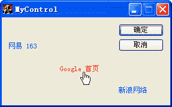

# Win32 编程进阶:打造自己的标准控件

> 原文：[`www.pediy.com/kssd/pediy12/129283.html`](https://www.pediy.com/kssd/pediy12/129283.html)

Win32 编程进阶:打造自己的标准控件  
作者：cntrump  
前言  
　　Windows 给我们提供了很多的标准控件，基本上够用的。但是有时候我们会对标准控件不满意，这时候就可以考虑自己编写控件。  
　　本教程的目的是编写一个出一个简单的标准控件，作用类似于网页上的超链接，除了可以接受 Windows 常规消息还可以处理控件自定义的消息。  
　　程序运行的效果如下：  
  
　　  
　　鼠标点击之后就会打开在程序中所指定的链接。  
准备工作：  
　　这个控件很简单，只要响应鼠标消息进行处理就可以了，在开始编码之前，先定义几个控件使用的消息和宏：  
1. 控件可以设置文字的对齐方式：  

代码:

```
// 文字的对齐方式,默认左对齐
// 左对齐
#define HLS\_LEFT  DT\_LEFT
// 居中对齐
#define HLS\_CENTER  DT\_CENTER
// 右对齐
#define HLS\_RIGHT  DT\_RIGHT

```

  
2. 还需要为控件设置超链接地址：  
代码:

```
// 超链接控件可接收的消息
// 设置超链接
#define HLM\_SETHYPERLINK  (WM\_USER+0x0001)
// 获取超链接
#define HLM\_GETHYPERLINK  (WM\_USER+0x0002)
// 设置和获取超链接的宏
#define HyperLink\_SetLink(hwnd, link) SendMessage(hwnd, HLM\_SETHYPERLINK, 
0, (LPARAM)link)
#define HyperLink\_GetLink(hwnd, link, length) SendMessage(hwnd, HLM\_GETHYPERLINK, (WPARAM)length, (LPARAM)link)

```

开始编码：  
1. 注册自己的控件类。  
我把控件类名称定义为"HyperLinkCtrl"，还要为窗口额外分配空间，这样才能进行更多的控制。  
代码:

```
// 注册控件类
ATOM WINAPI RegisterHyperLinkCtrl(HINSTANCE hIns)
{
  WNDCLASSEX wndClass;
  ZeroMemory(&wndClass, sizeof(wndClass));
  wndClass.cbSize = sizeof(wndClass);
  wndClass.style = CS\_PARENTDC|CS\_GLOBALCLASS; // 使用全局类并和父窗口共享 DC
  wndClass.lpszClassName = HyperLinkCtrlClassName;
  wndClass.hCursor = LoadCursor(NULL, IDC\_HAND); // 手型鼠标
  wndClass.hInstance = hIns;
  wndClass.lpfnWndProc = (WNDPROC)CtrlProc; // 控件的消息处理过程
  wndClass.cbWndExtra = sizeof(INT\*); // 为窗口分配额外内存,用来保存我们自己的指针.
  return RegisterClassEx(&wndClass);
}

```

2. 创建窗口  
　　成功注册窗口类之后就可以开始创建窗口了，创建窗口的过程和标准控件没有区别，为了方便使用，把它进行包装：  
代码:

```
// 创建一个超链接控件
HWND WINAPI CreateHyperLink(LPCTSTR pszTitle, // 显示的文本
                            DWORD style, // 窗口风格
                            INT x, // x 坐标
                            INT y, // y 坐标
                            INT nWidth, // 宽度
                            INT nHeight, //高度
                            HWND hWndParent, // 父窗口句柄
                            UINT CtrlID) // 控件 ID
{
  return CreateWindow(HyperLinkCtrlClassName, 
                      pszTitle, 
                      WS\_CHILD|style, // 必须是子窗口
                      x, 
                      y, 
                      nWidth, 
                      nHeight, 
                      hWndParent, 
                      (HMENU)CtrlID, 
                      NULL, 
                      0);
}

```

3. 处理控件窗口消息  
控件窗口一旦创建成功，系统就会调用控件的消息处理过程，我们的这个控件只处理 WM\_PAINT 和鼠标相关的几个消息和两个自定义消息，其他消息交给系统自动处理。  
整个消息处理过程太占篇幅，只捡几个关键的代码片段，自定义的函数参见源文件：  
WM\_PAINT 消息：  
对文本的绘制都集中在这个消息里，是显示文字的关键：  
代码:

```
  case WM\_PAINT:
    {
      PAINTSTRUCT ps;
      HDC hDc = BeginPaint(hWnd, &ps);
      SetCtrlTextColor(hWnd, hDc, RGB(0,0,255)); // 自定义函数
      EndPaint(hWnd, &ps);
    }
    break;

```

WM\_MOUSEMOVE，WM\_MOUSEHOVER 和 WM\_MOUSELEAVE：  
在鼠标移动到控件上面的时候，会触发 WM\_MOUSEMOVE，在这个消息里对鼠标进行跟踪以获取鼠标的状态：  
代码:

```
  case WM\_MOUSEMOVE:
    {
      tms.cbSize = sizeof(tms);
      tms.hwndTrack = hWnd;
      tms.dwFlags = TME\_HOVER|TME\_LEAVE;
      tms.dwHoverTime = 10;
      TrackMouseEvent(&tms);
      SetCursor(LoadCursor(NULL, IDC\_HAND)); 
    }
    break;
  case WM\_MOUSEHOVER: // 鼠标在控件上面时颜色为红色
      SetCtrlTextColor(hWnd, NULL, RGB(255,0,0));
    break;
  case WM\_MOUSELEAVE: // 鼠标离开时恢复原来的颜色
      SetCtrlTextColor(hWnd, NULL, RGB(0,0,255));
    break;

```

鼠标左键按下和弹起时，如果是对惯用左手的人还需要添加右键处理：  
代码:

```
  case WM\_LBUTTONDOWN:
    SetCursor(LoadCursor(NULL, IDC\_HAND));
    break;
  case WM\_LBUTTONUP: // 鼠标弹起时打开链接
    {
      TCHAR \*text = (TCHAR\*)GetWindowLong(hWnd, 0);
      SetCursor(LoadCursor(NULL, IDC\_HAND));
      if (text == NULL)
        break;      
      ShellExecute(hWnd, \_T("OPEN"), text, NULL, NULL, SW\_SHOW);
    }

```

最后是自定义消息：设置超链接和获取超链接  
HLM\_SETHYPERLINK 和 HLM\_GETHYPERLINK  
代码:

```
  case HLM\_SETHYPERLINK:
    {
      int length = lstrlen((LPCTSTR)lParam);
      TCHAR \*text = (TCHAR \*)GetWindowLong(hWnd, 0);
      
      if (text != NULL)
        delete \[\]text;

      text = new TCHAR\[length+1\];
      lstrcpy(text, (TCHAR\*)lParam);
      text\[length\] = TCHAR(0);
      SetWindowLong(hWnd, 0, (LONG)text);
    }
    break;
  case HLM\_GETHYPERLINK:
    {
      int length = 0;
      TCHAR \*text = (TCHAR\*)GetWindowLong(hWnd, 0);

      if (text == NULL)
        return 0;

      length = lstrlen(text);
      lstrcpyn((TCHAR\*)lParam, text, min(length, (int)wParam));
      return min(length, (int)wParam);
    }

```

基本上整个控件就完成了，为了能在对话框程序中方便使用，我还定义了一个将控件子类化为超链接的函数：  
代码:

```
// 子类化控件,在设计对话框程序时方便可视化调整
LONG WINAPI SubclassHyperLink(HWND hwnd)
{
  assert(hwnd);

  if (!SetWindowLong(hwnd, 0, 0))
    SetClassLong(hwnd, GCL\_CBWNDEXTRA, sizeof(INT\*));

  SetWindowLong(hwnd, 0, 0);

  return SetWindowLong(hwnd, GWL\_WNDPROC, (LONG)CtrlProc);
}

```

如何使用？  
1. 在 WinMain 函数里或者初始化函数里注册控件类：  
RegisterHyperLinkCtrl(hInstance);  
2. 再创建我们的自定义控件并设置超链接：  
HWND hLink = CreateHyperLink(\_T("Google 首页"), HLS\_CENTER, 30, 80, 200, 20, \*this, 0);  
     HyperLink\_SetLink(hLink, \_T("http://www.google.com"));  
3. 如果是在对话框中使用，计算坐标比较麻烦，可以采用子类化的方式：  
SubclassHyperLink(GetDlgItem(ID\_APP\_ABOUT));  
HyperLink\_SetLink(GetDlgItem(ID\_APP\_ABOUT), \_T("http://www.sina.com.cn"));  
小结  
整个控件我是直接写在源文件里实现的，如果是 C 语言的话可以直接包含进项目就可以使用了，但是如果是用在汇编语言中，则需要将控件编译成静态库或动态库，  
使用前先调用 RegisterHyperLinkCtrl 注册控件类。  
欢迎提出建议或意见：cntrump@gmail.com

上传的附件
|  || Win32 编程进阶-打造自己的标准控件.pdf  
 |
|  || HyperLink\_wtl.rar  
 |

Win32 编程进阶:打造自己的标准控件 后续  
作者：cntrump  
     上一章的教程中已经创建一个独立功能的控件，但是这个控件是封闭的，在父窗口的消息循环中接收不了控件的消息。如果只是单独地打开一个网页链接的话这是没有什么问题的，但如果需要像按钮一样单击之后进行其他处理就不行。  
     本章教程目的就是解决这个问题，让自定义的控件能像标准控件一样在父窗口的 WM\_COMMAND 消息中对其进行响应。  
     要解决这个问题很简单，只需要在控件相应的消息中把消息发给其父窗口就可以了。  
     关键的消息有两个：WM\_COMMAND 和 WM\_NOTIFY。  
     由于我们的这个控件很简单，WM\_COMMAND 消息就可以完全处理了，所以 WM\_NOTIFY 通知不用理会。  
     需要修改的地方是鼠标按下和弹起，还有转发 WM\_COMMAND 消息给父窗口。  
     修改后的地方：  

代码:

```
  case WM\_LBUTTONDOWN:
    SetCursor(LoadCursor(NULL, IDC\_HAND));
    wParam = GetDlgCtrlID(hWnd);
    SendMessage(GetParent(hWnd), WM\_COMMAND, wParam, (LPARAM)hWnd);
    break;
  case WM\_LBUTTONUP:
    {
      SetCursor(LoadCursor(NULL, IDC\_HAND));
      wParam = GetDlgCtrlID(hWnd);
      SendMessage(GetParent(hWnd), WM\_COMMAND, wParam, (LPARAM)hWnd);
    }
break;
case WM\_COMMAND:
    SendMessage(GetParent(hWnd), WM\_COMMAND, wParam, lParam);
    break;

```

     这样在父窗口就可以进行处理了，当子类化按钮时也不会改变按钮的点击行为了。

上传的附件
|  || Win32 编程进阶-打造自己的标准控件 后续.pdf  
 |
|  || HyperLink2\_sdk.rar  
 |
|  || [HyperLink\_sdk\[0223\].rar](129283/925015/54476.rar)  
 |