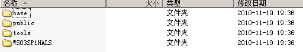
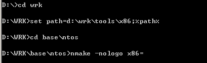
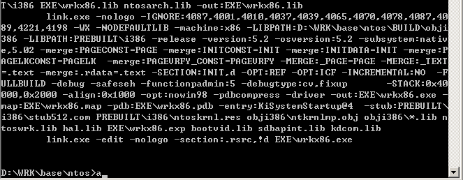
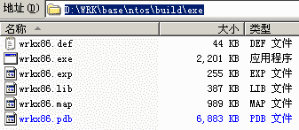
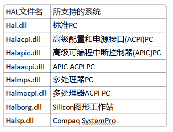
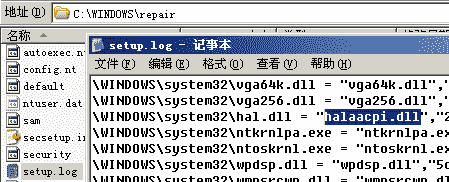
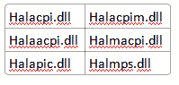
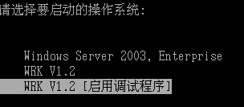

# WRK 安装与配置始末

> 原文：[`www.pediy.com/kssd/pediy11/125130.html`](https://www.pediy.com/kssd/pediy11/125130.html)

最近买了本《Windows 内核原理与实现》，书中是以 WRK 的代码为例讲述操作系统内核的。  
可书中配置 WRK 部分是以微软给的免费光盘的内容，配合了 Virtual PC2007 的虚拟系统。可在官网上并不是每个人都可以得到的，所以记录一下我的安装配置始末。希望对你有帮助少走弯路！  
  
[点这里了解什么是 WRK(Windows Research Kernel)](http://baike.baidu.com/view/3758841.htm)  
  
[点这里下载 Windows Server 2003 SP1\_iso](http://down.gougou.com/down?cid=99B340465964E65B377B9E424E53013E183D9559)  
  
[点这里下载 WRK1.2](http://download.csdn.net/source/2007880)  
  
WRK1.2 可在两种环境下运行：  
X86(Windows Server 2003 SP1)  
AMD64(Windows XP x64 Professional)  
可以在运行上述操作系统的物理计算机上安装 WRK，但是为了调试方便我们建议安装到虚拟机当中。我们这里就以 VMware 为例  
1.首先在 VMware 中安装 Windows Server 2003 SP1\[这里省略……\]  
(新建虚拟机-选择 Windows Server 2003 Standard Edition )  
2.将 WRK1.2 当中的 4 个目录托到虚拟机的系统里面，如图  
  
3.在虚拟机当中打开 CMD，进入 WRK 目录。并执行命令  
set path=d:\\wrk\\tools\\x86;%path%  
然后进入 base\\ntos 目录编译 WRK。如图  
  
4.回车后编译器开始编译 WRK，时间大约需要 2 分钟左右。编译成功后  
内容在 base\\ntos\\build\\exe 目录当中  
  
  
5.将 wrkx86.exe 文件复制到 windows\\system32 目录之下  
6.处理硬件抽象层(在 X86 平台下 WRK 内核需要多处理器版本的硬件抽象层 hal.dll 的支持。在 Windows 中，HAL 是一个独立的动态链接库。尽管 Windows 随带了多个主流机器的 HAL，但是在系统安装的时候只有一个会被选中，并拷贝和改名为 hal.dll……有点扯远了。我们看下 HAL 列表)  
  
既然有这么多 HAL 我们如何判断当前正在运行哪个 HAL 呢  
可以打开 c:\\windows\\repair\\setup.log 文件，然后搜索 Hal.dll 如图  
  
我们看到是 Halaacpi.dll。大家可以根据自己的机器使用了哪一个 HAL 对照下面的列表进行操作  
  
在我的虚拟机系统当中是 halaacpi.dll 那么我们就到  
d:\\wrk\\WS03SP1HALS\\x86\\halmacpi 目录中将  
halmacpi.dll 文件复制到 WINDOWS\\system32 目录下  
另外还有 2 个多处理的 HAL 文件同样也在 WS03SP1HALS\\x86 目录下，大家自己根据实际情况选择。  
7.做好上述工作以后打开虚拟机系统的 boot.ini 文件(文件夹选项-取消【隐藏受保护的操作系统文件(推荐)】前面的勾号确定后，可在 C:\\下找到 boot.ini 文件。记得取消只读模式)  
做如下修改：  

引用: multi(0)disk(0)rdisk(0)partition(1)\\WINDOWS="Windows Server 2003, Enterprise" /noexecute=optout /fastdetect  
multi(0)disk(0)rdisk(0)partition(1)\\WINDOWS="WRK V1.2" /kernel=wrkx86.exe hal=halmacpi.dll  
multi(0)disk(0)rdisk(0)partition(1)\\WINDOWS="WRK V1.2" /kernel=wrkx86.exe hal=halmacpi.dll /debug /debugport=com1 /baudrate=115200 

最后启动操作系统的时候可以看到  
  
  
那么剩下的事情就是在虚拟机上添加一个串行接口-命名管道-以及配置 WINDBG 的工作了。这里我想大家都比较熟悉了。