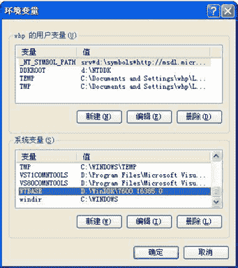
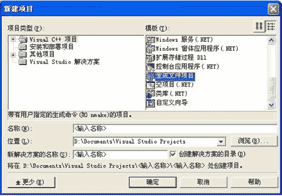
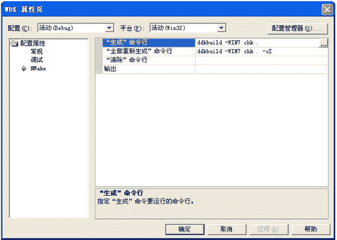

# 如何用 WDK 编译驱动

> 原文：[`www.pediy.com/kssd/pediy10/101644.html`](https://www.pediy.com/kssd/pediy10/101644.html)

今天倒腾了一上午，现在终于可以编译了，我的 WDK 版本是 D:\\WinDDK\\7600.16385.0，希望对大家有点帮助，不需要安装额外的 EasySys 或者 DDKWizard 啥的！VS2003+WDK 即可 

1、安装 WDK，我的目录是 D:\\WinDDK\\7600.16385.0，设置 W7BASE 环境变量 

  

2、下载 DDKBUILD.CMD 必须 V7.4 R43 DDKBUILD.CMD  
3、使用 vs 建立一个 MakeFile 工程 

4、在工程目录下建立 MakeFile，和 Sources，具体的怎么写不用操心，从 WDK 例子里  
面复制过来就是了，不过要注意的是 SOURCES 要稍微修改下：  
TARGETNAME=hello\_wdk  
TARGETTYPE=DRIVER  
TARGETPATH=OBJ  
SOURCES=main.c \\  
xxxx.c  
5、设置生成以及重新生成命令行，如图 

6、敲一个测试代码，编译看看  
  
#include<ntddk.h>  
NTSTATUS DriverEntry(IN PDRIVER\_OBJECT DriverObject,IN PUNICODE\_STRING  
RegistryPath)  
{  
KdPrint(("驱动加载了...."));  
return STATUS\_SUCCESS;  
}