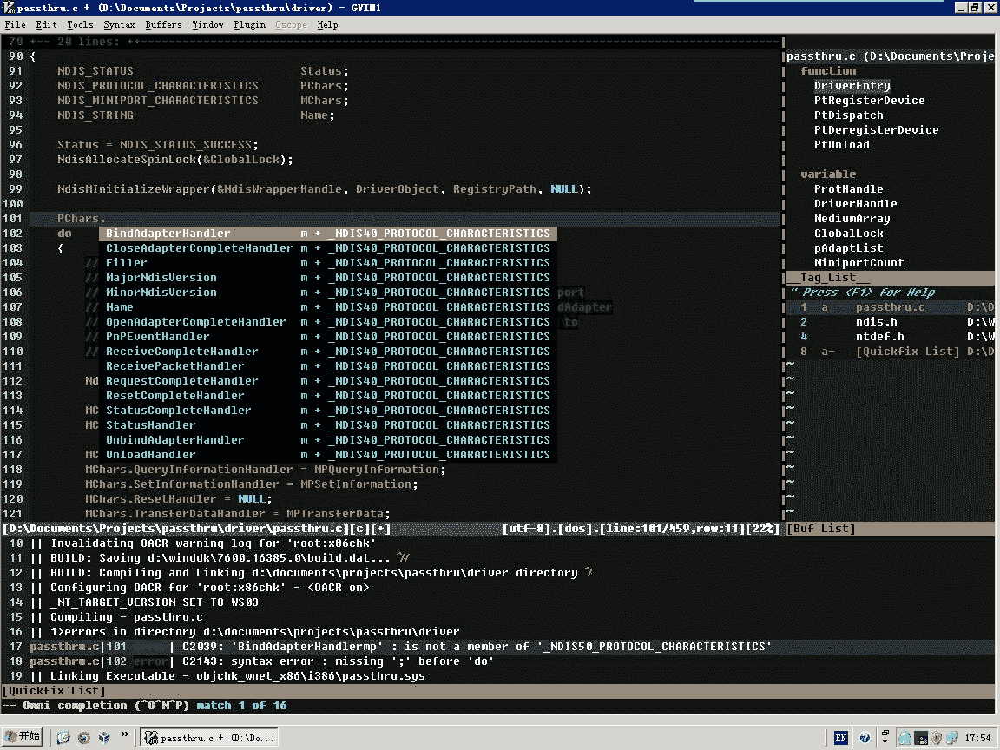

# Vim\_for\_wdk7600 开发配置

> 原文：[`www.pediy.com/kssd/pediy12/141890.html`](https://www.pediy.com/kssd/pediy12/141890.html)

具体的设置自行参考我的 VIM 配置，直接上效果图，just enjoy 有问题可问我，哈哈  
话说 VS 系列简直是太大了，至今只用 VC6，可惜 VC6 好像 WDK 支持不好~  
  

上传的附件
|  || vim\_for\_wdk.rar  
 |