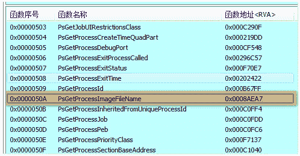
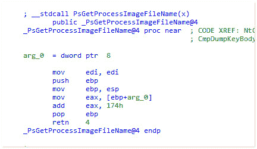
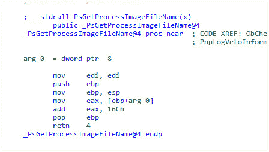
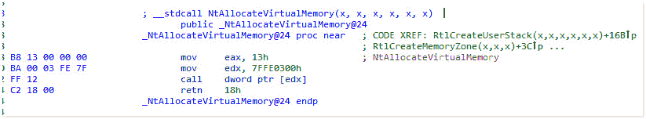

# 浅谈一下驱动开发中的硬编码

> 原文：[`www.pediy.com/kssd/pediy12/142463.html`](https://www.pediy.com/kssd/pediy12/142463.html)

  
驱动开发中硬编码是比较烦人的,不仅让别人看起来不怎么专业,自己看着心里也疙疙瘩瘩的不舒服  
最常见的就是对于 EPROCESS 结构中 ImageFileName 的定位,不同系统下这个域的偏移是不同的,  
常见做法就是得到 EPROCESS 之后根据系统的不同来加上不同的偏移,  
或者也有在 PsInitialSystemProcess 指向的 system 进程的 EPROCESS 中搜索 system 字串进行定位的.  
  
那么 Windows 真的没有为我们提供定位到这个域的函数吗?  
我们可以看一下内核文件的导出表,因为进程线程相关函数都是 Ps 开头,我们看一下这里有没有线索  
  
  
函数名称来看应该是与进程名相关的,再来到 IDA 中看一下  
  
<xp 下的实现>  
  
  
<win7 下的实现>  
  
  
熟悉 EPROCESS 结构的童鞋应该都马上想到这个就是在 EPROCESS 地址加上了一个偏移量来得到了 ImageFileName  
  
这个函数虽然被导出了,不过 WDK 中并没有介绍它,我们使用的时候定义一下原型,配合 MmGetSystemRoutineAddress 就可以了  
代码:

```
typedef PUCHAR  (\_\_stdcall \*sky\_PsGetProcessImageFileName)(PEPROCESS pEprocess);

PUCHAR GetSpecialProcessImageFileName(PEPROCESS pEprocess)
{
  UNICODE\_STRING            destString;
  sky\_PsGetProcessImageFileName    CallPsGetProcessImageFileName = NULL;

  if ( MmIsAddressValidEx((PVOID)pEprocess) == VCS\_INVALID ) return NULL;
  if ( IsValidObject(pEprocess,\*PsProcessType) == FALSE ) return NULL;

  RtlInitUnicodeString(&destString,(PWCHAR)L"PsGetProcessImageFileName");
  CallPsGetProcessImageFileName = (sky\_PsGetProcessImageFileName)MmGetSystemRoutineAddress(&destString);
  if (CallPsGetProcessImageFileName == NULL) return NULL;

  return CallPsGetProcessImageFileName(pEprocess);
}

```

类似的函数还有不少:  
代码:

```
PsGetProcessDebugPort 取得指定 EPROCESS 的调试端口信息
typedef PVOID  (\_\_stdcall \*sky\_PsGetProcessDebugPort)(PEPROCESS pEprocess);

PsGetProcessId 取得指定 EPROCESS 的进程 Id
typedef ULONG  (\_\_stdcall \*sky\_PsGetProcessId)(PEPROCESS pEprocess);

PsGetProcessInheritedFromUniqueProcessId 取得指定 EPROCESS 的父进程 Id
typedef ULONG  (\_\_stdcall \*sky\_PsGetProcessInheritedFromUniqueProcessId)(PEPROCESS pEprocess);

PsGetProcessJob 取得指定 EPROCESS 的 Job 信息
typedef PVOID  (\_\_stdcall \*sky\_PsGetProcessJob)(PEPROCESS pEprocess);

PsGetProcessPeb 取得指定 EPROCESS 的 Peb 地址
typedef PPEB  (\_\_stdcall \*sky\_PsGetProcessPeb)(PEPROCESS pEprocess);

PsGetProcessWin32Process 取得指定 EPROCESS 的 w32process 结构地址 <GUI>
typedef PVOID  (\_\_stdcall \*sky\_PsGetProcessWin32Process)(PEPROCESS pEprocess);


PsGetThreadTeb 取得指定 ETHREAD 的 Teb 地址
typedef PVOID  (\_\_stdcall \*sky\_PsGetThreadTeb)(PETHREAD pEthread);

PsGetThreadId 取得指定 ETHREAD 的线程 Id
typedef ULONG  (\_\_stdcall \*sky\_PsGetThreadId)(PETHREAD pEthread);

PsGetThreadProcessId 取得指定 ETHREAD 的进程 Id
typedef ULONG  (\_\_stdcall \*sky\_PsGetThreadProcessId)(PETHREAD pEthread);

```

  
这里我只是把自己可能用到的都提取出来了,更多的函数大家可以在 IDA 中去看一下~  
这些函数的使用方法与 PsGetProcessImageFileName 是一样的,自己可以封装一下  
  
  
  
\*\*\*\*\*\*\*\*\*\*\*\*\*\*\*\*\*\*\*\*\*\*\*\*\*\*\*\*\*  
  
再简单说一下关于 SSDT 的服务号吧,这些服务号不同的系统版本也不尽相同  
而且有很多未导出的函数,所以定位它们在 SSDT 表中的位置时有点烦  
  
但是所有的 SSDT 都是在 ntdll 中被导出的,我们可以通过在驱动中映射 ntdll 并解析 PE 输出表的方法来找到所有 SSDT 的服务号  
因为 Ntdll 中的所有 SSDT 函数形式都类似这样  
  
  
在输出表中得到函数地址之后越过首条 mov 指令的操作码,后面的双字就是服务号了  
下面对驱动中映射文件进行了简单封装:  
代码:

```
ULONG MapSpecialModule(PWCHAR pModulePath, PHANDLE ReturnModuleSection)
{
  UNICODE\_STRING      destString;
  OBJECT\_ATTRIBUTES    objAttr;
  NTSTATUS        status = STATUS\_SUCCESS;
  HANDLE          hFile = NULL;
  IO\_STATUS\_BLOCK      ioStatusBlock;
  HANDLE          Section = NULL;
  PVOID          pvSectionBase = NULL;
  ULONG          ulSectionSize = 0;
  ULONG          Result = 0;

  if ( pModulePath == NULL ) return 0;
  if ( ReturnModuleSection == NULL ) return 0;

  RtlInitUnicodeString(&destString,pModulePath);
  InitializeObjectAttributes(&objAttr,&destString,OBJ\_CASE\_INSENSITIVE | OBJ\_KERNEL\_HANDLE,NULL,NULL);

  status = ZwCreateFile(&hFile,FILE\_READ\_DATA | SYNCHRONIZE,&objAttr,&ioStatusBlock,NULL,
    FILE\_ATTRIBUTE\_NORMAL,FILE\_SHARE\_READ,FILE\_OPEN,  //存在则打开 不存在则返回错误码
    FILE\_SYNCHRONOUS\_IO\_NONALERT,NULL,0);
  if ( !NT\_SUCCESS(status) ) return 0;
  if ( !NT\_SUCCESS(ioStatusBlock.Status) ) return 0;


#define SEC\_COMMIT        0x8000000 
#define SEC\_IMAGE      0x1000000
  InitializeObjectAttributes(&objAttr,NULL,OBJ\_CASE\_INSENSITIVE | OBJ\_KERNEL\_HANDLE,NULL,NULL);

  status = ZwCreateSection(&Section,SECTION\_QUERY,&objAttr,NULL,PAGE\_READONLY,SEC\_COMMIT,hFile);
  if (!NT\_SUCCESS(status)) goto \_\_exit1;

  status = ZwMapViewOfSection(Section,
                ZwCurrentProcess(),
                &pvSectionBase,    //接受映射的基址初始化为 NULL
                0,    
                PAGE\_SIZE,      //这里指定起始映射多少字节
                0,          //section 起始至这里的偏移
                &ulSectionSize,    //初始化为 0
                ViewUnmap,
                MEM\_TOP\_DOWN,
                PAGE\_READONLY);
  if ( !NT\_SUCCESS(status) )
  {
    ZwClose(Section);
    Section = NULL;
    goto \_\_exit1;
  }

  \*ReturnModuleSection = Section;
  Result = (ULONG)pvSectionBase;

\_\_exit1:
  if ( hFile != NULL ) ZwClose(hFile);
  hFile = NULL;
  return Result;
}

BOOLEAN UnMapSpecialModule(ULONG SectionBase, HANDLE hModuleSection)
{
  if ( hModuleSection == NULL ) return FALSE;
  if ( SectionBase == 0 ) return FALSE;

  ZwUnmapViewOfSection(hModuleSection,(PVOID)SectionBase);
  ZwClose(hModuleSection);
  hModuleSection = 0;  
  return TRUE;
}

HANDLE globe\_NtdllModuleSection = NULL;
ULONG MapNtdllModule()
{
  PWCHAR  pNtdllPath = NULL;
  ULONG  Result = 0;

  if ( GetNtdllModulePath(&pNtdllPath) == FALSE ) return 0;
  Result = MapSpecialModule(pNtdllPath,&globe\_NtdllModuleSection);

  if ( pNtdllPath != NULL ) ExFreePool(pNtdllPath);
  pNtdllPath = NULL;
  return Result;
}


BOOLEAN UnMapNtdllModule(ULONG SectionBase)
{
  return UnMapSpecialModule(SectionBase,globe\_NtdllModuleSection);
}

```

  
映射完模块之后我们在其输出表中搜索指定函数名称就行了,这里需要自己实现一个 GetProcAddress  
因为 MmGetSystemRoutineAddress 只能得到内核模块以及 hal 模块中的函数信息  
对于 GetProcAddress 的实现,网上已有很多,我就不重发了,大家搜索一下吧~~