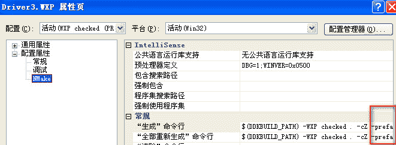
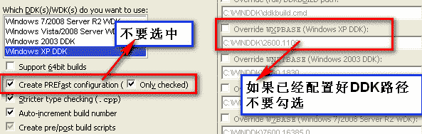

# vs + ddkwizard 不能生成 sys 文件 的真正原因

> 原文：[`www.pediy.com/kssd/pediy12/142849.html`](https://www.pediy.com/kssd/pediy12/142849.html)

ddkwizard +DDK+VS 安装好后,配置好环境参数后,  
  
新建一个驱动工程,编译,然后可以看到成功 1 个，失败 0 个 ,理论上是完全成功的  
  
但事实际上却没有生成 sys 文件 ,于是我尝试直接使用 DDK 的 build 命令,发现是可以成功生成的  
因此代码肯定是没有问题的  
  
用搜索引擎搜索不能生成的原因,转贴最多的就是关于 path 设置不正确什么的  
而且转载者非常之多,但真正原因并不在此 , 误导了很多初学者   
  
而且 csdn 上面有很多人也遇到我同样的问题,但都没得到解决,经过我多方尝试终于搞定  
  
原因是: 由于大家都使用的默认生成, 选择了 Create PREfast config… , '编译器添加了 'prefast' 参数 , 只要在属性页去掉即可  
    
第一种解决办法 : 在属性页 nmake 去掉参数  
   
   
   
  
第二种解决办法 : 直接在创建时不选中  
  
   
  
另外发现网上的另一个文章有个误区, 说要选中 DDK 路径, 如果你已经在环境变量中设置好了 WINDDK 路径 ,是不用勾选的  
  
除非你的 DDK 真正安装他选显示的路径