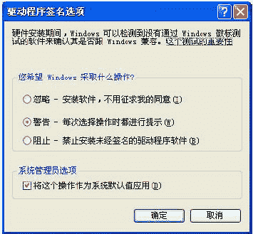
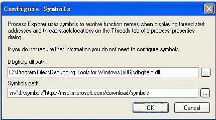
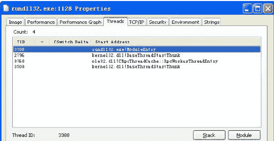
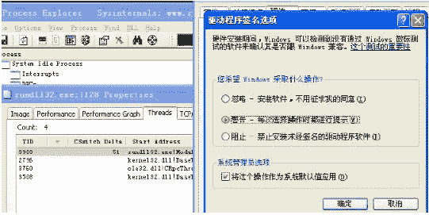
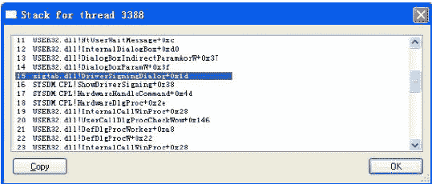
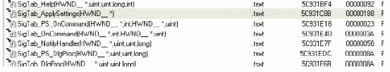
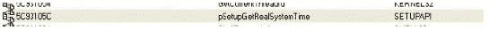

# 禁用驱动程序签名选项

> 原文：[`www.pediy.com/kssd/pediy10/100874.html`](https://www.pediy.com/kssd/pediy10/100874.html)

如何设置驱动程序签名选项  
  
如何设置驱动程序签名选项  
By boywhp@126.com  
  
最近无聊在看 windows internals 5，看到其中的 process explorer 介绍。就倒腾出了这个破文章，当然网上其实已经有现成的代码了，但是我现在要告诉你的是怎么抓鱼的方法。希望你能喜欢。效果就是如何自己用代码实现选择其中的选项，当然不是用模拟鼠标点击了。 

  
  
先贴一段 google 来的代码：  
DWORD WINAPI SetDriverSign()  
{  
    HKEY    hReg;  
    DWORD    dwLen;  
    DWORD    dwSeed;  
    DWORD    hProv;  
    DWORD    hHash;  
    DWORD    dwData;  
    BYTE    bHash\[16\];  
  
    if(RegOpenKeyExA(HKEY\_LOCAL\_MACHINE,"SYSTEM\\\\WPA\\\\PnP",0,KEY\_READ,&hReg) == ERROR\_SUCCESS)  
    {  
        dwLen = 4;  
        RegQueryValueExA(hReg,"seed",0,0,(LPBYTE)&dwSeed,&dwLen);  
        RegCloseKey(hReg);  
  
        CryptAcquireContext(&hProv,0,0,PROV\_RSA\_FULL,CRYPT\_VERIFYCONTEXT);  
        CryptCreateHash(hProv,0x8003,0,0,&hHash);  
  
        dwData = 0;  
        CryptHashData(hHash,(BYTE \*)&dwData,4,0);  
        CryptHashData(hHash,(BYTE \*)&dwSeed,4,0);  
  
        dwLen = 16;  
        CryptGetHashParam(hHash,HP\_HASHVAL,&bHash\[0\],&dwLen,0);  
  
        CryptDestroyHash(hHash);  
        CryptReleaseContext(hProv,0);  
  
        //    HKEY\_LOCAL\_MACHINE\\SOFTWARE\\Microsoft\\Windows\\CurrentVersion\\Setup    PrivateHash    BIN MD5  
        //    HKEY\_LOCAL\_MACHINE\\SOFTWARE\\Microsoft\\Driver Signing        Policy        BIN        0  
        //    HKEY\_LOCAL\_MACHINE\\SOFTWARE\\Microsoft\\Non-Driver Signing    Policy        BIN        0  
        //    HKEY\_CURRENT\_USER\\Software\\Microsoft\\Driver Signing            Policy        DWORD    0  
        lpParameter = 0;  
        RegOpenKeyExA(HKEY\_LOCAL\_MACHINE,"SOFTWARE\\\\Microsoft\\\\Driver Signing",0,KEY\_WRITE,&hReg);  
        RegSetValueExA(hReg,"Policy",0,REG\_BINARY,(BYTE \*)&dwData,1);  
        RegCloseKey(hReg);  
        RegOpenKeyExA(HKEY\_LOCAL\_MACHINE,"SOFTWARE\\\\Microsoft\\\\Non-Driver Signing",0,KEY\_WRITE,&hReg);  
        RegSetValueExA(hReg,"Policy",0,REG\_BINARY,(BYTE \*)&dwData,1);  
        RegCloseKey(hReg);  
        RegOpenKeyExA(HKEY\_CURRENT\_USER,"SOFTWARE\\\\Microsoft\\\\Driver Signing",0,KEY\_WRITE,&hReg);  
        RegSetValueExA(hReg,"Policy",0,REG\_BINARY,(BYTE \*)&dwData,1);  
        RegCloseKey(hReg);  
  
        RegOpenKeyExA(HKEY\_LOCAL\_MACHINE,"SOFTWARE\\\\Microsoft\\\\Windows\\\\CurrentVersion\\\\Setup",0,KEY\_WRITE,&hReg);  
        RegSetValueExA(hReg,"PrivateHash",0,REG\_BINARY,&bHash\[0\],16);  
        RegCloseKey(hReg);  
  
    }  
  
    return 0;  
}  
  
很神奇的代码吧，现在我们准备工具，自己来发掘一下，呵呵，当然就是 IDA + 调试器了，不过这里我并没有用调试器。  
  
思路很简单：首先把驱动程序签名选项对话框打开： 

  
  
关键是如何定位其中的代码，尤其是其中的确定按钮对应的代码，这里你可以用调试器啥的下断点，但是这里我介绍一个跟简单的方法：  
打开最新版的 process explorer  
  
首先设置 prcoess explorer 的符号路径 

  
  
再重复一次，我的电脑->属性->硬件->驱动程序签名，这时 process explorer 会将新起来的进程标绿，我们看到起来一个 rundll32.exe 进程。双击打开进程信息，并切换到线程选项卡：  

  
拿鼠标在驱动程序签名选项上瞎晃，瞎点几下！  
  
  
看到第一个线程 CSwitch Delta 活动频繁，点 Stack 按钮，查看线程 Stack: 

  
  
然后就依次查看下可疑的函数，发现 sigtab.dll 很可疑，IDA 之+注意加载 sigtab.Dll 符号文件，切换到 Functions 选项卡： 

  
  
认识 SigTab\_ApplySetting 吧！双击+F5  
int \_\_stdcall SigTab\_ApplySettings(HWND hDlg)  
{  
  int result; // eax@1  
  signed int v2; // eax@16  
  unsigned int v3; // eax@15  
  HKEY hKey; // \[sp+24h\] \[bp-8h\]@1  
  DWORD dwDisposition; // \[sp+14h\] \[bp-18h\]@1  
  LONG v6; // \[sp+1Ch\] \[bp-10h\]@1  
  signed int Data; // \[sp+28h\] \[bp-4h\]@2  
  DWORD Type; // \[sp+18h\] \[bp-14h\]@2  
  DWORD cbData; // \[sp+20h\] \[bp-Ch\]@2  
  \_\_int16 v10; // \[sp+8h\] \[bp-24h\]@15  
  \_\_int16 v11; // \[sp+Eh\] \[bp-1Eh\]@15  
  \_\_int16 v12; // \[sp+4h\] \[bp-28h\]@15  
  \_\_int16 v13; // \[sp+12h\] \[bp-1Ah\]@21  
  
  result = RegCreateKeyExW(  
             HKEY\_CURRENT\_USER,  
             L"Software\\\\Microsoft\\\\Driver Signing",  
             0,  
             0,  
             0,  
             0xF003Fu,  
             0,  
             &hKey,  
             &dwDisposition);  
  v6 = result;  
  if ( !result )  
  {  
    Data = 0;  
    Type = 4;  
    cbData = 4;  
    if ( !IsDlgButtonChecked(hDlg, 1001) )  
    {  
      if ( IsDlgButtonChecked(hDlg, 1002) )  
        Data = 2;  
    }  
    else  
    {  
      Data = 1;  
    }  
    v6 = RegSetValueExW(hKey, L"Policy", 0, Type, (const BYTE \*)&Data, cbData);  
    result = RegCloseKey(hKey);  
    if ( !v6 )  
    {  
      result = IsDlgButtonChecked(hDlg, 1003);  
      if ( result )  
      {  
        result = IsUserAdmin();  
        if ( result )  
        {  
          if ( !RegOpenKeyExW(HKEY\_LOCAL\_MACHINE, L"System\\\\WPA\\\\PnP", 0, 0x20019u, &hKey) )  
          {  
            cbData = 4;  
            if ( RegQueryValueExW(hKey, L"seed", 0, &Type, (BYTE \*)&Data, &cbData) || Type != 4 || cbData != 4 )  
              Data = 0;  
            RegCloseKey(hKey);  
          }  
          v10 = (\_WORD)&hKey | 4;  
          v3 = Data;  
          Data = 0;  
          v11 = v3;  
          v12 = v3 >> 16;  
          if ( IsDlgButtonChecked(hDlg, 1001) )  
          {  
            v2 = 1;  
          }  
          else  
          {  
            if ( !IsDlgButtonChecked(hDlg, 1002) )  
            {  
              LOWORD(v2) = Data;  
              goto LABEL\_21;  
            }  
            v2 = 2;  
          }  
          Data = v2;  
LABEL\_21:  
          v13 = (\_WORD)&v6 ^ ((\_WORD)&v6 ^ (unsigned \_\_int16)((\_WORD)v2 << 10)) & 0xC00;  
          return pSetupGetRealSystemTime(&v12);  
        }  
      }  
    }  
  }  
  return result;  
}  
pSetupGetRealSystemTime 是 SetupAPI 的导出函数 

  
  
剩下的自己去验证吧，我很神奇的是我一开始搜到的代码是哪位高人写的，为什么不直接用 pSetupGetRealSystemTime 呢？IDA 的 pSetupGetRealSystemTime 很复杂，希望高人研究下，我就不折腾了。附一个 google 到的比较类似的代码  
//用法：取消驱动验证 SetSigpolicy(0，1);还原驱动验证 SetSigpolicy(1，1);  
  
char \_\_cdecl SetSigpolicy(char a1, char a2)  
{  
  char v2;   
  HMODULE v3;   
  HMODULE v4;   
  FARPROC v5;   
  HKEY hKey;  
  DWORD cbData;  
  DWORD Type;   
  DWORD Data;   
  \_SYSTEMTIME SystemTime;   
  
  hKey = 0;  
  cbData = 4;  
  v2 = 0;  
  if ( !RegOpenKeyExA(HKEY\_LOCAL\_MACHINE, "SYSTEM\\\\CurrentControlSet\\\\Control\\\\Session Manager\\\\WPA\\\\PnP", 0, KEY\_QUERY\_VALUE, &hKey) )//正常 XP 不存在此键值  
  {  
    if ( !RegQueryValueExA(hKey, "seed", 0, &Type, (BYTE \*)&Data, &cbData) )  
    {  
      if ( cbData == 4 )  
      {  
        if ( Type == 4 )                                        // REG\_DWORD  
        {  
          v3 = LoadLibraryA("setupapi.dll");  
          v4 = v3;  
          if ( v3 )  
          {  
            v5 = GetProcAddress(v3, "pSetupGetRealSystemTime");  
            if ( v5 )  
            {  
       
              SystemTime.wDayOfWeek = 4 \* (a2 & 1); //参数 2 赋值到 wDayOfWeek 低位  
              SystemTime.wYear = HIWORD(Data);//Seed 高位赋值给 wYear  
              SystemTime.wMilliseconds = (((4 \* (a1 & 3)))<<16) + LOBYTE(SystemTime.wMilliseconds);//参数 1 赋值到 wMilliseconds 高位  
  
              SystemTime.wMinute = LOWORD(Data);//Seed 低位赋值给 wMinute   
              ((int (\_\_stdcall \*)(\_SYSTEMTIME \*))v5)(&SystemTime);//调用 pSetupGetRealSystemTime  
              v2 = 1;  
            }  
            FreeLibrary(v4);  
          }  
        }  
      }  
    }  
  }  
  if ( hKey )  
    RegCloseKey(hKey);  
  return v2;  
} 

当年我好像是从 system.cpl 入手的,最后根据 OD 的反汇编翻译成 C 的,所以呢,几乎和 MS 原始的一样.  
到了 Vista64 时代,06 年 10 月吧,没办法了,只能申请数字签名了.现在都用数字签名了,省事,协安装 dll 也不再需要了.  
  
  DWORD dwSeed=2,dwSize=sizeof(DWORD);  
  RegCreateKey(HKEY\_LOCAL\_MACHINE,TEXT("SYSTEM\\\\WPA\\\\PnP"),&hkey);  
  RegQueryValueEx(hkey,TEXT("seed"),0,NULL,(LPBYTE)&dwSeed,&dwSize);  
  RegCloseKey(hkey);  
  
  HCRYPTPROV hProv;  
  CryptAcquireContext(&hProv,NULL,NULL,PROV\_RSA\_FULL,CRYPT\_VERIFYCONTEXT);  
  HCRYPTHASH hHash;  
  CryptCreateHash(hProv,0x8003,NULL,NULL,&hHash);  
  DWORD dwSet=0x000;//忽略,0x100 警告,0x200 禁止  
  CryptHashData(hHash,(const BYTE \*)&dwSet,4,0);  
  CryptHashData(hHash,(const BYTE \*)&dwSeed,4,0);  
    
  #define HASHLEN 16  
  BYTE HashBuff\[HASHLEN\];  
  DWORD HashLen=HASHLEN;  
  CryptGetHashParam(hHash,HP\_HASHVAL,HashBuff,&HashLen,0);  
    
  CryptDestroyHash(hHash);  
    
  RegCreateKey(HKEY\_LOCAL\_MACHINE,TEXT("SOFTWARE\\\\Microsoft\\\\Windows\\\\CurrentVersion\\\\Setup"),&hkey);  
  SetB(hkey,TEXT("PrivateHash"),HashBuff,HASHLEN);  
  RegCloseKey(hkey);