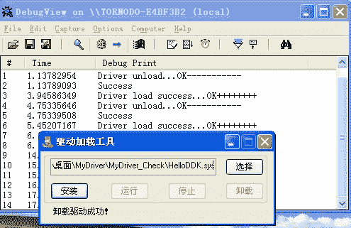

# 驱动加载工具

> 原文：[`www.pediy.com/kssd/pediy12/134776.html`](https://www.pediy.com/kssd/pediy12/134776.html)

新人，在学习的时候用 win32 汇编写的这个工具，原理很简单，加载驱动的时候就是创建一个服务，运行的时候就是启动服务，停止的时候是停止服务，卸载的时候删除服务。  
代码未优化，请高人指点。  

上传的附件
|  || DriverLoad.zip  
 |