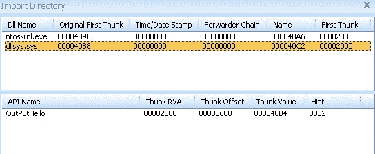
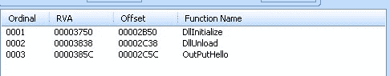

# ZwLoadDriver 用其他注册表路径加载驱动的办法~

> 原文：[`www.pediy.com/kssd/pediy12/142021.html`](https://www.pediy.com/kssd/pediy12/142021.html)

先上代码~  

代码:

```
#include <stdio.h>
#include <tchar.h>
#include   <locale.h>   
#include   <windows.h>   
#include <stdlib.h>
#include   <psapi.h>   
#include   <Tlhelp32.h>   
#pragma   comment   (lib,   "psapi.lib")
typedef struct \_UNICODE\_STRING {
  USHORT Length;
  USHORT MaximumLength;
  PWSTR Buffer;
} UNICODE\_STRING;
typedef UNICODE\_STRING \*PUNICODE\_STRING;
typedef struct \_STRING {
  USHORT Length;
  USHORT MaximumLength;
  PCHAR Buffer;
} ANSI\_STRING;
typedef ANSI\_STRING \*PANSI\_STRING;
DWORD drvldr\_load(char\* drvname)
{
  char regkey\[512\];
  int buflen;
  UNICODE\_STRING us;
  ANSI\_STRING as;
  HMODULE hNtdll = LoadLibraryA( ("ntdll.dll") );
  int (\_\_stdcall \*RtlAnsiStringToUnicodeString)(void\*,void\*,int)=
    (int (\_\_stdcall \*)(void \*,void \*,int))GetProcAddress(hNtdll,"RtlAnsiStringToUnicodeString");
  int (\_\_stdcall \*ZwLoadDriver)(void\*)=
    (int (\_\_stdcall \*)(void \*))GetProcAddress(hNtdll,"ZwLoadDriver");
  ///
  buflen=sprintf(regkey,"\\\\Registry\\\\Machine\\\\SOFTWARE\\\\%s",drvname);
  as.Buffer = (PCHAR)regkey;
  as.Length = (USHORT)buflen;
  as.MaximumLength=(USHORT)buflen;
  RtlAnsiStringToUnicodeString(&us, &as,TRUE);

  return ZwLoadDriver(&us);
}
DWORD drvldr\_reg(char\* drvname,DWORD start\_type,char\* path)
  //path should be kernel type like \\??\\xxx
{
  char regkey\[512\];
  DWORD regdata;
  int buflen;
  HKEY hkey;
  ///
  sprintf(regkey,"SOFTWARE\\\\%s",drvname);
  if(RegCreateKeyA(HKEY\_LOCAL\_MACHINE, regkey, &hkey)!=ERROR\_SUCCESS)
  {return -1;}
  regdata=SERVICE\_KERNEL\_DRIVER;
  RegSetValueExA(hkey, ("Type"), 0, REG\_DWORD, (const unsigned char \*)&regdata, 4);
  regdata=SERVICE\_ERROR\_NORMAL;
  RegSetValueExA(hkey, ("ErrorControl"), 0, REG\_DWORD, (const unsigned char \*)&regdata, 4);
  regdata = start\_type;
  RegSetValueExA(hkey, ("Start"), 0, REG\_DWORD, (const unsigned char \*)&regdata, 4);
  buflen = strlen(drvname);
  RegSetValueExA(hkey, ("DisplayName"), 0, REG\_EXPAND\_SZ, (const unsigned char \*)drvname, buflen);
  buflen = strlen(path); 
  RegSetValueExA(hkey, ("ImagePath"), 0, REG\_EXPAND\_SZ, (const unsigned char \*)path, buflen);
  RegSetValueExA(hkey,("Group"),0,REG\_SZ,(const BYTE \*)"Base",strlen("Base"));
  RegCloseKey(hkey); 
  //sprintf(regkey,"System\\\\CurrentControlSet\\\\Services\\\\%s",drvname);
  //RegCreateKeyA(HKEY\_LOCAL\_MACHINE, regkey, &hkey);
  //regdata=SERVICE\_KERNEL\_DRIVER;
  //RegCloseKey(hkey); 
  sprintf(regkey,"System\\\\Setup\\\\AllowStart\\\\%s",drvname);
  RegCreateKeyA(HKEY\_LOCAL\_MACHINE, regkey, &hkey);
  regdata=SERVICE\_KERNEL\_DRIVER;
  RegCloseKey(hkey); 
  return 0;
}
//Jan 4 2005
//Enable specific privilege
BOOL EnableSpecificPrivilege(BOOL bEnable,LPCTSTR Name)
{
  BOOL bResult = FALSE;
  HANDLE hToken;
  TOKEN\_PRIVILEGES TokenPrivileges;

  if(OpenProcessToken(GetCurrentProcess(),TOKEN\_QUERY | TOKEN\_ADJUST\_PRIVILEGES,&hToken) == 0)
  {
    return FALSE;
  }

  TokenPrivileges.PrivilegeCount = 1;
  TokenPrivileges.Privileges\[0\].Attributes = bEnable ? SE\_PRIVILEGE\_ENABLED : 0;
  bResult = LookupPrivilegeValue(NULL,Name,&TokenPrivileges.Privileges\[0\].Luid);
  if(!bResult)
  {
    CloseHandle(hToken);
    return FALSE;
  }

  bResult = AdjustTokenPrivileges(hToken,FALSE,&TokenPrivileges,sizeof(TOKEN\_PRIVILEGES),NULL,NULL);
  if(GetLastError() != ERROR\_SUCCESS || !bResult)
  {
    CloseHandle(hToken);
    return FALSE;
  }

  CloseHandle(hToken);
  return TRUE;
}

//Jan 4 2005
//Enable all privilege, return num of privileges successfully enabled
DWORD EnableAllPrivilege(BOOL bEnable)
{
  DWORD count=0; 
  ///
  count+=EnableSpecificPrivilege(bEnable,SE\_ASSIGNPRIMARYTOKEN\_NAME);
  count+=EnableSpecificPrivilege(bEnable,SE\_AUDIT\_NAME);
  count+=EnableSpecificPrivilege(bEnable,SE\_BACKUP\_NAME);
  count+=EnableSpecificPrivilege(bEnable,SE\_CHANGE\_NOTIFY\_NAME);
  count+=EnableSpecificPrivilege(bEnable,SE\_CREATE\_PAGEFILE\_NAME);
  count+=EnableSpecificPrivilege(bEnable,SE\_CREATE\_PERMANENT\_NAME);
  count+=EnableSpecificPrivilege(bEnable,SE\_CREATE\_TOKEN\_NAME);
  count+=EnableSpecificPrivilege(bEnable,SE\_DEBUG\_NAME);
  count+=EnableSpecificPrivilege(bEnable,SE\_INC\_BASE\_PRIORITY\_NAME);
  count+=EnableSpecificPrivilege(bEnable,SE\_INCREASE\_QUOTA\_NAME);
  count+=EnableSpecificPrivilege(bEnable,SE\_LOAD\_DRIVER\_NAME);
  count+=EnableSpecificPrivilege(bEnable,SE\_LOCK\_MEMORY\_NAME);
  count+=EnableSpecificPrivilege(bEnable,SE\_PROF\_SINGLE\_PROCESS\_NAME);
  count+=EnableSpecificPrivilege(bEnable,SE\_REMOTE\_SHUTDOWN\_NAME);
  count+=EnableSpecificPrivilege(bEnable,SE\_RESTORE\_NAME);
  count+=EnableSpecificPrivilege(bEnable,SE\_SECURITY\_NAME);
  count+=EnableSpecificPrivilege(bEnable,SE\_SHUTDOWN\_NAME);
  count+=EnableSpecificPrivilege(bEnable,SE\_SYSTEM\_ENVIRONMENT\_NAME);
  count+=EnableSpecificPrivilege(bEnable,SE\_SYSTEM\_PROFILE\_NAME);
  count+=EnableSpecificPrivilege(bEnable,SE\_SYSTEMTIME\_NAME);
  count+=EnableSpecificPrivilege(bEnable,SE\_TAKE\_OWNERSHIP\_NAME);
  count+=EnableSpecificPrivilege(bEnable,SE\_TCB\_NAME);
  count+=EnableSpecificPrivilege(bEnable,SE\_UNSOLICITED\_INPUT\_NAME);
  count+=EnableSpecificPrivilege(bEnable,SE\_MACHINE\_ACCOUNT\_NAME);

  return count;
}
int \_tmain(int argc, \_TCHAR\* argv\[\])
{
  EnableAllPrivilege(TRUE);
  drvldr\_reg("caonima",3,"\\\\??\\\\D:\\\\1.sys");
  drvldr\_load("caonima");
  return 0;
}

```

对于 1.sys 的有些特殊的要求，首先 1.sys 里的代码不会被真的执行，但是 1.sys 这个驱动导入的动态库驱动可以被执行  
举例下图：  
1.sys 的导入表样子：  
  
导入的 dllsys 的导出表样子：  
  
真正被执行的代码要写在动态库驱动的 NTSTATUS DllInitialize(IN PUNICODE\_STRING RegistryPath)里~~  
具体怎么写内核版动态库，请自行 baidu 研究。  
好了爆完~这个方法的好处就是写注册表的过程基本不触发任何报警至于加载部分，仁者见仁吧，这玩意 2005 年的东西了~