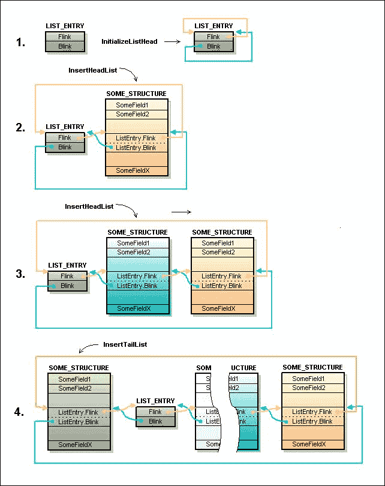

# Delphi 研究之驱动开发篇（五）--使用后备列表

> 原文：[`www.pediy.com/kssd/pediy10/59265.html`](https://www.pediy.com/kssd/pediy10/59265.html)

上篇教程我们介绍了驱动开发中如何使用系统内存堆，这一节让我们看看后备列表的使用。堆管理器管理着系统和用户堆，它把堆空间分为相同尺寸的块(block)。堆管理器会根据堆分配请求，去选择一个合适尺寸的未使用的块。显然，这个过程需要点时间。如果你需要固定尺寸的内存块，但是你事先并不知道它的大小和使用频率，这样的话为了性能的原因，你还是使用后备列表（Lookaside Lists）吧，后备列表是只有内核模式才有的。  
后备列表和系统内存池的主要的区别是什么呢？后备列表只可以分配固定大小的事先定义尺寸的内存块。后备列表会快很多，因为它不需要去搜索可用的未分配的内存。  
当你刚接触后备列表，你需要解决的问题不是怎么创建后备列表，而是管理你要分配的内存块。  
具体来说，你把你要使用和释放的内存存贮在哪里? 怎么存贮？这不是个简单的问题，因为你不知道块的数量。有三种结构来解决这个问题：  
◎ 单向链表(Singly linked list)  
◎ S-list 排序的单向链表（S-list, sequenced singly-linked list） (单向链表的改进)  
◎ 双向链表（Doubly linked list）  
  
我们将只接触双向链表，因为它最通用。  
如果你是第一次接触后备列表和双向链表这些概念，你会觉得下面的代码有点复杂，但实际上它们是非常简单的。  
后备列表（lookaside list）和双向链表（Doubly linked list）的英文名称都有一个"list"，但是它们是完全不同的。后备列表是一组事先分配的相同尺寸的内存块。这些块有些在使用，有些没被使用。当有内存分配请求的时候，系统会遍历这个列表寻找最近的未分配的块。如果未分配的块找到了，分配请求就很快被满足了。否则系统必须从分页或不分页内存池去分配。根据列表中分配行为发生的频率，系统会自动调整未分配块的数量来满足分配请求，分配的频率越高，会有越多的块被存储在后备列表中。后备列表如果总是不被使用，也会自动减少空间大小。  
双向链表是数据组织的一种形式。可以很方便地把同类结构连接在一起，并且很容易遍历。双向链表被系统广泛地使用来处理内部结构。  
  
我想了半天，也没有找到一个适合的简单的例子。所以下面这个驱动程序好像意义不大。但是可以帮助你理解相关的概念，还有双向链表。  
这里也没有提供驱动控制程序。你可以使用 KmdKit4D 包中的 KmdManager 或者类似的工具，还可以使用 DebugView 或 SoftICE 控制台来查看调试信息。  
  

代码:

```
unit LookasideList;

interface

uses
  nt\_status, ntoskrnl, macros;

function \_DriverEntry(pDriverObject: PDRIVER\_OBJECT;
                  pusRegistryPath: PUNICODE\_STRING): NTSTATUS; stdcall;

implementation

type
  PSOME\_STRUCTURE = ^SOME\_STRUCTURE;
  SOME\_STRUCTURE = record
    SomeField1: DWORD;
    SomeField2: DWORD;
    { . . .}                          {这里放入一些别的字段}
    ListEntry: LIST\_ENTRY;            {主角^\_^，可以放在结构的开始}
                                      {放在这里是为了演示的需要}
    { . . .}                          {这里放入一些别的字段}
    SomeFieldX: DWORD;
  end;

var
  g\_pPagedLookasideList: PPAGED\_LOOKASIDE\_LIST;
  g\_ListHead: LIST\_ENTRY;
  g\_dwIndex: DWORD;
  dwCnt: DWORD;

procedure AddEntry;
var
  pEntry: PSOME\_STRUCTURE;
begin
  {从后备列表中分配内存块}
  pEntry := ExAllocateFromPagedLookasideList(g\_pPagedLookasideList);
  if pEntry <> nil then
  begin
    DbgPrint('LookasideList: + Memory block allocated from lookaside list at address %08X'#13#10, pEntry);
    {初始化分配到的内存}
    memset(pEntry, 0, sizeof(SOME\_STRUCTURE));
    {一个节点可以添加到链表的头部、尾部或者其他地方，视个人喜好了}
    {本例添加到表头}
    InsertHeadList(@g\_ListHead, @pEntry^.ListEntry);
    {使用 SomeField1 保存表项的索引. 这是为了让我们能看见它在工作.}

    inc(g\_dwIndex);
    pEntry^.SomeField1 := g\_dwIndex;
    DbgPrint('LookasideList: + Entry #%d added'#13#10, pEntry^.SomeField1);
  end else
  begin
    DbgPrint('LookasideList: Very bad. Couldn''t allocate from lookaside list'#13#10);
  end;
end;

procedure RemoveEntry;
var
  pEntry, pTemp: pointer;
  ss: SOME\_STRUCTURE;
  offs: DWORD;
begin
  if IsListEmpty(@g\_ListHead) <> TRUE then
  begin
    {删除表项也一样，可以从头、尾或者其他地方删除,}
    {这里我们还是从头部开始删除.}

    {计算 offs 是因为 RemoveHeadList 返回的是 SOME\_STRUCTURE.ListEntry 的地址}
    {offs 就是 SOME\_STRUCTURE.ListEntry 到结构开始处的偏移量}
    offs := DWORD(@ss.ListEntry) - DWORD(@ss);

    {这里 pEntry ==> SOME\_STRUCTURE.ListEntry}
    {我们需要得到指向包含这个 ListEntry 的 SOMT\_STRUCTURE 结构的指针}
    {以便释放内存，用 pEntry - offs 即可得到结构的指针.}
    pEntry := RemoveHeadList(@g\_ListHead);

    {pTemp ==> SOME\_STRUCTURE，这里一定要弄明白}
    pTemp := pointer(DWORD(pEntry) - offs);
    DbgPrint('LookasideList: - Entry #%d removed'#13#10,
             PSOME\_STRUCTURE(pTemp)^.SomeField1);

    {向后备列表归还不用的内存}
    ExFreeToPagedLookasideList(g\_pPagedLookasideList, pTemp);
    DbgPrint('LookasideList: - Memory block at address %08X returned to lookaside list'#13#10, pTemp);
  end else
  begin
    DbgPrint('LookasideList: - An attempt was made to remove entry from empty lookaside list'#13#10);
  end;
end;

function \_DriverEntry(pDriverObject: PDRIVER\_OBJECT;
                      pusRegistryPath: PUNICODE\_STRING): NTSTATUS; stdcall;
begin
  DbgPrint(#13#10'LookasideList: Entering DriverEntry'#13#10);
  g\_pPagedLookasideList := ExAllocatePool(NonPagedPool, sizeof(PAGED\_LOOKASIDE\_LIST));
  if g\_pPagedLookasideList <> nil then
  begin
    DbgPrint('LookasideList: Nonpaged memory for lookaside list allocated at address %08X'#13#10,
             g\_pPagedLookasideList);
    ExInitializePagedLookasideList(g\_pPagedLookasideList, nil,
                                   nil, 0, sizeof(SOME\_STRUCTURE),
                                   $6D736157{'msaW'}, 0);
    DbgPrint('LookasideList: Lookaside list initialized'#13#10);
    InitializeListHead(@g\_ListHead);
    DbgPrint('LookasideList: Doubly linked list head initialized'#13#10);
    DbgPrint(#13#10'LookasideList: Start to allocate/free from/to lookaside list');
    g\_dwIndex := 0;
    dwCnt := 0;
    while dwCnt < 5 do
    begin
      AddEntry;
      AddEntry;
      RemoveEntry;
      inc(dwCnt);
    end;
    while true do
    begin
      RemoveEntry;
      if IsListEmpty(@g\_ListHead) = true then
      begin
        DbgPrint('LookasideList: List is empty'#13#10#13#10);
        break;
      end;
    end;
    {后备列表已清空，销毁之}
    ExDeletePagedLookasideList(g\_pPagedLookasideList);
    DbgPrint('LookasideList: Lookaside list deleted'#13#10);
    ExFreePool(g\_pPagedLookasideList);
    DbgPrint('LookasideList: Nonpaged memory for lookaside list at address %08X released'#13#10,
             g\_pPagedLookasideList);
  end else
  begin
    DbgPrint('LookasideList: Couldn''t allocate nonpaged memory for lookaside list control structure');
  end;
  DbgPrint('LookasideList: Leaving DriverEntry'#13#10);
  result := STATUS\_DEVICE\_CONFIGURATION\_ERROR;
end;

end.

```

代码:

```
g\_pPagedLookasideList := ExAllocatePool(NonPagedPool, sizeof(PAGED\_LOOKASIDE\_LIST));
if g\_pPagedLookasideList <> nil then
begin

```

我们分配 PAGED\_LOOKASIDE\_LIST 结构的非分页内存，这个结构用于管理后备列表，并把指针保存在变量 g\_pPagedLookasideList 中。注意：后备列表自身是可以分页的。例如，我们获取的内存可能被页出（page out）。文档关于这一点写的很清楚。  
代码:

```
ExInitializePagedLookasideList(g\_pPagedLookasideList, nil,
                                 nil, 0, sizeof(SOME\_STRUCTURE),
                                 $6D736157{'msaW'}, 0);

```

ExInitializePagedLookasideList 函数初始化我们上一步分配的 PAGED\_LOOKASIDE\_LIST 结构。这样后备列表就可以使用了。  
注意，在初始化时候，我们并没有指定我们需要多少块。那么系统怎么知道要准确地分配多少内存呢？实际上，内存如果事先没有分配，后备列表就不可能比常用的系统内存池要快了。问题就在于：开始的时候，系统分配只一点内存块（数量由系统来定义）。于是当我们开始从后备列表分配内存的时候，我们将获得这些预分配内存块的指针。每秒钟，系统都会调用 ExAdjustLookasideDepth 来调整所有的系统后备列表。调整的时候发现空闲的未分配块减少，系统就会分配新的内存块。这些额外分配的块的数量来自于后备列表的负载情况，例如：分配频率。系统会尽量调整让后备列表更有效。  
如果我们在调整时间内就耗尽了预分配内存块，系统就使用系统内存池，直到下一次调整。需要理解的一个重要问题是：如果内存分配速度太高，那么跟内存池分配方式比，就没有性能的优势了。你可以使用 MS Kernel Debugger 的命令"!lookaside"，评估你的后备列表的效率。  
  
代码:

```
InitializeListHead(@g\_ListHead);

```

我们可以调用 InitializeListHead 这个宏来双向链表的头。现在 LIST\_ENTRY 的两个域都包含了到结构自身的指针。这说明了双向链表是空的。  
  
  
  
代码:

```
g\_dwIndex := 0;

```

这个全局变量仅用来在后备列表分配的 SOME\_STRUCTURE 结构里放些内容，然后在调试信息里输出值来。  
代码:

```
dwCnt := 0;
while dwCnt < 5 do
begin
  AddEntry;
AddEntry;
RemoveEntry;
inc(dwCnt);
end;

```

循环 5 次。每次增加两个条目，删除一个条目。每个条目代表了某个结构。所有分配的结构都使用双向链表互相链接在一起。  
这个循环模拟了后备列表的随机分配过程。我们可以假设是为了保存一些数据而进行分配内存工作。如写一个驱动程序来截取某系统设备的调用（如截取 ZwOpenKey）时将截取的信息保存到分配的内存中，这时的内存分配动作就是类似的。  
  
代码:

```
while true do
begin
  RemoveEntry;
  if IsListEmpty(@g\_ListHead) = true then
  begin
    DbgPrint('LookasideList: List is empty'#13#10#13#10);
    break;
  end;
end;

```

现在我们有了一些用双向链表链接起来的后备列表条目分配块。我们假设我们又不需要他们了……  
我们在一个无限循环里调用 RemoveEntry 函数。RemoveEntry 从双向链表头删除一个条目，并释放回后备列表。这个循环一直运行，直到双向链表成空。可以使用 IsListEmpty 宏来检查这个状态。IsListEmpty 检查双向链表头(LIST\_ENTRY structure)的两个域是不是都指向链表头自己。  
这时，我们又回到了执行完 InitializeListHead 宏的状态了(参见图中的 1)。  
  
代码:

```
ExDeletePagedLookasideList(g\_pPagedLookasideList);

```

由于我们使用双向链表来管理后备列表的分配，当双向链表为空的时候，所有后备列表分配的条目都被归还。现在我就可以调用 ExDeletePagedLookasideList 来删除后备列表。这就释放了所有剩余的后备列表条目，然后删除了系统范围的活动的后备列表。  
  
代码:

```
ExFreePool(g\_pPagedLookasideList);

```

ExFreePool 释放了为 PAGED\_LOOKASIDE\_LIST 结构分配的不分页内存。如果你忘记了事先调用 ExDeletePagedLookasideList，你将会看见 BSOD, 因为一秒左右，系统就会调整丢失的后备列表。  
  
代码:

```
result := STATUS\_DEVICE\_CONFIGURATION\_ERROR;

```

由于我们释放了所有分配的资源，我们就可以卸载驱动程序了。  
以上内容很简单，尤其如果你学过《数据结构》这门课，或者以前接触过链表和队列这类概念的话。  
AddEntry 函数  
当我们需要一个新的内存块的时候我们调用 AddEntry。它会从后备列表分配一个新的条目，并增加到双向链表。  
  
代码:

```
pEntry := ExAllocateFromPagedLookasideList(g\_pPagedLookasideList);
if pEntry <> nil then
begin

```

我们调用 ExAllocateFromPagedLookasideList 就可以获得新的内存块指针，并保存在 esi 中。注意：我们没有告诉系统块的尺寸，因为尺寸在调用 ExInitializePagedLookasideList 就被定义--等于 SOME\_STRUCTURE 的尺寸。  
现在我们有了一个新的 SOME\_STRUCTURE 实例。我们就可以把它链到我们的双向链表了。在 AddEntry 第一次运行之前，双向链表还是空的。  
代码:

```
InsertHeadList(@g\_ListHead, @pEntry^.ListEntry);

```

图中的 2 描述了在第一个 InsertHeadList 调用后的状态。注意 InsertHeadList 的第二个参数，它不是 SOME\_STRUCTURE 的地址，而是它的 ListEntry 域的地址。例如：InsertHeadList 接收了这两个 LIST\_ENTRY 结构的地址，第一个是双向链表的头，第二个是我们需要链到这个双向链表的结构成员。InsertHeadList 链接这个新结构到双向链表的头（看图中的 3 的右边）。你可以使用 InsertTailList 链接到链表的尾部。  
如果你是往双向链表里第一次加条目，两个函数都产生同样的结果。以后就会象图中的 2 反映的那样了。  
如果当时双向链表不是空的话，InsertHeadList 就会在头部和条目右边之间分开双向链表，然后把新条目放在中间（见图中的 3）如果在尾部，也可以用 InsertTailList,效果一样。  
现在一切都很清楚了吧。  
  
代码:

```
inc(g\_dwIndex);
pEntry^.SomeField1 := g\_dwIndex;

```

我们在 SomeField1 保存新创建的表目的编号。你在 DbgView 中可以清楚地看到这些结构被增加和删除的顺序。  
  
RemoveEntry 函数  
RemoveEntry 函数和 AddEntry 相反。它把条目从双向链表头中解除链接，然后归还到后备列表。  
  
代码:

```
if IsListEmpty(@g\_ListHead) <> TRUE then
begin

```

确定双向链表是空的。  
pEntry := RemoveHeadList(@g\_ListHead);  
RemoveHeadList 把条目从双向链表中解除链接。你应该已经猜到 RemoveTailList 函数在尾部的时候可以做同样的事情了。而 RemoveEntryList 可以删除任何条目（当然包括尾部了）。  
这时，被解除的条目就独立存在了，双向链表把随后其余的条目链接在一起。  
  
代码:

```
offs := DWORD(@ss.ListEntry) - DWORD(@ss);
pTemp := pointer(DWORD(pEntry) - offs);

```

注意这里：RemoveTailList/RemoveHeadList/RemoveEntryList 返回了一个指针，这个指针指向了链表的头部或尾部或中间的条目(嵌入的 LIST\_ENTRY 结构)，却不会指向解除链接的 SOME\_STRUCTURE 结构自身。这些函数不知道 LIST\_ENTRY 在结构中的确切位置，也没有办法知道。这全靠你去计算 ListEntry 域在 SOME\_STRUCTURE 里的偏移，来获得指向自身结构的指针了（DDK 中的 CONTAINING\_RECORD 宏做这个事情，但这个宏在 Delphi 中却无法实现，所以只能用 offs := DWORD(@ss.ListEntry) - DWORD(@ss)这种方法去计算偏移量）。  
  
代码:

```
ExFreeToPagedLookasideList(g\_pPagedLookasideList, pTemp);

```

ExFreeToPagedLookasideList 将这个条目归还到后备列表或分页内存池。  
  
PS:本例子的源码已经打包放在 KmdKit 0.02 版里了，在[`bbs.pediy.com/showthread.php?t=58986`](http://bbs.pediy.com/showthread.php?t=58986)的第 14 楼