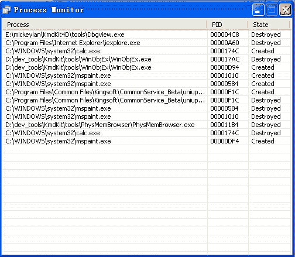
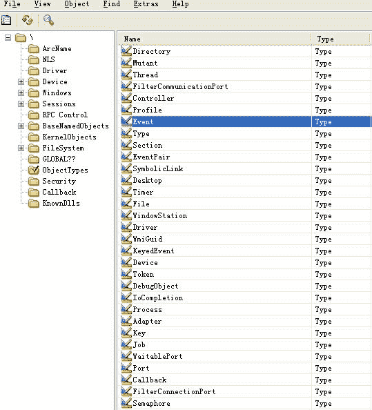
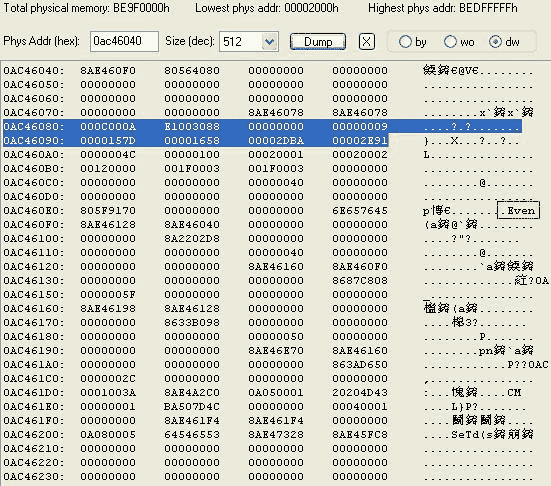
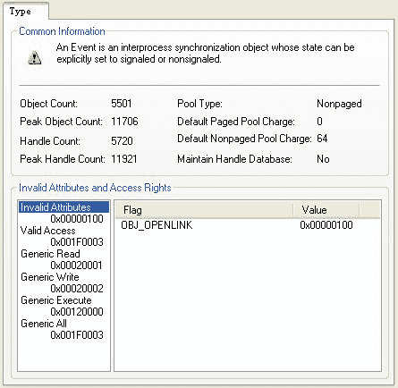

# Delphi 驱动开发研究（12）-- Shared Event

> 原文：[`www.pediy.com/kssd/pediy11/107123.html`](https://www.pediy.com/kssd/pediy11/107123.html)

假如我们需要实现一个驱动程序去收集一些操作系统的统计信息，并将这些信息发送给用户层的管理程序去处理，这就需要驱动程序与管理程序交互，如何实现这种功能呢？最简单的办法就是在管理程序里创建一个计时器，这个计时器每隔一定的间隔时间（例如，每秒一次）就触发一次，通过使用 DeviceIoControl 函数向驱动程序发送 I/O 控制码来收集统计信息（RegMon 和 FileMon 就是这样做的）。但是如果我们的驱动程序要收集的是一些不常发生的事件信息，比如我们要收集进程创建、销毁的信息，由于系统并非每时每刻都有进程创建或者销毁，所以定时执行 DeviceIoControl 往往都是白忙一场，获取不到任何信息。此时我们可以考虑增加触发定时器的间隔时间（例如，把间隔时间增加到 10 秒），但是如果间隔时间过长又可能会出现驱动程序已经收集到信息但是由于管理程序的定时器尚未被触发而导致未能及时获取统计信息的情况发生。显然，比较合理的方案应该是由驱动程序来决定管理程序什么时候获取统计信息，因为只有驱动程序才知道具体的事件是什么时候发生的，当事件发生后，驱动程序以某种方式通知管理程序，有事件发生，你可以获取数据了，此时管理程序再用 DeviceIoControl 向驱动程序发送控制码以获取最新的统计信息数据。  
事实上，Windows 给我们提供了两种比较好的方法可以让我们达到目的。一种方法是使用异步的 DeviceIoControl，这种方法要求用户在使用 CreateFile 创建对象时必须要设置 FILE\_FLAG\_OVERLAPPED 标志，同时填充一个 OVERLAPPED 结构并将其地址做为 CreateFile 的最后一个参数传递。异步 DeviceIoControl 调用可能返回的结果有三种：返回 TRUE，这说明驱动程序的分派子程序可以立即完成请求；返回 FALSE 并且调用 GetLastError 取得的错误码是 ERROR\_IO\_PENDING，这表明驱动程序的分派子程序返回 STATUS\_PENDING 并会在稍后完成控制操作。这里要注意的是，ERROR\_IO\_PENDING 并不代表真的出错了，它仅仅是一种系统表明任何事件正在被正常处理的途径而已；如果返回 FALSE 并且用 GetLastError 取得的错误码也不是 STATUS\_PENDING，那就是真的出错了。这里我们不打算详细讨论异步 DeviceIoControl 方法，有兴趣的话，您可以参考 DDK 或者 MSDN。另一种方法就是同步调用了，这种方法相对要容易些，这种方法要求在驱动程序和用户程序间共享一个事件，驱动程序通过这个事件对象向客户程序发送信号，客户程序收到信号后，就可以从驱动程序接收一些自己感兴趣的信息。  
如何才能共享事件呢？你可以使用一个命名对象，然后通过名字访问这个对象。我们之前在 SharedSection 的例子中就使用过这种方法。这种方法的基本技巧就是让该命名对象一直存在于内存中，所以缺点也就显而易见了，这个命名对象对所有进程都是可见的，但是即便如些，它也比使用无名对象要些。当然，我们还有更好的方法，就是先在客户程序中用 CreateEvent 创建一个对象，然后调用 DeviceIoControl 把事件句柄传递给驱动程序。在本章中我们将使用这种方法创建一个简单的进程监视器，这个监视器可以监视进程的创建与销毁。下面是 ProcessMon 管理程序运行时的截图：  
  
12.1 全局数据  
我们先来看一下 common.pas 中定义的一些全局数据。  

代码:

```
const
  IOCTL\_SET\_NOTIFY       = (FILE\_DEVICE\_UNKNOWN shl 16) or (FILE\_WRITE\_ACCESS shl 14) or ($800 shl 2) or METHOD\_BUFFERED;
  IOCTL\_REMOVE\_NOTIFY     = (FILE\_DEVICE\_UNKNOWN shl 16) or (0 shl 14) or ($801 shl 2) or 0;
  IOCTL\_GET\_PROCESS\_DATA = (FILE\_DEVICE\_UNKNOWN shl 16) or (FILE\_READ\_ACCESS shl 14) or ($802 shl 2) or METHOD\_BUFFERED;

  IMAGE\_FILE\_PATH\_LEN    = 512;

type
  {$RTTI EXPLICIT METHODS(\[\]) PROPERTIES(\[\]) FIELDS(\[\])}
  PROCESS\_DATA = packed record
    bCreate: DWORD;
    dwProcessId: DWORD;
    { full process's image file path }
    szProcessName: array\[0..IMAGE\_FILE\_PATH\_LEN - 1\] of AnsiChar;
  end;

```

  在这里，我们定义了三个控制码：IOCTL\_SET\_NOTIFY 使得驱动开始踪进程的创建和销毁；IOCTL\_REMOVE\_NOTIFY 的作用正好与 IOCTL\_SET\_NOTIFY 相反；IOCTL\_GET\_PROCESS\_DATA 则返回保存在 PROCESS\_DATA 结构里的进程信息，这个信息包括进程 ID、一个说明进程是被创建还是被销毁的标志以及相关进程的完整路径信息。  
  12.2 ProcessMon 的用户管理程序源码：  
代码:

```
unit main;

interface

uses
  Windows, Messages, SysUtils, Variants, Classes, Graphics, Controls, Forms,
  Dialogs, ComCtrls, WinSvc, common;

type
  TForm1 = class(TForm)
    lvProcessInfo: TListView;
    procedure FormActivate(Sender: TObject);
    procedure FormCreate(Sender: TObject);
    procedure FormClose(Sender: TObject; var Action: TCloseAction);
  private
    { Private declarations }
  public
    { Public declarations }
  end;

var
  Form1: TForm1;
  g\_hEvent: THandle;
  g\_fbExitNow: Boolean;
  g\_hDevice: THandle;

implementation

uses
  GetData;

var
  g\_hSCManager: THandle;
  g\_hService: THandle;
  tgd: TGetData;
{$R \*.dfm}

procedure TForm1.FormActivate(Sender: TObject);
var
  acModulePath: string;
  lpTemp: PChar;
  dwBytesReturned: DWORD;
begin
  g\_hSCManager := OpenSCManager(nil, nil, SC\_MANAGER\_ALL\_ACCESS);
  if g\_hSCManager <> 0 then
  begin
    acModulePath := GetCurrentDir + '\\' + ExtractFileName('ProcessMon.sys');
    g\_hService := CreateService(g\_hSCManager, 'ProcessMon',
                                'Process creation/destruction monitor',
                                SERVICE\_START or SERVICE\_STOP or \_DELETE,
                                SERVICE\_KERNEL\_DRIVER,
                                SERVICE\_DEMAND\_START,
                                SERVICE\_ERROR\_IGNORE,
                                PChar(acModulePath),
                                nil, nil, nil, nil, nil);
    if g\_hService <> 0 then
    begin
      if StartService(g\_hService, 0, lpTemp) then
      begin
        g\_hDevice := CreateFile('\\\\.\\ProcessMon', GENERIC\_READ or GENERIC\_WRITE,
                                0, nil, OPEN\_EXISTING, 0, 0);
        if g\_hDevice <> INVALID\_HANDLE\_VALUE then
        begin
          { No need it to be registered anymore }
          DeleteService(g\_hService);
          { Create unnamed auto-reset event to be signalled when there is data to read. }
          g\_hEvent := CreateEvent(nil, False, false, nil);
          { Create thread to wait event signalled. }
          tgd := TGetData.Create(False);
          if not DeviceIoControl(g\_hDevice, IOCTL\_SET\_NOTIFY,
                                 @g\_hEvent, SizeOf(g\_hEvent), nil, 0,
                                 dwBytesReturned, nil) then
          begin
            ShowMessage('无法设置通知!');
          end;
        end else
        begin
          ShowMessage('无法打开设备!');
        end;
      end else
      begin
        ShowMessage('无法启动驱动!');
      end;
    end else
    begin
      ShowMessage('无法注册驱动!');
    end;
  end else
  begin
    ShowMessage('无法连接到 SCM!');
  end;
end;

procedure TForm1.FormClose(Sender: TObject; var Action: TCloseAction);
var
  dwBytesReturned: DWORD;
  \_ss: SERVICE\_STATUS;
begin
  DeviceIoControl(g\_hDevice, IOCTL\_REMOVE\_NOTIFY,
                  nil, 0, nil, 0, dwBytesReturned, nil);

  g\_fbExitNow := true;  { If exception has occured not in loop thread it should exit now. }
  SetEvent(g\_hEvent);
  Sleep(100);

  CloseHandle(g\_hEvent);
  CloseHandle(g\_hDevice);

  ControlService(g\_hService, SERVICE\_CONTROL\_STOP, \_ss);

  DeleteService(g\_hService);

  CloseServiceHandle(g\_hService);
  CloseServiceHandle(g\_hSCManager);
end;

procedure TForm1.FormCreate(Sender: TObject);
begin
  if(MessageDlg('由于条件所限，本驱动仅在 Windows XP sp3 上做过测试，是否继续？',
    mtWarning, \[mbYes, mbNo\], 0, mbYes) = mrNo) then
  begin
    Application.Terminate;
  end;
end;

end.

```

  12.3 客户端程序说明  
  客户端程序比较简单，在 Form 的 OnActivate 事件处理函数中，我们加载驱动并启动它。如果启动成功则调用 CreateEvent 创建一个非信号态、自动重置的无名信号对象，并将其句柄保存在全局变量 g\_hEvent 中，接下来，创建一个线程用于与内核驱动交互。这里，我使用了 Delphi 的 TThread 对象。  
代码:

```
if not DeviceIoControl(g\_hDevice, IOCTL\_SET\_NOTIFY,
          @g\_hEvent, SizeOf(g\_hEvent), nil, 0,
                  dwBytesReturned, nil) then

```

接下来调用 DeviceIoControl 向驱动程序发送 IOCTL\_SET\_NOTIFY 控制码，并将事件对象句柄传送给驱动程序。如果成功，驱动程序就开始跟踪进程的创建和销毁，如果系统中有进程创建或者销毁，驱动程序就会设置事件对象到信号态以通知客户端程序有事情发生了，你可以获取信息了。  
  OnClose 事件处理函数完成退出前的清理工作，先调用 DeviceIoControl 函数向驱动程序发送 IOCTL\_REMOVE\_NOTIFY 控制码，让驱动程序停止跟踪，然后停止并卸载驱动。下面来看下线程对象。  
  12.4 线程对象  
代码:

```
unit GetData;

interface

uses
  Windows, WinSvc, Classes, common, ComCtrls, SysUtils, Dialogs;

type
  TGetData = class(TThread)
  private
    { Private declarations }
    ProcessData: PROCESS\_DATA;
    procedure FillProcessInfo;
  protected
    constructor Create(CreateSuspended: Boolean);
    procedure Execute; override;
  end;

implementation

{ 
  Important: Methods and properties of objects in visual components can only be
  used in a method called using Synchronize, for example,

      Synchronize(UpdateCaption);  

  and UpdateCaption could look like,

    procedure TGetData.UpdateCaption;
    begin
      Form1.Caption := 'Updated in a thread';
    end; 
    
    or 
    
    Synchronize( 
      procedure 
      begin
        Form1.Caption := 'Updated in thread via an anonymous method' 
      end
      )
    );
    
  where an anonymous method is passed.
  
  Similarly, the developer can call the Queue method with similar parameters as 
  above, instead passing another TThread class as the first parameter, putting
  the calling thread in a queue with the other thread.
    
}

{ TGetData }
uses
  main;

constructor TGetData.Create(CreateSuspended: Boolean);
begin
  inherited Create(CreateSuspended);
  Priority := tpHighest;
end;

procedure TGetData.FillProcessInfo;
var
  buffer: array\[0..1023\] of AnsiChar;
  rtnVal: DWORD;
  pTmp: PAnsiChar;
  tlItems: TListItem;
  iItemCnt: Integer;
begin
  { The path can be it the short form. Convert it to long. }
  { If no long path is found or path is in long form, GetLongPathName }
  { simply returns the specified path. }
  FillChar(buffer, SizeOf(buffer), 0);
  rtnVal := GetLongPathName(@processData.szProcessName, @buffer, SizeOf(buffer));
  if (rtnVal = 0) or (rtnVal >= SizeOf(buffer)) then
  begin
    { 1024 bytes was not enough. Just display whatever we've got from the driver. }
    { I want to keep the things simple. But you'd better to allocate more memory }
    { and call GetLongPathName again and again until the buffer size will }
    { satisfy the need. }
    pTmp := @processData.szProcessName;
  end else
    pTmp := @buffer;
  tlItems := Form1.lvProcessInfo.Items.Add;
  tlItems.Caption := string(pTmp);
  tlItems.SubItems.Add(Format('%8.8X', \[processData.dwProcessId\]));
  if ProcessData.bCreate <> 0 then
    tlItems.SubItems.Add('Created')
  else
    tlItems.SubItems.Add('Destroyed');
  iItemCnt := Form1.lvProcessInfo.Items.Count;
  Form1.lvProcessInfo.Items\[iItemCnt - 1\].MakeVisible(True);
end;

procedure TGetData.Execute;
var
  hThread: THandle;
  dwBytesReturned: DWORD;
begin
  { Place thread code here }
while True do
  begin
    if WaitForSingleObject(g\_hEvent, INFINITE) <> WAIT\_FAILED then
    begin
      if g\_fbExitNow then
        Break;

      if DeviceIoControl(g\_hDevice, IOCTL\_GET\_PROCESS\_DATA, nil, 0,
                         @ProcessData, SizeOf(ProcessData),
                         dwBytesReturned, nil) then
      begin
        Synchronize(FillProcessInfo);
      end;
    end else
    begin
      ShowMessage('Wait for event failed. Thread now exits. Restart application.');
      Break;
    end;
    Sleep(1);
  end;
end;

end.

```

  线程对象的作用就是等待驱动程序的通知，并在收到通知后从驱动程序获取信息并显示出来。  
代码:

```
constructor TGetData.Create(CreateSuspended: Boolean);
begin
  inherited Create(CreateSuspended);
  Priority := tpHighest;
end;

```

  一旦驱动程序里有最新的信息，我们就必须立即获取，否则信息就有可能被覆盖掉，因此，我们在构造函数中把线程的优先级设置成最高。当然在我们这个例子里是没必要这样做的，因为我们跟踪的进程的创建和销毁，这样的事件不会每时每刻都发生。  
代码:

```
while True do
  begin
  if WaitForSingleObject(g\_hEvent, INFINITE) <> WAIT\_FAILED then
    begin
    if g\_fbExitNow then
        Break;

    if DeviceIoControl(g\_hDevice, IOCTL\_GET\_PROCESS\_DATA, nil, 0,
            @ProcessData, SizeOf(ProcessData),
                      dwBytesReturned, nil) then
      begin
    Synchronize(FillProcessInfo);
    end;

```

接下来进入循环，等待驱动程序的通知，如果有通知到达，就调用 DeviceIoControl 向驱动发送 IOCTL\_GET\_PROCESS\_DATA 控制码获取数据，数据返回到 ProcessData 中，然后调用 FillProcessInfo 将信息显示到主窗体的 ListView 控件中。这里我们使用的是 VCL 控件，由于可视的 VCL 控件不支持多线程，所以我们用 Synchronize 函数，这里不讨论 TThread 的用法，您可以参考 Delphi 的相关文档。  
12.5 FillProcessInfo 函数  
有些时候，驱动程序返回的是短路径名（比如：C: \\ PROGRA ~ 1 \\ WinZip \\ WinZip32.EXE），我也不明白为什么会这样。解决这个问题的方法也很简单，我们只需要调用 windows 提供的 GetLongPathName 函数。GetLongPathName 的原型如下：  
代码:

```
function GetLongPathName(lpszShortPath: PWideChar; lpszLongPath: PWideChar;
                       cchBuffer: DWORD): DWORD; stdcall;
◎  lpszShortPath 是欲转换的短路径名字符串缓冲区
◎  lpszLongPath 是转换成长路径名的接收缓冲区
◎  cchBuffer 则是接收缓冲区的长度

```

函数成功返回转换成长路径名后的字符串的实际长度，如果接收缓冲区的长度太小不足以容纳转换后的长路径名字符串，那么函数会返回需要的缓冲区长度，这个长度包含空结束符，这个时候你就必须调整接收缓冲区的长度并重新调用 GetLongPathName。这里我偷懒就把接收缓冲区设置成 1024 个字节，大多数时候是够用的。  
代码:

```
Var
  buffer: array\[0..1023\] of AnsiChar;
  … …
FillChar(buffer, SizeOf(buffer), 0);
  rtnVal := GetLongPathName(@processData.szProcessName, @buffer, SizeOf(buffer));
  if (rtnVal = 0) or (rtnVal >= SizeOf(buffer)) then
  begin
    { 1024 bytes was not enough. Just display whatever we've got from the driver. }
    { I want to keep the things simple. But you'd better to allocate more memory }
    { and call GetLongPathName again and again until the buffer size will }
    { satisfy the need. }
    pTmp := @processData.szProcessName;
  end else
pTmp := @buffer;

```

12.6 ProcessMon 驱动程序源码  
  
代码:

```
unit ProcessMon;
{$POINTERMATH ON}

interface

uses
  nt\_status, common;

function \_DriverEntry(p\_DriverObject: PDRIVER\_OBJECT;
                  pusRegistryPath: PUNICODE\_STRING): NTSTATUS; stdcall;

implementation

uses
  ntoskrnl, fcall, macros, ProcPath;

var
  g\_usDeviceName, g\_usSymbolicLinkName: UNICODE\_STRING;
  g\_pkEventObject: PKEVENT;
  g\_fbNotifyRoutineSet: Boolean;
  g\_ProcessData: PROCESS\_DATA;
  g\_dwImageFileNameOffset: DWORD;

function DispatchCreateClose(p\_DeviceObject:PDEVICE\_OBJECT; p\_Irp:PIRP): NTSTATUS; stdcall;
begin
  p\_Irp^.IoStatus.Status := STATUS\_SUCCESS;
  p\_Irp^.IoStatus.Information := 0;

  IofCompleteRequest(p\_Irp, IO\_NO\_INCREMENT);
  result := STATUS\_SUCCESS;
end;

procedure DriverUnload(pDriverObject:PDRIVER\_OBJECT); stdcall;
begin
  IoDeleteSymbolicLink(@g\_usSymbolicLinkName);
  IoDeleteDevice(pDriverObject^.DeviceObject);
end;

procedure ProcessNotifyRoutine(dwParentId:HANDLE; dwProcessId:HANDLE; bCreate: DWORD); stdcall;
var
  peProcess: PVOID;   { PEPROCESS }
  fbDereference: Boolean;
  us: UNICODE\_STRING;
  \_as: ANSI\_STRING;
begin
  { reserve DWORD on stack }
  if PsLookupProcessByProcessId(dwProcessId, peProcess) = STATUS\_SUCCESS then
  begin
    //pop peProcess          ; -> EPROCESS
    fbDereference := True;  { PsLookupProcessByProcessId references process object }
  end else
  begin
    { PsLookupProcessByProcessId fails (on w2k only) with STATUS\_INVALID\_PARAMETER }
    { if called in the very same process context. }
    { So if we are here it maight mean (on w2k) we are in process context being terminated. }
    peProcess := IoGetCurrentProcess;
    fbDereference := False; {IoGetCurrentProcess doesn't references process object }
  end;
  g\_ProcessData.dwProcessId := dwProcessId;
  g\_ProcessData.bCreate := bCreate;

  memset(@g\_ProcessData.szProcessName, 0, SizeOf(IMAGE\_FILE\_PATH\_LEN));
  if GetImageFilePath(peProcess, @us) = STATUS\_SUCCESS then
  begin
    //lea eax, g\_ProcessData.szProcessName
    \_as.Buffer := @g\_ProcessData.szProcessName;
    \_as.MaximumLength := IMAGE\_FILE\_PATH\_LEN;
    \_as.\_Length := 0;

    RtlUnicodeStringToAnsiString(@\_as, @us, False);
    { Free memory allocated by GetImageFilePath }
    ExFreePool(us.Buffer);
  end else
  begin
    { If we fail to get process's image file path }
    { just use only process name from EPROCESS. }
    if g\_dwImageFileNameOffset <> 0 then
    begin
      memcpy(@g\_ProcessData.szProcessName, PAnsiChar(DWORD(peProcess) + g\_dwImageFileNameOffset), 16);
    end;
  end;
  if fbDereference then
  begin
    ObfDereferenceObject(peProcess);
  end;
  { Notify user-mode client. }
  KeSetEvent(g\_pkEventObject, 0, False);
end;

function DispatchControl(p\_DeviceObject:PDEVICE\_OBJECT; p\_Irp:PIRP): NTSTATUS; stdcall;
var
  liDelayTime: LARGE\_INTEGER;
  pIoStkLoc: PIO\_STACK\_LOCATION;
  UserHandle: Handle;
  lpExEventObjectType: PPointer;
  pObjectType: Pointer;
  rtnCode: NTSTATUS;
begin
  { Initialize to failure. }
  p\_Irp^.IoStatus.Status := STATUS\_UNSUCCESSFUL;
  p\_Irp^.IoStatus.Information := 0;
  pIoStkLoc := IoGetCurrentIrpStackLocation(p\_Irp);
  if pIoStkLoc^.Parameters.DeviceIoControl.IoControlCode = IOCTL\_SET\_NOTIFY then
  begin
    if pIoStkLoc^.Parameters.DeviceIoControl.InputBufferLength >= SizeOf(HANDLE) then
    begin
      if not g\_fbNotifyRoutineSet then    { For sure }
      begin
        UserHandle := Handle(p\_Irp^.AssociatedIrp.SystemBuffer^);
        lpExEventObjectType := GetImportFunAddr(@ExEventObjectType);
        pObjectType := PVOID(lpExEventObjectType^);
        rtnCode := ObReferenceObjectByHandle(UserHandle, EVENT\_MODIFY\_STATE,
                    pObjectType, UserMode, @g\_pkEventObject,
                    nil);
        if rtnCode = STATUS\_SUCCESS then
        begin
          { If passed event handle is valid add a driver-supplied callback routine }
          { to a list of routines to be called whenever a process is created or deleted. }
          rtnCode := PsSetCreateProcessNotifyRoutine(@ProcessNotifyRoutine, False);
          p\_Irp^.IoStatus.Status := rtnCode;
          if rtnCode = STATUS\_SUCCESS then
          begin
            g\_fbNotifyRoutineSet := True;
            DbgPrint('ProcessMon: Notification was set'#13#10);

            { Make driver nonunloadable }
            p\_DeviceObject^.DriverObject^.DriverUnload := nil;
          end else
          begin
            DbgPrint('ProcessMon: Couldn''t set notification'#13#10);
          end;
        end else
        begin
          p\_Irp^.IoStatus.Status := rtnCode;
          DbgPrint('ProcessMon: Couldn''t reference user event object. Status: %08X'#13#10, rtnCode);
        end;
      end;
    end else
    begin
      p\_Irp^.IoStatus.Status := STATUS\_BUFFER\_TOO\_SMALL;
    end;
  end else if pIoStkLoc^.Parameters.DeviceIoControl.IoControlCode = IOCTL\_REMOVE\_NOTIFY then
  begin
    { Remove a driver-supplied callback routine from a list of routines }
    { to be called whenever a process is created or deleted. }
    if g\_fbNotifyRoutineSet then
    begin
      rtnCode := PsSetCreateProcessNotifyRoutine(@ProcessNotifyRoutine, True);
      p\_Irp^.IoStatus.Status := rtnCode;
      if rtnCode = STATUS\_SUCCESS then
      begin
        g\_fbNotifyRoutineSet := False;
        DbgPrint('ProcessMon: Notification was removed'#13#10);
        { Just for sure. It's theoreticaly possible our ProcessNotifyRoutine is now being executed. }
        { So we wait for some small amount of time (~50 ms). }
        liDelayTime.HighPart := liDelayTime.HighPart or -1;
        liDelayTime.LowPart := ULONG(-1000000);

        KeDelayExecutionThread(KernelMode, False, @liDelayTime);

        { Make driver unloadable }
        p\_DeviceObject^.DriverObject^.DriverUnload := @DriverUnload;
        if g\_pkEventObject <> nil then
        begin
          ObfDereferenceObject(g\_pkEventObject);
          g\_pkEventObject := nil;
        end;
      end else
      begin
        DbgPrint('ProcessMon: Couldn''t remove notification'#13#10);
      end;
    end;
  end else if pIoStkLoc^.Parameters.DeviceIoControl.IoControlCode = IOCTL\_GET\_PROCESS\_DATA then
  begin
    if pIoStkLoc^.Parameters.DeviceIoControl.OutputBufferLength >= SizeOf(PROCESS\_DATA) then
    begin
      //mov eax, \[esi\].AssociatedIrp.SystemBuffer
      memcpy(p\_Irp^.AssociatedIrp.SystemBuffer, @g\_ProcessData, SizeOf(g\_ProcessData));
      p\_Irp^.IoStatus.Status := STATUS\_SUCCESS;
      p\_Irp^.IoStatus.Information := SizeOf(g\_ProcessData);
    end else
    begin
      p\_Irp^.IoStatus.Status := STATUS\_BUFFER\_TOO\_SMALL;
    end;
  end else
  begin
    p\_Irp^.IoStatus.Status := STATUS\_INVALID\_DEVICE\_REQUEST;
  end;
  { After IoCompleteRequest returns, the IRP pointer }
  { is no longer valid and cannot safely be dereferenced. }
  IofCompleteRequest(p\_Irp, IO\_NO\_INCREMENT);
  Result := p\_Irp^.IoStatus.Status;
end;

function GetImageFileNameOffset: DWORD;
var
  iCnt: Integer;
  iRtnVal: Integer;
  pTmp: PAnsiChar;
begin
  { Finds EPROCESS.ImageFileName field offset }
  { W2K    EPROCESS.ImageFileName = 01FCh }
  { WXP    EPROCESS.ImageFileName = 0174h }
  { WNET    EPROCESS.ImageFileName = 0154h }

  { Instead of hardcoding above offsets we just scan }
  { the EPROCESS structure of System process one page down. }
  { It's well-known trick. }

  pTmp := PAnsiChar(IoGetCurrentProcess);
  iCnt := 0;
  iRtnVal := 0;
  { one page more than enough. }
  while iCnt < $1000 do
  begin
    { Case insensitive compare. }
    iRtnVal := \_strnicmp(PAnsiChar(pTmp + iCnt), PAnsiChar('system'), 6);
    if iRtnVal = 0 then
      Break;
    Inc(iCnt)
  end;

  if iRtnVal = 0 then
  begin
    { Found. }
    Result := iCnt;
  end else
  begin
    { Not found. }
    Result := 0;
  end;
end;

function \_DriverEntry(p\_DriverObject: PDRIVER\_OBJECT;
                      pusRegistryPath: PUNICODE\_STRING): NTSTATUS; stdcall;
var
  status: NTSTATUS;
  pDeviceObject: PDEVICE\_OBJECT;
begin
  status := STATUS\_DEVICE\_CONFIGURATION\_ERROR;
  RtlInitUnicodeString(@g\_usDeviceName, '\\Device\\ProcessMon');
  RtlInitUnicodeString(@g\_usSymbolicLinkName, '\\DosDevices\\ProcessMon');
  if IoCreateDevice(p\_DriverObject, 0, @g\_usDeviceName,
                    FILE\_DEVICE\_UNKNOWN, 0, True,
                    @pDeviceObject) = STATUS\_SUCCESS then
  begin
    if IoCreateSymbolicLink(@g\_usSymbolicLinkName, @g\_usDeviceName) = STATUS\_SUCCESS then
    begin
      p\_DriverObject^.MajorFunction\[IRP\_MJ\_CREATE\] := @DispatchCreateClose;
      p\_DriverObject^.MajorFunction\[IRP\_MJ\_CLOSE\] := @DispatchCreateClose;
      p\_DriverObject^.MajorFunction\[IRP\_MJ\_DEVICE\_CONTROL\] := @DispatchControl;
      p\_DriverObject^.DriverUnload := @DriverUnload;

      g\_fbNotifyRoutineSet := False;
      memset(@g\_ProcessData, 0, SizeOf(g\_ProcessData));
      { it can be not found and equal to 0, btw }
      g\_dwImageFileNameOffset := GetImageFileNameOffset;

      status := STATUS\_SUCCESS;
    end else
        begin
      IoDeleteDevice(pDeviceObject);
    end;
  end;
  result := status;
end;

end.

```

  驱动程序由 processmon.pas 和 procpath.pas 两个文件组成，主要部分都位于 processmon.pas 中，procpath.pas 导出了一个公共函数 GetImageFilePath 用于取得进程映像文件的路径。限于篇幅，这里就不列出 procpath.pas 的源码了。  
  12.7 DriverEntry  
  在 DriverEntry 中，我们做了一项额外的工作从 EPROCESS 结构中取得 ImageFileName 字段的偏移。在 EPROCESS 结构中，ImageFileName 字段是这样定义的：  
ImageFileName: array \[0..15\] of AnsiChar;  
  这个字段不是空结束字符串，所以 ImageFileName 字段最多只能保存文件名的前 16 个字符。我们会把这个字段的内容复制到自定义结构 PROCESS\_DATA 中，但也仅在使用 GetImageFilePath 无法取得映像文件名的时候才会用到它。对于不同版本的 Windows 系统中，ImageFileName 字段在 EPROCESS 结构中的偏移也是不同的（win2k、winxp、win2k3 下，这个偏移依次是$1FC、$174 和$154），不过有个很简单的众所周知的方法可以定位这个偏移，你只需要逐字节向后搜索 EPROCESS 结构查找“system”这个字符串，它的位置就是 ImageFileName 字段的偏移地址。当然，由于这是个众所周知的方法，所以如果某些有心人修改了那个字符串的内容，我们的方法就失效了。不过至少我没有修改我自己的系统，所以这个方法在我的系统上是有效的，当运行 DriverEntry 时我们是处于系统上下文中。  
g\_dwImageFileNameOffset := GetImageFileNameOffset;  
  调用 GetImageFileNameOffset 函数将返回 ImageFileName 字段在 EPROCESS 结构中的偏移或者返回零（如果没找到）。GetImageFileNameOffset 函数很简单，我们来看下它是如何实现的。  
代码:

```
pTmp := PAnsiChar(IoGetCurrentProcess);
iCnt := 0;
  iRtnVal := 0;
  { one page more than enough. }
while iCnt < $1000 do
  begin
  { Case insensitive compare. }
    iRtnVal := \_strnicmp(PAnsiChar(pTmp + iCnt), PAnsiChar('system'), 6);
  if iRtnVal = 0 then
      Break;
  Inc(iCnt)
  end;

```

  首先调用 IoGetCurrentProcess 函数返回当前进程的 EPROCESS 结构的指针，有了这个值我们就可以从它的开始处逐字节向后搜索“system”这个字符串了，这里我们使用\_strnicmp 函数进行字符串比对，它会严格按照我们指定的长度进行字符串比较（这里的长度是 6 字节）。  
代码:

```
if iRtnVal = 0 then
  begin
  { Found. }
  Result := iCnt;
end else
  begin
  { Not found. }
  Result := 0;
end;

```

  如果找到“system”字符串，GetImageFileNameOffset 返回它的偏移值，没找到则返回 0。  
  12.8 对 IOCTL\_SET\_NOTIFY 控制码的处理  
  当驱动程序接收到用户管理程序发送过来的 IOCTL\_SET\_NOTIFY 控制码后，驱动程序就要开始跟踪进程的创建与销毁了。  
  在驱动中定义了一个全局变量 g\_fbNotifyRoutineSet，如果驱动程序已经在跟踪进程的创建与销毁，此变量的值为 True，否则为 False。所以我们在在收到 IOCTL\_SET\_NOTIFY 控制码时先要检查 g\_fbNotifyRoutineSet 的值，因为有可能此时驱动已经在跟踪进程的创建与销毁了。  
UserHandle := Handle(p\_Irp^.AssociatedIrp.SystemBuffer^);  
  UserHandle 就是用户程序传送过来的 Event 对象句柄。在以后的操作中，我们需要使用指向对象有指针而不是对象描述符，因此我们必须要对用户传递过来的数据进行有效性检查，然后取得用户程序的 Event 对象的指针，这一点在驱动程序中是非常重要的。ObReferenceObjectByHandle 函数可以替我们完成这项工作，它的原型是：  
代码:

```
function ObReferenceObjectByHandle(
    \_Handle: HANDLE;
    DesiredAccess: ACCESS\_MASK;
    ObjectType: PVOID;
    AccessMode: KPROCESSOR\_MODE;
    \_Object: PVOID;
HandleInformation: POBJECT\_HANDLE\_INFORMATION): NTSTATUS; stdcall;

◎  \_Handle 指定打开的对象句柄；
◎  DesiredAccess 指定对象的访问请求类型，需要指出，这里的访问类型依赖于具体的对象类型，请不要使用常用的访问权限；
◎  ObjectType 是一个指向对象类型的指针，在这里，对象类型可以是 PExEventObjectType、 PExSemaphoreObjectType、PIoFileObjectType、PPsProcessType、PPsThreadType、PSeTokenObjectType、PTmEnlistmentObjectType、PTmResourceManagerObjectType、PTmTransactionManagerObjectType、PTmTransactionObjectType，如果此参数为 nil，则由操作系统负责根据所传递的对象句柄去检查并匹配出对应的对象类型；
◎  AccessMode 指定访问检查的方式，有 UserMode 和 KernelMode 两种，一般较低级的驱动都使用 KernelMode；
◎  \_Object 用于接收返回的指向与对象句柄相关联的对象类型的指针；
◎  HandleInformation，这个参数在驱动程序中都设为 nil。

```

12.9 对象类型  
  本节将简要介绍一下 Windows 内核里提供的对象，Windows 2000 有 27 种内核对象，Windows XP 和 Windows 2003 则更多。我机器的操作系统是 Windows XP SP3，有 31 种内核对象，以下是我机器上内核对象类型的截图：  
  
以上对象都是真实存在于你的系统中的，点击它们中的任何一个都能取得与该对象相关的一些附加信息，每个对象都有一个 OBJECT\_TYPE 结构与之对应。  
  当操作系统被请求去创建一个新的内核对象时，操作系统会根据所要求的对象匹配正确的 OBJECT\_TYPE 结构。内核导出了部分对象类型结构（在 ntoskrnl.exe 中），比如用于描述 WindowStation 内核对象的 OBJECT\_TYPE 结构通过 ExWindowStationObjectType 变量导出，本例中使用的 Event 内核对象则通过 ExEventObjectType 变量导出。  
代码:

```
lpExEventObjectType := GetImportFunAddr(@ExEventObjectType);
pObjectType := PVOID(lpExEventObjectType^);
DbgPrint('ProcessMon: ExEventObjectType - %08X'#13#10,
        MmGetPhysicalAddress(pObjectType));

```

上述这段代码用于取得 ExEventObjectType 的地址，由于 Delphi 无法导入其他模块导出的变量，因此我们变通一下，将其当做函数导入，这样，其真实地址就保存在 IAT 中，每条导入函数的 IAT 记录有 6 字节，格式为 jmp ds:\[xxxxxxxx\]，机器码为 FF25xxxxxxxx，FF25 是长跳转的机器码，跳过这 2 字节就是需要的地址。这点与 C 中不同，需要注意。为了简化工作，我将取得导出变量的地址的操作写成 GetImportFunAddr 函数并放在 macros.pas 中，大家直接调用就可以了。这里取得的地址是虚拟地址，为了方便的用工具 dump 这段内存，我调用 MmGetPhysicalAddress 将其转换成物理地址，在我的系统里，ExEventObjectType 的物理地址是$0AC46040，dump 出来的内容如下：  
  
红框框住的是对象的名称，再看$0AC46090 开始处的四个地址，这四个地址分别是：TotalNumberOfObjects（系统中现有 Event 对象的总数量）、TotalNumberOfHandles（系统中已打开的 Event 对象句柄数）、HighWaterNumberOfObjects（系统中最多可同时存在的 Event 对象数）、HighWaterNumberOfHandles（系统中最多可同时存在的 Event 句柄数），它们的值分别是：$157D（5501）、$1658（5720）、$2DBA（11706）、$2E91（11921），这个数值与我们用相关的工具软件查看 Event 属性时得到的值是一致的，见下图：  
  
以上这些值是随时都会变化的，数值不同也是正常的，我只是截取的时机掌握的比较好，所以看着它们都是相同的^\_^。  
12.10 继续分析 IOCTL\_SET\_NOTIFY  
代码:

```
UserHandle := Handle(p\_Irp^.AssociatedIrp.SystemBuffer^);
lpExEventObjectType := GetImportFunAddr(@ExEventObjectType);
pObjectType := PVOID(lpExEventObjectType^);
DbgPrint('ProcessMon: ExEventObjectType - %08X'#13#10,
        MmGetPhysicalAddress(pObjectType));
rtnCode := ObReferenceObjectByHandle(UserHandle, EVENT\_MODIFY\_STATE,
            pObjectType, UserMode, @g\_pkEventObject,
            nil);

```

  首先取得从客户端程序传送过来的事件对象的句柄并保存到 UserHandle 中，接下来取得 ExEventObjectType 的地址，然后调用 ObReferenceObjectByHandle 取得指向 Event 对象的指针，如果成功，就会在 g\_pkEventObject 变量中返回指向客户端 Event 对象的指针。  
代码:

```
rtnCode := PsSetCreateProcessNotifyRoutine(@ProcessNotifyRoutine, False);
p\_Irp^.IoStatus.Status := rtnCode;

```

  接下来调用 PsSetCreateProcessNotifyRoutine 函数安装我们的回调函数 ProcessNotifyRoutine。PsSetCreateProcessNotifyRoutine 函数添加或者删除一个由驱动程序提供的回调函数到子程序列表中，这个列表里的程序会在系统创建或者锁毁一个进程时被调用，函数原型如下：  
代码:

```
Function PsSetCreateProcessNotifyRoutine(
NotifyRoutine: PCREATE\_PROCESS\_NOTIFY\_ROUTINE; 
Remove: Boolean): NTSTATUS; stdcall;
◎  NotifyRoutine 是一个函数指针，指向我们要安装的回调函数的地址；
◎  Remove 参数指定是安装回调函数还是删除回调函数，如果为 TRUE，则是删除回调函数，如果为 False 则是安装回调函数。

```

PCREATE\_PROCESS\_NOTIFY\_ROUTINE 是一个指向 TCREATE\_PROCESS\_NOTIFY\_ROUTINE 的函数指针，定义如下：代码:

```
TCREATE\_PROCESS\_NOTIFY\_ROUTINE = procedure(
    ParentId: HANDLE;
    ProcessId: HANDLE;
\_Create: Boolean); stdcall;

```

这个回调函数会接收到三个参数，ParentId 和 ProcessId 是指定进程的父进程 ID 和进程 ID，\_Create 参数表示进程是被创建（TRUE）还是被销毁（FALSE）。  
  可安装的回调函数的数量是有限制的，最多可以安装 8 个回调函数。DDK 的文档中特别强调如果你安装了回调函数，那么请记住在中止驱动前要删除它。类似的函数还有 PsSetCreateThreadNotifyRoutne、PsSetLoadImageNotifyRoutine，不过这两个函数与 PsSetCreateProcessNotifyRoutine 相比，少了 Remove 参数。  
代码:

```
if rtnCode = STATUS\_SUCCESS then
begin
g\_fbNotifyRoutineSet := True;
DbgPrint('ProcessMon: Notification was set'#13#10);

```

  如果成功安装回调函数，我们设置 g\_fbNotifyRoutineSet 标志。  
代码:

```
p\_DeviceObject^.DriverObject^.DriverUnload := nil;

```

  这里我们把 DriveUnload 置为空的目的是防止我们的驱动程序被过早的卸载，如果我们的客户端程序出错或者有其他程序卸载了我们的驱动程序，此时由于回调函数没有被删除，系统在创建或者销毁进程时仍然会调用我们残留在系统中的回调函数，这个显然是不允许的。  
  到了这里，一切都按我们的要求顺利实现了，现在要做的事情就是等待，等待系统中任何进程发生改变，一旦有这样的情况发生，我们的回调函数就将被调用。  
12.11 ProcessNotifyRoutine 回调函数  
代码:

```
if PsLookupProcessByProcessId(dwProcessId, peProcess) = STATUS\_SUCCESS then
begin
fbDereference := True;  { PsLookupProcessByProcessId references process object }
end else
begin
  peProcess := IoGetCurrentProcess;
fbDereference := False; {IoGetCurrentProcess doesn't references process object }
end;

```

  系统通过 dwProcessId 参数传送要创建或者销毁进程的进程 ID，我们需要的是与此进程关联的进程对象的指针。调用 PsLookupProcessByProcessId 函数并将 dwProcessId 参数传递给它，如果成功则返回一个与 dwProcessId 关联的进程的 EPROCESS 结构的引用指针。PsLookupProcessByProcessId 函数成功执行后会增加相关进程的 EPROCESS 结构的引用计数，所以在使用完之后一定要调用 ObDereferenceObject 去清除引用计数，由于在某些版本的 Windows 2000 上在同一进程上下文环境中调用 PsLookupProcessByProcessId 时会失败，如果发生这种情况时就需要调用 IoGetCurrentProcess 函数来取得 EPROCESS 结构指针，而 IoGetCurrentProcess 函数并不增加引用计数，所以在这里设置了一个变量 fbDereference，如果调用 PsLookupProcessByProcessId 成功返回，则此标志置为 True，否则置为 False，ProcessNotifyRoutine 回调函数在退出前判断些标志，如果为 True，则调用 ObDereferenceObject 清除对 EPROCESS 结构的引用计数。  
代码:

```
g\_ProcessData.dwProcessId := dwProcessId;
g\_ProcessData.bCreate := bCreate;

```

  这两行保存要创建或者销毁的进程的进程 ID 和标志（创建/销毁）。  
代码:

```
memset(@g\_ProcessData.szProcessName, 0, SizeOf(IMAGE\_FILE\_PATH\_LEN));
if GetImageFilePath(peProcess, @us) = STATUS\_SUCCESS then
begin
\_as.Buffer := @g\_ProcessData.szProcessName;
\_as.MaximumLength := IMAGE\_FILE\_PATH\_LEN;
\_as.\_Length := 0;

RtlUnicodeStringToAnsiString(@\_as, @us, False);
  { Free memory allocated by GetImageFilePath }
ExFreePool(us.Buffer);

```

  调用 GetImageFilePath 函数去取得创建或者销毁进程的完整映像路径名，如果成功，在 us.Buffer 中保存的就是 Unicode 格式的完整映像路径名，我们调用 RtlUnicodeStringToAnsiString 函数将其转换成 Ansi 格式，同时不要忘记释放 GetImageFilePath 函数为 us.Buffer 分配的内存空间。  
代码:

```
end else
begin
{ If we fail to get process's image file path }
{ just use only process name from EPROCESS. }
if g\_dwImageFileNameOffset <> 0 then
  begin
  memcpy(@g\_ProcessData.szProcessName, PAnsiChar(DWORD(peProcess) + g\_dwImageFileNameOffset), 16);
end;
end;

```

  如果 GetImageFilePath 返回失败，我们就无法取得进程的完整映像路径名，这时我们就只能提取 EPROCESS 结构里保存的进程名了，因为 EPROCESS 结构中定义的进程名字段长度只有 16 个字节，如果进程名长度超过 16 个字节，多余的部分会被截掉，因此这个字段就不是以空结束的字节串（ASCIIZ）了，因此我们把复制了全部的 16 个字节。  
代码:

```
KeSetEvent(g\_pkEventObject, 0, False);

```

  然后你就可以给客户端管理程序发送信号唤醒客户端线程，客户端线程向驱动程序发送 IOCTL\_GET\_PROCESS\_DATA 控制码收集进程信息。  
**未完待续**