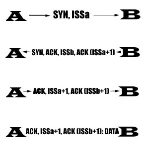
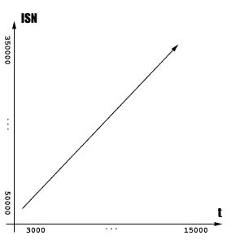
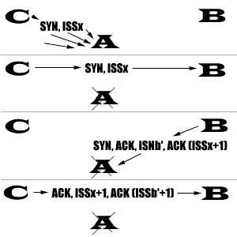

# TCP 劫持

> 原文：[`www.pediy.com/kssd/pediy12/133433.html`](https://www.pediy.com/kssd/pediy12/133433.html)

TCP 劫持  
此文自 http://www.techrepublic.com/article/TCP-hijacking/5033594 翻译而来，文章在翻译过程中根据译者个人理解有轻微改动。文章著作权归原作者所有，译者只保留中文著作权。本文只作为技术讨论之用，如因使用文中提到的技术而导致的任何良性和不良后果，本文概不负责。  
译者序：TCP 劫持是很老的技术，之所以翻译这篇文章是认为它揭示了系统可能存在的一些问题和 TCP 的协议的细节。此外，这篇文章详细阐述了在发起 TCP 劫持攻击时的细节思路。  
1.  前言  
2.  TCP 协议简介  
3.  如何发起 TCP 劫持  
4.  跨网段攻击  
a.  方法 1：猜测 ISN 数值  
b.  方法 2：利用信任关系进行 rsh 服务器攻击  
5.  总结  
1.前言  
不久前，TCP 劫持是入侵者获得对因特网服务器未授权访问的最流行手段之一。即便在如今，由于许多系统管理员仅仅是知道这样的潜在威胁但却并未了解其实现所使用的技术细节，导致 TCP 劫持仍然很常见。他们并不能阻止那些清楚了解他们工作的狡猾的黑客。为了建立有效的防范机制，你有必要了解 TCP 劫持的细节。这也是为什么我建议你先回顾 TCP 协议的原因。  
2.TCP 协议简介  
Transmission Control Protocol(TCP) 是 TCP/IP 分层协议模型中传输层的基本协议之一。TCP 协议使得数据包传输的纠错成为可能。它建立了从一台主机到另一台主机的逻辑连接－一种我们可以认为是不会发生错误的虚拟连接。TCP 协议的低层算法控制数据包队列和损坏数据包的重发。TCP 按数据包的 Sequence Number 域来处理它接收到所有数据包，并且将它们排序。所有这些对于虚拟连接都是透明的，并且将会随连接会话的结束而消失。TCP 协议是 TCP/IP 协议族中唯一提供额外数据包和连接认证识别机制的协议。而这恰好解释了为什么应用层的诸多协议，如 SMTP，FTP 和 TELNET 都使用 TCP 协议来访问远程主机。  
就 TCP 数据包的识别而言，TCP 包头由两个 32 位数组成，它们都被用作计数器，分别是 Sequence Number 和 Acknowledgment Number。另外还有个 6 位长的控制字段（也叫命令字段），可以是以下值：  
  URG: Urgent pointer field significant   
  ACK: Acknowledgment field significant   
  PSH: Push function   
  RST: Reset the connection   
  SYN: Synchronize Sequence Numbers   
  FIN: No more data from sender  
TCP 连接建立举例  
假设主机Ａ想要建立到主机Ｂ的 TCP 连接。则主机Ａ发送给主机Ｂ一个这样的数据包：  
A->B:SYN,ISSa  
在 A 发往 B 的信息中，命令字段的 SYN 置位，并且 Sequence Number 的初始值设置为 32 位数 ISSa。在主机 B 接收到这个数据包后，它作出响应：  
B->A：SYN,ACK,ISSb,ACK(ISSa+1)  
该响应消息设置命令字段为 SYN 和 ACK。主机 B 设置 Sequence Number 的初始值为 ISSb，并且设置 Acknowledgment Number 为 ISSa（从主机 A 发来的数据包）加 1。为完成三次握手，主机 A 发送数据包：  
A->B：ACK,ISSa+1，ACK（ISSb+1）  
该数据包设置命令字段为 ACK。而 Sequence Number 设置为 ISSa 加 1，Acknowledgment Number 设置为 ISSb 加 1.在该数据包发送之后，主机 A 就完成了 3 次握手。一个在主机 A 和 B 之间的 TCP 连接就建立了。从此，主机 A 就可以通过这条虚拟连接线路发送实际的数据了：  
A->B：ACK，ISSa+1，ACK（ISSb+1）；DATA  
你可以在下图中看到 TCP 连接建立的整个过程：  
  
  
3.如何发起 TCP 劫持  
在上面描述的 TCP 连接建立例子中，TCP 连接双方的唯一识别信息就是 Sequence Number 和 Acknowledgment Number 两个 32 位数。为了生成一个伪 TCP 数据包，入侵者唯一需要做的就是获得特定 TCP 连接的当前识别信息：Sequence Number 和 Acknowledgment Number。而另一方面，通过分析基于 TCP 实现的 FTP 和 Telnet 协议可以发现，识别 FTP 和 TELnet 数据包的工作都是由 TCP 协议处理，再无其他；因此，入侵者唯一需要做的就是获得特定 TCP 连接（如 TELNET 连接）的当前识别值，即当前的 Sequence Number 和 Acknowledgment Number。然后，入侵者从任意一台联网的主机，构造目标地址为特定 TCP 连接其中一方，源地址为另一方的 TCP 数据包即可。  
FTP 和 Telnet 协议都不会校验数据包来源的 IP 地址。当这些协议得到入侵者构造的伪数据包，协议会假设数据包是来源于 TCP 连接中另一方的合法数据包，并且发送响应包到（入侵者构造的数据包中设置的 IP 地址）。随后，原来的 TCP 连接会由于计数器不匹配而断开连接。  
对于上述类型的攻击，入侵者需要知道的仅仅是两个用于 TCP 协议识别信息的 32 位数的当前值。那如何获得该信息呢？如果攻击者和被攻击主机（以下简称靶机）在同一个网段或者靶机所有数据包都要通过攻击者所在的网段，那么攻击者所需要做的仅仅是捕获并分析网络通信数据。  
4.跨网段攻击  
  更复杂的是跨网段攻击-攻击者和靶机在不同的网段内。此时，获得 Sequence Number 和 Acknowledgment Number 就不那么容易了。入侵者此时有两种方法解决：第一种是使用数学方法猜测 TCP 连接的初始数值；第二种方法是利用 TCP 连接中的识别部分，通过 rsh 服务攻击。  
方法 1：猜测 ISN 数值  
关于网络的算法是如何生成初始的序列数值（Initial Sequence Number，ISN）的呢？显然，从安全的角度，最好是通过软件或硬件的具有极大周期的随机数发生器来随机生成 ISN。从而，每个新的 ISN 不依赖于前一个 ISN 的值；所以，攻击者即使想要从理论上找到一个 ISN 发生器的函数关系都是不可行的。  
然而，TCP 协议说明的作者和操作系统内核开发者并没有完全实现这样的 ISN 随机发生器。例如，TCP 协议说明建议该 32 位计数器每 4 微妙增 1。那么，在实际的实现中又是怎样的呢？在早期的伯克利兼容的 UNIx 内核中，该计数器的值每秒增 128 并且每个新连接增 64。分析 Linux 内核源代码可以知道，Linux 并非随机生成 ISN，而是依赖当前时间的变量（mcs 代表以微妙计的当前时间，s 是从 epoch 得到的以秒计的当前时间）：  
ISN=mcs+s\*1000000  
在其他系统中也同样存在这个问题，Windows NT 4.0 系统，ISN 的值每毫秒乘 10 倍（ms 表示毫秒计的时间）：  
ISN=ms\*10  
如果操作系统的网络子系统使用时间相关的 ISN 发生器，入侵者就能找到某个函数，该函数能够覆盖所有可能的 ISN 值。由于该函数与具体的操作系统实现相关，入侵者可以构造一个通用的 ISN 发生器函数（mcs 是以微妙通常是最小的计时单位，这依赖于具体硬件计的时间，ms 是以毫秒计的时间，s 是以秒计的时间）：  
ISN=F(mcs,ms,s);  
这是通用公式，我们可以假设 ISN 发生器函数依赖于微妙。最后，最可能有用的函数往往是一个简单的线性函数。  
当我们指定了 ISN 猜测的相关基本单位和函数依赖后，就距离获得操作系统的 ISN 发生器更近了。首先，可以分析操作系统内核的源代码。通常操作系统的源代码是不能得到的，除了 Linux 和三种 BSD 变体，它们都是开源的。  
因此，入侵者需要通过其他的方式获得 ISN 发生器和 mcs 参数之间的函数依赖关系。通常，入侵者把操作系统当作黑盒，并实现请求-应答测试。大量的正常 TCP 连接建立请求被发往受害系统，随后入侵者在每个时间间隔内，接收到同等数量（不考虑丢包等因数）的当前 ISN 值。入侵者以微妙为单位，记录应答的时间周期。最终，入侵者将得到一张包含离散 ISN 值和对应时间值的表（ISNn 是从测试开始起在时间 tn 时 ISN 的值，测试开始时间定义为 0）：  
ISN0  ISN1  ISN2 ~ISNn-1  ISNn  
t0  t1  t2~tn-1  tn  
现在，入侵者可以很容易根据上述对应表，通过数学方法生成 ISN 的函数依赖关系：ISN=f(t)，此处自变量 t 是 t0~tn 之间的值。  
当得到 ISN 发生器函数之后，入侵者就能很容易从上个 ISN 的值得到其他 ISN 值，从而能够基于时间预测下个可能的 ISN。  
由于网路数据包传输的往返时间关系，往返时间越短越有可能得到可靠的函数关系。往返时间越长，入侵者就越要考虑往返时间这个环境因素。（译者注：可以在得到函数关系前，测试往返时间。如大家熟知的 ping -t 命令。通过求得平均往返时间来考虑这个因素的影响。最理想的就是在稳定的网络环境下得到 ISN 函数关系。）当然，其实入侵者其实不必直接在受害机上测试函数关系，完全可以测试一台和受害机具有同样操作系统的主机，然后在其上做 ISN 函数测试。  
现在来看下在实际中 Linux 和 Windows NT 4.0 系统的实际结果。下面是 Linux 系统在有限时间周期内的示例结果：  
ISN  65135  134234  202324  270948  338028  
t  2759  5685  8560  11462  14303  
下图则是上表内容的图形表示：  
在得到服务器和客户机操作系统的 ISN 发生函数后，攻击者则开始侦听服务器系统，并且等待从客户机发来的连接请求。当连接建立后，攻击者计算在连接建立时使用的可能的 ISN 值。由于攻击者计算得到的 ISN 值是在有限范围内的可能值，攻击者将不得不猜测结果。当然，如果攻击者不得到函数关系而直接猜测，将必须猜测 2⁶⁴ 次，这是不现实的。而作了上述分析之后，攻击者大约需要发送 10000 个数据包来完全囊括所有可能的正确值。  
方法 2：利用信任关系进行 rsh 服务器攻击  
所有 Unix 类系统都有信任主机的概念。所有（译者注：在一个网络环境中，任何一台主机 A 度可以试图登录和访问到 lan/internet 的一台主机 B，这台 unix 主机 B 为安全起见可以拒绝任何用户登录自己的系统，也可以有选择的让某些用户登录自己的系统。如果该主机 B 对某些用户特别信任，就像人们对自己的好朋友和家人特别信任一样，就不需要他们提供用户密码直接登录自己的系统，省去了身份的验证。  
主机 A 始终信任远程网络上的某一台 unix 主机 B，那么就把主机 B 称为信任主机，而把信任主机上的用户称为信任用户。详见：http://dbblog.itpub.net/post/23779/212812）信任主机都能不经身份验证 和识别信息直接访问服务器。为通过信任主机不经身份验证访问服务器，必须使用远程服务（r-service）协议。大多数 Unix 类系统都有 rhost 文件，其中列举了信任主机的主机名和 ip 地址。每个远程服务都使用这个文件确定一台主机是否是信任主机。信任主机的唯一识别信息就是 ip 地址。几乎所有远程服务都使用 TCP 协议作为基础协议。  
远程服务中有个程序是远程 shell，即 rsh。rsh 能让信任主机发送命令到受害机的 shell 上并执行。在这种攻击中，仅仅发送命令，但却不能收到执行结果。对于攻击者来说，最大的困难就是需要发送源地址为信任主机 IP 地址的数据包，所以所有的结果数据都被发送到信任主机，而不会发送到攻击机。  
R.T. Morris 第一个提出这种提出这种攻击模式，下图描述了这种攻击的细节：  
  
设主机 A 存在于主机 B 的信任列表，C 是攻击机。C 向 B 的 TCP 端口（如邮件，echo 等）打开一个 TCP 连接。主机 C 就得到了 B 当前的 ISNb 值。C 伪装成 A，并向 B 发起 TCP 连接请求：  
C(A)->B:SYN,ISSx  
当 B 收到请求，它分析数据包的源 IP 地址，并认为是从信任主机 A 发来的数据。主机 B 以新的 ISNb’发送响应包到 A：  
B->A:SYN,ACK,ISNb’,ACK(ISSx+1)  
因此，主机 C 不会收到这个响应包。使用前一个 ISNb 和攻击者获得的生成 ISNb’的方法，主机 C 能够发送新的数据包到 B：  
C(A)->B:ACK,ISSx+1,ACK(ISNb’+1)  
为发送这个数据包，主机 C 必须尝试各种可能的 ISNb’+1 的可能值。  
当数据包发送成功，并被主机 B 认为是合法后，攻击者必须解决下面的问题。当主机 B 收到响应后，它认为这是从 A 发来的数据包，它会发出连接确认到主机 A。但由于 A 并没有发送过任何数据，A 会发出 RST 置位的包到主机 B，使得该连接被重置（即关闭）。因此攻击机 A 必须使用拒绝服务攻击来使得 A 无法响应主机 B。  
结果，主机 B 上的远程服务 r-service 会认为他已经建立与信任主机 A 之间的 TCP 连接，而实际上这是来自攻击机 C 的连接。攻击者 C 将能够通过 r-service 在主机 B 上执行命令，但却不能收到任何的回显数据。  
5.总结：  
TCP 劫持技术是一种很老的技术。在凯文\*米特尼克，世界头号黑客，在 1995 年使用 TCP 劫持侵入 Tsutomu Shimomura 的工作站并且 TCP 劫持技术细节被公布后，它很快成为黑客手中的重要手段。为实施这样的攻击，攻击者必须具备一些专业的知识。当然，操作系统的开发者总能够找到一些策略来防御这种攻击，或者至少设置障碍。  
这种技术现在已经很少使用，但是我必须说因特网上大约 35%的主机仍然存在这种潜在威胁。这并非操作系统的问题，而是信任主机和信任服务的问题，如 rsh，rlogin 和 rcmd。