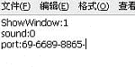
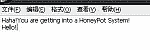

# 【原创】编写端口监视工具

> 原文：[`www.pediy.com/kssd/pediy10/103087.html`](https://www.pediy.com/kssd/pediy10/103087.html)

【破文标题】编写端口监视工具   
【破文作者】demoscene  
【作者邮箱】  
【工具】VC++6.0  
【平台】xp sp3  
【软件简介】我以前写的一个东西  
\------------------------------------------------------------------------------------------------  
【声明】得到了某大牛对我指点，我决定在论坛发表我的笫一篇文章，再次感谢大牛的指点！  
\------------------------------------------------------------------------------------------------  
  
  
  
有一天(具体是哪一天我忘记了)，一)时心血来潮，想学网络编程，就学了两天 ，写了这个所谓的端口监听工具  
  
大牛别笑，虽然这东西和驱动防为墙这些比起来或许没什么技术含量,但是对我这种小鸟来说 ，想法和在编写的过程中遇到问并解决是能学到很多东西的。  
  
其实我写这个东西的时候只看了书中介绍怎么写一个聊天工具，就想利用这一点东西能不能写出一点东西，聊天工具是不想写了，因为网上这样的文章一大把，大部分介绍网络编程的书都会用聊天工具作为例子，想想聊天工具中服务端  
  
是通过监听某一特定的端口来接收消息的，又联想到防火墙中也有监听端口的功能，于是就想到我也可以用这种方法来实现监听端口的功能，但是书中介绍的聊天工具只是监听一个端口，怎么实现监听多个端口呢？  
对了，我们可以用多线程，要监听多少个端口我们就开多少个线程，虽然这样效率低下，恕我愚昧，我只能想到这种方法，我知道防火墙用的肯定不是这种方法  
  
设计如下:  
1.为了让程序不那么死板，我们让程序能作一些参数的设置：  
1.要监听的端口  
2.发现有人连接到被监听的端口时是否声音提示  
3.程序运行时是否显示程序窗口  
我们用一个文件 config.ini 来保存这些参数信息  
来看看 config.ini  
  
其中 ShowWindow 字段表示是否显示端口，1 表示显示，0 表示不显示  
sound 字段表示是否有提示声音，1 表示有，0 表示没有  
port 字段表示要监听的端口，各端口这间用 '-' 隔开  
2. 当有人连接到我们的端口的时候我们给出提示，对方连接的时间日期，连接我们的哪个端口，对方的 IP,并给            对方发送一条人们自定义的消息，消息内容，人们作文件 Message.ini 来保存  
当对方断开连接的时候，我们同样给出对方的 IP，断开的日期时间，  
我们来看看 Message.ini，里面是随便的一些信息  
  
3.我们用文件 log.log 来保存所有的日志记录，方便我们不在的时候可以在以后查看  
  
有了思路，我们开工  
打开 VC6.0 新建一个工程，Win32 Console Application,输入工程名 HoneyPot，确定,选择一个支持 MFC 的程序(用 MFC 是为了在写多线程的时候可以偷一下懒,  
  
  

引用: // HoneyPot.cpp : Defines the entry point for the console application.  
//  
  
#include "stdafx.h"  
#include "HoneyPot.h"  
  
#ifdef \_DEBUG  
#define new DEBUG\_NEW  
#undef THIS\_FILE  
static char THIS\_FILE\[\] = \_\_FILE\_\_;  
#endif  
  
/////////////////////////////////////////////////////////////////////////////  
// The one and only application object  
  
CWinApp theApp;  
  
using namespace std;  
  
int \_tmain(int argc, TCHAR\* argv\[\], TCHAR\* envp\[\])  
{  
  int nRetCode = 0;  
    
  // initialize MFC and print and error on failure  
  if (!AfxWinInit(::GetModuleHandle(NULL), NULL, ::GetCommandLine(), 0))  
  {  
    // TODO: change error code to suit your needs  
    cerr << \_T("Fatal Error: MFC initialization failed") << endl;  
    nRetCode = 1;  
  }  
  else  
  {  
    // TODO: code your application's behavior here.  
    CString strHello;  
    strHello.LoadString(IDS\_HELLO);  
    cout << (LPCTSTR)strHello << endl;  
  }  
    
  return nRetCode;  
}  

  
上面是 VC 给我们生成的代码,我们把一些注释等一些不必要的东西去去，让大空看着舒服一些，  
  
  

引用: #include "stdafx.h"  
#include "HoneyPot.h"  
#include "stdio.h"  
#include "winsock2.h"  //Winsock 头文件  
#include "conio.h"  
#pragma comment (lib,"ws2\_32")   //ws2\_32.lib 库  
#ifdef \_DEBUG  
#define new DEBUG\_NEW  
#undef THIS\_FILE  
static char THIS\_FILE\[\] = \_\_FILE\_\_;  
#endif  
  
CWinApp theApp;  
  
using namespace std;  
  
int \_tmain(int argc, TCHAR\* argv\[\], TCHAR\* envp\[\])  
{  
  int nRetCode = 0;  
    
  if (!AfxWinInit(::GetModuleHandle(NULL), NULL, ::GetCommandLine(), 0))  
  {  
    cerr << \_T("Fatal Error: MFC initialization failed") << endl;  
    nRetCode = 1;  
  }  
  else  
  {  
    //我们在这里开始我们的代码  
    system("title 系紧要微型蜜罐系统 1.0");   //调用 DOS 设置标题  
    cout<<"Listening..........."<<endl;  
    HWND hWnd=FindWindow("ConsoleWindowClass",NULL);     
    char Text\[22\]={'0'};  
    char Text2\[\]="系紧要微型蜜罐系统 1.0";  
    readport();  //调用 readport 函数  
  }  
    
  return nRetCode;  
}  

下面来看 readport 函数  
  

引用: //函数的主要功能是读取 config.ini 中的信息，并根据这些信息做一些初始化工作  
//其实这里主要是一些字符串处理，其实大家可以直接用系统提供的 API 来直接操作 INI 文件  
//由于当时我设计这个东西的时候还没有见过 GetProfileInt， GetProfileSection，GetProfileString 等等这些函数，所以就直接读取文件，  
//这样做的一个缺点就是要进行很多的字符串处理，不过还好我有先见之明，用了 MFC（笑）  
int readport()  
{  
  FILE \*fp;  
  fp=fopen("config.ini","r");    //以只读方式打开 config.ini  
  if (fp==NULL)  
  {  
    MessageBox(NULL,"打开 config.ini 失败",NULL,MB\_OK);  
    ExitProcess(0);  
  }  
  char str\[500\]={'0'};     //定义字符串变量，用来保存 config.ini 的内容     
  fread(str,1,500,fp);     //读取 config.ini 的内容保存到 str  
  CString strShow;        //strShow 用来保存 config.ini 的 ShowWindow 字段  
  fclose(fp);                   
  CString tmp=\_T("");  
  tmp.Format("%s",str);     //把 str 也就是 config.in 中的内容复制一份到 tmp  
  strShow=tmp.Mid(11,1);    //取 ShowWinsow 的值,Mid(11,1)表示从秭 11 个字符开始取一个字符，就是 ShowWindow 的值  
  if (strShow=='0')              //判断 ShowWindow 的值是否为 0,如果为 0 则隐藏程序窗口  
  {  
    HWND hWnd=FindWindow("ConsoleWindowClass",NULL);       //获取程序窗口的的句柄，其中 ConsoleWindowClass 是控制台的的类名，因为我们的程序刚运行时是处于最前端，所以获取到的是我们程序的句柄，而不会    
      
    //获取到其他控制台程序的窗口的句柄  
    ShowWindow(hWnd,SW\_HIDE);      //隐藏窗口  
  }  
    
  tmp.Delete(0,26);    //删除前 26 个字符，剩下的就是端口的设置信息  
  int iPrev=0;  
  CString tmp2=\_T("haha");    //这个"haha"是随便的一个字符串，只要不是空就行，是为了让下面的 while 循环条件为真  
  while (tmp2!="")      //这个 while 循环读取设置的端口信息，并为每个端口 创建一个建线程进行监听  
  {  
      
    tmp2=\_T("");  
    int iPos=0;  
    count=tmp.Find('-',iPrev);    //查找第一个 '-' 字符的位置  
    iPos-=iPrev;      //用 iPos 减去 iPrev,其中 iPrev 保存的是前一个 '-' 的位置  
    tmp2=tmp.Mid(index,iPos);    //取两一个 '-' 字符之间的内容，就是我们的一个端口号  
    iPrev+=iPos+1;      //更新 iPrev 的值  
    if (str2=="")      //如果我们取到的端口号为空，退出循环  
    {  
      break;  
    }  
    char PortTmp\[1024\]={'0'};    //这里和下面几句实现将取到的端口号转换为 int 类型  
    sprintf(PortTmp,"%s",tmp2);    //......  
    int Port;        //......  
    Port=atoi(PortTmp);    //转换成 int 类型  
    AfxBeginThread(PortThread,(LPVOID)Port);    //创建一个新线程，所有的监听工作都在线程函数 PortThread  中完成  
  }  
  return 0;  
    
} 

  
下面来看 PortThread 函数  
  
  

引用: UINT PortThread(LPVOID lParam)  
{  
  WSADATA wsaData;  
  sockaddr\_in local;        //创建 SOCKET 的时候需要用到的结构，大家可以看 MSDN  
  int wsaret=WSAStartup(0x101,&wsaData);  //我们用 1.1 版本的 Winsock 库，调用 WSAStartup 函数来初始化 WSADATA 结构和加载 Winsoc 库的函数  
  if (wsaret!=0)        //调用成功，函数返回 0,  
  {  
    return 0;        //返回不为 0,退出程序  
  }  
  UINT iPort=(UINT)lParam;      //保存端口到 iPort  
        local.sin\_family=AF\_INET;    //下面 3 句是初始化 local  
        local.sin\_addr.S\_un.S\_addr=INADDR\_ANY;  
        local.sin\_port=htons(iPort);    //绑定传进来的端口   
          
        SOCKET server=socket(AF\_INET,SOCK\_STREAM,0);  //创建 SOCKET  
        if (server==INVALID\_SOCKET)      //如果创建失败，就退出程序  
        {  
          return 0;  
        }  
        if (bind(server,(sockaddr\*)&local,sizeof(local))!=0)    //bind 把 local 和 SOCKET 关联起来  
        {  
          return 0;          //失败，退出程序员  
        }  
        if (listen(server,200)!=0)        //listen 等待连接，指定等待队列的最大数目为 200  
        {  
          return 0;          //调用失败，退出程序  
        }  
          
        SOCKET client;  
        sockaddr\_in from;      
        int fromlen=sizeof(from);  
        while(1)            //进入循环  
        {  
          char temp\[512\]="0";  
          client=accept(server,(sockaddr\*)&from,&fromlen);    //accept 函数从等待队列中接收一个连接,接收到后继续执行下面的操作，否则进入睡眠状态  
          FILE \*thFile;          //下面几句读取 config.ini 中的 sound 字段，有点乱，为什么不在上面一起读  
          thFile=fopen("config.ini","r");  
            if (thFile==NULL)  
          {  
            MessageBox(NULL,"打开 config.ini 失败",NULL,MB\_OK);  
            ExitProcess(0);  
          }  
          char thRead\[30\]={'0'};  
          fread(thRead,1,30,thFile);  
          fclose(thFile);  
          CString strTh;  
          strTh.Format("%s",thRead);  
          CString thSound=\_T("");  
          thSound=strTh.Mid(19,1);        //thSound 保存 sound 字段的值  
          if (thSound=='1')          //如果值为 1，则声音提示  
          {  
            for (int i=0;i<10;i++)      //声音响 10 次  
            {  
              printf("%s","\\007");      //用标准出错流声音提示  
              Sleep(100);      //间隔 100 毫秒，速度较快  
            }  
            for (int j=0;j<10;j++)      //再声音提示 10 次，速度慢一点的  
            {  
              printf("%s","\\007");  
              Sleep(300);  
            }  
          }  
          SYSTEMTIME time;  
          GetLocalTime(&time);  //获取当前时间  
          FILE \*fp;  
          fp=fopen("log.log","a+");  //打开 log.log 文件，准备写入信息  
          char fileTemp\[126\]={'0'};  
          sprintf(fileTemp,"\\r\\n 发现目标:%s 攻击断口:%d 日期 %d-%d-%d 时间 %d:%d:%d\\r\\n",inet\_ntoa(from.sin\_addr),ntohs                          
              
            (local.sin\_port),time.wYear,time.wMonth,time.wDay,time.wHour,time.wMinute,time.wSecond);  //格式化字符串,from.sin\_addr 是对方的 IP  
          cout<<fileTemp<<endl;  //将信息输出到控制台窗口  
            
          fwrite(fileTemp,sizeof(char),strlen(fileTemp),fp);    //将信息写入到日志文件 log.log 中  
          fclose(fp);  
          CFileStatus rStatus;  
          CFile::GetStatus("Message.ini",rStatus);      
          if (rStatus.m\_size!=0)  //判断 Message.ini 是否为空  
          {  
            CStdioFile file;  
            if(!file.Open("Message.ini",CFile::modeRead))    
            {  
              cout<<"打开文件失败\\r";  
              return 0;  
            }  
            CString strText=\_T("");  
              
            while (file.ReadString(strText))  //读取 Message.ini 的内容  
            {  
              char tmp\[9000\]={'0'};  
                
              sprintf(tmp,"%s\\r\\n",strText);  
                
              send(client,tmp,sizeof(tmp),0);  //将 Message.ini 的内容发送给对方  
              strText=\_T("");  
            }  
              
            file.Close();  
              
              
          }  
          else  
          {  
            ;  //如果 Message.ini 为空，什么也不做  
          }  
            
          char recvstr\[256\];  
          int recvnum;  
          if((recvnum=recv(client,recvstr,256,0))==0)  //判断对方是否断开了连接  
          {  
              
              
            GetLocalTime(&time);  
            char in\[100\]={'0'};  
            sprintf(in,"目标:%s 已经断开连接 日期 %d-%d-%d 时间 %d:%d:%d",inet\_ntoa                      
                
            (from.sin\_addr),time.wYear,time.wMonth,time.wDay,time.wHour,time.wMinute,time.wSecond);  //如果断开了连接，将断开的信息输出到控制台  
            FILE \*infp;  
            infp=fopen("log.log","a+");  
           if (infp==NULL)  
            {  
              MessageBox(NULL,"打开 config.ini 失败",NULL,MB\_OK);  
              ExitProcess(0);  
            }  
            fwrite(in,sizeof(char),strlen(in),infp);    //将断开的信息写入日志文件  
              fclose(fp);  
            cout<<in<<endl;  
          }  
        }  
        closesocket(server);    //关闭 SOCKET  
        WSACleanup();    //释放 Winsock 库  
        return 0;  
} 

  
程序分析完了，附件里有完整的代码，  
可以到这里下载测试程序,http://www.crsky.com/soft/19032.html 

上传的附件
|  || new.rar  
 |