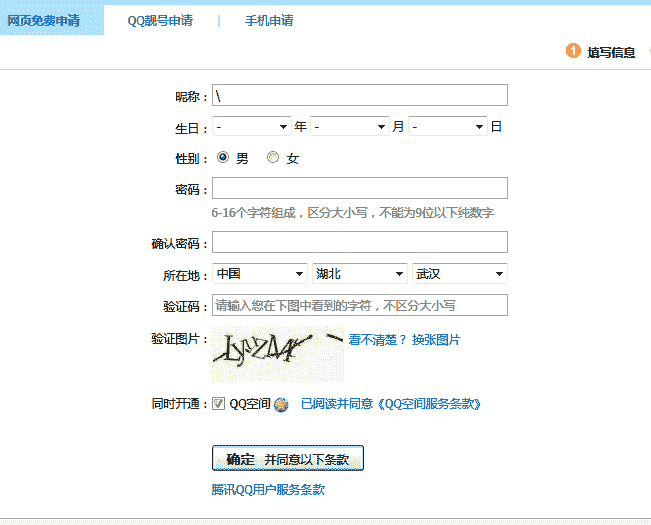
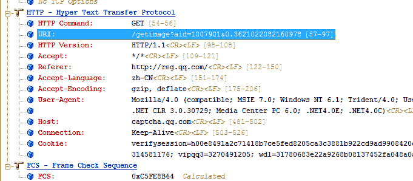
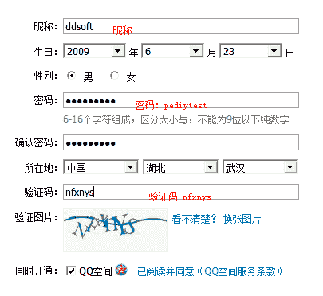
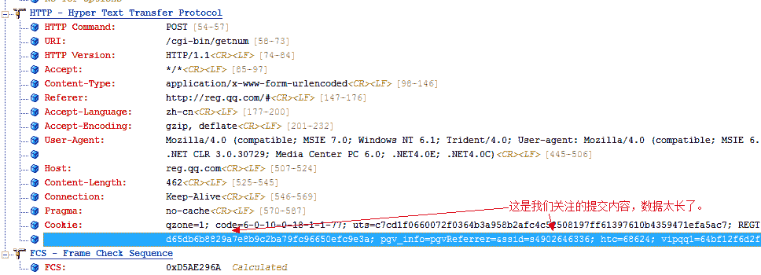
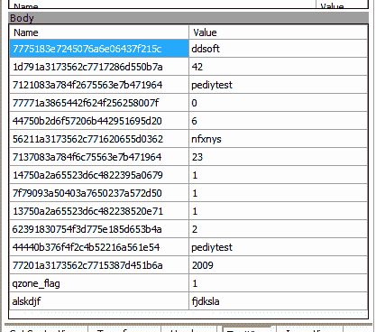

# QQ 号申请工具 编写原理

> 原文：[`www.pediy.com/kssd/pediy12/139450.html`](https://www.pediy.com/kssd/pediy12/139450.html)

大家都知道现在有很多申请 QQ 号的软件，只要填写软件上的验证码，就可以帮你自动申请一个 QQ，并保存下来。 它简化了 注册的流程。  
  
  
通常这类软件有两种，一个编程时用了 IE 的控件，直接向这些表单填写数据，另一种就是今天要讲的，用封包的方法来实现自动申请 QQ。  
  
想一下，我们面临的难题有：  
1.验证码的 gif 图片在哪，如何让程序获取图片，并显示出来。  
2.http 请求中包的分析和构建。  
当然第二个是重点。  
  
先完成第一项任务。  
我们打开 www.reg.qq.com ，会有这个 http 请求  
  
用文字就是：  
GET: http://captcha.qq.com/getimage?aid=1007901&0.3621022082160978  
Accept: \*/\*  
Referer: http://reg.qq.com/  
Accept-Language: zh-CN  
Accept-Encoding: gzip, deflate  
User-Agent: Mozilla/4.0 (compatible; MSIE 7.0; Windows NT 6.1; Trident/4.0; User-agent: Mozilla/4.0 (compatible; MSIE 6.0; Windows NT 5.1; SV1; http://bsalsa.com) ; SLCC2; .NET CLR 2.0.50727; .NET CLR 3.5.30729; .NET CLR 3.0.30729; Media Center PC 6.0; .NET4.0E; .NET4.0C)  
Host: captcha.qq.com  
Connection: Keep-Alive  
\---------------------------------------------  
http://captcha.qq.com/getimage?aid=1007901&0.3621022082160978  
看这个 url,有两个数据，是否是定值呢。  
再重新登陆 reg.qq.com,会发现 aid=后面的数字没有变，但第二个数据变化了。  
这个很容易理解，因为每次登陆会有不同的验证码嘛。  
  
但第一个数据，仔细看看之前发的包，就会知道 1007901，是 GetDay 产生的，过一天可能就加 1 了。呵呵！但今天无论怎么换验证码，都不会改变的。  
  
OK。 gif 图片已经获取。  
 

代码:

```
char  szAccept\[\]   = "Accept: \*/gif";
    char  szReferer\[\]   = "Referer:  http://reg.qq.com/\\r\\n\\r\\n";
  CString strBuffer   = \_T("");
  CString  strRecv     = \_T("");

  HINTERNET  hSession;   
  HINTERNET   hConnect;   
  HINTERNET   hRequest;   
  BOOL    bReturn   = FALSE;
  CString str=\_T("/getimage?aid=1007901&0.0022421072022002497");
  // 之前使用 Socket，现在使用 Wininet 相关 API 建立链接
  hSession = InternetOpen("InetAll",INTERNET\_OPEN\_TYPE\_PRECONFIG,NULL,NULL,0);
  hConnect = InternetConnect(hSession,"captcha.qq.com",INTERNET\_DEFAULT\_HTTP\_PORT,NULL,NULL,INTERNET\_SERVICE\_HTTP,0,1);
  hRequest = HttpOpenRequest(hConnect,"GET",str,NULL,"http://reg.qq.com/",(PCSTR\*)szAccept,INTERNET\_FLAG\_RELOAD,1);

  // 提交数据表单
  
  bReturn = HttpSendRequest(hRequest,NULL,-1,NULL,0);
  if(!bReturn)
  {
    MessageBox("发送 Http 请求失败！","提示",MB\_ICONERROR | MB\_OK);
    return FALSE;
  }

        //之后就是生成图片了。
  hFile.Open("temp.dat",CFile::modeWrite | CFile::modeCreate,NULL);
    
         InternetReadFile(hRequest,szRecvBuf,1024,&dwNumberOfBytesRead);
 
    }
```

1.2  怎么在 VC 的对话框窗口上显示出这个图片呢。  
　在此结出了一种借助于 COM 接口的 OLE 方法来实现上述功能  
　要使用 IPicture 的 COM 接口，其主要的接口是 IPicture 和 IPictureDisp，后者是由 IDispatch 接口派生以便通过自动化对图像的属性进行访问。图像对象也支持外部接口 IPropertyNotifySink，以便用户能在图像属性发生改变时作出决定。图像对象也支持 IPersistStream 接口，所以它能从一个 IStream 接口的实例对象保存、装载自己，而 IStream 接口也支持对流对象的数据读写。  
  
　　我们可以用函数 OleLoadPicture 从包含有图像数据的流中装载图像。该函数简化了基于流的图像对象的创建过程，可以创建一个新的图像对象并且用流中的内容对它进行初始化。其函数原型为：  
  
STDAPI OleLoadPicture( IStream \* pStream, //指向包含有图像数据的流的指针  
LONG lSize, //从流中读取的字节数  
BOOL fRunmode, //图像属性对应的初值  
REFIID riid, //涉及到的接口标识，描述要返回的接口指针的类型  
VOID ppvObj // 在 rrid 中用到的接口指针变量的地址) ;  
  
先将图片数据放入内存  
代码:

```
bool CQQ 号申请工具 Dlg::LoadPic(CString m\_path)
{
  IStream \*pStm;
  CFileStatus fstatus;
  CFile file;
  LONG cb; 
  if (file.Open(m\_path,CFile::modeRead)&&file.GetStatus(m\_path,fstatus)&& ((cb = fstatus.m\_size) != -1))
  {
    HGLOBAL hGlobal = GlobalAlloc(GMEM\_MOVEABLE, cb);
     LPVOID pvData = NULL;
     if (hGlobal != NULL)
       {
        if ((pvData = GlobalLock(hGlobal)) != NULL)
          {
            file.Read(pvData, cb);
            GlobalUnlock(hGlobal);
          CreateStreamOnHGlobal(hGlobal, TRUE, &pStm);
          }
       }
  }
  return TRUE;
}
```

为工程加一个 IPicture \*pPic 变量。  
直接调用 OleLoadPicture 函数从流中装载图像：  
  
OleLoadPicture(pStm,fstatus.m\_size,TRUE,IID\_IPicture,(LPVOID\*)&pPic));  
  
　　由于该函数有时会导致失败，所以应当用 SUCCEEDED 宏来做一些适当的保护工作,只有在数据装载成功的前提下才能继续下面的图像显示工作：  

代码:

```
int CQQ 号申请工具 Dlg::DrawPic(int x, int y, CDC\* pDC){  if(SUCCEEDED(OleLoadPicture(pStm,fstatus.m\_size,TRUE,IID\_IPicture,(LPVOID\*)&pPic)))  {    OLE\_XSIZE\_HIMETRIC hmWidth;    OLE\_YSIZE\_HIMETRIC hmHeight;     pPic->get\_Width(&hmWidth);     pPic->get\_Height(&hmHeight);    double fX,fY;    fX = (double)pDC->GetDeviceCaps(HORZRES)\*(double)hmWidth/((double)pDC->GetDeviceCaps(HORZSIZE)\*100.0);    fY = (double)pDC->GetDeviceCaps(VERTRES)\*(double)hmHeight/((double)pDC->GetDeviceCaps(VERTSIZE)\*100.0);    if(FAILED(pPic->Render(\*pDC,0,0,(DWORD)fX,(DWORD)fY,0,hmHeight,hmWidth,-hmHeight,NULL))) {      AfxMessageBox(\_T("渲染图像失败！"));      pPic->Release();  }      }   return 0;}
```

OK。测试下没有问题。第一步已经完全完成。  
  
2.现在开始进入 http 协议的处理。  
这里有一个非常 重要的 http 请求。。。之后的加密就靠它了。。  
  
GET:  http://reg.qq.com/cgi-bin/checkconn?seed0.9770701186312112  
  
Accept: \*/\*  
Accept-Language: zh-cn  
Referer: http://reg.qq.com/  
Accept-Encoding: gzip, deflate  
User-Agent: Mozilla/4.0 (compatible; MSIE 7.0; Windows NT 6.1; Trident/4.0; User-agent: Mozilla/4.0 (compatible; MSIE 6.0; Windows NT 5.1; SV1; http://bsalsa.com) ; SLCC2; .NET CLR 2.0.50727; .NET CLR 3.5.30729; .NET CLR 3.0.30729; Media Center PC 6.0; .NET4.0E; .NET4.0C)  
Host: reg.qq.com  
Connection: Keep-Alive  
  
  
seed 这个单词一看就知道是随机数。这个 http 请求,每次它会更新两个数组。  
包含 13 个值。 对应于网页上的所有内容。  
如密码，年，月，日，验证码 等等。  
  
我们看下这个 http 请求的返回内容。  
g\_dataArray=new Array(new Array("77201a3173562c7715387d451b6a","44440b376f4f2c4b52216a561e54","62391830754f3d775e185d653b4a","13750a2a65523d6c482238520e71","7f79093a50403a7650237a572d50","14750a2a65523d6c4822395a0679","7137083a784f6c75563e7b471964","56211a3173562c771620655d0362","44750b2d6f57206b442951695d20","77771a3865442f624f256258007f","7121083a784f2675563e7b471964","1d791a3173562c7717286d550b7a","7775183e7245076a6e06437f215c"),  
new Array(9759,9745,9748,9758,9752,9747,9755,9744,9754,9750,9749,9751,9753),"/cgi-bin/getnum");  
  
这里可能看不明白。  
我将这些数据逆序，并整理下  
"7775183e7245076a6e06437f215c"  
"1d791a3173562c7717286d550b7a",  
"7121083a784f2675563e7b471964",  
"77771a3865442f624f256258007f",  
"44750b2d6f57206b442951695d20",  
"56211a3173562c771620655d0362",  
"7137083a784f6c75563e7b471964",  
"14750a2a65523d6c4822395a0679",  
"7f79093a50403a7650237a572d50",  
"13750a2a65523d6c482238520e71",  
"62391830754f3d775e185d653b4a",  
"44440b376f4f2c4b52216a561e54",  
"77201a3173562c7715387d451b6a",  
  
看看我们在网页上申请后，所提交的 http 请求。  
  


数据太长，我列出来。  
  
POST : http://reg.qq.com/cgi-bin/getnum  
  
Accept: \*/\*  
Content-Type: application/x-www-form-urlencoded  
Referer: http://reg.qq.com/#  
Accept-Language: zh-cn  
Accept-Encoding: gzip, deflate  
User-Agent: Mozilla/4.0 (compatible; MSIE 7.0; Windows NT 6.1; Trident/4.0; User-agent: Mozilla/4.0 (compatible; MSIE 6.0; Windows NT 5.1; SV1; http://bsalsa.com) ; SLCC2; .NET CLR 2.0.50727; .NET CLR 3.5.30729; .NET CLR 3.0.30729; Media Center PC 6.0; .NET4.0E; .NET4.0C)  
Host: reg.qq.com  
Content-Length: 462  
Connection: Keep-Alive  
  
提交的数据：  
7775183e7245076a6e06437f215c=ddsoft&1d791a3173562c7717286d550b7a=42&7121083a784f2675563e7b471964=pediytest&77771a3865442f624f256258007f=0&44750b2d6f57206b442951695d20=6&56211a3173562c771620655d0362=nfxnys&7137083a784f6c75563e7b471964=23&14750a2a65523d6c4822395a0679=1&7f79093a50403a7650237a572d50=1&13750a2a65523d6c482238520e71=1&62391830754f3d775e185d653b4a=2&44440b376f4f2c4b52216a561e54=pediytest&77201a3173562c7715387d451b6a=2009&qzone\_flag=1&alskdjf=fjdksla  
列成表格形式一目了然。  
  
  
主要是发包时加密字串是固定顺序，但表单中的 value 顺序与 产生的第二个数组有关。  
因为第二个数据全部为数字，猜测与数字大小有关。我这里没有继续研究，有兴趣的朋友发表下你的成果。  
最后，感谢你的支持！  
  
不知能不能骗个精华。呵呵！