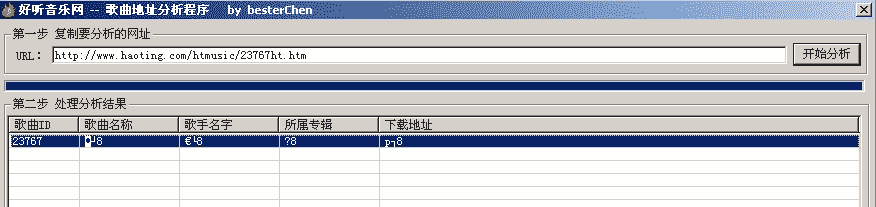
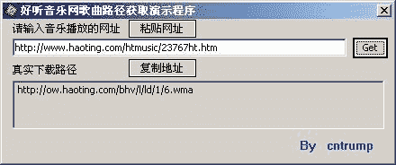

# 杀鸡焉用牛刀，再探好听音乐网

> 原文：[`www.pediy.com/kssd/pediy10/92326.html`](https://www.pediy.com/kssd/pediy10/92326.html)

看了破船兄的文章[【原创】好听音乐网 -- 歌曲下载分析流程及程序的编写](http://bbs.pediy.com/showthread.php?t=92286)，我也来写一个。破船的代码是智慧型的，我来个猛士型的。。  
  
打开好听音乐网的首页，随便点一首歌来听，出现了播放界面，同时音乐也出来了，这时查看源文件，容易发现如下关键代码  

代码:

```
           if("undefined"==typeof(UUAuthCode)|| UUAuthCode==null)  UUAuthCode="";
  else UUAuthCode="?"+UUAuthCode;
         urlht = "/21z/0/daodaidq090508/1/8f4257328b24c8d0\_5.wma"+UUAuthCode;
} 
seto();

var url='http://wma.haoting.com';

document.writeln("<object id=\\"mPlayer\\" width=365 height=62");
document.writeln(" classid=\\"CLSID:6BF52A52-394A-11D3-B153-00C04F79FAA6\\" type=application\\/x-oleobject standby=\\"Loading Windows Media Player ");
document.writeln("");
document.writeln("components...\\">");
document.writeln("             <param name=\\"URL\\" value='"+url+""+urlht+"'\>");

```

注意看加红部分，url + urlht 后所得字符串就是音乐下载地址，现在已经很明朗了，我们只要打开音乐播放页面，然后查看源文件，在里面找到类似/21z/0/daodaidq090508/1/8f4257328b24c8d0\_5.wma 的字符串，再和 http://wma.haoting.com 连接起来就是一个完整的下载地址了，现在是主要问题就是怎么找到这个/21z/0/daodaidq090508/1/8f4257328b24c8d0\_5.wma，这个就是靠 RP 了，通过观察，要查找到它的位置就要找到能唯一确定它的特征代码，而 /21z/ 这个字符串正是它的特征代码，这个字符串是唯一的，而且是通用的。发现了这个，剩下的就是体力活了，Now is Code Time , Go !  
  
代码:

```
#include <windows.h>
#include <UrlMon.h>

#pragma comment (lib, "URLmon.lib")

WCHAR wcURL\[2048\];
WCHAR wcFileName\[2048\];
char szBuffer\[256\];
char szFullPath\[512\];

int WINAPI WinMain(HINSTANCE hInstance,
           HINSTANCE hPrevInstance,
           LPSTR lpCmdLine,
           int nShowCmd)
{
  memset(szFullPath, 0, sizeof(char) \* 512);
  memset(szBuffer, 0, sizeof(char) \* 256);
  memset(wcFileName, 0, sizeof(WCHAR) \* 2048);
  memset(wcURL, 0, sizeof(WCHAR) \* 2048);
  
  lstrcpyA(szFullPath, "http://wma.haoting.com"); //好听音乐网的音乐服务器网址,域名是固定的
  lstrcpy(wcFileName, TEXT("C:\\\\Test.txt")); //临时保存的文件，会在文件关闭后自动被删除
  lstrcpy(wcURL, TEXT("http://www.haoting.com/htmusic/349809ht.htm")); //示例网址

  if (S\_OK == URLDownloadToFile(NULL, 
    wcURL, 
    wcFileName,
    0,
    NULL))
  {
    HANDLE hFile = CreateFile(wcFileName, 
      GENERIC\_READ, 
      FILE\_SHARE\_READ,
      NULL, OPEN\_EXISTING,
      FILE\_FLAG\_DELETE\_ON\_CLOSE,
      NULL);
    
        
    if (INVALID\_HANDLE\_VALUE == hFile)
    {
      hFile = NULL;
      return 0;
    }

    LARGE\_INTEGER FileSize = {0};

    GetFileSizeEx(hFile, &FileSize);
    
    HANDLE hMemFile = CreateFileMapping(hFile, NULL, PAGE\_READONLY, 0, 0, NULL);

    if (INVALID\_HANDLE\_VALUE == hMemFile)
    {
      hMemFile = NULL;
      return 0;
    }

    LPBYTE lpByte = (LPBYTE)MapViewOfFile(hMemFile, FILE\_MAP\_READ, 0, 0, 0);

    for (UINT i = 0; i < FileSize.u.LowPart; i++)
    {
      if ((\*lpByte == '/') 
        && (\*(lpByte + 1) == '2') 
        && (\*(lpByte + 2) == '1') 
        && (\*(lpByte + 3) == 'z')
        && (\*(lpByte + 4) == '/'))
      {
        for (int j = 0;; j++)
        {
          szBuffer\[j\] = \*lpByte;

          if ((\*lpByte == 'a')
            && (\*(lpByte - 1) == 'm')
            && (\*(lpByte - 2) == 'w')
            && (\*(lpByte - 3) == '.'))
          {
            break;
          }

          lpByte += 1;
        }

        break;
      }

      lpByte += 1;
    }
    
    UnmapViewOfFile((LPVOID)lpByte);
    CloseHandle(hMemFile);
    CloseHandle(hFile);
    
    lstrcatA(szFullPath, szBuffer);

    MessageBoxA(NULL, szFullPath, NULL, MB\_OK); //测试是否弹出了我们想要的下载地址 ^\_^ ~~

  }

  return 0;
}

```

我在 VS 2005 + server 2003 下编译测试通过~!  
有了这个查找引擎，做个 GUI 来实现批量下载还难吗  
  
PS:这个服务器都是提供 WMA 格式的，价值不大，我的方法也很挫，但是所想即所得  
附件中是一个编译好的示例，演示用的。

上传的附件
|  || test.zip  
 |

原文有误，以 /21z/ 做为特征码并不能保证 100%找到下载地址，应该改为用 .wma 做为特征码，应该修改为  

代码:

```
for (UINT i = 0; i < FileSize.u.LowPart; i++)
    {

      if ((\*lpByte == '.')           //判断是不是找到了特征代码
        && (\*(lpByte + 1) == 'w') 
        && (\*(lpByte + 2) == 'm') 
        && (\*(lpByte + 3) == 'a'))
      {
  
        for (;;)
        {
          
          lpByte -= 1;

          if (\*(lpByte - 1) == '"')  //退回到左边的引号开始的地方
          {
            
            for (UINT j = 0; ; j++)
            {
              szBuffer\[j\] = \*lpByte;
              
              if (\*(++lpByte) == '"') //判断是不是已经到尽头了
              {
                break;
              }

            }

            break;
          }

          
        }

        break;
      }

      lpByte += 1;
    }

```

\]  
给大家带来不便，对不起了。。

上传的附件
|  || test\_fix.zip  
 |

收益了，嘿嘿。  
我没有仔细的看他的 JS 代码，没有找到这样的代码，不过看了同学你的文章以后，仔细看了一下我的程序，才发现，我的程序也存在问题的。  
  

引用: urlht = "/21z/0/daodaidq090508/1/8f4257328b24c8d0\_5.wma"+UUAuthCode; 

这里的“UUAuthCode”起到了一定的防止下载的作用。  
  
很佩服 LZ 的学习精神，共同努力吧，嘿嘿 

破船通过分析 js 的方法能获取很多有用信息，对于我等懒人，本来想拿来改改就用的， 但是在使用过程中还是发现了一个小问题，在分析到一个页面的时候，出现了乱码。。  
  
反正源码已经有了，改改就行了，但是分析 js 实在是。。俺小菜目前的水平还不会，干脆还是直接读它的源文件吧，通过分析源文件，我们已经知道，真实的下载地址就是 url + urlht  urlht 每首歌都不一样，而且 url 也不是一个固定值，在这里又要对不起大家了，之前我一直认为它是一个固定值，就没有把它分析出来。发现了这个问题，只要修改分析引擎就可以达到我们的要求了，当然也可以分析出歌曲名，歌手，和所属专辑。在这里我只分析了它的下载地址并且封装在了 GetHaoTingWMAPath 这个函数里，对于我们来说，这个才是最重要的。修改后的代码如下：  

代码:

```
BOOL WINAPI GetHaoTingWMAPath(char \* lpFullPath/\*指向存放下载地址的缓冲区指针\*/, LPCTSTR lpURL/\*播放音乐的页面\*/, LPCTSTR lpFileName/\*存放源文件的临时文件，会在文件关闭后被自动删除\*/)
{
  char szBuffer\[256\];

  memset(szBuffer, 0, sizeof(char) \* 256);

  if (S\_OK == URLDownloadToFile(NULL, 
    lpURL, 
    lpFileName,
    0,
    NULL))
  {
    HANDLE hFile = CreateFile(lpFileName, 
      GENERIC\_READ, 
      FILE\_SHARE\_READ,
      NULL, OPEN\_EXISTING,
      FILE\_FLAG\_DELETE\_ON\_CLOSE,
      NULL);
    
        
    if (INVALID\_HANDLE\_VALUE == hFile)
    {
      hFile = NULL;
      return FALSE;
    }

    LARGE\_INTEGER FileSize = {0};

    GetFileSizeEx(hFile, &FileSize);
    
    HANDLE hMemFile = CreateFileMapping(hFile, NULL, PAGE\_READONLY, 0, 0, NULL);

    if (INVALID\_HANDLE\_VALUE == hMemFile)
    {
      hMemFile = NULL;
      return FALSE;
    }

    LPBYTE lpByte = (LPBYTE)MapViewOfFile(hMemFile, FILE\_MAP\_READ, 0, 0, 0);

    for (UINT i = 0; i < FileSize.u.LowPart; i++)
    {

      if ((\*lpByte == '.')           //判断是不是找到了特征代码
        && (\*(lpByte + 1) == 'w') 
        && (\*(lpByte + 2) == 'm') 
        && (\*(lpByte + 3) == 'a'))
      {
  
        for (;;)
        {
          
          lpByte -= 1;

          if (\*(lpByte - 1) == '"')
          {
            
            for (UINT j = 0; ; j++)
            {
              szBuffer\[j\] = \*lpByte;
              
              if ((\*lpByte == 'a')
                && (\*(lpByte - 1) == 'm')
                && (\*(lpByte - 2) == 'w')
                && (\*(lpByte - 3) == '.'))
              {
                break;
              }

              lpByte += 1;

            }

            break;
          }

          
        }
        
        for (UINT k = 0; ; k++)
        {
          

          if ((\*lpByte == 'h')
            && (\*(lpByte + 1) == 'a')
            && (\*(lpByte + 2) == 'o')
            && (\*(lpByte + 3) == 't')
            && (\*(lpByte + 4) == 'i')
            && (\*(lpByte + 5) == 'n')
            && (\*(lpByte + 6) == 'g')
            && (\*(lpByte + 7) == '.')
            && (\*(lpByte + 8) == 'c')
            && (\*(lpByte + 9) == 'o')
            && (\*(lpByte + 10) == 'm'))
          {
            
            for (;;)
            {
              lpByte -= 1;

              if ((\*(lpByte - 1) == '\\''))
              {
              
                for (UINT l = 0; ; l++)
                {
                  lpFullPath\[l\] = \*lpByte;

                  if ((\*lpByte == 'm')
                    && (\*(lpByte - 1) == 'o')
                    && (\*(lpByte - 2) == 'c')
                    && (\*(lpByte - 3) == '.'))
                  {
                    break;
                  }

                  lpByte += 1;
                }

                break;
              }

            }
            
            break;
          }

          lpByte += 1;

        }

        break;
      }

      lpByte += 1;
    }
    
    UnmapViewOfFile((LPVOID)lpByte);

    CloseHandle(hMemFile);
    CloseHandle(hFile);
    
    lstrcatA(lpFullPath, szBuffer);

    return TRUE;

  }

  return FALSE;

}

```

为了方便，我写了个 GUI 界面来查看效果:  
  
附件里是我写的 Demo 程序，我试过很多页面，都可以读出来。破船的那个程序有一个缺点，就是分析起来太久了，对于批量分析不太适用。。。  
  
PS:  
刚刚编辑完帖子，就发现破船回复了。。我写的这个分析引擎貌似它的防下载没有作用,因为我只读到.wma 就不再读了，它后面是什么内容都不用管了...

上传的附件
|  || Demo.rar  
 |