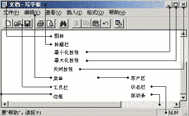
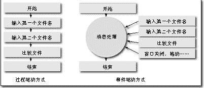
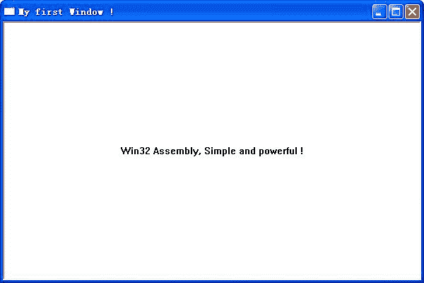
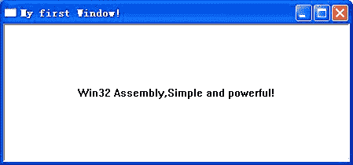
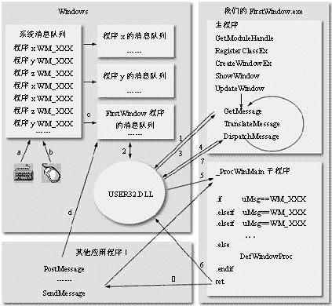
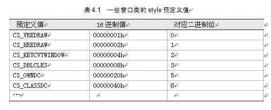

# 【study-note】Windows 环境下 32 位汇编语言程序设计--第四章 第一个窗口程序 4.1 开始了解窗口(1)

> 原文：[`www.pediy.com/kssd/pediy10/63046.html`](https://www.pediy.com/kssd/pediy10/63046.html)

**第四章 第一个窗口程序 4.1 开始了解窗口(1)**4.1.1 窗口是什么  
    窗口是什么？大家每天在使用 Windows，屏幕上的一个个方块就是一个个窗口！那么，窗口为什么是这个样子呢？窗口就是程序吗？  
  
1. 使用窗口的原因(窗口是什么呢？看看自家阳台上的窗口就知道了。windows 操作系统里的窗口就是从那里延伸过来的，要理解也不是那么难的。)  
  
      回想一下 DOS 时代的计算机屏幕，在 1990 年 Windows 3.0 推出之前，计算机的屏幕一直使用文本模式，黑洞洞的底色上漂浮着白色的小字，性能不高的图形模式只用于游戏和一些图形软件。对 DOS 程序来说，屏幕是惟一的，上面有个光标表示输入字符的位置，程序运行后往屏幕输出一些信息，退出时输出的信息就留在了屏幕上，然后是第二个程序重复这个过程，当屏幕被写满的时候，整个屏幕上卷一行，最上面一行被去掉，然后程序在最底下新空出来的一行上继续输出。(作者讲这些话时我想应该是假设初学者连什么是 DOS 程序都不会的，要是那样的话，看这本书是铁定看不懂的。作者很留恋那个幸福的 DOS 时代吧。)  
      对于一个单任务的操作系统，这种方式是很合理的，因为平时使用传真机或打字机就是用上卷的方式来容纳新的内容的。但是如果是多任务呢？两个程序同时往屏幕上写东西或者两个人同时往打字机上打字，那么谁都看不懂混在一起的是什么。DOS 下的 TSR（内存驻留）程序是多个程序同时使用一个屏幕的例子，但实质上这并不是多任务，而是 TSR 将别的程序暂时挂起，挂起的程序不可能在 TSR 执行期间再向屏幕输出内容，TSR 在输出自己的内容之前必须保存屏幕上显示的内容，并在退出的时候把屏幕恢复原来的样子，否则挂起的程序并不知道屏幕已经被改变，在这个过程中，DOS 不会去干预中间发生的一切。(这里有一句话不甚理解，TSR 会输出自己的内容吗？为什么？后面的在 TSR 输出前将屏幕保存起来，和在使用后将屏幕恢复成原来的样子，这个倒不难理解。关键是什么是内存驻留程序？它和一般的程序有什么区别？)  
  
      Windows 是多任务的操作系统，可以同时运行多个程序，同样，各个程序在屏幕上的显示不能互相干扰，而且，多个程序可以看成是“同时”运行的，在后台的程序也可能随时向屏幕输出内容，这中间的调度是由 Windows 完成的。Windows 采用的方法是给程序一块矩形的屏幕空间，这就是窗口。应用程序通过 Windows 向属于自己的窗口显示信息，Windows 判断该窗口是不是被别的窗口挡住，并把没有挡住的部分输出到屏幕上，这样屏幕上显示的东西就不会互相覆盖而乱套。对于应用程序来说，它只需认为窗口就是自己拥有的显示空间就可以了。(这一段话极其重要，尤其是显示为紫色的一段文字，更是重要的没法讲。它是那么的简约而不简单啊，向我们展示了 WINDOWS 操作系统的一个深层面的运行原理，而又是其一个非常重要的原理。)  
2. 窗口和程序的关系  
  
    既然不同窗口的内容就是不同程序的输出，那么一个窗口就是一个程序吗？反过来，一个程序就是一个窗口吗？  
  
答案是否定的，一个窗口不一定就是一个程序，它可能只是一个程序的一部分。一个程序可以建立多个顶层窗口，如 Windows 的桌面和任务栏都是顶层窗口，但它们都属于“文件管理器”进程，所以并不是一个窗口就是一个程序的代表。Windows 的窗口采用层次结构，一个窗口中可以建立多个子窗口，如窗口中的状态栏、工具栏，对话框中的按钮、文本输入框与复选框等都是子窗口。子窗口中还可以再建立下一级子窗口，如 Word 工具栏上的字体选择框。(这里的介绍非常有意义啊，深入的阐述了 windows 窗口和程序之间的关系。而这个关系又应该是我们每一个学习 WINDOWS 编程的人所了解和掌握的。这一段话，真的非常重要，难以用言语来形容它的重要性。以后可能还要回来继续看看这段话才行。真的太重要了。)  
     反过来，运行的程序并非一定就是窗口，比如悄悄在后台运行的木马程序就不会显示一个窗口向用户报告它在干什么。在 Windows NT 下用“任务管理器”查看，进程的数量比屏幕上的窗口多得多，意味着很多的运行程序并没有显示窗口。如果一个程序不想和用户交互，它可以选择不建立窗口。(上面显示红色的两句话很好很强大，尤其是最后一句话，更是有意思啊。老罗真是编程经验丰富的人啊，他已经成为了我奋斗的目标了。)  
      所以本章的标题“第一个窗口程序”指学习编写第一个以标准的窗口为界面的程序，而不是泛指 Windows 程序。如果要写的 Win32 程序不是以窗口为界面的，如控制台程序等，就不一定采用本章中提及的以消息驱动的程序结构。(老罗真的太强大了，这两个不同颜色的句子都非常有意义，windows 程序并非必须是图形界面的才算是，它也可以是控制台下的程序，真的太有意义的一段话了，标出来以后要回来继续研究。)  
      虽然以窗口为界面的程序并不是所有 Windows 程序的必然选择，但绝大部分的应用程序是以这种方式出现的，从操作系统的名称“Windows”就可以看出这一点，了解窗口程序就是相当于在了解 Windows 工作方式的基础。(红色的话非常重要，如果不懂 WINDOWS 工作方式的话，就必须得对这句话高度重视才行。)  
4.1.2 窗口界面  
  
    大部分的窗口看上去都是大同小异的，先来看一个典型的窗口，即 Windows 附带的写字板，如图 4.1 所示。用它来说明窗口的各个部分。 (说出红色的那句话，说明了老罗把 WINDOWS 窗口看得有多么的透彻了啊，老罗不亏是大众的偶像和榜样啊。)  
  
  
  
4.1 一个典型的窗口图  
  
  
  
     窗口一般由屏幕上的矩形区域组成，不同的窗口可能包括一些相同的组成部分，如标题栏、菜单、工具栏、边框和状态栏等，每个部分都有自己固定的行为模式：(这一句话好有用，标下来在有需要的时候再研究研究。)  
●   窗口边框窗口的外沿就是窗口边框，用鼠标按住边框并拖动可以调整窗口的大小。(老罗太了不起了，给我们下了一个极其准确的窗口边框的定义，即鼠标按住后可以改变窗口大小的窗口部分为窗口边框。以后不会对这个概念有任何的模糊感了。)  
●   标题栏窗口的最上面是标题栏，用鼠标按住标题栏拖动可移动窗口，双击标题栏则将窗口最大化或从最大化的状态恢复。通过标题栏的颜色可以区分窗口是不是活动窗口，同时标题栏列出了应用程序的名称。(和上面的句子一样，这里画红色的句子相当有意义啊，老罗又给我们对标题栏下了一个极其准确的定义啊，即双击标题栏窗口将最大化或从最大化的状态恢复。这句话真的太形象生成了，试一下就可以知道什么是标题栏了。而不像某些书里面说的太模糊太没感觉了太容易产生歧义了。)  
●   菜单标题栏下面是菜单，单击菜单会弹出各种功能选择。  
  
●   工具栏菜单的下面是工具栏，工具栏上用图标的方式列出最常用的功能，相当于菜单的快捷方式。(对菜单和工具栏的描述非常的形象生动到位啊。对一些词语用得真的是太好了啊。)  
  
●   图标和“最小化”、“最大化”与“关闭”按钮图标位于标题栏的左边，三个控制按钮则位于标题栏的右边。单击图标会弹出一个系统菜单，双击图标则相当于按下了“关闭”按钮。“最小化”、“最大化”按钮用来控制窗口的大小。(描述得太好了，太准确了，老罗写的这一节真的是太好了啊。太感动了,@#$%\*&^)  
●   状态栏状态栏位于窗口的最下面，用来显示一些状态信息。  
  
●   客户区窗口中间用来工作或输出的区域，叫做窗口的客户区，把窗口看做是一张白纸的话，客户区就是白纸中真正用来写东西的部分，程序在这里和用户进行交互。(客户区这个概念极其重要啊，而这里描述得那么的形象，非常容易理解，初学者看到这里都会觉得 WIN32 汇编不过这么简单而已的。)  
●   滚动条如果客户区太小不足于显示全部内容，右边或底部可能还有滚动条，拖动它可以滚动窗口的客户区，以便看到其他的内容。  
  
    虽然大部分窗口看上去都差不多，但并不是每个窗口都有这些东西，也许有的窗口就没有图标和最小化、最大化框，有的没有工具栏或状态栏，有的没有标题栏，而有的就干脆是个奇怪的形状，如 Office 帮助中的助手，那些小狗小猫都是些不折不扣的窗口，Windows 的桌面和桌面下面的任务栏也都是窗口，就连屏幕保护的黑屏幕也是一个大小为整个屏幕、没有标题栏和边框的窗口！(太强大了，老罗对 WINDOWS 下的窗口的了解已经到了一个这么恐怖的境界了啊。强大的老罗啊。小狗小猫，任务栏，黑屏幕，这些都是 WINDOWS 下的窗口啊，太让人意外了。)  
     一致的窗口形状和行为模式为 Windows 用户提供了一致的用户界面，几乎所有的窗口程序都在菜单的第一栏设置有关文件的操作和退出功能、最后一栏设置程序的帮助，相同的功能在工具栏上的图标也是大同小异的，用户可以不再像在 DOS 下那样，对不同的程序需要学习不同的界面，用户自从学会使用第一个软件起，就基本学会了所有 Windows 软件的使用模式，而且可以通过相似的菜单、工具栏等来发掘程序的新功能。窗口的菜单和客户区则是最个性化的东西，菜单随程序功能的不同而不同，而客户区则是窗口程序的输出区域，不同的程序在客户区内显示了不同的内容。(什么是行为模式？窗口形状很容易理解，基本是矩形的。行为模式呢？菜单功能是一种行为模式吗？在客户区输出内容是一种行为模式吗？)  
4.1.3 窗口程序是怎么工作的  
  
1. 窗口程序的运行模式  
  
    对程序员来说，要了解的不仅是用户可以看到的部分，还必须了解窗口底下的东西，了解用怎样的程序结构来实现窗口的行为模式。(这句话说得非常有道理，可以极大的打击一些自以为认识底层没有意义的无知分子。)  
      DOS 程序员熟悉的是顺序化的、按过程驱动的程序设计方法。程序有明显的开始、明显的过程和明显的结束，由程序运行的阶段来决定用户该做什么。而窗口程序是事件驱动的（再次提醒：这里是“窗口程序”而不是“Windows 程序”，因为和窗口有关的程序才是事件驱动的，其他的 Windows 可能并不这样工作，如控制台程序的结构还是同 DOS 程序一样是顺序化的，但与窗口相关的 Windows 程序占了绝大多数，所以大部分的书籍中讲到 Windows 程序就认为是事件驱动的程序），用户可能随时发出各种消息，如操作的过程中觉得窗口不够大了，就马上会拖动边框，程序必须马上调整客户区的内容以适应新的窗口大小；用户觉得想先干别的事情，可能会把窗口最小化，关闭按钮也有可能随时被按下，这意味着程序要随时可以处理退出的请求。如果非要规定干活的时候不能移动窗口与调整大小，那么这些窗口就会呆在桌面上一动不动。(这里非常细致到位的介绍了 DOS 程序和 WINDOWS 程序的区别啊，尤其是对 WINDOWS 或窗口程序的描述非常有用。让我们对过程驱动和消息驱动的程序有了更加清晰的认识。)  
  
  
/////////////////////////////////////////////////////////////////////////////////////////////////////////////////////////////  
本资料来自罗云彬的 WIN32 汇编教程，本人只是添加一点点注解而已（见括号内容），而这仅是个人见解，如有雷同，纯属巧合。如有不同见解，也可发表出来，大家一起讨论，本文章最终解释权归罗去彬所有。谢谢。  
/////////////////////////////////////////////////////////////////////////////////////////////////////////////////////////////

第四章 第一个窗口程序 4.1 开始了解窗口(2)      
      先通过一个简单的例子来说明两种程序设计方式的不同，以 DOS 下的文件比较命令 comp 为例，程序运行时先提示输入第一个文件名，然后是输入第二个文件名，程序比较后退出，同时把结果输出在屏幕上。假如有一个窗口版的 comp 程序，那么运行时会在屏幕上出现一个对话框，上面有两个文本框用来输入两个文件名，还会有个“比较”按钮，按下后开始比较文件，用户可以随时按下“关闭”按钮来退出程序。(dos 程序是典型的过程程序,做什么事情都按过程来执行。)  
  
      两种程序的运行会有相当大的不同，如图 4.2 所示，DOS 程序必须按照顺序运行，当运行到输入第二个文件名时，用户不可能回到第一步修改第一个文件名，这时候用户也不能退出（除非用户强制用 Ctrl＋C 键，但这不是程序的本意）；而在窗口程序中用户可以随意选择先输入哪个文件名，同时也可以对窗口进行各种操作，当用户做任何一个操作的时候，相当于发出了一个消息，这些消息没有任何顺序关系，程序中必须随时准备处理不同的消息。(消息处理机制下的程序具有的灵活性远远要比按照顺序运行的程序要有优越性。)  
  
  
  
图 4.2 不同的程序结构模式  
  
  
    这就决定了窗口程序必定在结构上和 DOS 程序有很大的不同，窗口程序实现大部分功能的代码应该呆在同一个模块图中的“消息处理”模块中，这个模块可以随时应付所有类型的消息，只有这样才能随时响应用户的各种操作。(如果所有的代码都集中在一个模块里，那么代码是否会失去平衡呢？即导致某些地方代码很庞大。)  
下面先来看一个地地道道的 Win32 汇编窗口程序。(这是最激动人心的时刻!)  
  
  
2. FirstWindow 源代码  
  
  
    读者可以在所带光盘的 Chapter04\\FirstWindow 目录中找到源代码，目录里面有两个文件，它们是汇编源文件 FirstWindow.asm 和 nmake 工具使用的 makefile，汇编源程序如下：(大多数好的教程里都会写着，虽然可以从光盘里轻松的将代码复制到电脑上，但最好应该自己将它们打进去，而不是使用现成的。这样对初学者来说可以加深对程序的印象。据说微软前掌门人 BILL 在他很少写代码时，却还是会一句一句的将其它的工程师写的程序的代码打在电脑上。用意何在可显而易见。以下是我自己打的代码，我还添加了非常详细的注释进去，当然这并不是一个好习惯，但是可以大大加深对程序的理解，虽然有可能是不正确的，但至少有了自己的理解。比起对程序什么都不了解的要好点。btw:在我一句一句代码打出来时，居然少打了处理消息的缺省函数进去，害我得花了好长时间来检查程序错在哪里，=-=||，有了这个教训，以后应该不会再犯这个错误了。)  
  

代码:

```
;=============================================
;=>使用 386 指令集
;=>内存模式为平坦模式
;=>函数调用为标准调用方式，即参数从右到左压栈，由被调用者恢复堆栈
;============================================

.386
.model  flat,stdcall
option  casemap:none

;=========
;=>文件定义
;=========
include  windows.inc
include  gdi32.inc
includelib  gdi32.lib
include  user32.inc
includelib  user32.lib
include  kernel32.inc
includelib  kernel32.lib

;==============
;=>数据段
;==============
.data?
hInstance    dd  ?
hWinMain    dd  ?

.const
szClassName  db  'MyClass',0
szCaptionMain  db  'My first Window!',0
szText    db  'Win32 Assembly,Simple and powerful!',0

;==========
;=>代码段
;==========
.code

;==========================================
;=>窗口过程
;=>告诉编译器在函数中使用 ebx edi esi 寄存器,参数缺省时为 dword 类型
;==========================================
\_ProcWinMain  proc  uses ebx edi esi,hWnd,uMsg,wParam,lParam

    ;定义一个绘制结构体变量和一个矩形结构体变量
    ;绘制结构体变量存储一些关于在屏幕上绘制图形的信息
    ;矩形结构体存储窗口的大小

    local  @stPs:PAINTSTRUCT
    local  @stRect:RECT
    local  @hDc
    
    ;将接受到的消息传送到 eax 中去，以作进一步的处理
    ;为什么要传送到 eax 中去呢？不喜欢也可以换 ebx 的
    ;重要的是里面的消息，而不是存储这个消息的寄存器
    mov  eax,uMsg

    .if  eax==WM\_PAINT  ;绘制消息，当屏幕变动时触发该消息事件

      ;调用开始绘制 API 取得窗口 DC 并将其传送到 DC 句柄
      invoke  BeginPaint,hWnd,addr @stPs
      mov  @hDc,eax

      ;取得窗口的坐标并将其传送到结构体变量
      invoke  GetClientRect,hWnd,addr @stRect

      ;完成上面工作后，在客户区中以水平垂直居中形式输出一行文字
      invoke  DrawText,@hDc,addr szText,-1,addr @stRect,DT\_SINGLELINE or DT\_CENTER or \\
                  DT\_VCENTER

      ;结束绘制图形并进行扫尾工作
      invoke  EndPaint,hWnd,addr @stPs

    .elseif  eax==WM\_CLOSE  ;如果接收到关闭窗口的消息

      ;调用销毁窗口 API 销毁创建的窗口
      invoke  DestroyWindow,hWinMain
    .else
      ;如果不是自己感兴趣的消息，就交给缺省消息处理函数去处理吧
      invoke  DefWindowProc,hWnd,uMsg,wParam,lParam
      
      ret
    .endif

    xor  eax,eax

    ret
\_ProcWinMain  endp

;========================================
;=>主函数,用于创建窗口及接受消息和分发消息到相应窗口中去
;========================================
\_WinMain    proc

    ;定义一个窗口类结构体变量，这里的类不是 C++里说的类，而是一个结构体，仅是名字叫类而已
    ;这个类限制了将要创建的窗口的风格，利用这个类可以创建 N 个窗口，一般只要一个就可以了
    local  @stWndClass:WNDCLASSEX
    
    ;定义一个消息结构体变量，同样是一个结构体，这说明了结构体类型是多么的重要
    local  @stMsg:MSG

    ;调用取模块句柄 API，参数是 NULL,并将结果传送到实例句柄变量
    invoke  GetModuleHandle,NULL
    mov  hInstance,eax

    ;将窗口类结构体变量清空为 0,这是为了防止不必要的意外发生
    invoke  RtlZeroMemory,addr @stWndClass,sizeof @stWndClass

;==========
;=>注册窗口类
;==========  
    ;加载光标资源到内存，并将其句柄传送到窗口类变量，这里加载的是系统的光标
    ;其实我们可以轻松将其替换成我们自己的光标,但这超出了第一个窗口程序的要求了
    invoke  LoadCursor,0,IDC\_ARROW
    mov  @stWndClass.hCursor,eax

    ;将模块实例句柄传送到窗口类中去
    ;这里不是直接用 mov 指令传送，而是通过堆栈间接传送的
    push  hInstance
    pop  @stWndClass.hInstance

    ;将窗口类结构体类型大小传送到窗口类结构体变量的 cbsize 成员中
    mov  @stWndClass.cbSize,sizeof WNDCLASSEX

    ;设置窗口风格为当窗口水平或垂直方向大小发生改变时要重新刷新窗口
    ;CS\_HREDRAW 表示 窗口类风格(CS) 为 水平方向(H)发生改变时重绘窗口(REDRAW)
    ;CS\_VREDRAW 表示 窗口类风格(CS) 为 垂直方向(V)发生改变时重绘窗口(REDRAW)
    ;更多风格请参照微软 MSDN,其实这两个风格一般情况下已经足够了
    mov  @stWndClass.style,CS\_HREDRAW or CS\_VREDRAW

    ;将所谓的窗口消息处理函数的地址传送到窗口类成员 lpfnWndProc 中去
    ;lpfnWndProc 要分四个部分看:lp 表示 long point 即变量类型为 长指针(指针就指针还长指针,不可理解)
    ;      Wnd 表示 window(s) 即窗口
    ;      Proc 表示 process 即处理
    ;四个部分合起来就是类型为指向窗口处理函数的指针，即存储函数的地址的变量
    ;恐怖的术语常常成为我们学习的阻碍，现在开始要透过现象看本质，指针不过是一个变量而已，只是它里面存储的是另一个
    ;内存单元的地址
    mov  @stWndClass.lpfnWndProc,offset \_ProcWinMain

    ;设置窗口背景颜色为窗口缺省颜色再加 1
    ;这里 COLOR\_WINDOW 是一个常量，是已经设置好的颜色值
    mov  @stWndClass.hbrBackground,COLOR\_WINDOW+1
    
    ;设置窗口类名为 szClassName
    ;窗口类变量名和窗口类名有什么关系呢？  简单点说一个是结构体变量，一个是字符串
    ;关于其作用可百度一下
    ;lpszClassName 这个名字好长啊=-=|| @#$%(&\*^
    ;我们可以这样理解：lp 为变量类型，即 long point 长指针
    ;    sz 为变量类型，即字符串。和上面的合起来就是字符串指针
    ;    ClassName 为类名，即变量的名字，这样命名易于理解很多
    ;上面几个意思合起来就是：指向一个类名字符串的指针
    mov  @stWndClass.lpszClassName,offset szClassName

    invoke  RegisterClassEx,addr @stWndClass
;============
;=>建立并显示窗口
;============
    invoke  CreateWindowEx,WS\_EX\_CLIENTEDGE,\\
      offset szClassName,offset szCaptionMain,\\  ;参数为窗口类名和窗口标题,窗口标题才会显示
      WS\_OVERLAPPEDWINDOW,\\  
      100,100,600,400,\\        ;窗口大小
      NULL,NULL,hInstance,NULL      ;其中有一个参数是本模块句柄

    ;将创建的窗口的句柄传送到主窗口句柄变量,其实它这个变量不过是一个双字变量而已
    ;没什么好怕的，见多用多就熟悉了
    mov  hWinMain,eax

    ;显示创建好的窗口
    invoke  ShowWindow,hWinMain,SW\_SHOWNORMAL

    ;刷新窗口的客户区
    invoke  UpdateWindow,hWinMain
;===========
;=>消息循环
;===========
    .while  TRUE      ;死循环，一般都有这么一个循环在消息处理程序中的
    
      ;获取系统发送到这个程序对应的消息队列里的消息
      invoke  GetMessage,addr @stMsg,NULL,0,0
      
      
      .break  .if  eax==0

      ;对获取的消息进行"解密"，即如果有键盘键按下，则将两个键盘消息合并为一个字符消息处理
      invoke  TranslateMessage,addr @stMsg

      ;将消息发送到各自的处理函数中去处理,即什么窗口的消息，就发送到什么窗口的
      ;消息处理函数去处理，一个窗口可以有一个处理函数，二个则可能有两个处理函数
      invoke  DispatchMessage,addr @stMsg

    .endw

    ret
\_WinMain    endp

;=======================================
start:  
    call  \_WinMain
    invoke  ExitProcess,NULL
;=======================================
end  start

```

  
  
  
/////////////////////////////////////////////////////////////////////////////////////////////////////////////////////////////  
本资料来自罗云彬的 WIN32 汇编教程，本人只是添加一点点注解而已（见括号内容），而这仅是个人见解，如有雷同，纯属巧合。如有不同见解，也可发表出来，大家一起讨论，本文章最终解释权归罗去彬所有。谢谢。  
/////////////////////////////////////////////////////////////////////////////////////////////////////////////////////////////

如果觉得看上面的代码繁杂，可以看"原版"的清晰版的代码  
  

代码:

```
.386
                 .model flat,stdcall
                 option casemap:none

;>>>>>>>>>>>>>>>>>>>>>>>>>>>>>>>>>>>>>>>>>>>>>>>>>>>>>>>>>>>>>>>>>>>>
; Include 文件定义
;>>>>>>>>>>>>>>>>>>>>>>>>>>>>>>>>>>>>>>>>>>>>>>>>>>>>>>>>>>>>>>>>>>>>
include          windows.inc
include          gdi32.inc
includelib       gdi32.lib
include          user32.inc
includelib       user32.lib
include          kernel32.inc
includelib       kernel32.lib

;>>>>>>>>>>>>>>>>>>>>>>>>>>>>>>>>>>>>>>>>>>>>>>>>>>>>>>>>>>>>>>>>>>>>
; 数据段
;>>>>>>>>>>>>>>>>>>>>>>>>>>>>>>>>>>>>>>>>>>>>>>>>>>>>>>>>>>>>>>>>>>>>
                 .data?

hInstance        dd         ?

hWinMain         dd         ?

                 .const

szClassName      db    'MyClass',0

szCaptionMain    db    'My first Window !',0

szText           db    'Win32 Assembly, Simple and powerful !',0

;>>>>>>>>>>>>>>>>>>>>>>>>>>>>>>>>>>>>>>>>>>>>>>>>>>>>>>>>>>>>>>>>>>>>
; 代码段
;>>>>>>>>>>>>>>>>>>>>>>>>>>>>>>>>>>>>>>>>>>>>>>>>>>>>>>>>>>>>>>>>>>>>
                 .code

;>>>>>>>>>>>>>>>>>>>>>>>>>>>>>>>>>>>>>>>>>>>>>>>>>>>>>>>>>>>>>>>>>>>>
; 窗口过程
;>>>>>>>>>>>>>>>>>>>>>>>>>>>>>>>>>>>>>>>>>>>>>>>>>>>>>>>>>>>>>>>>>>>>
\_ProcWinMain     proc  uses ebx edi esi,hWnd,uMsg,wParam,lParam

                 local @stPs:PAINTSTRUCT

                 local @stRect:RECT

                 local @hDc

                 mov   eax,uMsg

;\*\*\*\*\*\*\*\*\*\*\*\*\*\*\*\*\*\*\*\*\*\*\*\*\*\*\*\*\*\*\*\*\*\*\*\*\*\*\*\*\*\*\*\*\*\*\*\*\*\*\*\*\*\*\*\*\*\*\*\*\*\*\*\*\*\*\*\*
                 .if      eax ==    WM\_PAINT

                          invoke    BeginPaint,hWnd,addr @stPs

                          mov       @hDc,eax

                          invoke    GetClientRect,hWnd,addr @stRect

                          invoke    DrawText,@hDc,addr szText,-1,\\

                                   addr @stRect,\\

                                   DT\_SINGLELINE or DT\_CENTER or DT\_VCENTER

                          invoke    EndPaint,hWnd,addr @stPs

;\*\*\*\*\*\*\*\*\*\*\*\*\*\*\*\*\*\*\*\*\*\*\*\*\*\*\*\*\*\*\*\*\*\*\*\*\*\*\*\*\*\*\*\*\*\*\*\*\*\*\*\*\*\*\*\*\*\*\*\*\*\*\*\*\*\*\*\*
                 .elseif  eax ==    WM\_CLOSE

                          invoke    DestroyWindow,hWinMain

                          invoke    PostQuitMessage,NULL

;\*\*\*\*\*\*\*\*\*\*\*\*\*\*\*\*\*\*\*\*\*\*\*\*\*\*\*\*\*\*\*\*\*\*\*\*\*\*\*\*\*\*\*\*\*\*\*\*\*\*\*\*\*\*\*\*\*\*\*\*\*\*\*\*\*\*\*\*
                 .else
                          invoke    DefWindowProc,hWnd,uMsg,wParam,lParam

                                   ret

                          .endif
;\*\*\*\*\*\*\*\*\*\*\*\*\*\*\*\*\*\*\*\*\*\*\*\*\*\*\*\*\*\*\*\*\*\*\*\*\*\*\*\*\*\*\*\*\*\*\*\*\*\*\*\*\*\*\*\*\*\*\*\*\*\*\*\*\*\*\*\*
                 xor      eax,eax

                 ret
\_ProcWinMain     endp

;>>>>>>>>>>>>>>>>>>>>>>>>>>>>>>>>>>>>>>>>>>>>>>>>>>>>>>>>>>>>>>>>>>>>
\_WinMain         proc
                 local    @stWndClass:WNDCLASSEX

                 local    @stMsg:MSG

                 invoke   GetModuleHandle,NULL

                 mov                hInstance,eax

                 invoke   RtlZeroMemory,addr @stWndClass,sizeof @stWndClass

;\*\*\*\*\*\*\*\*\*\*\*\*\*\*\*\*\*\*\*\*\*\*\*\*\*\*\*\*\*\*\*\*\*\*\*\*\*\*\*\*\*\*\*\*\*\*\*\*\*\*\*\*\*\*\*\*\*\*\*\*\*\*\*\*\*\*\*\*
; 注册窗口类
;\*\*\*\*\*\*\*\*\*\*\*\*\*\*\*\*\*\*\*\*\*\*\*\*\*\*\*\*\*\*\*\*\*\*\*\*\*\*\*\*\*\*\*\*\*\*\*\*\*\*\*\*\*\*\*\*\*\*\*\*\*\*\*\*\*\*\*\*
                 invoke   LoadCursor,0,IDC\_ARROW

                 mov      @stWndClass.hCursor,eax

                 push     hInstance

                 pop      @stWndClass.hInstance

                 mov      @stWndClass.cbSize,sizeof WNDCLASSEX

                 mov      @stWndClass.style,CS\_HREDRAW or CS\_VREDRAW

                 mov      @stWndClass.lpfnWndProc,offset \_ProcWinMain

                 mov      @stWndClass.hbrBackground,COLOR\_WINDOW + 1

                 mov      @stWndClass.lpszClassName,offset szClassName

                 invoke   RegisterClassEx,addr @stWndClass

;\*\*\*\*\*\*\*\*\*\*\*\*\*\*\*\*\*\*\*\*\*\*\*\*\*\*\*\*\*\*\*\*\*\*\*\*\*\*\*\*\*\*\*\*\*\*\*\*\*\*\*\*\*\*\*\*\*\*\*\*\*\*\*\*\*\*\*\*
; 建立并显示窗口
;\*\*\*\*\*\*\*\*\*\*\*\*\*\*\*\*\*\*\*\*\*\*\*\*\*\*\*\*\*\*\*\*\*\*\*\*\*\*\*\*\*\*\*\*\*\*\*\*\*\*\*\*\*\*\*\*\*\*\*\*\*\*\*\*\*\*\*\*
                 invoke   CreateWindowEx,WS\_EX\_CLIENTEDGE,\\

                          offset szClassName,offset szCaptionMain,\\

                          WS\_OVERLAPPEDWINDOW,\\

                          100,100,600,400,\\

                          NULL,NULL,hInstance,NULL

                 mov      hWinMain,eax

                 invoke   ShowWindow,hWinMain,SW\_SHOWNORMAL

                 invoke   UpdateWindow,hWinMain

;\*\*\*\*\*\*\*\*\*\*\*\*\*\*\*\*\*\*\*\*\*\*\*\*\*\*\*\*\*\*\*\*\*\*\*\*\*\*\*\*\*\*\*\*\*\*\*\*\*\*\*\*\*\*\*\*\*\*\*\*\*\*\*\*\*\*\*\*
; 消息循环
;\*\*\*\*\*\*\*\*\*\*\*\*\*\*\*\*\*\*\*\*\*\*\*\*\*\*\*\*\*\*\*\*\*\*\*\*\*\*\*\*\*\*\*\*\*\*\*\*\*\*\*\*\*\*\*\*\*\*\*\*\*\*\*\*\*\*\*\*
                 .while   TRUE

                          invoke    GetMessage,addr @stMsg,NULL,0,0

                          .break    .if eax  == 0

                          invoke    TranslateMessage,addr @stMsg

                          invoke    DispatchMessage,addr @stMsg

                 .endw

                 ret
\_WinMain         endp
;>>>>>>>>>>>>>>>>>>>>>>>>>>>>>>>>>>>>>>>>>>>>>>>>>>>>>>>>>>>>>>>>>>>>
start:
                 call     \_WinMain

                 invoke   ExitProcess,NULL
;>>>>>>>>>>>>>>>>>>>>>>>>>>>>>>>>>>>>>>>>>>>>>>>>>>>>>>>>>>>>>>>>>>>>
                 end      start

```

第四章 第一个窗口程序 4.1 开始了解窗口(3)    
      让我们打开一个 DOS 窗口，切换到 FistWindow 所在的目录，运行环境设置的批处理文件 var.bat，再键入 nmake 编译出 FirstWindow.exe，这个程序只有 2 560 字节，运行后窗口出来了，如图 4.3 所示。对于这个窗口，用户可以拖动边框去改变大小、按标题栏上的按钮来最大化和最小化，当光标移到边框的时候，会自动变成双箭头……总之，这个窗口包括了一个典型窗口的所有特征。(当用户去改变这个窗口的时候，系统自动调用缺省消息处理函数来处理相应的事件。在这个程序中我们只对 WM\_PAINT、WM\_CLOSE 这两个消息感兴趣而已,故我们为处理它们而添加了相应的处理消息的代码进去。)  
  
  
  
图 4.3 FirstWindow 的运行结果  
  
    接下来开始分析源代码，看了这三页多的源代码，第一个感觉是什么？是不是想撤退了？笔者刚开始编 Win32 程序的时候就是这种感觉，可能 90％的人有同样的感觉，别急，过了这一关，Win32 汇编的入门就成功了一半，所以千万要挺住！有个振奋人心的消息是，这个程序是大部分窗口程序的模板，以后要写一个新的程序，把它拷贝过来再往中间添砖加瓦就是了，功夫一点都不白费。(三页代码确实挺多的，容易让人产生恐惧感。如老罗所说，再难再苦也要咬着牙挺过来，很快就会好的。不过我对这个有疑问，如果实在是看不下去的话，我宁可把它放一边先，去学点自己更容易掌握和吸收的技术，等时机成熟了再来看。因为这本书如果让大多数人实在无法看下去的话，那还不如去找另一本更适合自己看的书去。)  
  
  
      先静下心来分析一下程序的结构，还看得懂，很好！其实源程序的结构在第三章里已经了解过了，首先是注释……模式定义……include…… .data 数据段，都没有问题，这些已经占去了近 40 行了，好了，终于是关键的代码段了，统计一下，只剩 80 行代码了。(消息处理机制下的程序确实是有个结构的，但并不是说它就是很死板的，我们大可不必把所有的代码放在窗口消息处理函数里，如果代码堆放得太多的话，程序会显得极度不平衡的。)  
  
      分析一下程序的结构，发现入口是 start，然后执行了一个\_WinMain 子程序，完成后就是程序退出的函数 ExitProcess，再看\_WinMain 的结构，前面是顺序下来的几个 API：  
  
GetModuleHandle → RtlZeroMemory → LoadCursor → RegisterClassEx  
  
→ CreateWindowEx → ShowWindow → UpdateWindow  
  
从名称上就能看出它们的用途，很明显，窗口是在 CreateWindowEx 处建立的，ShowWindow 则是把窗口显示在屏幕上，这些代码是窗口的建立过程。(确实，如众所周知的一样，API 的名字已经很好的描述了它的功能了。因为我们很有必要仔细研究一下 API 的名字和它的功能的关系，这样就容易理解一点，而不会对 API 产生恐惧感了。即使不能完全理解，但看到名字至少也知道点意思。)  
  
     接下来，就是一个由 3 个 API 组成的循环了：  
  
GetMessage → TranslateMessage → DispatchMessage  
  
       很明显，这是和消息有关的循环，因为 API 名称中都带有 Message 字样，如果退出这个循环，程序也就结束了，这个循环叫做消息循环。设置\_WinMain 子程序并不是必须的，可以把\_WinMain 的所有代码放到主程序中，没有任何影响，之所以这样只是为了将这里使用的变量定义成局部变量，这样可以方便移植。(这里表达了好几个重要的信息：一是处理消息的三个极其重要的 API，它们名字里都带有 Message 字样；二是由这几个 API 构成的循环为消息循环，几乎没有哪个 WINDOWS 程序里少了这个循环的，这非常好的表明了这个循环的重要性；三是消息处理函数里的所有代码可以放到主函数内部，但把它做成一个函数的好处是方便移植。如果真将消息处理函数里的所有代码放到主程序内部，那我们在注册窗口类时就没必要将消息处理函数的地址传递到窗口类成员中去了，我这样做了，结果运行程序没有显示窗口，另外，我想将消息处理函数里的代码移到主程序中去，发现这样做很不妥。还是保持原状的好。)  
  
  
       看了程序的流程，似乎没有什么地方涉及窗口的行为，如改变大小和移动位置的处理等。再看源程序，除了\_WinMain，还有一个子程序\_ProcWinMain，但除了在 WNDCLASSEX 结构的赋值中提到过它，好像就没有什么地方要用到这个子程序，起码在自己编写的源代码中没有任何一个地方调用过它。(表面上我们一次也没有调用\_ProcWinMain 这个函数,实际上这个函数一直在被调用，只要程序接受到了消息，它就会被调用，只是这个函数不是由我们调用而是由程序自动调用而已。这里面涉及了一个思想，那就是什么函数来消息用户触发的事件所发出的消息的思想。)  
  
      再看\_ProcWinMain，它是一个分支结构处理的子程序，功能是把参数 uMsg 取出来，根据不同的 uMsg 执行不同的代码，完了以后就退出了，中间也没有任何东西和主程序有关联。(这段话已经很清楚的描述了\_ProcWinMain 这个函数的功能了，它和主程序的一个关联就是它处理的消息由主程序传送过来的。)  
  
       第一个窗口程序就是由这么两个似乎是风马牛不相及的部分组成的，但它确实能工作，对于写惯了 DOS 汇编的程序员来说，这似乎不可理解。下面来看看这么一个陌生而奇怪的程序是如何工作的。(当我第一次看到 windows 程序的这些函数的时候，给我的第一感觉就是有点多余，有点 bt，因为当时实在不明白什么是消息处理函数。还好后来自学了点 MFC，总算对 WINDOWS 下的消息处理机制有点理解了。因而现在学 WIN32 高级汇编编程也就没那么吃力了。)  
  
3. 窗口程序的运行过程  
  
     在屏幕上显示一个窗口的过程一般有以下步骤，这就是主程序的结构流程：  
  
（1）得到应用程序的句柄（GetModuleHandle）。  
  
（2）注册窗口类(RegisterClassEx)。在注册之前，要先填写 RegisterClassEx 的参数 WNDCLASSEX 结构。  
  
（3）建立窗口（CreateWindowEx）。  
  
（4）显示窗口（ShowWindows）。  
  
（5）刷新窗口客户区（UpdateWindow）。  
  
（6）进入无限的消息获取和处理的循环。首先获取消息（GetMessage），如果有消息到达，则将消息分派到回调函数处理（DispatchMessage），如果消息是 WM\_QUIT，则退出循环。(不管对这个主程序的执行流程感觉有多么的陌生，我们都应该要相信，这个流程是通用且非常重要的，因此对这个流程了如指掌非常必要。)  
  
      程序的另一半\_ProcWinMain 子程序是用来处理消息的，它就是窗口的回调函数（Callback），也叫做窗口过程，之所以是回调函数是因为它是由 Windows 而不是我们自己调用的，我们调用 DispatchMessage，而 DispatchMessage 再回过来调用窗口过程。(这里什么回调函数、窗口过程，又是一些非常专业的术语，这些术语常常成为我们学习的一个阻碍，其实这里它们只不过就是一个函数，只是这个函数被我们编写后，我们要将它的地址传送给一些指定的成员，让 WINDOWS 去根据具体情况调用它们，而不是由我们自己决定在哪里、什么时候调用它们。)  
  
      所有的用户操作都是通过消息来传给应用程序的，如用户按键，鼠标移动，选择了菜单和拖动了窗口等，应用程序中由窗口过程接收消息并处理，在例子程序中就是\_ProcWinMain。窗口过程构造了一个分支结构，对应不同的消息执行不同的代码，所以一个应用程序中几乎所有的功能代码都集中在窗口过程里。(用户的一举一动都会触发一个事件，然后由系统根据这些事件自动发出相应的消息到所要操作的程序中去，并让程序作出响应。后面一句话，即据有的功能代码都集中在窗口过程里，这句话让我看了有点汗颜啊，难以想像一个程序里的所有功能代码都集中在一个过程里，会是什么样的一种情况啊。)  
  
     窗口程序运行中消息传输的流程可以由图 4.4 来表示。(很形象生动的表示了消息的发出和消息的处理整个过程。)  
  
     先来看看 Windows 对消息的处理。Windows 在系统内部有一个系统消息队列，当输入设备有所动作的时候，如用户按动了键盘、移动了鼠标，按下或放开了鼠标等，Windows 都会产生相应的记录放在系统消息队列里，如图 4.4 中的箭头 a 和 b 所示，每个记录中包含消息的类型、发生的位置（如鼠标在什么坐标移动）和发生的时间等信息。  
  
  
  
图 4.4 窗口程序的运行过程  
  
      同时，Windows 为每个程序（严格地说是每个线程）维护一个消息队列，Windows 检查系统消息队列里消息的发生位置，当位置位于某个应用程序的窗口范围内的时候，就把这个消息派送到应用程序的消息队列里，如图 4.4 中的箭头 c 所示。(每个线程应有一个消息队列，虽然还不太清楚啥是线程，但知道了线程有一个消息队列确实是件不错的事，而且随着学习的深入我将很快就会知道什么是线程了。这里说明了用户操作了硬件，即触发了事件，接着系统将事件对应的消息发送到系统消息队列里，再分析这获取的消息是属于哪个程序的，将它发送到对应程序的消息队列里去。消息经历了：系统消息队列=>就用程序消息队列.)  
  
       当应用程序还没有来取消息的时候，消息就暂时保留在消息队列里，当程序中的消息循环执行到 GetMessage 的时候，控制权转移到 GetMessage 所在的 USER32.DLL 中（箭头 1），USER32.DLL 从程序消息队列中取出一条消息（箭头 2），然后把这条消息返回应用程序（箭头 3）。(消息经历了 应用程序的消息队列=>应用程序里。由 GetMessage 完成这伟大而又神圣的任务。)  
  
     应用程序可以对这条消息进行预处理，如可以用 TranslateMessage 把基于键盘扫描码的按键消息转换成基于 ASCII 码的键盘消息，以后也会用到 TranslateAccelerator 把键盘快捷键转换成命令消息，但这个步骤不是必需的。(这里有三个概念需要理解：按键消息、键盘消息、命令消息。这三个概念都相当重要，需要加以注意啊。有空再回来瞄瞄。消息被处理的过程为：按键消息=>键盘消息=>命令消息。)  
  
      然后应用程序将处理这条消息，但方法不是自己直接调用窗口过程来完成，而是通过 DispatchMessage 间接调用窗口过程，Dispatch 的英文含义是“分派”，之所以是“分派”，是因为一个程序可能建有不止一个窗口，不同的窗口消息必须分派给相应的窗口过程。当控制权转移到 USER32.DLL 中的 DispatchMessage 时，DispatchMessage 找出消息对应窗口的窗口过程，然后把消息的具体信息当做参数来调用它（箭头 5），窗口过程根据消息找到对应的分支去处理，然后返回（箭头 6），这时控制权回到 DispatchMessage，最后 DispatchMessage 函数返回应用程序（箭头 7）。这样，一个循环就结束了，程序又开始新一轮的 GetMessage。(DispatchMessage 和 GetMessage 都是 USER32.DLL 里的函数，算不算是应用程序的一部分呢？因为它们是 USER32.DLL 函数，就可以说最后 DispatchMessage 函数返回应用程序了吗？它本来不是应用程序的一部分吗？就好像一个应用程序不是操作系统的一部分，它在运行后要返回操作系统一样？不会是因为 DispatchMessage 是系统 API 的原因吧？)  
  
      有个很常见的问题：为什么要由 Windows 来调用窗口过程，程序取了消息以后自己处理不是更简便吗？事实上并非如此，如果程序自己处理消息的“分派”，就必须自己维护本程序所属窗口的列表，当程序建立的窗口不止一个的时候，这个工作就变得复杂起来；另一个原因是：别的程序也可能用 SendMessage 通过 Windows 直接调用你的窗口过程；第三个原因：Windows 并不是把所有的消息都放进消息队列，有的消息是直接调用窗口过程处理的，如 WM\_SETCURSOR 等实时性很强的消息，所以窗口过程必须开放给 Windows。(我对这里的通过用 SendMessage 来调用别的程序的窗口过程非常感兴趣啊，感觉非常神秘，很有趣.对第三个必须由 WINDOWS 来调用窗口过程的原因感觉太牵强了，因为如果由应用程序本身来处理不是一样可以直接处理 WM\_SETCUROSR 等实时性消息吗？)  
  
       应用程序之间也可以互发消息，PostMessage 是把一个消息放到其他程序的消息队列中，如图 4.4 中箭头 d 所示，目标程序收到了这条消息就把它放入该程序的消息队列去处理；而 SendMessage 则越过消息队列直接调用目标程序的窗口过程（如图 4.4 中箭头 I 所示），窗口过程返回以后才从 SendMessage 返回（如图 4.4 中箭头 II 所示）。(实话说，看到这里感觉是最精彩的，对 PostMessage 和 SendMessage 的本质有了更加深入的认识了。一个是发送消息到另一个程序的队列中去，一个是直接调用另一个程序的窗口过程。)  
  
      窗口过程是由 Windows 回调的，Windows 又是怎么知道往哪里回调呢？答案是我们在调用 RegisterClassEx 函数的时候告诉了 Windows。(在注册窗口类时将回调函数的偏移地址传递到窗口类成员中去。)  
  
/////////////////////////////////////////////////////////////////////////////////////////////////////////////////////////////  
本资料来自罗云彬的 WIN32 汇编教程，本人只是添加一点点注解而已（见括号内容），而这仅是个人见解，如有雷同，纯属巧合。如有不同见解，也可发表出来，大家一起讨论，本文章最终解释权归罗去彬所有。谢谢。  
///////////////////////////////////////////////////////////////////////////////////////////////////////////////////////////// 

第四章 第一个窗口程序  
4.2 分析窗口程序(2)  
  
      程序定义了一个 WNDCLASSEX 结构的变量@stWndClass，用 RtlZeroMemory 将它填为全零（局部变量初始化的重要性在第三章中已经强调过），再填写结构的各个字段，这样，没有赋值的部分就保持为 0，结构各字段的含义如下：(在这里可以学到一个 API 即 RtlZeroMemory 的功能，它是将一个变量用 0 填充的函数。功能很简单，但却相当重要。)  
  
  
●   hIcon 图标句柄，指定显示在窗口标题栏左上角的图标。Windows 已经预定义了一些图标，同样，程序也可以使用在资源文件中定义的图标，这些图标的句柄可以用 LoadIcon 函数获得。例子程序没有用到图标，所以 Windows 给窗口显示了一个默认的图标。(图标句柄是一个编号，我们可以将自定义的图标的句柄传送给 LoadIcon 来加载自己创建的图标，也可以直接使用系统预定义的句柄来加载系统 DLL 中的图标资源。Windows 的默认图标全在系统 Dll 文件中，并不是单独的图标文件.不过，Windows 支持用其它图标来替换原有的图标，这不需要把图标文件一定放在哪个文件夹，也就是说任意位置的图标都可以用.替换桌面上一些程序图标的方法为:在桌面上点右键－－桌面－－自定义桌面－－更改图标 在这里就可以更改图标了。可以支持的单独图标应为\*.ico 文件，另外也支持程序文件（\*.exe）或 DLL 文(\*.dll)中的图标.你还可以用这个方法查看 user32.dll 或其它程序里面有什么图标资源，你还可以查一下上次我们创建的 myfirstwindow 里的图标资源，你会发现，其实里面根本没有图标，这因为它用的是 user32.dll 里共用的资源,所以理所当然里面不会有图标了。)  
  
●   hCursor 光标句柄，指定了鼠标在窗口中的光标形状。同样，Windows 也预定义了一些光标，可以用 LoadCursor 获取它们的句柄，IDC\_ARROW 是 Windows 预定义的箭头光标，如果想使用自定义的光标，也可以自己在资源文件中定义。(myfirstwindow 这个程序貌似加载了 user32.dll 里的光标资源，而没有加载窗口左上角的图标，而我怎么看到了程序的窗口上使用了 user32.dll 里的图标资源，另外我也没有发现 user32.dll 里的光标资源啊？怪了啊.不怕，我有办法。 ^o^用 ResHacker 打开它就可以查看里面所有的资源了。ResHacker 这款软件太 BT 了，不仅可以提取 EXE 或 DLL 中的资源,包括对话框、字符串、图标，或者声音文件等,还可以将它们替换成自己想要的资源。经我查找 user32.dll 和 myfirstwindow.exe 里的资源发现，前者包含了后者需要的图标和光标资源，而后者根本不包含有资源。)  
  
●   lpszMenuName 指定窗口上显示的默认菜单，它指向一个字符串，描述资源文件中菜单的名称，如果资源文件中菜单是用数值定义的，那么这里使用菜单资源的数值。窗口中的菜单也可以在建立窗口函数 CreateWindowEx 的参数中指定。如果在两个地方都没有指定，那么建立的窗口上就没有菜单。(通过这里可以学到一个非常有用的技术，就是通过在 CreateWindowEx 中指定菜单句柄，就可以将创建的菜单添加到窗口上。另外菜单可以是数值，即句柄，也可以是字符串吗？为什么可以是一个字符串？WINDOWS 里所有的资源都通过句柄来识别的，那么说字符串也是一个句柄吗？明显不太可能啊.)  
  
●   hInstance 指定要注册的窗口类属于哪个模块，模块句柄在程序开始的地方已经用 GetModuleHandle 函数获得。(这里的 API 的参数只有一个，可为空也可为一个字符串指针，当为空时返回当前模块句柄，否则返回指定的 EXE 或 DLL 句柄。)  
  
●   cbSize 指定 WNDCLASSEX 结构的长度，用 sizeof 伪操作来获取。很多 Win32 API 参数中的结构都有 cbSize 字段，它主要是用来区分结构的版本，当以后新增了一个字段时，cbSize 就相应增大，如果调用的时候 cbSize 还是老的长度，表示运行的是基于旧结构的程序，这样可以防止使用无效的字段。(终于知道 cbsize 是做啥用的了，以前以为是一个没多大意义的成员，现在终于知道了，它是系统判断新旧 WINDOWS 结构体类型的根据啊。意义挺重大的啊。)  
  
●   style 窗口风格。CS\_HREDRAW 和 CS\_VREDRAW 表示窗口的宽度或高度改变时是否重画窗口。比较重要的是 CS\_DBLCLKS 风格，指定了它，Windows 才会把在窗口中快速两次单击鼠标的行为翻译成双击消息 WM\_LBUTTONDBLCLK 发给窗口过程。笔者就曾经忘了指定它，结果怎么也搞不出双击消息来。(从这里可以学到 WINDOWS 下的三种窗口风格，其中两种是垂直或水平方向改变时是否重绘窗口。另一种是设置了 CS\_DBLCLKS 风格时 WINDOWS 才响应用户的双击键消息。这三种风格极其重要，记得前两种风格没有设置时窗口好像死了一样，不会重新刷新，这种情况第一次遇见时真感到很无语的啊。)  
  
●   hbrBackground 窗口客户区的背景色。前面的 hbr 表示它是一个刷子（Brush）的句柄，“刷子”一词形象地表示了填充一个区域的着色模式。Windows 预定义了一些刷子，如 BLACK\_BRUSH 和 WHITE\_BRUSH 等，可以用下列语句来得到它们的句柄：(MFC 下的 GDI 里有很多对象，如画笔、刷子、位图等，这些 GDI 对象功能非常强大。曾经用过它们来作动画，感觉很不错。这里的刷子我想功能和使用方法和 MFC 下的应该是差不多的吧。)  
  
      invoke   GetObjectStock, WHITE\_BRUSH  
但在这里也可以使用颜色值，Windows 已经预定义了一些颜色值，分别对应窗口各部分的颜色，如 COLOR\_BACKGROUND，COLOR\_HIGHLIGHT，COLOR\_MENU 和 COLOR\_WINDOW 等，使用颜色值的时候，Windows 规定必须在颜色值上加 1，所以程序中的指令是：(为什么一定要加上 1 呢？因为如果不加 1，而你又取 COLOR\_SCROLLBAR 作为颜色值时，成员 hbrBackground 会被当作空画刷，这时你需要自己去作额外的处理。实际上 COLOR\_WINDOW 如果不加 1 的话，它等价于 COLOR\_MENU+1，即还是被看作是加 1 的了。关于一些颜色值的定义，可参考一下 WINDOWS.H 这个头文件。以下为几个我摘录下来的颜色值：  
代码:

```
COLOR\_SCROLLBAR                      equ 0
COLOR\_BACKGROUND                     equ 1
COLOR\_ACTIVECAPTION                  equ 2
COLOR\_INACTIVECAPTION                equ 3
COLOR\_MENU                           equ 4
COLOR\_WINDOW                         equ 5
COLOR\_WINDOWFRAME                    equ 6)

```

代码:

```


```

代码:

```
mov      @stWndClass.hbrBackground,COLOR\_WINDOW + 1

```

●   lpszClassName 指定程序员要建立的类命名，以便以后用这个名称来引用它。这个字段是一个字符串指针，在程序里，它指向“MyClass”字符串。(为什么要指定类名呢？因为 WINDOWS 规定每一个窗口必须得有一个类名，每一种类都对应风格不同的窗口，WINDOWS 已经为我们预定义好很多标准的类了，我们只要引用其类名就可以直接创建一些标准窗口了，如 EDIT 和 BUTTON 这两个类名，不用我说大家也可以知道它们是编辑框和按钮窗口的了。如果我们要创建属于自己的窗口的话，就得给它指定一个异于标准窗口类名的名称。如果它为空，那么它将使用缺省标准窗口类的风格。)  
  
●   cbWndExtra 和 cbClsExtra 分别是在 Windows 内部保存的窗口结构和类结构中给程序员预留的空间大小，用来存放自定义数据，它们的单位是字节。不使用自定义数据的话，这两个字段就是 0。(cbWndExtra 和 cbClsExtra 都是整数，是为窗口类和窗口指定分配额外内存用的。如果它们非 0，则在创建窗口类时系统自动为窗口分配指定的内存。这些内存可用于存储一些具有个性化的内容。如果你的窗口具有背景音乐，那么你可以在窗口类扩展内存里设置 1，否则为 0。如果你需要音乐的存储路径，那么你可以在 cbWndExtra 指向的内存里放入这个路径字符串，这样在程序中我们就可以直接使用这些扩展内存里的数据，而不是频繁的访问全局变量了。因为这些内存是和窗口绑定的，因而只要我们知道窗口的句柄，我们就可以访问它们。我们可以通过 SetClassLong 和 GetClassLong 来设置和获取窗口类扩展内存里的数据，可以通过 SetWindowLong 和 GetWindowLong 来设置和获取窗口扩展内存里的数据。)  
  
●   lpfnWndProc 最重要的参数，它指定了基于这个类建立的窗口的窗口过程地址。通过这个参数，Windows 就知道了在 DispatchMessage 函数中把窗口消息发到哪里去，一个窗口过程可以为多个窗口服务，只要这些窗口是基于同一个窗口类建立的。Windows 中不同应用程序中的按钮和文本框的行为都是一样的，就是因为它们是基于相同的 Windows 预定义类建立的，它们背后的窗口过程其实是同一段代码。(lpfnWndProc 确实存储的是一个地址，只不过存储的是一个函数的地址，这个函数除了参数类型和个数要遵循规定之外，其它的可以自己定义。)  
       结构中的 style 表示窗口的风格，Windows 已经有一些预定义的值，它们是以 CS（Class Style 的缩写）开始的标识符，如表 4.1 所示。  
  
  
     可以看到，这些预定义值实际上在使用不重复的数据位，所以可以组合起来使用，同时使用不同的预定义值并不会引起混淆。(这也正是可以直接使用置位运算符将某种风格添加到窗口类中的原因，曾经的我对风格的置位运算感到莫名其妙，现在这种感觉已经一扫而空了。)  
  
     对于不同二进制位组合的计算，“加”和“或”的结果是一样的，在 FirstWindow 程序中用 CS\_HREDRAW or CS\_VREDRAW 来代表两个组合，若用 CS\_HREDRAW＋CS\_VREDRAW 也并没有什么不同，但强烈建议使用 or，因为如果不小心指定了两个同样的风格时：CS\_HREDRAW or CS\_VREDRAW or CS\_VREDRAW 和原来的数值是一样的，而 CS\_HREDRAW＋CS\_VREDRAW＋ CS\_VREDRAW 就不对了，因为 1 or 1＝1，而 1＋1 就等于 2 了。(使用风格的置位运算而不是使用加法运算的原因。)  
  
2. 建立窗口  
  
     接下来的步骤是在已经注册的窗口类的基础上建立窗口，使用“类”的原因是定义窗口的“共性”，建立窗口时肯定还要指定窗口的很多“个性化”的参数如 WNDCLASSEX 结构中没有定义的外观、标题、位置、大小和边框类型等属性，这些属性是在建立窗口时才指定的。(总算搞明白了，为什么有了窗口类之后，还要在创建窗口的 API 里加入那么多的窗口风格了，原来是为了更加灵活多变的创建窗口，而不是说有了一个窗口类后使用它就必须得创建完全一模一样的窗口来。要不我们使用标准窗口类来创建窗口，那类所体现出来的共性则完全成为我们创建个性化窗口的瓶颈了。)  
  
      和注册窗口类时用一个结构传递所有参数不同，建立窗口时所有的属性都是用单个参数的方式传递的，建立窗口的函数是 CreateWindowEx（注意不要写成 CreateWindowsEx），同样，它是 Win16 中 CreateWindow 函数的扩展，主要表现在多了一个 dwExStyle（扩展风格）参数，原因是 Win32 比 Win16 中多了很多种窗口风格，原来的一个风格参数已经不够用了。CreateWindowEx 函数的使用方法是：(总算又多明白了窗口创建函数的一个参数了,至于其它的很简单，看名字就可以理解了，它们都是为了创建个性化的窗口而服务的。)  
  
代码:

```
invoke CreateWindowEx,dwExStyle,lpClassName,lpWindowName,dwStyle,\\
            x,y,nWidth,nHeight,hWndParent,hMenu,hInstance,lpParam

```

     虽然这个函数的参数多达 12 个，但它们很好理解：(话是这么说，对初学者来说要完全理解这些参数意义还是挺费劲的,不过相信即使不完全懂，经过一段时间的潜移默化或强化认识之后对它们的理解会逐渐加强的。)  
  
  
●   lpClassName 建立窗口使用的类名字符串指针，在 FirstWindow 程序中指向“MyClass”字符串，表示使用“MyClass”类建立窗口，这正是我们自己注册的类，这样一来，这个窗口就有“MyClass”的所有属性，并且消息将被发到“MyClass”中指定的窗口过程中去，当然，这里也可以是 Windows 预定义的类名。(为什么窗口类名要和窗口类结构体变量名分开呢？不会是因为它们一个是字符串，一个是结构体吧？另外窗口类结构体变量是临时变量，注完册后就没了。这也是仅需要一个字符串来代表窗口类的原因吧，而且还可以节省内存，想一下，一个几个字节的字符串和一个几十个字节的结构体变量就知道了。)  
  
●   lpWindowName 指向表示窗口名称的字符串，该名称会显示在标题栏上。如果该参数空白，则标题栏上什么都没有。(窗口名称和窗口类名，我一直感觉应该换个位置的，我总是在这里混淆，不知道哪个是窗口类名，哪个是窗口标题。西文人的思维和东方人的思维不一样就是不一样啊，连写个程序都体现出来了。另外如栈的访问、内存数据的存储格式都是和西文人的思维一样的，最可怕的是 ASCII 码就是为他们自己而专门发明的。)  
  
●   hMenu 窗口上要出现的菜单的句柄。在注册窗口类的时候也定义了一个菜单，那是窗口的默认菜单，意思是如果这里没有定义菜单（用参数 NULL）而注册窗口类时定义了菜单，则使用窗口类中定义的菜单；如果这里指定了菜单句柄，则不管窗口类中有没有定义都将使用这里定义的菜单；两个地方都没有定义菜单句柄，则窗口上没有菜单。另外，当建立的窗口是子窗口时（dwStyle 中指定了 WS\_CHILD），这个参数是另一个含义，这时 hMenu 参数指定的是子窗口的 ID 号，这样可以节省一个参数的位置，因为反正子窗口不会有菜单。(hMenu 在老罗的教材的程序里多处使用了，一般就是一个在 LoadMenu 加载自定义的菜单后返回来的句柄，这个句柄由系统分配。)  
  
●   lpParam 这是一个指针，指向一个欲传给窗口的参数，这个参数在 WM\_CREATE 消息中可以被获取，一般情况下用不到这个字段。(个人感觉这个参数最容易被忽略，如果有没有都一样的话，那还要它干嘛呢？)  
  
●   hInstance 模块句柄，和注册窗口类时一样，指定了窗口所属的程序模块。(前面已经说明了，一个程序运行多次时实际上只有一个句柄，一个程序分不同的实例，但实际上是共用一个模块句柄的。说是实例句柄其实只是还沿用以前旧 WINDOWS 的一个说法而已。)  
  
●   hWndParent 窗口所属的父窗口，对于普通窗口（相对于子窗口），这里的“父子”关系只是从属关系，主要用来在父窗口销毁时一同将其“子”窗口销毁，并不会把窗口位置限制在父窗口的客户区范围内，但如果要建立的是真正的子窗口（dwStyle 中指定了 WS\_CHILD 的时候），这时窗口位置会被限制在父窗口的客户区范围内，同时窗口的坐标（x，y）也是以父窗口的左上角为基准的。(一般意义上的子窗口会在父窗口销毁时一同被销毁，而严格意义上的子窗口不 会这样，还会被限制活动范围，即父窗口的客户区。)  
  
●   x，y 指定窗口左上角位置，单位是像素。默认时可指定为 CW\_USEDEFAULT，这样 Windows 会自动为窗口指定最合适的位置，当建立子窗口时，位置是以父窗口的左上角为基准的，否则，以屏幕左上角为基准。(x,y 就是窗口显示时的屏幕坐标.)  
  
●   nWidth，nHeight 窗口的宽度和高度，也就是窗口的大小，同样是以像素为单位的。默认时可指定为 CW\_USEDEFAULT，这样 Windows 会自动为窗口指定最合适的大小。(也很简单，nWidth,nHeight 为窗口的大小。)  
  
窗口的两个参数 dwStyle 和 dwExStyle 决定了窗口的外形和行为，dwStyle 是从 Win16 开始就有的属性，表 4.2 列出了一些常见的 dwStyle 定义，它们是一些以 WS（Windows Style 的缩写）为开头的预定义值。(窗口的外形和行为指的是对象的属性和操作，虽然汇编是面向硬件的编程，但 WIN32 编程不是真正意义上的汇编，它应该属于高级汇编语言，因一些高级指令以及大量可供调用的 API 而使得它与硬件已经有一定程度的隔离了。WINDOWS 汇编编程是面向对象的编程。因而里面的对象都具有属性和操作，使用过 VB 的朋友就非常清楚这个概念了,什么属性和操作的设置都是可视化操作的。当然我不是很熟悉 VB,只是举个具体的例子说明而已。)  
  
  
ps:  
推荐两款我研究这篇文章过程中使用到的工具,一款是用来查看 DLL 里的所有函数用的,叫 depends.exe;另一款是用来提取 DLL 或 EXE 等文件里的资源用的，我就用它来查看了一下 myfirstwindow 里的资源和 user32.dll 里的资源，收获不少哦,它能做的事情可不止这些^o^,慢慢搜索吧。再推荐一篇教程，我就是看了它才知道这两款工具的.  
  
[教程:<<windows 系统的活动大陆：细看 DLL\[操作系统 DOS/win9x\]>>](http://www.it.com.cn/f/edu/0610/16/336552_1.htm)  
  
工具：Resurse Hacker V3.4.0 Built 2003.01.24 汉化版  
  
简介： 一个类似于 eXeScope 的但在某些方面比它还好一些的工具。1. 查看 Win32 可执行和相关文件的资源 (\*.exe, \*.dll, \*.cpl, \*.ocx)，在已编译和反编译的格式下都可以。2. 提取 (保存) 资源到文件 (\*.res) 格式，作为二进制，或作为反编过的译资源脚本或图像。图标，位图，指针，菜单，对话，字符串表，消息表，加速器，Borland 窗体和版本信息资源都可以被完整地反编译为他们各自的格式，不论是作为图像或 \*.rc 文本文件。3. 修改 (替换) 可执行文件的资源。图像资源 (图标，指针和位图) 可以被相应的图像文件 (\*.ico, \*.cur, \*.bmp)，\*.res 文件，甚至另一个 \*.exe 文件所替换。对话，菜单，字符串表，加速器和消息表资源脚本 (以及 Borland 窗体) 可以通过使用内部资源脚本编辑器被编辑和重新编译。资源也可以被一个 \*.res 文件所替换，只要替换的资源与它是同一类型并且有相同的名称。4. 添加新的资源到可执行文件。允许一个程序支持多种语言，或者添加一个自定义图标或位图 (公司的标识等) 到程序的对...  
  
下载：  
ResHacker.rar  
DEPENDS.rar  
  
  
  
  
/////////////////////////////////////////////////////////////////////////////////////////////////////////////////////////////  
本资料来自罗云彬的 WIN32 汇编教程，本人只是添加一点点注解而已（见括号内容），而这仅是个人见解，如有雷同，纯属巧合。如有不同见解，也可发表出来，大家一起讨论，本文章最终解释权归罗去彬所有。谢谢。  
/////////////////////////////////////////////////////////////////////////////////////////////////////////////////////////////