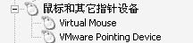

# 虚拟键盘、虚拟鼠标驱动

> 原文：[`www.pediy.com/kssd/pediy10/74327.html`](https://www.pediy.com/kssd/pediy10/74327.html)

能够在设备管理器中模拟出虚拟鼠标和键盘的驱动程序。 

上传的附件
|    ||   
 |
|  || 虚拟设备.rar  
 |
|  || 虚拟鼠标.rar  
 |
|   
 ||  |