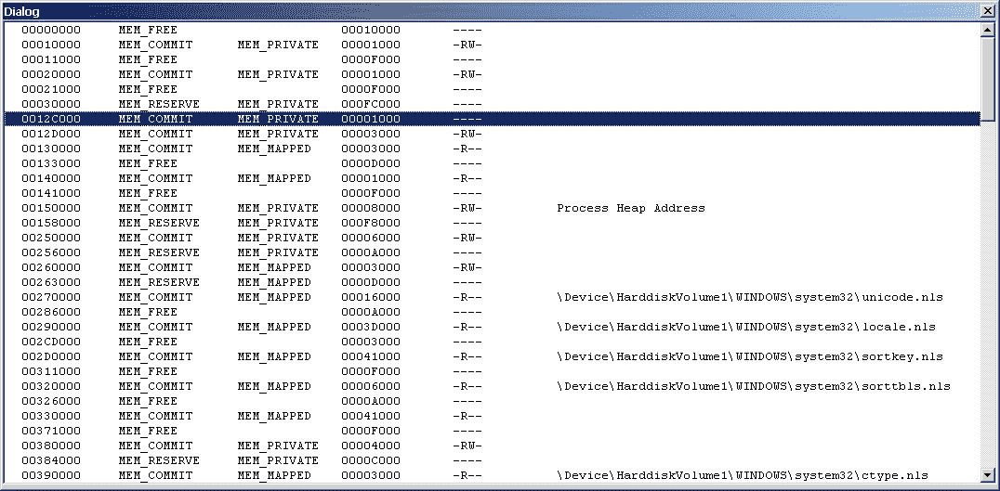

# windows 下 32 位汇编语言学习笔记 第十章 内存管理部分 1

> 原文：[`www.pediy.com/kssd/pediy10/89301.html`](https://www.pediy.com/kssd/pediy10/89301.html)

**windows 下 32 位汇编语言学习笔记 第十章 内存管理部分**  
  
前面 5 6 7 8 9 章都是介绍 windows 界面设计有关的内容，这些内容大概看一下就可以，等需要用的时候再回过头来查。一次性记住的可能性不大。这些章节也没有什么难度，自己看看就可以。  
我所关心的还是 windows 系统相关知识，说道界面设置，对 RC 资源再熟悉做界面还是 Delphi,C++builder 比较快速。  
  
本章介绍了很多 windows 下关于内存管理的函数,书上有句话说的很好，不要去深究这些函数分配的内存具体放在内存寻址空间的什么地方,只需要知道什么时候该用什么类型的内存管理函数就可以。  
  
**Global 标准内存管理**  
  
GlobalAlloc 函数使用 GMEM\_MOVEABLE 参数返回的是个内存句柄，内容是一个地址，这个地址才是可以使用的内存块。比如：  
PVOID lpMem =  GlobalAlloc(GHND, 1000);  
现在 lpMem 指向的内容是一个地址，必须通过 GlobalLock(lpMem)函数返回这个指针才能使用。  
  
实际上 GMEM\_MOVEABLE 参数和 GMEM\_FIXED 区别就是前者必须要经过 GlobalLock 才能使用，后者则通过返回的指针直接使用。  
  
关于什么时候可移动，我没法测，不知道 windows 在什么情况下去移动这块内存。  
  
GlobalAlloc 分配内存是紧凑的，就是说分配的多个内存空间可以放在一个内存页面里，只要能放的下。  
  
**Heap 堆内存管理**  
Heap 内存管理非配基本上和 Global 的用法相当,一般的用法都是 GetProcessHeap 得到进程默认堆，然后 HeapAlloc 分配。  
  
**虚拟内存管理**  
有一点必须知道，VirtualAlloc,所分配的空间都是页对齐的，分配 1 字节的内存空间也会占用 4096 字节的一个内存页，再次使用 VirtualAlloc 分配内存会从新的一页开始。  
每个虚拟内存页面有三种状态：Free：自由状态,Commit：提交状态,Reserve：保留状态。  
  
八种保护属性:  
PAGE\_NOACCESS,PAGE\_READONLY,PAGE\_READWRITE,PAGE\_EXECUTE,PAGE\_EXECUTE\_READ,PAGE\_EXECUTE\_READWRITE,PAGE\_EXECUTE\_WRITECOPY,PAGE\_WRITECOPY  
这八种属性在第一章的笔记里有介绍。  
  
虚拟内存页面还有 4 种类型  
Free：空闲，没有提交也没有使用的。Private：私有，该区域的虚拟地址和系统页文件关联。Image：映像，改区域的虚拟内存地址和 exe 文件或 dll 文件关联。  
Mapped：映射，改区域的内存和其他硬盘上的文件关联。  
  
这些页面的属性，类型，状态，就是 80386 保护模式下，windows 系统管理虚拟内存的机制。  
  
虚拟内存管理函数中提供了几个可以操作其他进程虚拟地址的函数。  
  
LPVOID VirtualAllocEx(HANDLE hProess,LPVOID lpAddress,SIZE\_T dwSize,DWORD flProtect)  
  
这个函数可以在别的进程空间保留或者提交一块内存。比如 DLL 的远程注入就是使用这个函数在目标进程开辟一块虚拟内存空间，将要注入的 dll 名通过 WriteProcessMemory 函数写进目标进程的虚拟内存空间，然后再通过 CreateRemoteThread 函数运行 LoadLibraryA 加载写入的 dll 文件，LoadLibraryA 函数位于 kernel32.dll 中，由于每个进程运行都会加载这个 dll，所以 LoadLibraryA 函数在不同进程中的地址是一样的，可以直接再目标进程使用。  
  
比如下面的例子:  
// 向目标进程地址空间写入 DLL 名称  
DWORD dwSize, dwWritten;  
dwSize = lstrlenA( lpszDll ) + 1;  
LPVOID lpBuf = VirtualAllocEx( hProcess, NULL, dwSize, MEM\_COMMIT, PAGE\_READWRITE );  
if ( NULL == lpBuf )  
{  
     CloseHandle( hProcess );  
    // 失败处理  
}  
if ( WriteProcessMemory( hProcess, lpBuf, (LPVOID)lpszDll, dwSize, &dwWritten ) )  
{  
    // 要写入字节数与实际写入字节数不相等，仍属失败  
    if ( dwWritten != dwSize )  
     {  
         VirtualFreeEx( hProcess, lpBuf, dwSize, MEM\_DECOMMIT );  
         CloseHandle( hProcess );  
        // 失败处理  
     }  
}  
else  
{  
     CloseHandle( hProcess );  
    // 失败处理  
}  
// 使目标进程调用 LoadLibrary，加载 DLL  
DWORD dwID;  
LPVOID pFunc = LoadLibraryA;  
HANDLE hThread = CreateRemoteThread( hProcess, NULL, 0, (LPTHREAD\_START\_ROUTINE)pFunc, lpBuf, 0, &dwID );  
\_\_\_\_\_\_\_\_\_\_\_\_\_\_\_\_\_\_\_\_\_\_\_\_\_\_\_\_\_\_\_\_\_\_\_\_\_\_\_\_\_\_\_\_\_\_\_\_\_\_\_\_\_\_\_\_\_\_\_\_\_\_\_\_\_\_\_\_\_\_\_\_\_\_\_\_\_\_\_\_\_\_\_\_\_\_\_\_\_\_\_\_\_\_\_\_\_\_\_\_\_\_\_\_\_\_\_\_\_\_\_\_\_\_\_\_\_\_\_\_\_\_\_  
  
  
DWORD VirtualQuery(PVOID pvAddress,PMEMORY\_BASIC\_INFORMATION lpBuffer,SIZE\_T dwLength);  
这个函数可以用来查询 pvAddress 指定的内存空间的状态 State,类型 Type,和保护属性 Protect,地址空间的属性保存在 MEMORY\_BASIC\_INFO 结构中。用这个函数，就可以写一个和 Cheat Engine 里一样的查看内存 Region 的程序。  
  
下面这个小程序就是使用 VirtualQuery 函数实现查询当前进程中的内存区域状态。实现的功能比 Cheat Engine 里的还多了可以知道哪里的内存是进程堆，那里映射，映像了什么文件。  
  
部分参考 windows 核心编程第十章的内容  

代码:

```
;显示内存信息
.386
.model flat,stdcall
option casemap:none

include windows.inc
include kernel32.inc
includelib kernel32.lib
include macros.asm
include user32.inc
includelib user32.lib
include Psapi.inc
includelib Psapi.lib

IDD\_DIALOG  equ 104
IDC\_LIST  equ 1001  

.data?
  hInstance  dd ?
  hWinMain  dd ?
  hProcess  dd ?
.const
  msg      db  "%10p %15s %15s %10p %10s",0
  memfree    db  "MEM\_FREE   ",0
  memcommit  db  "MEM\_COMMIT ",0
  memreserve  db  "MEM\_RESERVE",0
  unknow    db  '           ',0
  memimage  db  "MEM\_IMAGE  ",0
  memmapped  db  "MEM\_MAPPED ",0
  memprivate  db  "MEM\_PRIVATE",0
  
.code
;内存状态
\_FormatState proc wState
  mov eax,wState
  .if eax == MEM\_COMMIT
    lea eax,offset memcommit
  .elseif eax == MEM\_FREE
    lea eax,offset memfree
  .elseif eax == MEM\_RESERVE
    lea eax,offset memreserve
  .else
    lea eax,offset unknow    
  .endif
  ret
\_FormatState endp
;内存类型
\_FormatType proc wType
  mov eax,wType
  .if  eax == MEM\_IMAGE
    lea eax,offset memimage
  .elseif eax == MEM\_MAPPED
    lea eax,offset memmapped
  .elseif eax == MEM\_PRIVATE
    lea eax,offset memprivate
  .else
    lea eax,offset unknow        
  .endif
  ret
\_FormatType endp
;保护属性
\_FormatProtect proc wProtect,szBuffer
  mov eax,wProtect
  .if eax == PAGE\_READONLY
    invoke wsprintf,szBuffer,offset CTXT('%s'),CTXT('-R--')
  .elseif eax == PAGE\_READWRITE
    invoke wsprintf,szBuffer,offset CTXT('%s'),CTXT("-RW-")
  .elseif eax == PAGE\_WRITECOPY
    invoke wsprintf,szBuffer,offset CTXT('%s'),CTXT("-RWC")
  .elseif eax == PAGE\_EXECUTE
    invoke wsprintf,szBuffer,offset CTXT('%s'),CTXT("E---")
  .elseif eax == PAGE\_EXECUTE\_READ
    invoke wsprintf,szBuffer,offset CTXT('%s'),CTXT("ER--")
  .elseif eax == PAGE\_EXECUTE\_READWRITE
    invoke wsprintf,szBuffer,offset CTXT('%s'),CTXT("ERW-")
  .elseif eax == PAGE\_EXECUTE\_WRITECOPY
    invoke wsprintf,szBuffer,offset CTXT('%s'),CTXT("ERWC")
  .else
    invoke wsprintf,szBuffer,offset CTXT('%s'),CTXT("----")
  .endif
  ret
\_FormatProtect endp

;显示内存信息
\_ShowMemoryState proc uses ecx hwndLB
  local  @msg\[1024\]:byte
  local  @path\[MAX\_PATH\]:byte
  local   @mbi:MEMORY\_BASIC\_INFORMATION
  local  @Ret:dword
  local  @szState:dword
  local  @szType:dword  
  local  @szProtect\[5\]:byte
  local  @pHeapAddress:dword
  
  ;ebx 作为下一个查询的内存地址
  xor ebx,ebx
\_loopbegin:
  invoke VirtualQuery,ebx,addr @mbi,sizeof @mbi  
  mov @Ret,eax
  mov eax,@mbi.BaseAddress  
  invoke \_FormatState,@mbi.State
  mov @szState,eax
  invoke \_FormatType,@mbi.lType
  mov @szType,eax
  invoke \_FormatProtect,@mbi.Protect,addr @szProtect
  invoke wsprintf,addr @msg,offset msg,@mbi.BaseAddress,@szState,@szType,@mbi.RegionSize,addr @szProtect
  
  ;标志内存映射，映像文件
  .if @mbi.State != MEM\_PRIVATE    
    invoke GetCurrentProcess
    mov hProcess,eax
    invoke GetMappedFileName,hProcess,ebx,addr @path,MAX\_PATH
    .if eax
      invoke lstrcat,addr @msg,CTXT('          ')
      invoke lstrcat,addr @msg,addr @path
    .endif    
  .endif
  ;标志堆地址
  invoke GetProcessHeap
  mov @pHeapAddress,eax
  .if  ebx==eax
    invoke lstrcat,addr @msg,CTXT('          ')
    invoke lstrcat,addr @msg,CTXT('Process Heap Address')
  .endif    
  invoke SendMessage,hwndLB,LB\_ADDSTRING,0,addr @msg
  
  add ebx,@mbi.RegionSize
  cmp @Ret,sizeof @mbi
  je \_loopbegin 
  ret
\_ShowMemoryState endp

\_DlgProc  proc hWnd,wMsg,wParam,lParam
  mov eax,wMsg
  .if eax == WM\_CLOSE
    invoke EndDialog,hWnd,0
  .elseif  eax == WM\_INITDIALOG
    invoke GetDlgItem,hWnd,IDC\_LIST  
    invoke \_ShowMemoryState,eax
  .else
    mov eax,FALSE
    ret
  .endif
  mov eax,TRUE
    ret
\_DlgProc endp

start:
  invoke GetModuleHandle,NULL
  mov hInstance,eax
  invoke DialogBoxParam,hInstance,IDD\_DIALOG,NULL,offset \_DlgProc,WM\_INITDIALOG
  invoke ExitProcess,NULL
end start

```

代码:

```
//资源文件 使用 ResEdit 编辑
// Generated by ResEdit 1.4.4.19
// Copyright (C) 2006-2008
// http://www.resedit.net

#include "res.h"
#include <windows.h>
#include <commctrl.h>
#include <richedit.h>

//
// Dialog resources
//
IDD\_DIALOG DIALOGEX 0, 0, 535, 252
STYLE DS\_MODALFRAME | DS\_SETFONT | WS\_VISIBLE | WS\_BORDER | WS\_CAPTION | WS\_DLGFRAME | WS\_POPUP | WS\_SYSMENU
EXSTYLE WS\_EX\_WINDOWEDGE
CAPTION "Dialog"
FONT 10, "Courier New", 400, 0, 0
BEGIN
    LISTBOX         IDC\_LIST, 0, 0, 535, 250, WS\_TABSTOP | WS\_VSCROLL | LBS\_NOINTEGRALHEIGHT | LBS\_SORT | LBS\_NOTIFY
END

```

通过循环调用 VirtualQuery,通过返回的 mbi 结构获得所有进程地址空间的各种信息，从 0 地址开始查找，每次查找后把地址加上 mbi 结构的 RegionSize(区域尺寸)再查找下一个区域的信息。  
还可以通过 DWORD GetMappedFileName(HANDLE hProcess,LPVOID,lpv,LPTSTR lpFilename,DWORD nSize)检查类型为 MEM\_IMAGE，MEM\_MAPPED 的内存区域加载文件的路径。  
还可以通过 HANDLE GetProcessHeap(VOID)获得进程堆地址。  
  
程序里用到了 Masm 宏 CTEXT(),用这个宏就不必每次使用个字符串都去.data 或.const 里定义，这个宏实际上就是实现再.data 或者.const 定义一个字符串。  
  
程序的运行结果如下：  
  
  
  
依次显示：Address,State,Type,RegionSize,Protect,其他描述  
  
  
**汇编的串指令**  
汇编中有一些专门用来处理连续内存单元的指令，叫做串操作指令。串指令通过 EDI 或 ESI 来指定，可以对内存单元按字节，字或者双子进行处理，并更具操作对象的字节数根据 DF（方向标志）对 DEI,ESI 变址寄存器自动增减 1,2,或 4 字节.  
  
先看看书里的例子:  
将 szSource 中的内存移动到 szDest 中.  
mov esi,offset szSource  
mov edi,offset szDest  
mov ecx,dwSize  
cld        
rep movesb    
  
cld 指令是清方向指令，使 DF 标志为 0，使每次移动一个字节，esi 和 edi 都加 1。  
movesb 是串移动指令，后面的 b 代表 byte 每次移动一个字节类型,还可以是 movesw(移动一个字),movesd（移动一个双字），并根据方向位和字节大小对 dsi 和 edi 进行增减.  
rep 是重复字符串操作指令,后面跟一个串操作指令来重复串指令，重复的次数由 ecx 来决定，所以，上面例子中把 dwSize 放到 ecx 寄存器中，用来指定内存单元大小。  
  
stosb/stosw/stosd 指令的作用是把 al（1 字节）,ax（2 字节）,eax（4 字节）的值，填充 EDI 指向的内存区域。同样根据 DF 来对 EDI 进行增减。  
  
lodsb/lodsw/lodsd 指令是把 ESI 指向的内存区域取一个字节，2 字或者 4 字节,放入 al,ax,eax 中,根据 DF 标志位对 ESI 进行增减。  
  
本章的内容需要熟练掌握，不管写什么样的程序，对可用内存的利用的和理解都是很关键的。对于本章，我计划多写一些小程序，1 来加深对内从使用的理解，2 来熟悉汇编语法。  
  
由于好久没有跟新，所以先发上来一部分，第二部分会有更多的内存使用的代码和例子。