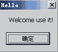
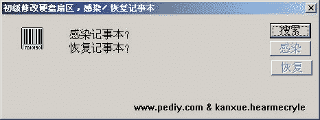
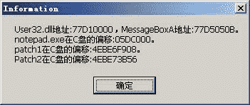

# 初级修改硬盘扇区，感染记事本

> 原文：[`www.pediy.com/kssd/pediy11/113848.html`](https://www.pediy.com/kssd/pediy11/113848.html)

初级修改硬盘扇区，感染记事本  
目的：  
  学习了西方失败的漏洞分析技术和借鉴了天易 love 的直接写磁盘扇区的思路，参阅了 NTFS 文件格式。决定动手实践，为记事本添加 Welcome 提示框，并进行扇区级修改。算是对学习的一个总结性练习。也为看雪尽点绵薄之力。  
知识要点：  
（1）OD 应用，分析记事本 PE 文件可插入代码位置；Dependency 手动找所需要的 API 地址。  
（2）WinHex 应用，手动修改记事本在磁盘扇区二进制代码。  
（3）用 VC++6.0 写出感染通用程序。分析 NFTS 磁盘格式，利用文件$MFT 的文件名属性$FILE\_NAME，直接遍历磁盘找到记事本文件的具体偏移。（只给出算偏移的部分代码）  
（4）为人要本份。建议学习密码学版主 rockinuk 大大近期关注的法律与道德相关内容。  
  
运行与记事本关联的文件后,都会弹出以下  
  
运行效果  
  
  
  
  
修改硬盘扇区感染记事本.rar 文档  
InjectNotepad.rar InjectNotepad.exe  
goto.rar goto.h  
  
  
参考资料：  
西方失败漏洞分析技术  
http://bbs.pediy.com/showthread.php?t=56445  
天易 love 直接写盘思路  
http://bbs.pediy.com/showthread.php?t=110997  
NTFS 格式介绍  
http://hi.baidu.com/%B7%B3%B2%BB%B7%B3/blog/item/54ceb06f6725ead280cb4a62.html