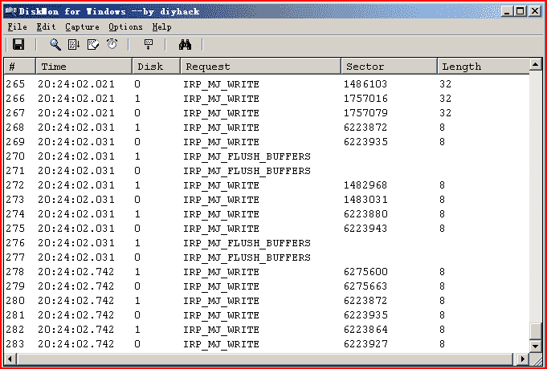

# DiskMon 高度模仿版 sys+GUI 开源代码

> 原文：[`www.pediy.com/kssd/pediy10/95456.html`](https://www.pediy.com/kssd/pediy10/95456.html)

SysinternalsSuite 中的 DiskMon 逆向源代码  
  
相关信息：http://www.debugman.com/read.php?tid=3581  
  
已测：Xp sp2、Vista sp1  
  

上传的附件
|  || DiskMon.rar  
 |