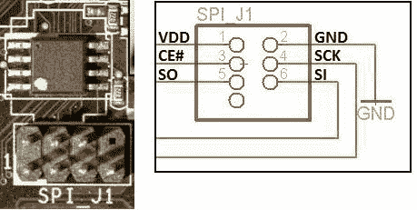
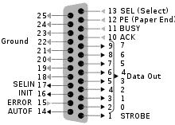
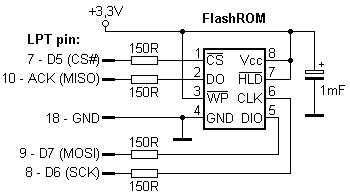
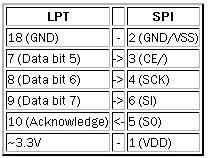
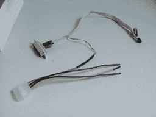

# LPT 接口刷写主板 BIOS 芯片

> 原文：[`www.pediy.com/kssd/pediy12/140114.html`](https://www.pediy.com/kssd/pediy12/140114.html)

本文介绍了用 LPT 接口实现 SPI 编程器的功能，适用于 BIOS 修复、BIOS 调试开发等用途。  
  
先说一下故事背景。  
  
SerialICE 项目(http://www.serialice.com/)在系统 BIOS 启动初期即接管 Processor，使用改编的 QEMU 引擎以模拟方式介入后续指令的执行，从而实现硬件 ICE 的调试功能。  
沿用 SerialICE 的思路，本人已成功将手上的华硕 P5k-e+Intel Q6600 改造成(非完美的)硬件调试器。这种的调试器比 bochs 调时器支持的硬件广泛，bochs 需要为每一种外部设备编写代码模拟，bochs 至今仍不支持 1394 接口，bochs 的显卡过于老旧，根本无法运行 DirectX9/10 的代码。另外显示卡、以太网卡等外围部件不需要软件模拟，执行速度比 bochs 快很多。  
  
为了开发这个项目，需要反复折腾 BIOS ROM，官方的刷写工具只能在系统正常的时候使用，调试期间经常把 BIOS 刷死，因此必须另想办法。现在的 PC 主机板 BIOS ROM 芯片一般都采用 SPI 接口，SPI 协议引脚少，实现简单。通常在 ROM 旁边有一个 7 针的外部编程接口，如下图所示。  
  
  
老旧电脑的 LPT 接口配以合适的程序，能实现诸如 SPI、JTAG 等很多功能，除了速度稍慢。LPT 的 DB25 插头引脚定义如下图。  
  
捷克的 Rayer 利用 LPT 实现了 SPI 的接口编程(http://rayer.ic.cz/elektro/spipgm.htm)。接线图如下图所示。  
  
找一个 IDE 硬盘或软驱的接头，砍下一部分并附带接线，与 LPT 的 DB25 插头按下表连接。  
  
  
3.3V 电源可取自本机 ATX 电源（桔黄色就是+3.3V）或另外的备用电源。由于 SPI EEPROM 数字电路芯片的瞬态电流比较大，需要在 3.3V 电源 Vcc 脚与 GND 之间接不小于 1000uF 的电容（耐压 6V 以上），Rayer 电路中的 150 欧姆电阻可有可无。最后制成的电缆类似下图。  
  
  
Rayer 在网站上提供了一个 SPI 编程工具(SPIPGM)，但是这个工具适用的芯片范围很窄。  
  
flashrom 项目(http://flashrom.org)提供了对更多芯片的支持。  
  
电缆连接正确，电源接通后  
运行 flashrom -p rayer\_spi 即显示侦侧出的 SPI EEPROM 的型号；  
运行 flashrom -r bios.rom -p rayer\_spi 可以 dump 出 EEPROM；  
运行 flashrom -w bios.rom -p rayer\_spi 可以写入 EEPROM。  
  
有了这个几乎免费的 ROM 芯片编程器，就可以随心所欲，毫无顾忌的修改 BIOS 了。预掌握 Processor，必先掌握 BIOS。