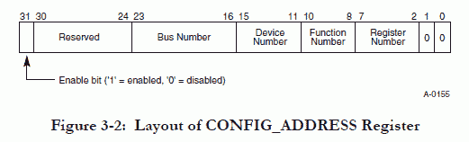
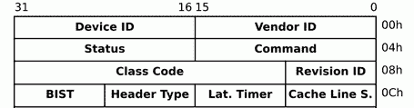
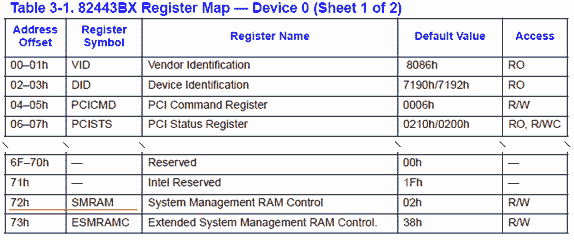
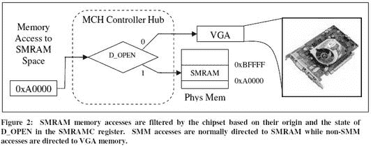
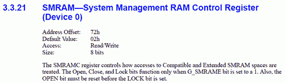
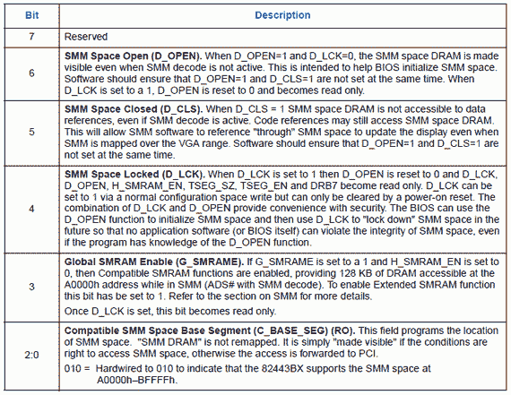
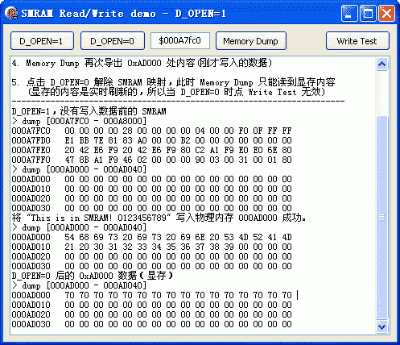

# SMM Rootkit 初步 - 读写 SMRAM（带你迈入 CPU 级 Rootkit 之门）

> 原文：[`www.pediy.com/kssd/pediy10/84835.html`](https://www.pediy.com/kssd/pediy10/84835.html)

好吧，我承认标题有点夸大，不介意的都进来 BS 我把   
就像 qihoocom 大侠说的，“SMM XX 早就几万年前就不是什么秘密了”，不过国内讨论这个的到是鲜见，希望这篇文章能抛砖引玉吧。  
  
之前看到 rootkit.com 上 Implementing SMM PS/2 Keyboard sniffer 那个代码，狠狠震撼了一把。于是开始研究 SMM，半月下来总算有些收获。这里将如何读写 SMRAM 的方法拿出来科普一下，希望更多人能迈入编写 SMM Rootkit 的大门。  
文章后面提供可以在 VPC 和 VMware 两大虚拟机中运行的代码，将演示如何在 WinXP(SP2)中读写 SMRAM。（本文只考虑最简单的系统环境，不涉及 SMM Space Locked(D\_LCK)=1 时无法读写 SMRAM 的情况）另外，按 Ivanov 大牛的说法，这种方法局限性很大，只能在没有执行 Intel 修补方案的主板上运用（感谢两大 VM 模拟的都是 I440BX ）。  
  
对硬件方面接触尚浅，文中若有疏漏之处，欢迎指正。  
  
  
\--------------------------------------------------------------------------------------------------------  
  
首先放下 PCI 相关的诸多知识，我用最短的篇幅叙述读写 SMRAM 的过程。希望这篇文章能带你迈出 SMM Rootkit 的第一步。  
首先说说什么是 SMM（System Management Mode）。[System Management Mode Hack](http://www.phrack.org/issues.html?issue=65&id=7&mode=txt)中说：SMM 是专门为电源管理设计的执行规则。当进入 SMM 后，系统的各个部件可以被关闭或者使用最低的功耗。SMM 独立于其他的系统软件，也可以被用在其他目的...  [该文章中文版点这里](http://hi.baidu.com/deep_pro/blog/item/fd2f75771b14351cb051b9d5.html)  
  
了解 SMM 是什么东西就够了，这篇文章不会涉及太多 SMM 的东西。相反，读写 SMRAM 更需要的是 PCI 配置空间（PCI Configuration Space）方面的知识。  
先讲讲两个访问 PCI 配置空间的 I/O 端口：CF8h 和 CFCh  
通过向 CF8h 端口写一个特殊的地址，我们就可以在 CFCh 端口上读写指定寄存器的值。这里要读的寄存器是位于配置空间偏移为 72h 的 8bit 寄存器 SMRAM (System Management RAM Control Register)  
  
首先要介绍一下 CF8h 这个 I/O 端口。实际上 I/O CF8h 写的是 CONFIG\_ADDRESS 寄存器，所以 CF8h 又叫 CONFIG\_ADDRESS。其布局如下\[1\]：  
  
按上图格式，31 位置 1(enable)，假设 I440BX 的北桥 82443BX 位于 Bus: 0, Device:0, Func:0（后面将教你如何确定芯片类型以及取得这几个值），这样配置空间的基址就是 0x80000000。  
  
通过 I/O 指令向 CF8h 写入 0x80000000，就可以从 CFCh（CONFIG\_DATA）中读出 82443BX 配置空间偏移为 0 的一个 DWORD 值了。而这个 DWORD 的高低 16 位分别是 VendorID 和 DeviceID，如图：  
  
  
下面在我们去读配置空间偏移为 72h 的 SMRAM 前，首先注意一个特性。不知道你注意到没有，回头看看 CONFIG\_ADDRESS 的低 2 位，它们被定义为 0。且不谈 PCI 规范上的大道理，说白了这个地方为 0 是为了限制你给出的地址必须为 4 的整数倍。了解到这一点再看那个 Register Number 就比较好理解了，原来这个寄存器编号和偏移是这么对应的。  
  
  
好了，那么偏移为 72h (01110010) 的 SMRAM，最后两位置零是 70h (01110000)，即位于编号为 1C (11100)的寄存器上。所以只要向 CF8h 里写入 0x80000070 这个地址，此时从 CFCh 端口读出的数据就是包含 SMRAM 的一个 DWORD 了。  
  
  
  
假设读出来的数据为 DWORD 380A0000h (00 00 0A 38)，对照上面 82443BX 寄存器表可知：  

代码:

```
70h    00
71h    00
72h    0A    SMRAM
73h    38    ESMRAMC

```

  
  
好了，SMRAM 寄存器读出来了，下面进入正题：如何将 SMRAM 内容映射到 0xA0000。  
从文献\[2\]中了解到，只要 D\_OPEN=1 时，对物理内存 0xA0000 的访问会变成这样：  
  
  
D\_OPEN 位在哪？SMRAM = 0Ah 又代表什么？根据文献\[1\]记载，SMRAM 的各位意义如下（关于 SMRAM 更详细解释，见文章末尾补充资料不部分）：  
代码:

```
   7    6      5     4       3      2 - 0
   0  D\_OPEN D\_CLS D\_LCK G\_SMRAME C\_BASE\_SEG
        |                    1       010
        |-> 我们就是要设置 D\_OPEN = 1

```

原来的 0Ah 就是 0000 1010。只要第四位的 D\_LCK 不为 1，好了，向 SMRAM 写入 4Ah (0100 1010)，于是飞跃光明之巅！  
  
  
  
  
  
**附带程序中整个映射 SMRAM 过如下：**  
1. 首先遍历 PCI 设备，找到 I440BX 的 82443BX Host Bridge Controller。  
    （VMware Workstation 6.0.x 中 82443BX 的 VendorID: 8086h  DeviceID: 7190h）  
    （Virtual PC 2007 6.0.x 中 82443BX 的 VendorID: 8086h  DeviceID: 7192h）  
    很幸运，这两个虚拟机中，82443BX 都位于 Bus:0, Device:0, Func:0，所以 PCI 配置空间基址都是 0x80000000。  
2. 以 I/O 伪代码为例，读 SMRAM：  
    out( CF8h, 80000070h )   // 还记得 0x80000070 怎么来的吗？  
    in( CFCh, eax )          // 读出包含 SMRAM 的一个 DWORD，如 380A0000h  
    shr eax, 10h             // SMRAM 的 8bit 在第三个字节处，右移 16 位（2 字节）  
// 此时 AL 中就是 SMRAM 内容了（0Ah）  
3. 置 D\_OPEN 为 1，并且 C\_BASE\_SEG 设为 010  
（C\_BASE\_SEG 在初始化时就是 010 了，不过为了防止意外，最好重设一下）  
    out( CF8h, 80000070h )  
    mov eax, 384A0000h       // 写回 D\_OPEN 置 1 后的 SMRAM（4Ah）  
    out( CFCh, eax )  
4. 此时对物理内存 0xA0000-0xBFFFF 读写，就是在 SMRAM 中了。写完试试 D\_OPEN=0 隐藏看看，读 0xA0000 是不是又回到显存了？  
注意：当 SMM Space Lock(D\_LCK)为 1 时，这种方法是无法修改 SMRAM 的，只能另辟蹊径。  
  
  
另外，关于读出的 SMRAM 内容，一定会有人质疑 0xA0000 处真的是 SMRAM？关于这点，可以去看看 SMRAM 的布局 http://www.sandpile.org/ia32/smm.htm。  
我一般是通过 7FF0h (EIP) 和 7FF4h (EFLAGS) 这两个 DWORD 判断的（SMBASE 默认是 0xA0000）：  
\> dump \[000A7FC0 - 000A8000\]  
000A7FC0   00 00 00 00 28 00 00 00 00 04 00 00 F0 0F FF FF   
000A7FD0   E1 BB 7E 81 83 A0 00 00 B2 00 00 00 00 00 00 00   
000A7FE0   20 42 E6 F9 20 42 E6 F9 80 C2 A1 F9 E0 E0 6E 80   
000A7FF0   47 8B A1 F9 46 02 00 00 00 90 03 00 31 00 01 80  
EIPEFLAGS  
  
  

引用: **补充资料：**  
这里是 Intel 440BX AGPset: 82443BX Host Bridge Controller\[1\] 中关于 SMRAM 的详细解释：  
  
  
  
还有些相关知识，有时间再补上... 

  
**参考文献：**  
\[1\] Intel 440BX AGPset: 82443BX Host Bridge Controller  
[`download.intel.com/design/chi...s/29063301.pdf`](http://download.intel.com/design/chipsets/datashts/29063301.pdf)  
\[2\] Shawn Embleton, Sherri Sparks, Cliff Zou.  
[SMM Rootkits: A New Breed of OS Independent Malware](http://www.cs.ucf.edu/~czou/research/SMM-Rootkits-Securecom08.pdf)  
\[3\] Loic Duflot, Daniel Etiemble, Olivier Grumelard.  
[Using CPU System Management Mode to Circumvent Operating System Security Functions](http://www.ssi.gouv.fr/fr/sciences/fichiers/lti/cansecwest2006-duflot-paper.pdf)  
\[4\] Intel 64 and IA-32 Architectures Software Developer's Manual Volume 3B: System Programming Guide  
[`www.intel.com/products/processor/manuals/`](http://www.intel.com/products/processor/manuals/)  
\[5\] A tool for FreeBSD to discover SMRAM on i440BX based motherboards  
[`unix.derkeiler.com/Mailing-Li...att-0448/smm.c`](http://unix.derkeiler.com/Mailing-Lists/FreeBSD/hackers/2004-03/att-0448/smm.c)  
  
  
**测试环境：**  
Intel Pentium D 3.0GHz 双核 + Virtual PC 2007(6.0.192.0) + WinXP(SP2)  
Intel Pentium D 3.0GHz 双核 + VMware Workstation (6.0.4-93057) + WinXP(SP2)  
AMD Athlon 64 X2 Dual 4000+ + Virtual PC 2007(6.0.192.0) + WinXP(SP2)  
  
Virtual PC 2007 下的运行截图：  
  
  
由于手头没有 I440BX 的主板，无法使用真实机器测试。另外 AMD64 Architecture Programmer's Manual Volume 2: System Programming 也提及了 SMM 的相关细节，目前还没有仔细看。  
如果你在其他芯片组上测试成功，欢迎给我来信：upbit@126.com  
  
ps: 忘补上一个开发库了，程序里用到了 WinIO，可以到这里[`www.internals.com/`](http://www.internals.com/)  
    WinIO 这个开发库附带 C 和 VB 的例子，理论上我这里给的代码都能翻译成 C 或 VB 的，有兴趣的不妨试试  
.

上传的附件
|  || winio.zip \[附件请到原帖下载：http://bbs.pediy.com/showthread.php?t=84835 \]   
 |
|  || SMRAM 读写演示\_bin.rar  
 |
|  || SMRAM 读写演示\_src.rar  
 |

使用附件中的程序枚举 PCI 设备，代码参考自 遍历 PCI 设备 这篇文章：  
http://hi.baidu.com/deep\_pro/blog/item/fd2f75771b14351cb051b9d5.html  
  
例如这是我在 VPC 里的结果：  

引用: \[80000000\] 01  VID:8086/D:7192  B:00 D:00 F:00   06-00-00 (V:03)  
\[80003800\] 02  VID:8086/D:7110  B:00 D:07 F:00   06-01-00 (V:01)  
\[80003900\] 03  VID:8086/D:7111  B:00 D:07 F:01   01-01-80 (V:01)  
\[80003A00\] 04  VID:0000/D:0000  B:00 D:07 F:02   00-00-00 (V:00)  
\[80003B00\] 05  VID:8086/D:7113  B:00 D:07 F:03   06-80-00 (V:02)  
\[80004000\] 06  VID:5333/D:8811  B:00 D:08 F:00   03-00-00 (V:00)  
\[80005000\] 07  VID:1011/D:0009  B:00 D:0A F:00   02-00-00 (V:20) 

  
这里主要关注的是 VendorID 和 DeviceID（VID:8086/D:7192），以及最前方的地址信息（80000000）。关于这两个 ID 所代表的意义，我们可以到 [`www.pcidatabase.com/`](http://www.pcidatabase.com/) 上进行查询。  
  
例如我 VPC 2007 的设备信息：  

引用: 440BX/ZX chipset Host-to-PCI Bridge  
\[80000000\] 01  VID:8086/D:7192  B:00 D:00 F:00   06-00-00 (V:03)  
PIIX4/4E/4M ISBridgeA   
\[80003800\] 02  VID:8086/D:7110  B:00 D:07 F:00   06-01-00 (V:01)  
PIIX4/4E/4M IDE Controller  
\[80003900\] 03  VID:8086/D:7111  B:00 D:07 F:01   01-01-80 (V:01)  
\-  
\[80003A00\] 04  VID:0000/D:0000  B:00 D:07 F:02   00-00-00 (V:00)  
PIIX4/4E/4M Power Management Controller  
\[80003B00\] 05  VID:8086/D:7113  B:00 D:07 F:03   06-80-00 (V:02)  
S3 Graphics Co., Ltd - Trio 64/64V  
\[80004000\] 06  VID:5333/D:8811  B:00 D:08 F:00   03-00-00 (V:00)  
Digital Equipment Corporation - Fast Ethernet Ctrlr  
\[80005000\] 07  VID:1011/D:0009  B:00 D:0A F:00   02-00-00 (V:20) 

VMware VMware Workstation 6.0 的：  

引用: 82443BX/ZX 440BX/ZX AGPset Host Bridge  
\[80000000\] 01  VID:8086/D:7190  B:00 D:00 F:00   06-00-00 (V:01)  
82443BX/ZX 440BX/ZX AGPset PCI-to-PCI bridge  
\[80000800\] 02  VID:8086/D:7191  B:00 D:01 F:00   06-04-00 (V:01)  
82371AB/EB/MB PIIX4/4E/4M ISBridgeA   
\[80003800\] 03  VID:8086/D:7110  B:00 D:07 F:00   06-01-00 (V:08)  
82371AB/EB/MB PIIX4/4E/4M IDE Controller  
\[80003900\] 04  VID:8086/D:7111  B:00 D:07 F:01   01-01-8A (V:01)  
82371AB/EB/MB PIIX4/4E/4M USB Interface  
\[80003A00\] 05  VID:8086/D:7112  B:00 D:07 F:02   0C-03-00 (V:00)  
82371AB/EB/MB PIIX4/4E/4M Power Management Controller  
\[80003B00\] 06  VID:8086/D:7113  B:00 D:07 F:03   06-80-00 (V:08)  
VMware Inc. - 9500MGS NVIDIA  
\[80007800\] 07  VID:15AD/D:0405  B:00 D:0F F:00   03-00-00 (V:00)  
BT958 SCSI Host Adaptor  
\[80008000\] 08  VID:104B/D:1040  B:00 D:10 F:00   01-00-00 (V:01)  
VMware Inc. - ??  
\[80008800\] 09  VID:15AD/D:0790  B:00 D:11 F:00   06-04-01 (V:02)  
Am79C970/1/2/3/5/6 PCnet LANCE PCI Ethernet Controller  
\[80020000\] 10  VID:1022/D:2000  B:02 D:00 F:00   02-00-00 (V:10)  
ES 1371 AudioPCI  
\[80020800\] 11  VID:1274/D:1371  B:02 D:01 F:00   04-01-00 (V:02)  
VMware Inc. - Standard Enhanced PCI to USB Host Controller  
\[80021000\] 12  VID:15AD/D:0770  B:02 D:02 F:00   0C-03-20 (V:00) 

  
我只找到 I440BX 的设计手册，几台实际机器用的芯片乱七八糟（SIS、VIA、NVIDIA 都有），网上又下不到相关的资料，实在是无法把程序写得更通用  
如果哪位好心人有在其他芯片组的主板上找 SMRAM 的资料，也请拿出来分享一下。  
  
抱歉，昨天忙中出错，已经把附件 **PCI 设备枚举.rar **传上来了

上传的附件
|  || PCI 设备枚举\_src.rar  
 |
|  || PCI 设备枚举\_bin.rar \[附件请到原帖下载：[`bbs.pediy.com/showpost.php?p=598432&postcount=2`](http://bbs.pediy.com/showpost.php?p=598432&postcount=2) \]   
 |