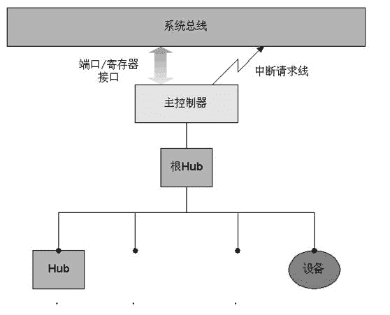
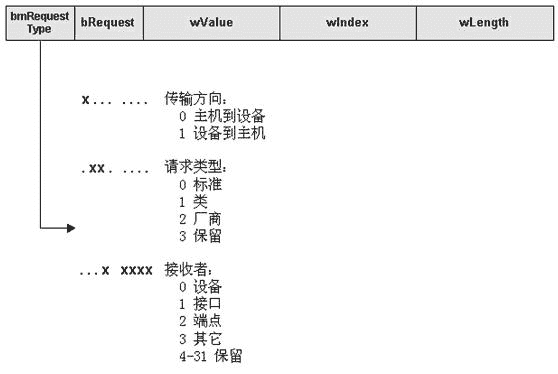
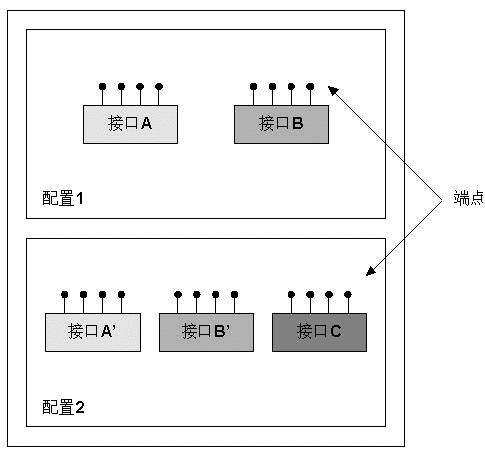

# Windows USB 功能驱动开发总结

> 原文：[`www.pediy.com/kssd/pediy10/98263.html`](https://www.pediy.com/kssd/pediy10/98263.html)

【文章标题】: Windows USB 功能驱动开发总结  
【文章作者】: yybing  
【作者声明】: 只是感兴趣，没有其他目的。失误之处敬请诸位大侠赐教!  
\--------------------------------------------------------------------------------  
  
    最近做了一个 USB 设备的功能驱动，并对其速度的瓶颈做了一些分析，最后找到了影响此设备的速度的主要原因。由于 USB 设备的通用性，代码的主体直接使用 DDK 提供的示例代码：Bluckusb。从正确编译到能正常读写数据有几个关键点，总结了一下，特与大家分享，有不足之处请不吝赐教。  
  
1、 USB 驱动结构图  
 

   
图表 1：USB 设备层次结构    USB 主控制器与其它 I/O 设备一样直接连接到系统总线上。操作系统与主控制器通信使用 I/O 口或内存寄存器，通过普通的中断信号，系统可以接受主控制器的事件通知。主控制器连接一棵 USB 设备树。一种称为 hub 的设备作为其它设备的连接点。多个 hub 能以菊链方式连接，可以连接到 USB 规范中定义的最大深度。其它设备，如照相机、麦克风、键盘等等，直接连到 hub 上。为了精确地表达概念，USB 使用术语 function 来描述非 hub 设备。  
  
2、 写 USB 功能驱动需要了解的内容

> a.  驱动编译方法  
> 各种入门书上都有介绍，用 DDK 的 Dos 环境编译时，错误信息会在 Dos 界面显示，如果这些信息不能定位问题，可以到代码目录下找名字为 buildxx 的 log 文件。  
> b.  驱动与设备的关联  
> 驱动与设备的关联是靠 INF 文件来指定的。简单来说只要把 DDK 中提供的 USB 驱动示例中的 INF 文件中的 VID\_XXXX 和 PID\_XXXX 中的 XXXX 换成自己设备的 VID 和 PID 值，\[SourceDisksFiles\]节中 BULKUSB.sys 换成自己的驱动文件名称就可以使驱动和设备关联。更多 INF 文件介绍可以参考相关介绍文档。  
> c.  设备自定义的命令  
> 自定义的设备，一般都会自定义一些控制命令，在写驱动时，需要了解这些命令的作用，在调试时方便定位问题所在。  
> 此处需要把 IoControl 命令和设备命令区分开，IoControl 命令是应用程序与驱动进行交互的命令，IoControl 命令的生成与设备没有直接关系，可以随意设置只要不与驱动的标准命令发生冲突就可以；设备命令是在令牌阶段使用，也即 Setup 包，设备命令由硬件设计者要定义，设备命令是主机和设备通信的第一步。

  
图表 2：SETUP 令牌的内容

> d.  USB 驱动与设备交互的方式  
> Windows 中通过发送 URB 和 USB 设备进行通信备，各种函数代码中的核心是构造 URB，发送 URB，Setup 包（令牌包）中的信息也被包含在 URB 中。为了方便构造 URB，DDK 提供了一组宏函数，使用宏函数可以很方便构造不同类型的 URB，构造 Setup 包的宏为 UsbBuildVendorRequest ，其中 index，value，request 在硬件中会用到。

3、 正确读写数据的关键点  
  
    USB 设备读写主要由是通过端点来进行，一个端点的数据流方向只能有一个 IN 或者 OUT。端点存在于接口中，接口由配置时取得，配置主要在 IRP\_MJ\_CREATE 的 Dispatch 函数里执行。配置、接口与端点的关系如下图所示。在 DDK 提供的 Bulkusb 的代码中，PipeInfomation 设置有问题，用 fileObject 保存 pipe handle 没有道理，需要改成用 deviceExtension 来保存；UsbInterfaces 中，Pipes 数组至少有两个元素，一个是写数据时用的 Handle，一个是读数据时用的 Handle，在我的设备中 Pipes\[0\]写，Pipes\[1\]写。  
   
图表 3：USB 设备的配置、接口、端点  
4、 调试驱动的工具  
  
    查看打印信息，需要用 DbgView；要跟踪驱动代码用 Windbg，串口线进行双机调试，调试前需要下载被调试机的符号文件；测试并且查看 USB 读写数据，用 Bus Hound，USBlyzer 配合使用；驱动代码编辑用 Source Insight；代码编译直接用 DDK 提供的编译环境即可。  
  
附件为改造后的驱动代码  
   
  
\--------------------------------------------------------------------------------  
【版权声明】: 本文原创于看雪技术论坛, 转载请注明作者并保持文章的完整, 谢谢!  
  
                                                       2009 年 09 月 22 日 09:39:16