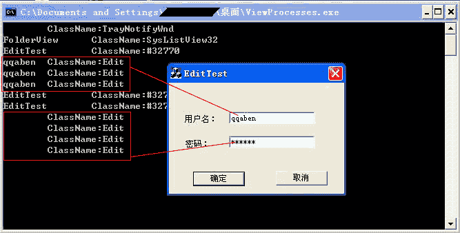

# 星号查看器编写

> 原文：[`www.pediy.com/kssd/pediy10/86282.html`](https://www.pediy.com/kssd/pediy10/86282.html)

【文章标题】: 星号查看器的编写  
【下载地址】: 自己搜索下载  
【作者声明】: 只是感兴趣，没有其他目的。失误之处敬请诸位大侠赐教!  
\--------------------------------------------------------------------------------  
【详细过程】  
    这两天下了查看星号的软件，感觉界面很难看，还带了很多杂七杂八的功能，乱的不成样子，让人没有心情用。所以心血来潮想自己写一个。以前只知道发送 WM\_GETTEXT 消息可以获得一个窗口上的文字，于是做了以下测试：    
   

代码:

```
  //控制台
    .......... 
    while(1)
    {
      Sleep(1000);
      POINT Point;
      ::GetCursorPos(&Point);
      HWND m\_hWnd=WindowFromPoint(Point);
      if(m\_hWnd)
      {
        char szText\[256\];
        int iLength = SendMessage(m\_hWnd,WM\_GETTEXT,256,(LPARAM)szText);
        szText\[iLength\]='\\0';
        {
          char szClassName\[128\];
          int iClassLength = GetClassName(m\_hWnd,szClassName,128);
          szClassName\[iClassLength\] = '\\0';
          printf("%s  ClassName:%s\\n",szText,szClassName);
        }
      }  
    } 
    .............

```

  
从图中可以看到当鼠标移动到用户名那一栏时正确的获得了编辑框里的内容，但是在密码那一栏却什么都没有得到。看来编辑框在设置了 ES\_PASSWORD  风格后，做了某些保护，可能丢弃了外界的 WM\_GETTEXT 消息吧。看了看 MSDN 里对 ES\_PASSWORD 风格的解释：    
Displays an asterisk (\*) for each character typed into the edit control. This style is valid only for singleline edit controls.   
  
To change the characters that is displayed, or set or clear this style, use the EM\_SETPASSWORDCHAR message.   
  
  
看了这一句  To change the characters that is displayed, or set or clear this style, use the EM\_SETPASSWORDCHAR message.   
  
忽然异想天开，要是先给密码框发送 EM\_SETPASSWORDCHAR 消息，再发送 WM\_GETTEXT 消息是不是就能获得密码了呢？改了下代码再测试，我想结果大家都能猜到的，仍然得不到密码，如果这样就能得到密码，那 MS 也太那啥了吧~ :-) 更搞笑的是我把鼠标移到用户名那一栏的编辑框时， 用户名也变成密码框啦。  
  
于是就想看看别人写的星号查看器里是怎么写的，下了 3 款星号查看器。挑了一款没加壳，也没附加 DLL 的。OD 载入，想着在 SendMessage，或者 GetWindowLong 上下断点。Ctrl+N 查找当前模块中的名称。找到这两个函数，对比了一下，调用 SendMessage 的地方比较多，所以先在 GetWindowLong 上下断点看看。  
  
F9 运行程序，拖动软件上的放大镜图标，程序停在这里：  
  
  
  00401ABC  |> \\6A F0         push    -10                           ; /Index = GWL\_STYLE  
  
  00401ABE  |.  FF75 10       push    dword ptr \[ebp+10\]            ; |hWnd  
  00401AC1  |.  FF15 0C924000 call    dword ptr \[<&USER32.GetWind>  ; \\GetWindowLongA  
  00401AC7  |.  8BD8          mov     ebx, eax  
  00401AC9  |.  8D85 D8FCFFFF lea     eax, dword ptr \[ebp-328\]      ;  堆栈地址=0012F87C, (ASCII "EDIT")  
  00401ACF  |.  68 ECB14000   push    0040B1EC                      ;  ASCII "EDIT"  
  00401AD4  |.  50            push    eax                           ;  可见在 GetWindowLong 前面已经调用过 GetClassName  
  00401AD5  |.  E8 361B0000   call    00403610                      ;  对比放大镜指向的窗口类型是否是 EDIT  
  00401ADA  |.  59            pop     ecx  
  00401ADB  |.  85C0          test    eax, eax  
  00401ADD  |.  59            pop     ecx  
  00401ADE  |.  0F84 CA000000 je      00401BAE                      ;  是 Edit, 跳到关键的地方    
  ..........  
  
  00401BAE  |> \\F6C3 20       test    bl, 20  
  00401BB1  |.  74 57         je      short 00401C0A  
  00401BB3  |.  833D 4CE44000>cmp     dword ptr \[40E44C\], 0  
  00401BBA  |.^ 74 D9         je      short 00401B95  
  00401BBC  |.  8D45 14       lea     eax, dword ptr \[ebp+14\]  
  00401BBF  |.  50            push    eax  
  00401BC0  |.  FF75 10       push    dword ptr \[ebp+10\]            ;  可以用 spy 查看一下，此处存放的是密码框的句柄  
  00401BC3  |.  FFD7          call    edi                           ;  USER32.GetWindowThreadProcessId  
  00401BC5  |.  FF75 14       push    dword ptr \[ebp+14\]            ; /ProcessId  
  00401BC8  |.  6A 00         push    0                             ; |Inheritable = FALSE  
  00401BCA  |.  68 3A040000   push    43A                           ; |Access = CREATE\_THREAD|VM\_OPERATION|VM\_READ|VM\_WRITE|QUERY\_INFORMATION  
  00401BCF  |.  FF15 34904000 call    dword ptr \[<&KERNEL32.OpenP>  ; \\OpenProcess  
  00401BD5  |.  8BF0          mov     esi, eax  
  00401BD7  |.  85F6          test    esi, esi  
  00401BD9  |.  74 1C         je      short 00401BF7  
  00401BDB  |.  8D85 D8FEFFFF lea     eax, dword ptr \[ebp-128\]  
  00401BE1  |.  50            push    eax  
  00401BE2  |.  FF75 10       push    dword ptr \[ebp+10\]  
  00401BE5  |.  56            push    esi  
  00401BE6  |.  E8 01F6FFFF   call    004011EC                       ;  关键的地方  
  00401BEB  |.  83C4 0C       add     esp, 0C  
  00401BEE  |.  56            push    esi                            ; /hObject  
  00401BEF  |.  FF15 38914000 call    dword ptr \[<&KERNEL32.Close>   ; \\CloseHandle  
  00401BF5  |.  EB 13         jmp     short 00401C0A  
  00401BF7  |>  8D85 D8FEFFFF lea     eax, dword ptr \[ebp-128\]  
  00401BFD  |.  68 50E44000   push    0040E450  
  00401C02  |.  50            push    eax  
  00401C03  |.  E8 98130000   call    00402FA0  
  00401C08  |.  59            pop     ecx  
  00401C09  |.  59            pop     ecx  
  00401C0A  |>  8D85 D8FEFFFF lea     eax, dword ptr \[ebp-128\]  
  00401C10  |.  50            push    eax                            ; /Text  
  00401C11  |.  68 EC030000   push    3EC                            ; |/ControlID = 3EC (1004.)  
  00401C16  |.  FF75 08       push    dword ptr \[ebp+8\]              ; ||hWnd  
  00401C19  |.  FF15 94914000 call    dword ptr \[<&USER32.GetDlgI>   ; |\\GetDlgItem  
  00401C1F  |.  50            push    eax                            ; |hWnd  
  00401C20  |.  FF15 10924000 call    dword ptr \[<&USER32.SetWind>   ; \\SetWindowTextA    
  
  至于 GetWindowThreadProcessId ，OpenProcess 等函数的功能可以查阅 MSDN。接着跟进 call    004011EC  
  
  004011EC  /$  6A 00         push    0  
  004011EE  |.  FF7424 10     push    dword ptr \[esp+10\]  
  004011F2  |.  FF7424 10     push    dword ptr \[esp+10\]           ;  Edit 的句柄， 就叫它 m\_EditHwnd 吧  
  004011F6  |.  FF7424 10     push    dword ptr \[esp+10\]           ;  调用 OpenProcess 后返回的进程句柄 ，先叫它 m\_ThreadHandle  
  004011FA  |.  E8 01FEFFFF   call    00401000                     ;  某个函数，形如：Function(var1,var2,var3,var4)  
  004011FF  |.  83C4 10       add     esp, 10  
  00401202  \\.  C3            retn\[/code\]    
 再跟进 call    00401000       
  00401000  /$  55            push    ebp  
  00401001  |.  8BEC          mov     ebp, esp  
  00401003  |.  6A FF         push    -1  
  00401005  |.  68 38924000   push    00409238  
  0040100A  |.  68 B0314000   push    004031B0                            ;  SE 处理程序安装  
  0040100F  |.  64:A1 0000000>mov     eax, dword ptr fs:\[0\]  
  00401015  |.  50            push    eax  
  00401016  |.  64:8925 00000>mov     dword ptr fs:\[0\], esp  
  0040101D  |.  81EC 30010000 sub     esp, 130  
  00401023  |.  53            push    ebx  
  00401024  |.  56            push    esi  
  00401025  |.  57            push    edi  
  00401026  |.  33F6          xor     esi, esi  
  00401028  |.  8975 E4       mov     dword ptr \[ebp-1C\], esi  
  0040102B  |.  8975 DC       mov     dword ptr \[ebp-24\], esi  
  0040102E  |.  8975 D0       mov     dword ptr \[ebp-30\], esi  
  00401031  |.  8975 E0       mov     dword ptr \[ebp-20\], esi  
  00401034  |.  8975 FC       mov     dword ptr \[ebp-4\], esi  
  00401037  |.  68 60B04000   push    0040B060                            ; /pModule = "user32"  
  0040103C  |.  FF15 6C904000 call    dword ptr \[<&KERNEL32.GetModuleHa>  ; \\GetModuleHandleA  
  00401042  |.  8945 CC       mov     dword ptr \[ebp-34\], eax  
  00401045  |.  3BC6          cmp     eax, esi  
  00401047  |.  0F84 17010000 je      00401164  
  0040104D  |.  8B45 0C       mov     eax, dword ptr \[ebp+C\]  
  00401050  |.  8985 C4FEFFFF mov     dword ptr \[ebp-13C\], eax  
  00401056  |.  807D 14 00    cmp     byte ptr \[ebp+14\], 0  
  0040105A  |.  B8 50B04000   mov     eax, 0040B050                       ;  ASCII "SendMessageW"  
  0040105F  |.  75 05         jnz     short 00401066  
  00401061  |.  B8 40B04000   mov     eax, 0040B040                       ;  ASCII "SendMessageA"  
  00401066  |>  50            push    eax                                 ; /ProcNameOrOrdinal  
  00401067  |.  FF75 CC       push    dword ptr \[ebp-34\]                  ; |hModule  
  0040106A  |.  FF15 D8904000 call    dword ptr \[<&KERNEL32.GetProcAddr>  ; \\GetProcAddress  
  00401070  |.  8985 C8FEFFFF mov     dword ptr \[ebp-138\], eax            ;  获取了 SendMessage 函数的地址，保存好，一会要用到  
  00401076  |.  6A 40         push    40  
  00401078  |.  59            pop     ecx  
  00401079  |.  33C0          xor     eax, eax  
  0040107B  |.  8DBD CCFEFFFF lea     edi, dword ptr \[ebp-134\]  
  00401081  |.  F3:AB         rep     stos dword ptr es:\[edi\]  
  00401083  |.  39B5 C8FEFFFF cmp     dword ptr \[ebp-138\], esi  
  00401089  |.  0F84 D5000000 je      00401164  
  0040108F  |.  6A 04         push    4                                   ; /flProtect = 4  
  00401091  |.  68 00100000   push    1000                                ; |flAllocationType = 1000 (4096.)  
  00401096  |.  BF 08010000   mov     edi, 108                            ; |  
  0040109B  |.  57            push    edi                                 ; |dwSize => 108 (264.)  
  0040109C  |.  56            push    esi                                 ; |lpAddress  
  0040109D  |.  FF75 08       push    dword ptr \[ebp+8\]                   ; |hProcess  
  004010A0  |.  FF15 DC904000 call    dword ptr \[<&KERNEL32.VirtualAllo>  ; \\VirtualAllocEx  
  004010A6  |.  8945 D8       mov     dword ptr \[ebp-28\], eax             ;  
  
 在 m\_ThreadHandle 的虚地址空间里分配一块空间 VirMem1， 108h 字节  
  
  004010A9  |.  3BC6          cmp     eax, esi  
  004010AB  |.  0F84 B3000000 je      00401164  
  004010B1  |.  8D4D E0       lea     ecx, dword ptr \[ebp-20\]  
  004010B4  |.  51            push    ecx                                 ; /pBytesWritten  
  004010B5  |.  57            push    edi                                 ; |BytesToWrite => 108 (264.)  
  004010B6  |.  8D8D C4FEFFFF lea     ecx, dword ptr \[ebp-13C\]            ; |  
  004010BC  |.  51            push    ecx                                 ; |Buffer = 0012F60C  
  004010BD  |.  50            push    eax                                 ; |Address = D60000  
  004010BE  |.  FF75 08       push    dword ptr \[ebp+8\]                   ; |hProcess = 00000088 (window)  
  004010C1  |.  8B1D E0904000 mov     ebx, dword ptr \<&KERNEL32.WriteP>  ; |kernel32.WriteProcessMemory  
  004010C7  |.  FFD3          call    ebx                                 ; \\WriteProcessMemory   
  
从 Buffer = 0012F60C 开始，向 VirMem1 里写入了一些东西，在数据窗口里跟随 Buffer 指向的地址 可以看到 0008093E 是 Edit 的句柄，772DF3B7 正是 SendMessage 的地址。（不保证在你的机器上看到的也是这些值哦~）    
  
![  
  
写入这两个值是干嘛用的还不知道，先不管它。接着往下看  
  
  004010C9  |.  BE EB114000   mov     esi, 004011EB  
  004010CE  |.  81EE CB114000 sub     esi, 004011CB  
  004010D4  |.  89B5 C0FEFFFF mov     dword ptr \[ebp-140\], esi  
  004010DA  |.  6A 40         push    40                                  ; /flProtect = 40 (64.)  
  004010DC  |.  68 00100000   push    1000                                ; |flAllocationType = 1000 (4096.)  
  004010E1  |.  56            push    esi                                 ; |dwSize => 20 (32.)  
  004010E2  |.  6A 00         push    0                                   ; |lpAddress = NULL  
  004010E4  |.  FF75 08       push    dword ptr \[ebp+8\]                   ; |hProcess = 00000088 (window)  
  004010E7  |.  FF15 DC904000 call    dword ptr \[<&KERNEL32.VirtualAllo>  ; \\VirtualAllocEx   
  
又分配了一块空间 VirMem2 ，大小 32 个字节  
  
  004010ED  |.  8945 D4       mov     dword ptr \[ebp-2C\], eax               ;  分配的内存地址： D70000  
  004010F0  |.  85C0          test    eax, eax  
  004010F2  |.  74 6E         je      short 00401162  
  004010F4  |.  8D4D E0       lea     ecx, dword ptr \[ebp-20\]  
  004010F7  |.  51            push    ecx                                   ; /pBytesWritten  
  004010F8  |.  56            push    esi                                   ; |BytesToWrite => 20 (32.)  
  004010F9  |.  68 CB114000   push    004011CB                              ; |Buffer = ViewPass.004011CB  
  004010FE  |.  50            push    eax                                   ; |Address = D70000  
  004010FF  |.  FF75 08       push    dword ptr \[ebp+8\]                     ; |hProcess = 00000088 (window)  
  00401102  |.  FFD3          call    ebx                                   ; \\WriteProcessMemory  
  
 向 VirMem2 里 也写入了一些东西，Buffer = ViewPass.004011CB，这里指向的好像是一个函数地址。在数据窗口跟随，只看见大片的 16 进制，在右键菜单里选择 “反汇编”，显示如下：  
  
  
  004011CB   .  56                    push    esi  
  004011CC   .  8B7424 08             mov     esi, dword ptr \[esp+8\]  
  004011D0   .  8D46 08               lea     eax, dword ptr \[esi+8\]  
  004011D3   .  50                    push    eax  
  004011D4   .  68 00010000           push    100  
  004011D9   .  6A 0D                 push    0D  
  004011DB   .  FF36                  push    dword ptr \[esi\]  
  004011DD   .  FF56 04               call    dword ptr \[esi+4\]  
  004011E0   .  80A6 07010000 00      and     byte ptr \[esi+107\], 0  
  004011E7   .  5E                    pop     esi  
  004011E8   .  C2 0400               retn    4   
  
先往下看，稍后再分析这是干嘛的。  
  
  00401104  |.  8D45 DC       lea     eax, dword ptr \[ebp-24\]  
  00401107  |.  50            push    eax                                   ; /lpThreadId  
  00401108  |.  33F6          xor     esi, esi                              ; |  
  0040110A  |.  56            push    esi                                   ; |dwCreationFlags => 0  
  0040110B  |.  FF75 D8       push    dword ptr \[ebp-28\]                    ; |lpParameter => 00D60000  
  0040110E  |.  FF75 D4       push    dword ptr \[ebp-2C\]                    ; |lpStartAddress = 00D70000  
  00401111  |.  56            push    esi                                   ; |dwStackSize => 0  
  00401112  |.  56            push    esi                                   ; |lpThreadAttributes => 0  
  00401113  |.  FF75 08       push    dword ptr \[ebp+8\]                     ; |hProcess = 00000088 (window)  
  00401116  |.  FF15 E4904000 call    dword ptr \[<&KERNEL32.CreateRemoteT>  ; \\CreateRemoteThread      
  
为 m\_ThreadHandle 创建了一个线程，m\_ThreadHandle 还记得吗？创建密码框的进程，用 OpenProcess 获得的。从 MSDN 里查了 CreateRemoteThread 函数的参数，  lpStartAddress = 00D70000 该线程创建完后，将从这里开始执行。  lpParameter => 00D60000，这就是为该线程传递的参数了。  
  
仔细看一下， 00D60000 不就是 VirMem1,00D70000 不就是 VirMem2 ？  
  
现在可以分析写入到 VirMem2 的代码了。  
  
  
  004011CB   .  56            push    esi              
  004011CC   .  8B7424 08     mov     esi, dword ptr \[esp+8\]       ;参数 00D60000      
  004011D0   .  8D46 08       lea     eax, dword ptr \[esi+8\]       ;00D60008,用来保存获得第密码      
  004011D3   .  50            push    eax                          ;WM\_GETTEXT 返回的字符串地址        
  004011D4   .  68 00010000   push    100                          ;最多返回 100h 个字符      
  004011D9   .  6A 0D         push    0D                           ;WM\_GETTEXT      
  004011DB   .  FF36          push    dword ptr \[esi\]              ;密码框的句柄  
  004011DD   .  FF56 04       call    dword ptr \[esi+4\]            ;SendMessage 的地址  
  004011E0   .  80A6 07010000>and     byte ptr \[esi+107\], 0        ;'\\0 '  
  004011E7   .  5E            pop     esi  
  004011E8   .  C2 0400       retn    4  
  
分析之前先回忆一下调用一个 Call 时所要做的工作，  
1、push 参数  
2、push 返回地址  
3、调用中断  
4、中断返回  
  
  
我们把新创建的这个线程当一个函数来看，假设现在 esp 初始时指向的是 00000018，可以建立这样一个模型。  
  
代码:

```
 
    堆栈          内容
    000010      push esi
    000014      返回地址
    000018      为线程传递的参数 00D60000
    00001C  
    000020
    000024
 

```

  
再结合上面的注释，这回清楚啦~    
  
主要的地方分析完了，接着往下看：  
  
  0040111C  |.  8945 E4       mov     dword ptr \[ebp-1C\], eax  
  0040111F  |.  3BC6          cmp     eax, esi  
  00401121  |.  74 3F         je      short 00401162  
  00401123  |.  6A FF         push    -1                                    ; /Timeout = INFINITE  
  00401125  |.  50            push    eax                                   ; |hObject = 00000098 (window)  
  00401126  |.  FF15 EC904000 call    dword ptr \[<&KERNEL32.WaitForSingle>  ; \\WaitForSingleObject  
  
  hObject = 00000098 就是我们刚创建的线程，WaitForSingleObject，我找不到合适的词翻译了，这里就是等到执行过 GET\_TEXT 以后，才走下面的 ReadProcessMemory  
  
  
  0040112C  |.  8D45 E0       lea     eax, dword ptr \[ebp-20\]  
  0040112F  |.  50            push    eax                                   ; /pBytesRead  
  00401130  |.  57            push    edi                                   ; |BytesToRead => 108 (264.)  
  00401131  |.  8D85 C4FEFFFF lea     eax, dword ptr \[ebp-13C\]              ; |  
  00401137  |.  50            push    eax                                   ; |Buffer = 0012F60C  
  00401138  |.  FF75 D8       push    dword ptr \[ebp-28\]                    ; |pBaseAddress = D60000  
  0040113B  |.  FF75 08       push    dword ptr \[ebp+8\]                     ; |hProcess = 00000088 (window)  
  0040113E  |.  FF15 90904000 call    dword ptr \[<&KERNEL32.ReadProcessMe>  ; \\ReadProcessMemory  
  
把 VirMem1 再读回来，密码也就跟着出来啦。再往下就是释放空间，函数返回，关闭进程句柄，显示密码了。    
  
  
整理整个流程可以归纳为这几步：  
  
  第一步： 获取 Edit 框的句柄;  
  
  第二步： GetWindowThreadProcessId()获得创建 Edit 的线程 ID;  
  
  第三步： OpenProcess(); 打开该线程对象，获取该对象 HANDLE;  
  
  第四步： 在远程线程里分配空间，存入我们要执行的代码;  
  
  第五步： 创建远程线程，执行我们的代码;  
  
  第六步： 取回结果;  
  
  第七步： 释放空间;  
  
  
感觉就像是派了个间谍去当卧底，间谍偷看了密码以后再回来告诉我们，家贼难防啊！  
  
附关键代码及编译好的程序。  
  
代码:

```
 
 //定义全局变量
  static BYTE RemoteCode\[\]=
  {
    "\\x56\\x8B\\x74\\x24\\x08\\x8D\\x46\\x08"
 
    "\\x50\\x68\\x00\\x01\\x00\\x00\\x6A\\x0D"
 
    "\\xFF\\x36\\xFF\\x56\\x04\\x80\\xA6\\x07"
 
    "\\x01\\x00\\x00\\x00\\x5E\\xC2\\x04\\x00"
 
  };
 
  struct Parameter{
 
    HWND    hWnd;
 
    FARPROC    pProc;
 
    DWORD    dwBuffer\[128\]; 
 
    Parameter()
    {
 
      hWnd  =0;
 
      pProc =0;
 
      memset(dwBuffer,0,sizeof(dwBuffer));
 
    }
 
  };  
 
  Parameter RemoteParmeter;
 

```

  
  
  
代码:

```
 
 
void CPWDLookDlg::GetPassWord(HWND hWnd)
{
 
    try{
 
      RemoteParmeter.hWnd = hWnd;
 
      DWORD  m\_ThreadID = 0;
 
      GetWindowThreadProcessId(hWnd,&m\_ThreadID);  
 
      HANDLE  m\_ThreadHandle = ::OpenProcess(0x43A,FALSE,m\_ThreadID);
 
      if(!m\_ThreadHandle)  { return; }  
 
      HMODULE m\_Usr32Mod = GetModuleHandle("user32");
 
      FARPROC m\_SendMessageFun = GetProcAddress(m\_Usr32Mod,"SendMessageA");
 
      RemoteParmeter.pProc = m\_SendMessageFun;  
 
      LPVOID  m\_VirMem1 = VirtualAllocEx(m\_ThreadHandle,NULL,sizeof(RemoteParmeter),MEM\_COMMIT,PAGE\_READWRITE);
 
      if(!m\_VirMem1) { return; }
 
      if(!WriteProcessMemory(m\_ThreadHandle,m\_VirMem1, &RemoteParmeter,sizeof(RemoteParmeter),NULL)) {return;}
 
      LPVOID  m\_VirMem2 = VirtualAllocEx(m\_ThreadHandle,NULL,sizeof(RemoteCode),MEM\_COMMIT,PAGE\_EXECUTE\_READWRITE);  
 
      if(!m\_VirMem2) { return; }
 
      if(!WriteProcessMemory(m\_ThreadHandle,m\_VirMem2, RemoteCode,sizeof(RemoteCode),NULL)){return;}  
 
      HANDLE m\_RemoteThreadHandle = 
        CreateRemoteThread(m\_ThreadHandle,NULL,NULL,(LPTHREAD\_START\_ROUTINE)m\_VirMem2,m\_VirMem1,NULL,NULL);
 
      if(!m\_RemoteThreadHandle) { return; } 
 
      WaitForSingleObject(m\_RemoteThreadHandle,INFINITE);
 
      if(!ReadProcessMemory(m\_ThreadHandle,m\_VirMem1 ,&RemoteParmeter,sizeof(RemoteParmeter),NULL)) {return;} 
 
      CString m\_strPwd;
 
      m\_strPwd.Format("%s",RemoteParmeter.dwBuffer);
 
      m\_ediPWord.SetWindowText(m\_strPwd);  
 
      VirtualFreeEx(m\_ThreadHandle,m\_VirMem1,0,MEM\_RELEASE);
 
      VirtualFreeEx(m\_ThreadHandle,m\_VirMem2,0,MEM\_RELEASE);
 
      DWORD lpExitCode;
 
      GetExitCodeThread(m\_RemoteThreadHandle ,&lpExitCode);
 
      CloseHandle(m\_RemoteThreadHandle);
 
      CloseHandle(m\_ThreadHandle);
 
    }catch(...)
 
    {
      AfxMessageBox("Error!");
    }
 
}
 

```

  
  
  
  
编译好的程序：  
PassWordLook.rar \[解压密码：pediy\]  
\--------------------------------------------------------------------------------  
  
  
  
【经验总结】  
  
    又简单看了一下剩下的两款星号查看软件，虽然形式有些不同，不过都是用的这种方法。现在的软件，密码框一般都做了保护处理，用这种方法已经不行了。在这里写出来只是交流一下思路。菜鸟一只，前辈莫笑。另外问一个弱弱的问题，在这个程序里因为要动态的把一段代码注入到另一个进程里。我直接在 OD 里复制的机器码保存在 RemoteCode 数组里了。除了这种方法以外还有什么好方法？还有一个问题就是想得到某一段程序的机器码的时候大家都是怎么做的？希望各位前辈赐教。  
  
第一次发帖子，今天才知道原来帖子排版这么难排，怎么也排不好。  
  
\--------------------------------------------------------------------------------  
  
【版权声明】: 本文原创于看雪技术论坛, 转载请注明作者并保持文章的完整, 谢谢!  
  
                                                                                         2009 年 04 月 14 日 19:19:03 

引用: *最初由 **cnhnyu**发布*  楼主， 恕我愚钝， 我想知道  
//定义全局变量  
  static BYTE RemoteCode\[\]=  
  {  
    "\\x56\\x8B\\x74\\x24\\x08\\x8D\\x46\\x08"  
   
    "\\x50\\x68\\x00\\x01\\x00\\x00\\x6A\\x0D"  
   
    &qu... 

PUSH ESI  
MOV ESI,DWORD PTR SS:\[ESP+8\]  
LEA EAX,DWORD PTR DS:\[ESI+8\]  
PUSH EAX  
PUSH 100  
PUSH 0D  
PUSH DWORD PTR DS:\[ESI\]  
CALL DWORD PTR DS:\[ESI+4\]  
AND BYTE PTR DS:\[ESI+107\],0  
POP ESI  
RETN 4  
DB 00  
esp+4 应该是返回地址  
想知道为什么 esp+8 里放的是 hwnd 地址