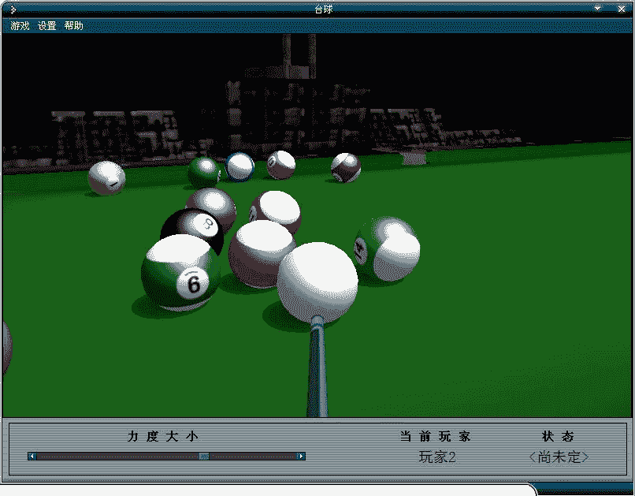

# 【作品提交】台球

> 原文：[`www.pediy.com/kssd/pediy10/67071.html`](https://www.pediy.com/kssd/pediy10/67071.html)

精心制作的一款游戏，声音与画面做了很多处理  
软件界面可以更换皮肤  
  
技术含量：DX8 的建立 3D 引擎, 光投影反射，矢量的碰撞检测,动量守恒与反射定律,以及能量守恒定律，其中还有资源的加密处理移位反相...  
  
运行环境： win2000 以上 + DX8 + VB 运行库  
编译环境： win2000 以上 + VB6 + VC6 + activeskin4.0 以上  
  
SKN.ocx 注册环境：  
           1.路径为英文路径   
           2.下载 activeskin 注册  
           3.VB 注册  
  
  
  
  
文件比较大，只得分卷了  
  
附上了完整源码  
  
不知道这个软件作品有没有违规，先共享给大家，谢谢

上传的附件
|  || Billiards.part01.rar\[附件请到论坛下载：[`bbs.pediy.com/showthread.php?t=67071`](http://bbs.pediy.com/showthread.php?t=67071%20) \]  
 |
|  || Billiards.part02.rar  
 |
|  || Billiards.part03.rar  
 |
|  || Billiards.part04.rar  
 |
|  || Billiards.part05.rar  
 |
|  || Billiards.part06.rar  
 |
|  || Billiards.part07.rar  
 |
|  || Billiards.part08.rar  
 |