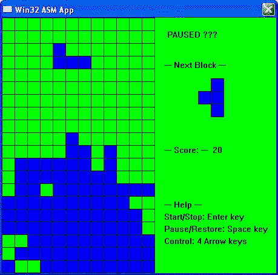

# Win32 汇编实现的一个完整的俄罗斯方块游戏

> 原文：[`www.pediy.com/kssd/pediy12/96568.html`](https://www.pediy.com/kssd/pediy12/96568.html)

一直没什么大作产生（当然也产生不了），哎！花了几天时间用汇编写了个俄罗斯方块游戏，大概 1600 行代码，弄个邀请码，谢谢！  
  
  
  
简单介绍：  
游戏总体有空闲、运行中、暂停中、游戏结束 4 个状态，构成一个状态机，相关事件由按键、判断到游戏结束组成，响应动作主要是控制定时器、控制活动块、改变相关参数等。  
4 个状态里，游戏运行中状态最为复杂些，要处理方向键控制活动块、定时器响应等。  
数据结构设计上，主游戏区的方阵由多个 word 来表示，一行对应一个 word，一格对应一个 bit；下落块总共有 7 种类型，每种又根据旋转方向有 4 种布局，对于每种类型块的每个旋转布局都统一成一个 16bit 大小的 word 来表示；等等。（多写几行字，看起来好看些）  
  
顺便把源码和 exe 上传了上来。

上传的附件
|  || Win32 汇编实现的俄罗斯方块(更新).zip  
 |