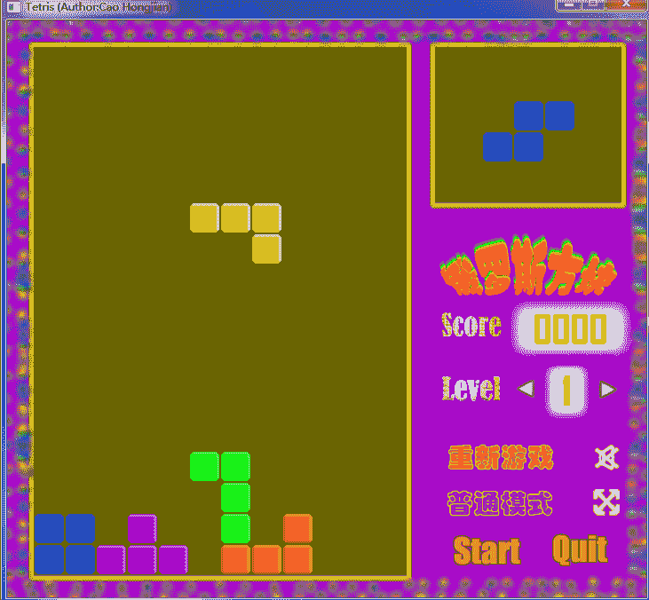
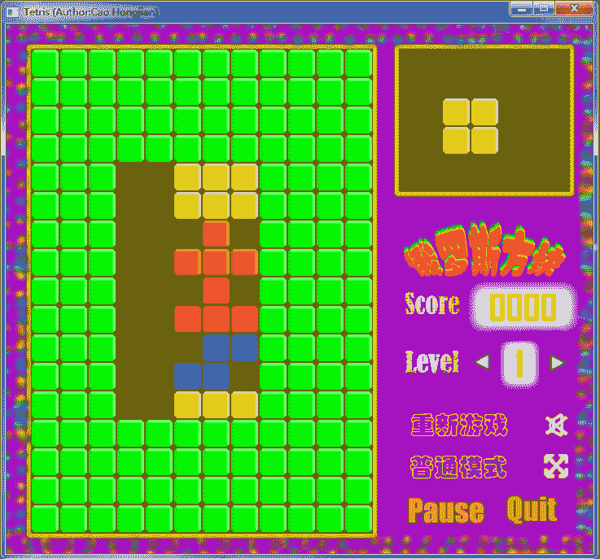

# C 语言写的俄罗斯方块

> 原文：[`www.pediy.com/kssd/pediy11/119739.html`](https://www.pediy.com/kssd/pediy11/119739.html)

小游戏使用 c 语言+SDL 写的，编译环境为 vs2005，也没什么技术含量，希望能拿到邀请码，成为正式会员，更好的学习。  
节了两张图，程序和源码在 debug.rar,由于大小限制图片单独打包了，解压后放在 debug 就可运行  
  
  
  

上传的附件
|  || debug.rar  
 |
|  || pictures.rar  
 |