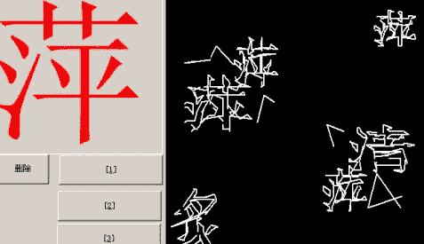
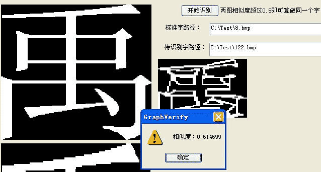
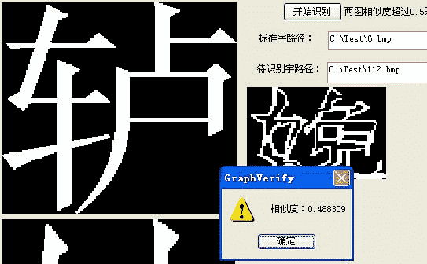
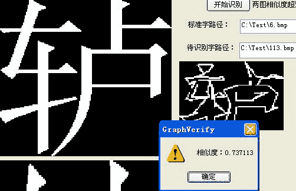

# 【公开源代码】完美、诛仙等游戏验证码答题反外挂系统的初级识别程序

> 原文：[`www.pediy.com/kssd/pediy10/85954.html`](https://www.pediy.com/kssd/pediy10/85954.html)

write by [`hi.baidu.com/weolar/blog/item/7f14ac6412821bf8f63654aa.html`](http://hi.baidu.com/weolar/blog/item/7f14ac6412821bf8f63654aa.html)  
  
如题，完美、诛仙等游戏为了防止外挂，设置了验证码答题系统。  
  
这种系统的答题方式是识别下图中有几个红色字表示的汉字。  
  
  
这种图对汉字做了大量的扭曲变形、干扰线添加等工作，导致识别工作变的异常困难。  
  
当初想搞这种设别是为因为毕业设计与此有关，现在毕设改了也就没用了。  
  
下面这个工程是当初我做的识别系统扣出来的一部分，只实现了对某个字和标准字的  
相似度对比部分。（对重叠汉字的区分识别、干扰线去除等操作还有点不完善，就去掉了。）  
可以看出，相同的字的相似度基本在 0.5xxx 以上。这可以作为区分不同字的依据。  
  
工程的界面比较挫，只是扣出来后用来测试用的，而且代码 malloc 后的内存都没释放，  
大家将就着  
看吧！   
另外，这玩意完全靠自己写的，没用啥库，就是一个很简单的算法  
（虽然简单但是当时为了能出效果还是换了很多种算法呐），  
而且我也根本没学过啥模式识别的，光凭自己苦想出算法的。各位要打击请随意   
  
**附件中 TEST.RAR 为测试用的图片。别的图片不支持。**  
  
  
可以看出来不同的字的相似度比较低。  
  

上传的附件
|  || test.rar  
 |
|  || GraphVerify1.rar   
 |
|  |