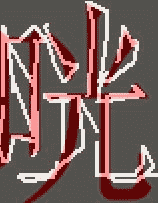
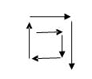

# 浅谈完美、诛仙等游戏验证码的识别

> 原文：[`www.pediy.com/kssd/pediy10/86213.html`](https://www.pediy.com/kssd/pediy10/86213.html)

浅谈完美、诛仙等游戏验证码的识别  
write by [`hi.baidu.com/weolar/blog/item/dd173a6d1cdbd9f342169446.html`](http://hi.baidu.com/weolar/blog/item/dd173a6d1cdbd9f342169446.html)  
最近老有人问我那个程序的识别原理是什么，虽然代码给出去了，不过我想这东西估计大家看着也有点痛苦，毕竟是自己想的代码，别人读起来比较费劲，所以我就根据程序算法的一些有意思的知识点简单讲讲吧~~希望不要被鄙视。  
一，程序识别的预处理  
我先把程序的一些预处理讲一下，在函数  
CMyGraph::BmpToMatrix(LPCWCH lpDIBFilePath,PBmpMatrixInfo pOutBmpMatrixInfo,int Mode) 中，实现了将 BMP 图片的像素点阵提取出来，转换为二维数组形式。  
typedef struct \_BmpMatrixInfo{  
  
  int lWidth;  
  int lHight;  
  int lNum;  
  BYTE \*Matrix;  
}BmpMatrixInfo, \*PBmpMatrixInfo;  
这个结构体负责存储描述这个二维数组点阵的信息。其中 BYTE \*Matrix;  
存放了二维数组，这样我们用  
BOOL MyMatrixMath::SetByte(PBmpMatrixInfo BmpMatrix, int x, int y, BYTE Value)  
{  
  
  if (BmpMatrix->lHight < 0 || BmpMatrix->lWidth < 0)  
  {  
    return 0;  
  }  
  
  if (BmpMatrix->lHight < y || BmpMatrix->lWidth < x)  
  {  
    return 0;  
  }  
  \*(PBYTE)(BmpMatrix->Matrix + BmpMatrix->lWidth \*y + x) = Value;  
  return TRUE;  
}  
  
BYTE MyMatrixMath::GetByte(PBmpMatrixInfo BmpMatrix, int x, int y)  
{  
  
  if (0 > y || 0 > x)  
  {  
    return 0;  
  }  
  
  if (BmpMatrix->lHight <= y || BmpMatrix->lWidth <= x)  
  {  
    return 0;  
  }  
  return \*(PBYTE)(BmpMatrix->Matrix + BmpMatrix->lWidth \*y + x);   
  //     \*(PBYTE)(\*(PBYTE)(BmpMatrix->Matrix+x)+y );  
}  
函数便能访问和设置其中任意一个坐标的元素。  
在预处理中，我们先用  
    
CMyGraph::ErosionDIB( (LPSTR)MatrixBmp.Matrix,  MatrixBmp.lWidth,  MatrixBmp.lHight,1, structure);  
将整个图片进行膨胀处理，然后将连在一起的点全部取出来一次，再和原来的图像进行过滤，这样便得到了提取好了的单个字。  
不过对于这种验证码，还有个非常不爽的地方，就是有时候两个字会连在一起。我的处理方案是判断一个连在一起的部分的长宽是否超出比例，而且四个角是否有一个有大量空白。  
而对付干扰线，目前我的策略不太好，仅仅是根据线的长宽比例判定。这样有的汉字笔画也会被 K 掉。我下一个想法是根据干扰线的特征进行过滤。  
二，汉字的相似度计算  
    其实这个的原理非常简单（所以大家看了不要鄙视……）。大家看我一副图就知道了：  
  
  
将标准字和待识别字重叠在一块大家就看出来了，两个字能重合在一起的点数非常的多！  
我的想法就是将抽取出来的每个字和一个标准字进行对比，循环将待识别字的每个点与标准字每个点相应位置进行对比，如果相应坐标位置附件某个距离有标准字的点的话就记录下来，然后将所有记录的点数除以总点数便是相似度。  
  
当然这样有个前提就是两副图的位置要摆好。我的解决方案是对齐宽度后将高度一点点的放大，再取相似度最大值，这样便很好的解决的位置问题。  
  
当然，我们还可以加上更进一步的过滤工作。比如对于那种特别不符合的点也记录下来，让整个图的相似度降低。不过我发现这样对于识别貌似效果不大好，所以就去掉了。  
其实还有一个可以利用的地方，大家仔细看图，可以发现虽然很多线都扭曲了，不过仍然有少部分的垂直和水平的线条。这个也能用来作为定位的标志。  
  
点的相应最短距离计算  
  
   在算一个坐标附近多远有一个点的时候如果用暴力遍历每个坐标的话会很耗 cpu 的。所以我想了个有意思的方式：使用一个函数  
int MyMatrixMath::CreateDirArr(int i)  
{  
  float n = (float)((int)((SquareRootFloat((float)(1+4 \* i)) - 1) / 2) + 1);  
  n = n - (int)n > 0.01 ? n + 1: (int)n;  
  n = n - 1;  
  int k = (int)(i - (n \*n + n) <= n + 1 ? (2 \*n + 1): 2 \*(n + 1));  
  
  return k % 4;  
}产生一个数组。这个数组很有意思，产生的数为 0--3 的整数。如果把 0-3 对应上右下左的话，那么如果我们每一步都根据这个方向前进的话就会这样前进：  
  
  
这样便能很快取到附近的点。（当然，这样会有一点小小的误差，不过这种误差可以忽略不记。）  
平方根的计算  
  
上面的产生数列操作中用到了开平方运算。这个如果我从网上找到了个很强大的计算函数：  
/\*  
\================  
SquareRootFloat Quake III:code/common/cm\_trace.c  
\================  
\*/  
float MyMatrixMath::SquareRootFloat(float number)  
{  
  long i;  
  float x, y;  
  const float f = 1.5F;  
  
  x = number \* 0.5F;  
  y = number;  
  i = \*(long\*) &y;  
  i = 0x5f3759df - (i >> 1);  
  y = \*(float\*) &i;  
  y = y \*(f - (x \*y \* y));  
  y = y \*(f - (x \*y \* y));  
  return number \*y;  
}  
这个是 Quake III 的代码里面的。很神奇的代码！下面一段话来自网上，相信大家看了能学到不少有意思的东西：  
有人在 Quake III 的源代码里面发现这么一段用来求平方根的倒数的代码,经过测试    
   
它比直接算 1/sqrt(n)快 4 倍,而误差最大为 0.1%:    
  
算法的原理其实不复杂,就是牛顿迭代法,用 x-f(x)/f'(x)来不断的逼近 f(x)=a 的根。   
   
简单来说比如求平方根,f(x)=x²=a ,f'(x)= 2\*x,f(x)/f'(x)=x/2,把 f(x)代入   
   
x-f(x)/f'(x)后有(x+a/x)/2，现在我们选 a=5,选一个猜测值比如 2，   
那么我们可以这么算    
5/2 = 2.5; (2.5+2)/2 = 2.25; 5/2.25 = xxx; (2.25+xxx)/2 = xxxx ...    
这样反复迭代下去，结果必定收敛于 sqrt(5)，没错，一般的求平方根都是这么算的    
但是卡马克(quake3 作者)真正牛 B 的地方是他选择了一个神秘的常数 0x5f3759df 来计   
   
算那个猜测值   
就是我们加注释的那一行,那一行算出的值非常接近 1/sqrt(n),这样我们只需要 2 次牛   
   
顿迭代就可以达到我们所需要的精度.   
好吧 如果这个还不算 NB,接着看:   
普渡大学的数学家 Chris Lomont 看了以后觉得有趣，决定要研究一下卡马克弄出来的    
这个猜测值有什么奥秘。Lomont 也是个牛人，在精心研究之后从理论上也推导出一个    
最佳猜测值，和卡马克的数字非常接近, 0x5f37642f。卡马克真牛，他是外星人吗？    
   
传奇并没有在这里结束。Lomont 计算出结果以后非常满意，于是拿自己计算出的起始    
值和卡马克的神秘数字做比赛，看看谁的数字能够更快更精确的求得平方根。结果是    
卡马克赢了... 谁也不知道卡马克是怎么找到这个数字的。    
   
最后 Lomont 怒了，采用暴力方法一个数字一个数字试过来，终于找到一个比卡马克数    
字要好上那么一丁点的数字，虽然实际上这两个数字所产生的结果非常近似，这个暴    
力得出的数字是 0x5f375a86。    
   
Lomont 为此写下一篇论文，"Fast Inverse Square Root"。    
  
  
整个讲解完毕。虽然真正算法很简单……不过当时我也是试验了 N 次才验证出来的。开始我用了不少方法，甚至还进行了一部分的笔画识别。不过都没这个方法的速度快，效率高。  
希望里面的一些东西对各位有用~~