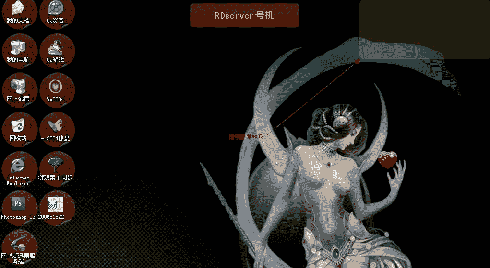

# 刚完成一个透明圆角矩形代码的编写，与大家分享一下

> 原文：[`www.pediy.com/kssd/pediy10/102605.html`](https://www.pediy.com/kssd/pediy10/102605.html)

先看下网上的实现半透明矩形的代码  
  
  
一个可绘制半透明矩形的代码 -nohacks 收集整理  
  
                                    
 CDC   memdc;     
  CBitmap   bmp,\*pOldBitmap;     
  memdc.CreateCompatibleDC(pDC);     
  bmp.CreateCompatibleBitmap(pDC,300,200);     
  pOldBitmap   =   memdc.SelectObject(&bmp);     
  memdc.FillSolidRect(0,0,300,200,RGB(0,0,255));   //蓝色     
  BLENDFUNCTION   bf;     
  bf.BlendOp   =   AC\_SRC\_OVER;     
  bf.BlendFlags   =   0;     
  bf.SourceConstantAlpha   =   0x7f;   //半透明     
  bf.AlphaFormat   =   0;     
  AlphaBlend(pDC->GetSafeHdc() ,0,0,300,200,memdc.GetSafeHdc(),0,0,300,200,bf);     
   memdc.SelectObject(pOldBitmap);     
    
    
  
typedef struct \_BLENDFUNCTION {  
  BYTE  BlendOp;                              源混合操作，只支持 AC\_SRC\_OVER  
  BYTE  BlendFlags;                            保留，必须为 0  
  BYTE  SourceConstantAlpha;                    透明度 0-255  
  BYTE  AlphaFormat;                            透明这里应为 0，  
}BLENDFUNCTION, \*PBLENDFUNCTION, \*LPBLENDFUNCTION;  
  
   
  
AlphaBlend　　函数功能：该函数用来显示具有指定透明度的图像。  
　　函数原型：AlphaBlend(HDC hdcDest,int nXOriginDest,int nYOriginDest,int nWidthDest,int hHeightDest,HDC hdcSrc,int nXOriginSrc,int nYOriginSrc,int nWidthSrc,int nHeightSrc,BLENDFUNCTION blendFunction)；  
　　参数：  
　　hdcDest：指向目标设备环境的句柄。  
　　nXoriginDest：指定目标矩形区域左上角的 X 轴坐标，按逻辑单位。  
　　nYOriginDest：指定目标矩形区域左上角的 Y 轴坐标，按逻辑单位。  
　　nWidthDest：指定目标矩形区域的宽度，按逻辑单位。  
　　hHeghtdest：指向目标矩形区域高度的句柄，按逻辑单位。  
　　hdcSrc：指向源设备环境的句柄。  
　　nXOriginSrc：指定源矩形区域左上角的 X 轴坐标，按逻辑单位。  
　　nYOriginSrc：指定源矩形区域左上角的 Y 轴坐标，按逻辑单位。  
　　nWidthSrc：指定源矩形区域的宽度，按逻辑单位。  
　　nHeightSrc：指定源矩形区域的高度，按逻辑单位。  
　　blendFunction：指定用于源位图和目标位图使用的 alpha 混合功能，用于整个源位图的全局 alpha 值和格式信息。源和目标混合功能当前只限为 AC\_SRC\_OVER。  
  
   
  
AlphaBlend 的详细说明：http://baike.baidu.com/view/1080365.htm?fr=ala0  
  
   
    我们要实现在桌面上画透明圆角矩形，用上面的代码肯定不行，CreateCompatibleBitmap 不能创建圆角矩形的 BMP 图片，当然我们可以用 RoundRect 画圆角矩形，但怎么进行透明叠加了，我们可以采用下面的方法：  
  
创建 2 个与屏幕兼容的 DC 和 BMP  
   
在源 BMP 上用 RoundRect 画圆角矩形，用 AlphaBlend 进行透明叠加，结果保存在目标 BMP  
  
如下面的代码：  
  
  
HDC ＝ GetDC (0)  ' 取屏幕 DC  
CDC ＝ CreateCompatibleDC (HDC)  ' 目标设备环境的句柄  
dc ＝ CreateCompatibleDC (HDC)  ' 源设备环境的句柄  
  
BMP ＝ CreateCompatibleBitmap (HDC, 1024, 768)  ' 目标 BMP  
fBitmap ＝ CreateCompatibleBitmap (HDC, 1024, 768)  ' 源 BMP  
  
ReleaseDC (0, HDC)  
  
SelectObject (CDC, BMP)  ' 关联到目标 DC  
oldBitmap ＝ SelectObject (dc, fBitmap)  ' 关联到源 DC  
  
' 开始在源 BMP 上画圆角矩形  
hPen ＝ CreatePen (PS\_INSIDEFRAME|PS\_SOLID), 500, RGB (255, 255, 10))  
SelectObject (dc, hPen)  
RoundRect (dc, 1024, 1024－ 275, 124, 20, 20)  
  
  
  ' 画随机壁纸，要在透明处理前  
  
  .......  
  
' 进行透明叠加，结果在目标 DC  
  
  bf.BlendOp   =   AC\_SRC\_OVER  
  bf.BlendFlags   =   0  
  bf.SourceConstantAlpha   =  50  
  bf.AlphaFormat   =   0  
 AlphaBlend (CDC, 0, 0, 1024, 768, dc, 0, 0, 1024, 768, bf)  
  
  
这样 BMP 里就是含有透明矩形的 BMP 图片了，在进行桌面美化时这段代码非常有用，效果见下图 

写到文件 (“c:\\liangfei.bmp”, GetBitsFromBitmapHandle (BMP))   
  
  
  
  
.子程序 GetBitsFromBitmapHandle, 字节集, , 根据位图句柄取回位图数据。  
.参数 hBitmap, 整数型  
.局部变量 Bitmap, BITMAP  
.局部变量 Resource, 字节集  
.局部变量 BitmapFileHeader, BITMAPFILEHEADER  
.局部变量 bfh, 字节集  
.局部变量 hMemDC, 整数型  
.局部变量 BitmapInfo, BITMAPINFO  
.局部变量 bi, 字节集  
  
GetObjectA (hBitmap, 5 × 4 ＋ 2 ＋ 2, Bitmap)  
  
hMemDC ＝ CreateCompatibleDC (0)  
  
BitmapInfo.BITMAPINFOHEADER.biSize ＝ 4 × 11  
GetDIBits\_BimapInfo (hMemDC, hBitmap, 0, 0, 0, BitmapInfo, 0)  
  
Resource ＝ 取空白字节集 (BitmapInfo.BITMAPINFOHEADER.biSizeImage)  
BitmapInfo.BITMAPINFOHEADER.biCompression ＝ 0  
GetDIBits (hMemDC, hBitmap, 0, Bitmap.bmHeight, Resource, BitmapInfo, 0)  
  
' 构造位图信息  
bi ＝ 取空白字节集 (BitmapInfo.BITMAPINFOHEADER.biSize)  
  
CopyMemory\_BITMAPINFO (bi, BitmapInfo, BitmapInfo.BITMAPINFOHEADER.biSize)  
  
' 构造位图文件头  
BitmapFileHeader.bfType ＝ 19778  
BitmapFileHeader.bfOffBits ＝ 2 × 4 ＋ 3 × 2 ＋ BitmapInfo.BITMAPINFOHEADER.biSize  
BitmapFileHeader.bfSize ＝ BitmapFileHeader.bfOffBits ＋ BitmapInfo.BITMAPINFOHEADER.biSizeImage  
BitmapFileHeader.bfReserved1 ＝ 0  
BitmapFileHeader.bfReserved2 ＝ 0  
bfh ＝ 取空白字节集 (14)  
CopyMemory\_BITMAPFILEHEADER (bfh, BitmapFileHeader, 14)  
DeleteDC (hMemDC)  
返回 (bfh ＋ bi ＋ Resource)