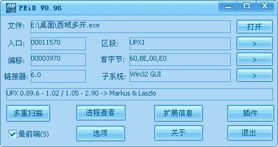
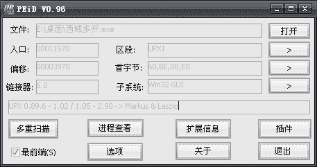
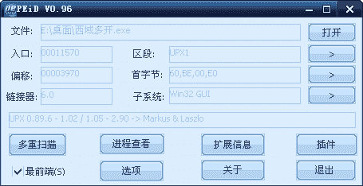

# 给 PEiD 添加换肤功能（易语言源码）

> 原文：[`www.pediy.com/kssd/pediy12/129868.html`](https://www.pediy.com/kssd/pediy12/129868.html)

某一天，见到一个 0.96 版本的 peid，我用的还是 0.94 版本的，为不至于太落后就下载吧，看了一下，界面被“好事者”改得不太美观，还加上了自己的 logo，于是就用刚学的“易语言”写了个 dll，然后修改主文件，调用这个 dll 达到给 PEiD 换皮肤的目的，共有 10 种皮肤可以设置。  
      
    如不想使用或更换皮肤，删除 PEID 目录中的 skin.ini 文件即可。  
  
    如何修改软件调用我们写的这个 dll，这个比较简单，就略去了。  
  
    附件中有易语言的源码，刚学的，不要砸砖头  
  
      跟其他编程语言相比，易语言还有很多需要完善的地方，因用惯了别的语言，反正用易语言极度不适。  
      
    用了人家还说人家不好，我真不厚道......   
  
     
  
       
  
       
  
\--------------------------------------------------------------------  
  
                   PEidSkin.part1.rar  
                   PEidSkin.part2.rar  
                   PEidSkin.part3.rar  
  
\-------------------------------------------------------------------