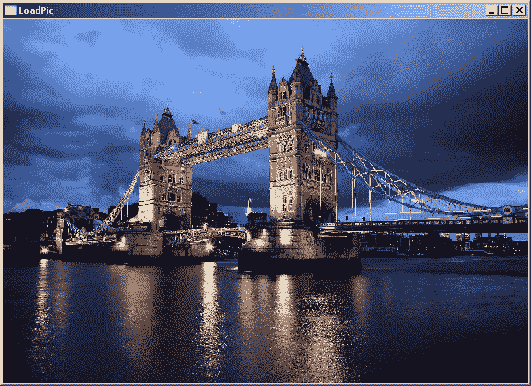

# 从最小的 LoadPic 开始（IPICTURE 接口）。。

> 原文：[`www.pediy.com/kssd/pediy12/137125.html`](https://www.pediy.com/kssd/pediy12/137125.html)

参考原型：  
微软的 loadpic.exe，  
下载地址：http://support.microsoft.com/kb/218972  
  
我能做到的最小的 LoadPic:  
  
#include <windows.h>  
#include <olectl.h>  
  
LPPICTURE      gpPicture;  
HWND        hWnd;  
HDC          hDC;  
long        hmWidth,hmHeight;  
int          SrcX,SrcY;  
  
LRESULT CALLBACK MainWndProc(HWND, UINT,WPARAM, LPARAM);  
void LoadPictureFile(char\* point);  
  
int WINAPI WinMain(HINSTANCE hInstance,HINSTANCE hPrevInstance,LPSTR lpCmdLine,int nCmdShow)  
{  
  
  MSG      msg;  
  WNDCLASS  wndclass;  
  
  wndclass.style = 0;  
  wndclass.cbClsExtra = 0;  
  wndclass.cbWndExtra = 0;  
  wndclass.hCursor = LoadCursor(NULL, IDC\_ARROW);  
  wndclass.lpszMenuName =  NULL;  
    hInstance=GetModuleHandle(NULL);  
  wndclass.hInstance = hInstance;  
  wndclass.hIcon = NULL;  
  wndclass.lpfnWndProc = MainWndProc;  
  wndclass.hbrBackground = (HBRUSH)(COLOR\_WINDOW);  
  wndclass.lpszClassName = "MyWindowClass";  
  RegisterClass (&wndclass);  
  hWnd = CreateWindow ("MyWindowClass","LoadPic",  
             WS\_MAXIMIZEBOX|WS\_MINIMIZEBOX|WS\_SYSMENU|WS\_SIZEBOX,  
             CW\_USEDEFAULT, 0, CW\_USEDEFAULT, 0, NULL,NULL,hInstance,NULL);  
  hDC = GetDC(hWnd);  
  ShowWindow(hWnd, SW\_SHOWNORMAL);  
  while (GetMessage(&msg, NULL, 0, 0))   
  {  
    DispatchMessage(&msg);  
  }  
  return 0;  
}  
  
void LoadPictureFile(char\* point)  
{  
  char    szPath\[255\];  
  OLECHAR    wszPath\[255\];  
  int      i,j;  
    
  if (gpPicture)  
  {  
    gpPicture->Release();  
  }  
  i=0;  
  j=0;  
  do  
  {  
    szPath\[j\]=point\[i\];  
    if(szPath\[j\]=='\\\\')  
    {  
      j++;  
      szPath\[j\]='\\\\';  
    }  
    i++;  
    j++;  
  }while(point\[i-1\]!='\\0');  
  MultiByteToWideChar(CP\_ACP, 0, szPath, -1, wszPath, 255);    
  OleLoadPicturePath(wszPath, 0, 0, 0, IID\_IPicture, (LPVOID \*)&gpPicture);  
  gpPicture->get\_Width(&hmWidth);  
  gpPicture->get\_Height(&hmHeight);  
  SrcX=hmWidth\*GetDeviceCaps(hDC, LOGPIXELSX)/2540;  
  SrcY=hmHeight\*GetDeviceCaps(hDC, LOGPIXELSY)/2540;  
  InvalidateRect(hWnd,NULL,1);  
}  
  
LRESULT CALLBACK MainWndProc(HWND hWnd, UINT message, WPARAM wParam, LPARAM lParam)  
{  
  PAINTSTRUCT    ps;  
  OPENFILENAME  ofn;  
    char      szFileName\[255\];  
    
  switch (message)   
  {  
    case WM\_RBUTTONUP:  
      szFileName\[0\]='\\0';  
      ofn.lStructSize=sizeof(OPENFILENAME);  
      ofn.hwndOwner=hWnd;  
      ofn.hInstance=0;  
      ofn.lpstrFilter="JPG Files (\*.jpg)\\0\*.jpg\\0";  
      ofn.lpstrCustomFilter=0;  
      ofn.nMaxCustFilter=0;  
      ofn.nFilterIndex=0;  
      ofn.lpstrFile=szFileName;  
      ofn.nMaxFile=MAX\_PATH;    
      ofn.lpstrFileTitle=0;  
      ofn.nMaxFileTitle=MAX\_PATH;        
      ofn.lpstrInitialDir=0;  
      ofn.lpstrTitle=0;  
      ofn.Flags=OFN\_HIDEREADONLY|OFN\_PATHMUSTEXIST;  
      ofn.nFileOffset=0;  
      ofn.nFileExtension=0;  
      ofn.lpstrDefExt=NULL;  
      ofn.lCustData=0;  
      ofn.lpfnHook=0;  
      ofn.lpTemplateName=0;  
      if (GetOpenFileName(&ofn))   
      {  
        LoadPictureFile(szFileName);  
      }  
      break;  
    case WM\_PAINT:  
      BeginPaint(hWnd, &ps);  
      if (gpPicture)  
      {  
        gpPicture->Render(hDC, 0, 0, SrcX, SrcY, 0, hmHeight, hmWidth, -hmHeight, NULL);  
      }  
      EndPaint(hWnd, &ps);  
      break;  
    case WM\_DESTROY:  
      ExitProcess(0);    
      break;  
    default:  
      return DefWindowProc (hWnd, message, wParam, lParam);  
   }  
   return 0;  
}  
  
VC6 编译后大小：2032 字节，连 2K 都不到。  
  
源程序下载：

上传的附件
|  || LoadPic.zip  
 |

几点说明：  
  
1:link 选项：  
/entry:"WinMain"   
/align:16  
  
2: 用 CreateWindow，不用 CreateWindowEx  
  
3:消息循环：  
  while (GetMessage(&msg, NULL, 0, 0))   
  {  
    DispatchMessage(&msg);  
  }  
配合  
case WM\_DESTROY:  
      ExitProcess(0);  
  
4:用 OleLoadPicturePath，不用 OleLoadPicture  
  
5:目录单斜杠\\转双斜杠\\\\：  
  i=0;  
  j=0;  
  do  
  {  
    szPath\[j\]=point\[i\];  
    if(szPath\[j\]=='\\\\')  
    {  
      j++;  
      szPath\[j\]='\\\\';  
    }  
    i++;  
    j++;  
  }while(point\[i-1\]!='\\0'); 

增加以下功能：  
  
1:启动画面不用默认，使用黑色背景，400\*300 大小，居中显示  
  wndclass.hbrBackground = (HBRUSH)(GetStockObject (BLACK\_BRUSH));  
  
  dl=(GetSystemMetrics(SM\_CXFULLSCREEN)-400)/2;  
  dt=(GetSystemMetrics(SM\_CYFULLSCREEN)-300)/2;  
  dx=400;  
  dy=300;  
  hWnd = CreateWindow ("MyWindowClass","LoadPic",  
             WS\_MAXIMIZEBOX|WS\_MINIMIZEBOX|WS\_SYSMENU|WS\_SIZEBOX,  
             dl,dt,dx,dy,NULL,NULL,hInstance,NULL);  
2:支持拖放  
  DragAcceptFiles(hWnd,TRUE);  
  
  
      if (!GetOpenFileName(&ofn))   
      {  
        break;  
      }  
    case WM\_DROPFILES:  
        if(message==WM\_DROPFILES)  
      {  
        DragQueryFile((HDROP)wParam, 0, szFileName, 255);  
      }  
      LoadPictureFile(szFileName);  
      break;  
3:全图显示  
  sx=SrcX;  
  sy=SrcY;  
  dx=GetSystemMetrics(SM\_CXFULLSCREEN);  
  dy=GetSystemMetrics(SM\_CYFULLSCREEN);  
  while((sx>dx)&&(sy>dy))  
  {  
    sx=sx>>1;  
    sy=sy>>1;  
  }  
  dl=-4;  
  dt=-4;  
  if(dx>sx)  
  {  
    dl=(dx-sx-8)>>1;  
    dx=  sx;  
  }  
  if(dy>sy)  
  {  
    dt=(dy-sy)>>1;  
    dy=sy;  
  }  
  dx=dx+8;  
  dy=dy+27;  
  EndDeferWindowPos(DeferWindowPos(BeginDeferWindowPos(1),hWnd,HWND\_TOP,dl,dt,dx,dy,SWP\_NOZORDER));  
  
  
gpPicture->Render(hDC, 0, 0, sx, sy, 0, hmHeight, hmWidth, -hmHeight, NULL);  
  
4:窗口大小限制  
    case WM\_GETMINMAXINFO:  
      ((LPMINMAXINFO)lParam)->ptMaxPosition.x=dl;  
      ((LPMINMAXINFO)lParam)->ptMaxPosition.y=dt;  
      ((LPMINMAXINFO)lParam)->ptMaxSize.x=dx;  
      ((LPMINMAXINFO)lParam)->ptMaxSize.y=dy;  
      ((LPMINMAXINFO)lParam)->ptMaxTrackSize.x=dx;  
      ((LPMINMAXINFO)lParam)->ptMaxTrackSize.y=dy;  
      break;  
  
显示效果图：  
  
  
编译后大小：2688 字节  
下载：LoadPic.zip 

继续增加：  
  
5：命令行支持：  
  p=GetCommandLine();  
  if(\*p=='"')  
  {  
    do  
    {  
      p++;  
    }  
    while(\*p!='"');  
  }  
    do  
  {  
    p++;  
  }  
  while((\*p!='\\0')&&(\*p!=' '));  
  p--;  
  do  
  {  
    p++;  
  }  
  while(\*p==' ');  
  if(\*p=='"')  
  {  
    q=p;  
    p++;  
    \*q=' ';  
    do  
    {  
      q++;  
    }  
    while(\*q!='"');  
    \*q='\\0';  
  }  
  if(\*p!='\\0')  
  {  
    LoadPictureFile(p);  
  }  
  
6：添加图标  
选用 acdsee32 经典图标  
  
有了以上 2 步，可以文件关联了：  
Windows Registry Editor Version 5.00  
  
\[HKEY\_CLASSES\_ROOT\\.JPG\]  
@="JPGFile"  
  
\[HKEY\_CLASSES\_ROOT\\JPGFile\]  
@="JPG Image File"  
  
\[HKEY\_CLASSES\_ROOT\\JPGFile\\DefaultIcon\]  
@="LoadPic.exe,1"  
  
\[HKEY\_CLASSES\_ROOT\\JPGFile\\Shell\]  
@="Open"  
  
\[HKEY\_CLASSES\_ROOT\\JPGFile\\Shell\\Open\\Command\]  
@="LoadPic.exe %l"  
  
替代系统的 jpg 文件浏览器，效果如何？  
  
编译后大小：4.90k（5024 字节）  
  
源码下载：LoadPic.zip