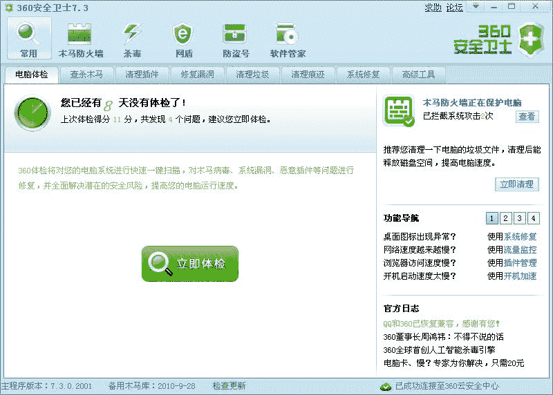

# DirectUI 技术开发界面

> 原文：[`www.pediy.com/kssd/pediy11/124957.html`](https://www.pediy.com/kssd/pediy11/124957.html)

最近，学习了一下 DirectUI 技术。因为，我觉得虽然是安全编程，但是个人安全作品同样会遇到编写客户端 UI 的问题，有一个绚丽的界面一定会加分不少，了解这方面的内容也会学到不少知识。  
像 QQ 这样的公司的界面开发库当然不会给你开源了，这是学习的一个国外的程序员写的开源 DirectUI 库（[`www.viksoe.dk/code/windowless1.htm`](http://www.viksoe.dk/code/windowless1.htm)）；它主要是探讨一种实现的可能性和思路,和实际应用还有一定距离，一个国内的程序员基于此代码，进行重构和修正 Bug，并放到了 google 上（[`code.google.com/p/duilib/`](http://code.google.com/p/duilib/)）。  
我是根据 google 上的代码，编写了一个 Demo，patch 了部分代码，效果如下图：  
  
源代码：

上传的附件
|  || DirectUI.rar  
 |