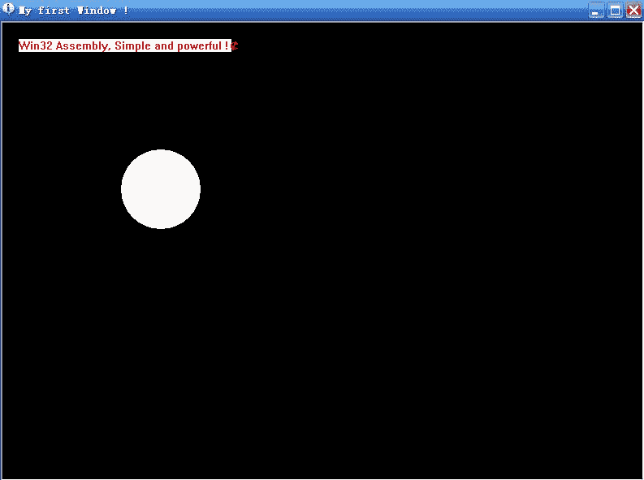

# Win32 编写的 DIrectDraw 窗口模式程序,请支持.

> 原文：[`www.pediy.com/kssd/pediy10/64643.html`](https://www.pediy.com/kssd/pediy10/64643.html)

源码下载:win32window.rar;---------------------------------------;  
;    DDRAW  Demo                  ;  
;      本人初学 win32 汇编不久，对其并不是太熟，当然学习汇编仅是为了学破解，  
;学破解原来的目的是想自己做外挂，当然我也正在跨出这一步，只是基础太差，不知  
;要到何能马月才有所成。  
;  本程序主要是用汇编实现了 DirectDraw 的窗口化。在写这个程序时在网上查了  
;很久似乎并没有用 WIN32 写的窗口模式的 DirectDraw 程序，所以只有边学习，边摸索，  
;大家都知道很多游戏是全屏的。并没有提供窗口化，为了对游戏进行一些辅助性的修改  
;实现窗口化是很有必要的，那么如果有人想用 WIN32 对游戏进行修改，那么可以共同探讨  
;一下，本程序还存在一些不足之处，请指正，不过总体方向没错。  
;  下一篇我将用 WIN32 实现全屏和窗口化之间的切换。请大家鼓力一下小弟。;    Author :         Jacksheng         ;  
;---------------------------------------;  
  
; View with TAB size 8  
  
    TITLE WIN32ASM EXAMPLE  
    .486  
    .MODEL FLAT, STDCALL  
    option casemap :none  
  
;-----------------------------------------------------------;  
;                WIN32ASM / DDRAW DEMO                     ;  
;-----------------------------------------------------------;  
  
INCLUDE   windows.inc  
INCLUDE   gdi32.inc  
INCLUDE   kernel32.inc  
INCLUDE   user32.inc  
INCLUDE   ddraw.inc  
  
INCLUDELIB   gdi32.lib  
INCLUDELIB   kernel32.lib  
INCLUDELIB   user32.lib  
INCLUDELIB   ddraw.lib  
  
ICO\_MAIN  equ  1000h  
;>>>>>>>>>>>>>>>>>>>>>>>>>>>>>>>>>>>>>>>>>>>>>>>>>>>>>>>>>>>>>>>>>>>>        ;对 MESSAGEBOX 进行宏定义  
FATAL    MACRO  msg  
    LOCAL   @@msg  
    .DATA  
    @@msg  db  msg, 0  
    .CODE  
    INVOKE  MessageBox, hWinMain, ADDR @@msg, ADDR szDisplayName, MB\_OK  
    INVOKE  ExitProcess, 0  
ENDM  
;>>>>>>>>>>>>>>>>>>>>>>>>>>>>>>>>>>>>>>>>>>>>>>>>>>>>>>>>>>>>>>>>>>>>        ;对色进行宏定义  
RGB     macro red,green,blue   
          xor eax,eax   
          mov ah,blue   
          shl eax,8   
          mov ah,green   
          mov al,red   
endm   
  
  
; 数据段  
  
;>>>>>>>>>>>>>>>>>>>>>>>>>>>>>>>>>>>>>>>>>>>>>>>>>>>>>>>>>>>>>>>>>>>>  
  
                .data?  
hInstance       dd       ?  
hWinMain        dd       ?  
stRt    RECT  <?>  
stPoint    POINT  <?>  
stPoint2  POINT  <?>  
lpDD    LPDIRECTDRAW    ?    ; DDraw object  
lpDDSPrimary  LPDIRECTDRAWSURFACE  ?    ; DDraw primary surface  
lpDDSStore  LPDIRECTDRAWSURFACE  ?  
ddsd    DDSURFACEDESC    <?>    ; DDraw surface descriptor  
ddscaps    DDSCAPS      <?>    ; DDraw capabilities   
pcClipper  LPDIRECTDRAWCLIPPER   ?  
@hDc    HDC      ?  
stFx    DDBLTFX      <?>  
                 .const  
  
szCaptionMain   db        'My first Window !',0  
szText          db        'Win32 Assembly, Simple and powerful !',0  
szClassName  db    "DDRAW Plasma Demo", 0  ; class name  
szDisplayName  EQU    <szClassName>    ; window name  
szTest    db    "This is a stinky App",0  
;>>>>>>>>>>>>>>>>>>>>>>>>>>>>>>>>>>>>>>>>>>>>>>>>>>>>>>>>>>>>>>>>>>>>  
; 代码段  
;>>>>>>>>>>>>>>>>>>>>>>>>>>>>>>>>>>>>>>>>>>>>>>>>>>>>>>>>>>>>>>>>>>>>  
  
                 .code  
;>>>>>>>>>>>>>>>>>>>>>>>>>>>>>>>>>>>>>>>>>>>>>>>>>>>>>>>>>>>>>>>>>>>>  
; // old DirectDraw Initialization stuff.  
;// Set a window mode DirectDraw Display.  
;>>>>>>>>>>>>>>>>>>>>>>>>>>>>>>>>>>>>>>>>>>>>>>>>>>>>>>>>>>>>>>>>>>>>          
\_Init    proc  
    invoke    DirectDrawCreate,NULL,ADDR lpDD,NULL        ;建对象  
    .if    eax  !=DD\_OK  
        FATAL   "Failed to create directdraw object!"        
    .endif  
;>>>>>>>>>>>>>>>>>>>>>>>>>>>>>>>>>>>>>>>>>>>>>>>>>>>>>>>>>>>>>>>>>>>>      
    DDINVOKE  SetCooperativeLevel, lpDD, NULL, DDSCL\_NORMAL      ;建控制级非独占模式  
    .IF     eax   != DD\_OK  
        FATAL   "Couldn't set DirectDraw cooperative level"  
    .ENDIF  
;>>>>>>>>>>>>>>>>>>>>>>>>>>>>>>>>>>>>>>>>>>>>>>>>>>>>>>>>>>>>>>>>>>>>      
    invoke    RtlZeroMemory,addr  ddsd,sizeof  ddsd  
    mov    \[ddsd.dwSize\], sizeof DDSURFACEDESC  
    mov    \[ddsd.dwFlags\], DDSD\_CAPS  
    mov    \[ddsd.ddsCaps.dwCaps\], DDSCAPS\_PRIMARYSURFACE  
    DDINVOKE  CreateSurface, lpDD, ADDR ddsd, ADDR lpDDSPrimary, NULL    ;建主表面  
    .IF     eax   != DD\_OK  
        FATAL   "Couldn't create primary surface"  
    .ENDIF  
;>>>>>>>>>>>>>>>>>>>>>>>>>>>>>>>>>>>>>>>>>>>>>>>>>>>>>>>>>>>>>>>>>>>>      
    mov    \[ddsd.dwSize\], sizeof DDSURFACEDESC  
    mov    \[ddsd.dwFlags\], DDSD\_CAPS or DDSD\_WIDTH or DDSD\_HEIGHT  
    mov    \[ddsd.ddsCaps.dwCaps\], DDSCAPS\_OFFSCREENPLAIN OR DDSCAPS\_3DDEVICE  
    mov    \[ddsd.dwWidth\],800  
    mov    \[ddsd.dwHeight\],600    
    DDINVOKE  CreateSurface, lpDD, ADDR ddsd, ADDR lpDDSStore, NULL    ;建后台表面  
    .IF     eax   != DD\_OK  
        FATAL   "Couldn't create store surface"  
    .ENDIF  
;>>>>>>>>>>>>>>>>>>>>>>>>>>>>>>>>>>>>>>>>>>>>>>>>>>>>>>>>>>>>>>>>>>>>    
    DDINVOKE  CreateClipper, lpDD, 0, ADDR pcClipper, NULL      ;设裁剪器  
    .IF     eax   != DD\_OK  
        FATAL   "Couldn't create Clipper "  
    .ENDIF  
    DDCINVOKE  SetHWnd,pcClipper, 0, hWinMain  
    .IF     eax   != DD\_OK  
        DDCINVOKE  Release,pcClipper  
        FATAL  "Failed to create primary surface"  
    .ENDIF  
    DDSINVOKE  SetClipper,lpDDSPrimary,pcClipper  
    .IF     eax != DD\_OK  
        DDCINVOKE  Release,pcClipper  
        FATAL   "Failed to create SetClipper primary surface"  
    .ENDIF  
    ret       
\_Init    endp  
;>>>>>>>>>>>>>>>>>>>>>>>>>>>>>>>>>>>>>>>>>>>>>>>>>>>>>>>>>>>>>>>>>>>>  
; // Load images from offscteen buffer to primary buffer  
; // and for display.  
;>>>>>>>>>>>>>>>>>>>>>>>>>>>>>>>>>>>>>>>>>>>>>>>>>>>>>>>>>>>>>>>>>>>>      
  
\_DisPlay  proc  
    push  0  
    pop  stPoint.x  
    push  0  
    pop  stPoint.y  
    invoke  ClientToScreen,hWinMain,addr  stPoint    ;get the client area on the desktop by using this line.  
    xor  eax,eax  
    mov  eax,stPoint.x  
    mov  stRt.left,eax  
    add  eax,800  
    mov  stRt.right,eax  
    mov  eax,stPoint.y  
    mov  stRt.top,eax  
    add  eax,600  
    mov  stRt.bottom,eax  
      
    .while  TRUE  
      DDSINVOKE  Blt,lpDDSPrimary,addr stRt,  lpDDSStore,NULL,DDBLT\_WAIT,NULL  
      .if     eax     == DD\_OK  
        ;ret  
          .BREAK   
      .elseif   eax     == DDERR\_SURFACELOST  
          DDSINVOKE  Restore, lpDDSPrimary  
          DDSINVOKE  Restore, lpDDSStore  
      .elseif    eax    !=DDERR\_WASSTILLDRAWING  
          ret        
            ;FATAL "Couldn't lock surface"  
      .endif  
        
    .endw  
    ret  
\_DisPlay  endp  
;>>>>>>>>>>>>>>>>>>>>>>>>>>>>>>>>>>>>>>>>>>>>>>>>>>>>>>>>>>>>>>>>>>>>     
; a test:// The conclusion is: Under no circumstance, draw directly to  
; primary Surface!// It doesn't work that way.// ...// ...  
; This is just a simple test function. It has shit use in this  
; project.  
;>>>>>>>>>>>>>>>>>>>>>>>>>>>>>>>>>>>>>>>>>>>>>>>>>>>>>>>>>>>>>>>>>>>>      
\_TestDraw  proc  pointx,pointy  
    ;local  @hDc:HDC                //要设为全局变量才行.  
    local  @Point:POINT    
    local  @Rect:RECT  
  
    mov  eax,pointx  
    mov  @Point.x,eax  
    sub  eax,50  
    mov  @Rect.left,eax  
    add  eax,100  
    mov  @Rect.right,eax  
    mov  eax,pointy  
    mov  @Point.y,eax  
    sub  eax,50  
    mov  @Rect.top,eax  
    add  eax,100  
    mov  @Rect.bottom,eax  
    DDSINVOKE  GetDC,lpDDSStore,addr @hDc  
    .if  eax!=DD\_OK  
      ret  
    .else  
    invoke  ClientToScreen,hWinMain,addr  @Point          ;坐标转换即相对转为绝对因 DIRECTXDRAW 需要  
    RGB  255,255,0  
    invoke  SetTextColor,@hDc,eax  
    invoke  TextOut,@hDc, 20, 20,addr  szText, sizeof  szText  
    invoke  Ellipse,@hDc,@Rect.left,@Rect.top,@Rect.right,@Rect.bottom  
    DDSINVOKE  ReleaseDC,lpDDSStore,@hDc  
    .endif  
    ret  
\_TestDraw  endp  
;>>>>>>>>>>>>>>>>>>>>>>>>>>>>>>>>>>>>>>>>>>>>>>>>>>>>>>>>>>>>>>>>>>>>  
; clear both off csreen buffer and primary buffer.  
;>>>>>>>>>>>>>>>>>>>>>>>>>>>>>>>>>>>>>>>>>>>>>>>>>>>>>>>>>>>>>>>>>>>>  
\_Clear    proc  
    mov  eax,sizeof  stFx  
    mov  stFx.dwSize,eax  
    mov  stFx.dwFillColor,0  
    .while  TRUE  
      DDSINVOKE  Blt,lpDDSPrimary,NULL,NULL,NULL,DDBLT\_COLORFILL,addr  stFx  
      .if     eax     == DD\_OK  
          .BREAK   
      .elseif   eax     == DDERR\_SURFACELOST  
          DDSINVOKE  Restore, lpDDSPrimary  
      .elseif    eax    !=DDERR\_WASSTILLDRAWING  
          .BREAK        
      .endif  
    .endw  
      
    .while  TRUE  
      DDSINVOKE  Blt,lpDDSStore,NULL,NULL,NULL,DDBLT\_COLORFILL,addr  stFx  
      .if     eax     == DD\_OK  
          .BREAK   
      .elseif   eax     == DDERR\_SURFACELOST  
          DDSINVOKE  Restore, lpDDSStore  
      .elseif    eax    !=DDERR\_WASSTILLDRAWING  
          .BREAK        
      .endif  
    .endw  
    ret  
\_Clear    endp  
  
;>>>>>>>>>>>>>>>>>>>>>>>>>>>>>>>>>>>>>>>>>>>>>>>>>>>>>>>>>>>>>>>>>>>>  
; // make sure all things are terminated and set to NULL  
;// when application ends.  
;>>>>>>>>>>>>>>>>>>>>>>>>>>>>>>>>>>>>>>>>>>>>>>>>>>>>>>>>>>>>>>>>>>>>  
\_Terminate  proc  
\_Terminate  endp  
;>>>>>>>>>>>>>>>>>>>>>>>>>>>>>>>>>>>>>>>>>>>>>>>>>>>>>>>>>>>>>>>>>>>>  
; 窗口过程  
;>>>>>>>>>>>>>>>>>>>>>>>>>>>>>>>>>>>>>>>>>>>>>>>>>>>>>>>>>>>>>>>>>>>>  
  
\_ProcWinMain     proc      uses ebx edi esi,hWnd,uMsg,wParam,lParam  
                 local     @stPs:PAINTSTRUCT  
                 local     @stRect:RECT  
                     mov       eax,uMsg  
                   
;\*\*\*\*\*\*\*\*\*\*\*\*\*\*\*\*\*\*\*\*\*\*\*\*\*\*\*\*\*\*\*\*\*\*\*\*\*\*\*\*\*\*\*\*\*\*\*\*\*\*\*\*\*\*\*\*\*\*\*\*\*\*\*\*\*\*\*\*  
                 .if      eax==  WM\_LBUTTONDOWN  
                     mov eax,lParam   
              and eax,0FFFFh   
              mov stPoint2.x,eax   
              mov eax,lParam   
              shr eax,16   
              mov stPoint2.y,eax   
  
                     ;invoke   GetCursorPos,addr   stPoint2  
  
                            invoke  \_Clear  
        invoke  \_TestDraw,stPoint2.x,stPoint2.y  
                            invoke  \_DisPlay  
                       
;\*\*\*\*\*\*\*\*\*\*\*\*\*\*\*\*\*\*\*\*\*\*\*\*\*\*\*\*\*\*\*\*\*\*\*\*\*\*\*\*\*\*\*\*\*\*\*\*\*\*\*\*\*\*\*\*\*\*\*\*\*\*\*\*\*\*\*\*  
                 .elseif    eax ==   WM\_CLOSE  
                       
                     FATAL "Please accept Quit!"  
                            invoke  DestroyWindow,hWinMain  
                            invoke  PostQuitMessage,NULL  
;\*\*\*\*\*\*\*\*\*\*\*\*\*\*\*\*\*\*\*\*\*\*\*\*\*\*\*\*\*\*\*\*\*\*\*\*\*\*\*\*\*\*\*\*\*\*\*\*\*\*\*\*\*\*\*\*\*\*\*\*\*\*\*\*\*\*\*\*  
                 .else  
                            invoke  DefWindowProc,hWnd,uMsg,wParam,lParam  
                                ret  
                 .endif  
;\*\*\*\*\*\*\*\*\*\*\*\*\*\*\*\*\*\*\*\*\*\*\*\*\*\*\*\*\*\*\*\*\*\*\*\*\*\*\*\*\*\*\*\*\*\*\*\*\*\*\*\*\*\*\*\*\*\*\*\*\*\*\*\*\*\*\*\*  
                 xor        eax,eax  
                 ret  
\_ProcWinMain     endp  
  
;>>>>>>>>>>>>>>>>>>>>>>>>>>>>>>>>>>>>>>>>>>>>>>>>>>>>>>>>>>>>>>>>>>>>  
\_WinMain         proc  
                 local      @stWndClass:WNDCLASSEX  
                 local      @stMsg:MSG  
                 invoke     GetModuleHandle,NULL  
                 mov             hInstance,eax  
                 invoke     RtlZeroMemory,addr @stWndClass,sizeof @stWndClass  
  
;\*\*\*\*\*\*\*\*\*\*\*\*\*\*\*\*\*\*\*\*\*\*\*\*\*\*\*\*\*\*\*\*\*\*\*\*\*\*\*\*\*\*\*\*\*\*\*\*\*\*\*\*\*\*\*\*\*\*\*\*\*\*\*\*\*\*\*\*  
; 注册窗口类  
;\*\*\*\*\*\*\*\*\*\*\*\*\*\*\*\*\*\*\*\*\*\*\*\*\*\*\*\*\*\*\*\*\*\*\*\*\*\*\*\*\*\*\*\*\*\*\*\*\*\*\*\*\*\*\*\*\*\*\*\*\*\*\*\*\*\*\*\*  
    invoke    LoadIcon,NULL,IDI\_INFORMATION  
    mov    @stWndClass.hIcon,eax  
              invoke     LoadCursor,0,IDC\_ARROW  
                mov        @stWndClass.hCursor,eax  
                push       hInstance  
                pop        @stWndClass.hInstance  
                mov        @stWndClass.cbSize,sizeof WNDCLASSEX  
                mov       @stWndClass.style,CS\_HREDRAW or CS\_VREDRAW  
                mov        @stWndClass.lpfnWndProc,offset \_ProcWinMain  
                INVOKE    GetStockObject, BLACK\_BRUSH  
    ;mov    \[wc.hbrBackground\], eax  
                mov        @stWndClass.hbrBackground,eax;COLOR\_WINDOW + 1  
                mov        @stWndClass.lpszClassName,offset szClassName  
                invoke     RegisterClassEx,addr @stWndClass  
;\*\*\*\*\*\*\*\*\*\*\*\*\*\*\*\*\*\*\*\*\*\*\*\*\*\*\*\*\*\*\*\*\*\*\*\*\*\*\*\*\*\*\*\*\*\*\*\*\*\*\*\*\*\*\*\*\*\*\*\*\*\*\*\*\*\*\*\*  
; 建立并显示窗口  
;\*\*\*\*\*\*\*\*\*\*\*\*\*\*\*\*\*\*\*\*\*\*\*\*\*\*\*\*\*\*\*\*\*\*\*\*\*\*\*\*\*\*\*\*\*\*\*\*\*\*\*\*\*\*\*\*\*\*\*\*\*\*\*\*\*\*\*\*  
                invoke     CreateWindowEx,WS\_EX\_CLIENTEDGE,\\  
                           offset szClassName,offset szCaptionMain,\\  
                           WS\_OVERLAPPEDWINDOW,\\  
                           100,100,800,600,\\  
                           NULL,NULL,hInstance,NULL  
                mov        hWinMain,eax  
                invoke    \_Init  
                invoke     ShowWindow,hWinMain,SW\_SHOWNORMAL  
                invoke     UpdateWindow,hWinMain  
                    
;\*\*\*\*\*\*\*\*\*\*\*\*\*\*\*\*\*\*\*\*\*\*\*\*\*\*\*\*\*\*\*\*\*\*\*\*\*\*\*\*\*\*\*\*\*\*\*\*\*\*\*\*\*\*\*\*\*\*\*\*\*\*\*\*\*\*\*\*  
; 消息循环  
;\*\*\*\*\*\*\*\*\*\*\*\*\*\*\*\*\*\*\*\*\*\*\*\*\*\*\*\*\*\*\*\*\*\*\*\*\*\*\*\*\*\*\*\*\*\*\*\*\*\*\*\*\*\*\*\*\*\*\*\*\*\*\*\*\*\*\*\*  
                 .while     TRUE  
                            invoke    GetMessage,addr @stMsg,NULL,0,0  
                            .break    .if eax  == 0  
                            invoke    TranslateMessage,addr @stMsg  
                            invoke    DispatchMessage,addr @stMsg  
                 .endw  
                 ret  
                   
\_WinMain         endp  
;>>>>>>>>>>>>>>>>>>>>>>>>>>>>>>>>>>>>>>>>>>>>>>>>>>>>>>>>>>>>>>>>>>>>  
start:  
                 call       \_WinMain  
                 invoke     ExitProcess,NULL  
;>>>>>>>>>>>>>>>>>>>>>>>>>>>>>>>>>>>>>>>>>>>>>>>>>>>>>>>>>>>>>>>>>>>>  
                 end        start  
  
  
  
  
  
  
DDRAW.INC 这个文件主要是参考 Ewald Snel  这位牛人的.并做了些修改.  
;---------------------------------------;  
;  DDRAW include file          ;  
;                    ;  
;  Author :  Ewald Snel        ;  
;  Copyright (C) 1999, Diamond Crew  ;  
;                    ;  
;  http://here.is/diamond/        ;  
;---------------------------------------;  
  
  
STDMETHOD  MACRO  name, argl :VARARG  
LOCAL @tmp\_a  
LOCAL @tmp\_b  
  
@tmp\_a  TYPEDEF PROTO argl  
@tmp\_b  TYPEDEF PTR @tmp\_a  
name    @tmp\_b    ?  
ENDM  
  
DDINVOKE  MACRO  func, this, arglist :VARARG  
  mov      eax , \[this\]  
  mov      eax , \[eax\]  
  
  IFB <arglist>  
    INVOKE \[IDirectDrawVtbl. func\]\[eax\], this  
  ELSE  
    INVOKE \[IDirectDrawVtbl. func\]\[eax\], this, arglist  
  ENDIF  
ENDM  
  
DDSINVOKE  MACRO  func, this, arglist :VARARG  
  mov      eax , \[this\]  
  mov      eax , \[eax\]  
  
  IFB <arglist>  
    INVOKE \[IDirectDrawSurfaceVtbl. func\]\[eax\], this  
  ELSE  
    INVOKE \[IDirectDrawSurfaceVtbl. func\]\[eax\], this, arglist  
  ENDIF  
ENDM  
  
DDCINVOKE  MACRO  func, this, arglist :VARARG  
  mov      eax , \[this\]  
  mov      eax , \[eax\]  
  
  IFB <arglist>  
    INVOKE \[IDirectDrawClipperVtbl. func\]\[eax\], this  
  ELSE  
    INVOKE \[IDirectDrawClipperVtbl. func\]\[eax\], this, arglist  
  ENDIF  
;这一段是本人参考着新加的.为建窗口模式的需要.  
ENDM  
  
  
DirectDrawCreate    PROTO :DWORD, :DWORD, :DWORD  
DirectDrawCreateClipper  PROTO :DWORD, :DWORD, :DWORD  
DirectDrawEnumerateA  PROTO :DWORD, :DWORD  
DirectDrawEnumerate    EQU    <DirectDrawEnumerateA>  
  
EXTERNDEF  C CLSID\_DirectDraw:GUID  
EXTERNDEF  C CLSID\_DirectDrawClipper:GUID  
EXTERNDEF  C IID\_IDirectDraw:GUID  
EXTERNDEF  C IID\_IDirectDrawSurface:GUID  
EXTERNDEF  C IID\_IDirectDrawPalette:GUID  
EXTERNDEF  C IID\_IDirectDrawClipper:GUID  
  
LPDIRECTDRAW      TYPEDEF    PTR IDirectDraw  
LPDIRECTDRAWSURFACE    TYPEDEF    PTR IDirectDrawSurface  
LPDIRECTDRAWPALETTE    TYPEDEF    PTR IDirectDrawPalette  
LPDIRECTDRAWCLIPPER    TYPEDEF    PTR IDirectDrawClipper  
LPDDFXROP        TYPEDEF    PTR DDFXROP  
LPDDSURFACEDESC      TYPEDEF    PTR DDSURFACEDESC  
LPDDCAPS        TYPEDEF    PTR DDCAPS  
LPDDBLTFX        TYPEDEF    PTR DDBLTFX  
LPDDSCAPS        TYPEDEF    PTR DDSCAPS  
LPDDCOLORKEY      TYPEDEF    PTR DDCOLORKEY  
LPDDOVERLAYFX      TYPEDEF    PTR DDOVERLAYFX  
LPDDPIXELFORMAT      TYPEDEF    PTR DDPIXELFORMAT  
LPDDBLTBATCH      TYPEDEF    PTR DDBLTBATCH  
  
; windows defines  
LPRECT          TYPEDEF    PTR RECT  
LPPALETTEENTRY      TYPEDEF    PTR PALETTEENTRY  
LPRGNDATA        TYPEDEF    PTR RGNDATA  
  
  
DDCOLORKEY  STRUC  
  dwColorSpaceLowValue    DWORD    ?  
  dwColorSpaceHighValue    DWORD    ?  
DDCOLORKEY  ENDS  
  
  
DDBLTFX    STRUC  
  dwSize            DWORD    ?  
  dwDDFX            DWORD    ?  
  dwROP            DWORD    ?  
  dwDDROP            DWORD    ?  
  dwRotationAngle        DWORD    ?  
  dwZBufferOpCode        DWORD    ?  
  dwZBufferLow        DWORD    ?  
  dwZBufferHigh        DWORD    ?  
  dwZBufferBaseDest      DWORD    ?  
  dwZDestConstBitDepth    DWORD    ?  
UNION  
  dwZDestConst        DWORD    ?  
  lpDDSZBufferDest      LPDIRECTDRAWSURFACE    ?  
ENDS  
  dwZSrcConstBitDepth      DWORD    ?  
UNION  
  dwZSrcConst          DWORD    ?  
  lpDDSZBufferSrc        LPDIRECTDRAWSURFACE    ?  
ENDS  
  dwAlphaEdgeBlendBitDepth  DWORD    ?  
  dwAlphaEdgeBlend      DWORD    ?  
  dwReserved          DWORD    ?  
  dwAlphaDestConstBitDepth  DWORD    ?  
UNION  
  dwAlphaDestConst      DWORD    ?  
  lpDDSAlphaDest        LPDIRECTDRAWSURFACE    ?  
ENDS  
  dwAlphaSrcConstBitDepth    DWORD    ?  
UNION  
  dwAlphaSrcConst        DWORD    ?  
  lpDDSAlphaSrc        LPDIRECTDRAWSURFACE    ?  
ENDS  
UNION  
  dwFillColor          DWORD    ?  
  dwFillDepth          DWORD    ?  
  lpDDSPattern        LPDIRECTDRAWSURFACE    ?  
ENDS  
  ddckDestColorkey      DDCOLORKEY    <>  
  ddckSrcColorkey        DDCOLORKEY    <>  
DDBLTFX    ENDS  
  
  
DDSCAPS    STRUC  
  dwCaps      DWORD    ?  
DDSCAPS    ENDS  
  
  
DDCAPS    STRUC  
  dwSize              DWORD    ?  
  dwCaps              DWORD    ?  
  dwCaps2              DWORD    ?  
  dwCKeyCaps            DWORD    ?  
  dwFXCaps            DWORD    ?  
  dwFXAlphaCaps          DWORD    ?  
  dwPalCaps            DWORD    ?  
  dwSVCaps            DWORD    ?  
  dwAlphaBltConstBitDepths    DWORD    ?  
  dwAlphaBltPixelBitDepths    DWORD    ?  
  dwAlphaBltSurfaceBitDepths    DWORD    ?  
  dwAlphaOverlayConstBitDepths  DWORD    ?  
  dwAlphaOverlayPixelBitDepths  DWORD    ?  
  dwAlphaOverlaySurfaceBitDepths  DWORD    ?  
  dwZBufferBitDepths        DWORD    ?  
  dwVidMemTotal          DWORD    ?  
  dwVidMemFree          DWORD    ?  
  dwMaxVisibleOverlays      DWORD    ?  
  dwCurrVisibleOverlays      DWORD    ?  
  dwNumFourCCCodes        DWORD    ?  
  dwAlignBoundarySrc        DWORD    ?  
  dwAlignSizeSrc          DWORD    ?  
  dwAlignBoundaryDest        DWORD    ?  
  dwAlignSizeDest          DWORD    ?  
  dwAlignStrideAlign        DWORD    ?  
  dwRops              DWORD    8 DUP (?)  
  ddsCaps              DDSCAPS    <>  
  dwMinOverlayStretch        DWORD    ?  
  dwMaxOverlayStretch        DWORD    ?  
  dwMinLiveVideoStretch      DWORD    ?  
  dwMaxLiveVideoStretch      DWORD    ?  
  dwMinHwCodecStretch        DWORD    ?  
  dwMaxHwCodecStretch        DWORD    ?  
  dwReserved1            DWORD    ?  
  dwReserved2            DWORD    ?  
  dwReserved3            DWORD    ?  
  dwSVBCaps            DWORD    ?  
  dwSVBCKeyCaps          DWORD    ?  
  dwSVBFXCaps            DWORD    ?  
  dwSVBRops            DWORD    8 DUP (?)  
  dwVSBCaps            DWORD    ?  
  dwVSBCKeyCaps          DWORD    ?  
  dwVSBFXCaps            DWORD    ?  
  dwVSBRops            DWORD    8 DUP (?)  
  dwSSBCaps            DWORD    ?  
  dwSSBCKeyCaps          DWORD    ?  
  dwSSBFXCaps            DWORD    ?  
  dwSSBRops            DWORD    8 DUP (?)  
  dwReserved4            DWORD    ?  
  dwReserved5            DWORD    ?  
  dwReserved6            DWORD    ?  
DDCAPS    ENDS  
  
  
DDOVERLAYFX    STRUC  
  dwSize            DWORD    ?  
  dwAlphaEdgeBlendBitDepth  DWORD    ?  
  dwAlphaEdgeBlend      DWORD    ?  
  dwReserved          DWORD    ?  
  dwAlphaDestConstBitDepth  DWORD    ?  
UNION  
  dwAlphaDestConst      DWORD    ?  
  lpDDSAlphaDest        LPDIRECTDRAWSURFACE    ?  
ENDS  
  dwAlphaSrcConstBitDepth    DWORD    ?  
UNION  
  dwAlphaSrcConst        DWORD    ?  
  lpDDSAlphaSrc        LPDIRECTDRAWSURFACE    ?  
ENDS  
  dckDestColorkey        DDCOLORKEY    <>  
  dckSrcColorkey        DDCOLORKEY    <>  
  dwDDFX            DWORD    ?  
  dwFlags            DWORD    ?  
DDOVERLAYFX    ENDS  
  
  
DDPIXELFORMAT  STRUC  
  dwSize        DWORD    ?  
  dwFlags        DWORD    ?  
  dwFourCC      DWORD    ?  
UNION  
  dwRGBBitCount    DWORD    ?  
  dwYUVBitCount    DWORD    ?  
  dwZBufferBitDepth  DWORD    ?  
  dwAlphaBitDepth    DWORD    ?  
ENDS  
UNION  
  dwRBitMask      DWORD    ?  
  dwYBitMask      DWORD    ?  
ENDS  
UNION  
  dwGBitMask      DWORD    ?  
  dwUBitMask      DWORD    ?  
ENDS  
UNION  
  dwBBitMask      DWORD    ?  
  dwVBitMask      DWORD    ?  
ENDS  
UNION  
  dwRGBAlphaBitMask  DWORD    ?  
  dwYUVAlphaBitMask  DWORD    ?  
ENDS  
DDPIXELFORMAT  ENDS  
  
  
DDSURFACEDESC  STRUC  
  dwSize        DWORD    ?  
  dwFlags        DWORD    ?  
  dwHeight      DWORD    ?  
  dwWidth        DWORD    ?  
  lPitch        DWORD    ?  
  dwBackBufferCount  DWORD    ?  
UNION  
  dwMipMapCount    DWORD    ?  
  dwZBufferBitDepth  DWORD    ?  
  dwRefreshRate    DWORD    ?  
ENDS  
  dwAlphaBitDepth    DWORD    ?  
  dwReserved      DWORD    ?  
  lpSurface      DWORD    ?  
  ddckCKDestOverlay  DDCOLORKEY    <>  
  ddckCKDestBlt    DDCOLORKEY    <>  
  ddckCKSrcOverlay  DDCOLORKEY    <>  
  ddckCKSrcBlt    DDCOLORKEY    <>  
  ddpfPixelFormat    DDPIXELFORMAT  <>  
  ddsCaps        DDSCAPS      <>  
DDSURFACEDESC  ENDS  
  
  
DDBLTBATCH  STRUC  
  lprDest      LPRECT    ?  
  lpDDSSrc    LPDIRECTDRAWSURFACE    ?  
  lprSrc      LPRECT    ?  
  dwFlags      DWORD    ?  
  lpDDBltFx    LPDDBLTFX  ?  
DDBLTBATCH  ENDS  
  
  
  
  
IDirectDrawVtbl  STRUC  
  ; IUnknown methods  
  STDMETHOD  QueryInterface, :PTR IDirectDraw, :PTR, :PTR PTR  
  STDMETHOD  AddRef, :PTR IDirectDraw  
  STDMETHOD  Release, :PTR IDirectDraw  
  ; IDirectDraw methods  
  STDMETHOD  Compact, :PTR IDirectDraw  
  STDMETHOD  CreateClipper, :PTR IDirectDraw, :DWORD, :PTR LPDIRECTDRAWCLIPPER, :PTR IUnknown  
  STDMETHOD  CreatePalette, :PTR IDirectDraw, :DWORD, :LPPALETTEENTRY, :PTR LPDIRECTDRAWPALETTE, :PTR IUnknown  
  STDMETHOD  CreateSurface, :PTR IDirectDraw, :LPDDSURFACEDESC, :PTR LPDIRECTDRAWSURFACE, :PTR IUnknown  
  STDMETHOD  DuplicateSurface, :PTR IDirectDraw, :LPDIRECTDRAWSURFACE, :PTR LPDIRECTDRAWSURFACE  
  STDMETHOD  EnumDisplayModes, :PTR IDirectDraw, :DWORD, :LPDDSURFACEDESC, :PTR , :PTR  
  STDMETHOD  EnumSurfaces, :PTR IDirectDraw, :DWORD, :LPDDSURFACEDESC, :PTR , :PTR  
  STDMETHOD  FlipToGDISurface, :PTR IDirectDraw  
  STDMETHOD  GetCaps, :PTR IDirectDraw, :LPDDCAPS, :LPDDCAPS  
  STDMETHOD  GetDisplayMode, :PTR IDirectDraw, :LPDDSURFACEDESC  
  STDMETHOD  GetFourCCCodes, :PTR IDirectDraw, :PTR DWORD, :PTR DWORD  
  STDMETHOD  GetGDISurface, :PTR IDirectDraw, :PTR LPDIRECTDRAWSURFACE  
  STDMETHOD  GetMonitorFrequency, :PTR IDirectDraw, :DWORD  
  STDMETHOD  GetScanLine, :PTR IDirectDraw, :DWORD  
  STDMETHOD  GetVerticalBlankStatus, :PTR IDirectDraw, :PTR SWORD  
  STDMETHOD  Initialize, :PTR IDirectDraw, :PTR GUID  
  STDMETHOD  RestoreDisplayMode, :PTR IDirectDraw  
  STDMETHOD  SetCooperativeLevel, :PTR IDirectDraw, :HWND, :DWORD  
  STDMETHOD  SetDisplayMode, :PTR IDirectDraw, :DWORD, :DWORD, :DWORD  
  STDMETHOD  WaitForVerticalBlank, :PTR IDirectDraw, :DWORD, :PTR  
IDirectDrawVtbl  ENDS  
  
  
IDirectDrawPaletteVtbl  STRUC  
  ; IUnknown methods  
  STDMETHOD  QueryInterface, :PTR IDirectDrawPalette, :PTR, :PTR PTR  
  STDMETHOD  AddRef, :PTR IDirectDrawPalette  
  STDMETHOD  Release, :PTR IDirectDrawPalette  
  ; IDirectDrawPalette methods  
  STDMETHOD  GetCaps, :PTR IDirectDrawPalette, :PTR DWORD  
  STDMETHOD  GetEntries, :PTR IDirectDrawPalette, :DWORD, :DWORD, :DWORD, :LPPALETTEENTRY  
  STDMETHOD  Initialize, :PTR IDirectDrawPalette, :LPDIRECTDRAW, :DWORD, :LPPALETTEENTRY  
  STDMETHOD  SetEntries, :PTR IDirectDrawPalette, :DWORD, :DWORD, :DWORD, :LPPALETTEENTRY  
IDirectDrawPaletteVtbl  ENDS  
  
  
IDirectDrawClipperVtbl  STRUC  
  ; IUnknown methods  
  STDMETHOD  QueryInterface, :PTR IDirectDrawClipper, :PTR, :PTR PTR  
  STDMETHOD  AddRef, :PTR IDirectDrawClipper  
  STDMETHOD  Release, :PTR IDirectDrawClipper  
  ; IDirectDrawClipper methods  
  STDMETHOD  GetClipList, :PTR IDirectDrawClipper, :LPRECT, :LPRGNDATA, :PTR DWORD  
  STDMETHOD  GetHWnd, :PTR IDirectDrawClipper, :PTR HWND  
  STDMETHOD  Initialize, :PTR IDirectDrawClipper, :LPDIRECTDRAW, :DWORD  
  STDMETHOD  IsClipListChanged, :PTR IDirectDrawClipper, :PTR SWORD  
  STDMETHOD  SetClipList, :PTR IDirectDrawClipper, :LPRGNDATA, :DWORD  
  STDMETHOD  SetHWnd, :PTR IDirectDrawClipper, :DWORD, :HWND  
IDirectDrawClipperVtbl  ENDS  
  
  
IDirectDrawSurfaceVtbl  STRUC  
  ; IUnknown methods  
  STDMETHOD  QueryInterface, :PTR IDirectDrawSurface, :PTR, :PTR PTR  
  STDMETHOD  AddRef, :PTR IDirectDrawSurface  
  STDMETHOD  Release, :PTR IDirectDrawSurface  
  ; IDirectDrawSurface methods  
  STDMETHOD  AddAttachedSurface, :PTR IDirectDrawSurface, :LPDIRECTDRAWSURFACE  
  STDMETHOD  AddOverlayDirtyRect, :PTR IDirectDrawSurface, :LPRECT  
  STDMETHOD  Blt, :PTR IDirectDrawSurface, :LPRECT, :LPDIRECTDRAWSURFACE, :LPRECT, :DWORD, :LPDDBLTFX  
  STDMETHOD  BltBatch, :PTR IDirectDrawSurface, :LPDDBLTBATCH, :DWORD, :DWORD  
  STDMETHOD  BltFast, :PTR IDirectDrawSurface, :DWORD, :DWORD, :LPDIRECTDRAWSURFACE, :LPRECT, :DWORD  
  STDMETHOD  DeleteAttachedSurface, :PTR IDirectDrawSurface, :DWORD, :LPDIRECTDRAWSURFACE  
  STDMETHOD  EnumAttachedSurfaces, :PTR IDirectDrawSurface, :PTR , :PTR  
  STDMETHOD  EnumOverlayZOrders, :PTR IDirectDrawSurface, :DWORD, :PTR , :PTR  
  STDMETHOD  Flip, :PTR IDirectDrawSurface, :LPDIRECTDRAWSURFACE, :DWORD  
  STDMETHOD  GetAttachedSurface, :PTR IDirectDrawSurface, :LPDDSCAPS, :PTR LPDIRECTDRAWSURFACE  
  STDMETHOD  GetBltStatus, :PTR IDirectDrawSurface, :DWORD  
  STDMETHOD  GetCaps, :PTR IDirectDrawSurface, :LPDDSCAPS  
  STDMETHOD  GetClipper, :PTR IDirectDrawSurface, :PTR LPDIRECTDRAWCLIPPER  
  STDMETHOD  GetColorKey, :PTR IDirectDrawSurface, :DWORD, :LPDDCOLORKEY  
  STDMETHOD  GetDC, :PTR IDirectDrawSurface, :PTR HDC  
  STDMETHOD  GetFlipStatus, :PTR IDirectDrawSurface, :DWORD  
  STDMETHOD  GetOverlayPosition, :PTR IDirectDrawSurface, :PTR DWORD, :PTR DWORD  
  STDMETHOD  GetPalette, :PTR IDirectDrawSurface, :PTR LPDIRECTDRAWPALETTE  
  STDMETHOD  GetPixelFormat, :PTR IDirectDrawSurface, :LPDDPIXELFORMAT  
  STDMETHOD  GetSurfaceDesc, :PTR IDirectDrawSurface, :LPDDSURFACEDESC  
  STDMETHOD  Initialize, :PTR IDirectDrawSurface, :LPDIRECTDRAW, :LPDDSURFACEDESC  
  STDMETHOD  IsLost, :PTR IDirectDrawSurface  
  STDMETHOD  mLock, :PTR IDirectDrawSurface, :LPRECT, :LPDDSURFACEDESC, :DWORD, :PTR   
  STDMETHOD  ReleaseDC, :PTR IDirectDrawSurface, :HDC  
  STDMETHOD  Restore, :PTR IDirectDrawSurface  
  STDMETHOD  SetClipper, :PTR IDirectDrawSurface, :LPDIRECTDRAWCLIPPER  
  STDMETHOD  SetColorKey, :PTR IDirectDrawSurface, :DWORD, :LPDDCOLORKEY  
  STDMETHOD  SetOverlayPosition, :PTR IDirectDrawSurface, :SDWORD, :SDWORD  
  STDMETHOD  SetPalette, :PTR IDirectDrawSurface, :LPDIRECTDRAWPALETTE  
  STDMETHOD  Unlock, :PTR IDirectDrawSurface, :PTR   
  STDMETHOD  UpdateOverlay, :PTR IDirectDrawSurface, :LPRECT, :LPDIRECTDRAWSURFACE, :LPRECT, :DWORD, :LPDDOVERLAYFX  
  STDMETHOD  UpdateOverlayDisplay, :PTR IDirectDrawSurface, :DWORD  
  STDMETHOD  UpdateOverlayZOrder, :PTR IDirectDrawSurface, :DWORD, :LPDIRECTDRAWSURFACE  
IDirectDrawSurfaceVtbl  ENDS  
  
  
IDirectDraw        STRUC  
  lpVtbl    DWORD    ?  
IDirectDraw        ENDS  
  
IDirectDrawPalette    STRUC  
  lpVtbl    DWORD    ?  
IDirectDrawPalette    ENDS  
  
IDirectDrawClipper    STRUC  
  lpVtbl    DWORD    ?  
IDirectDrawClipper    ENDS  
  
IDirectDrawSurface    STRUC  
  lpVtbl    DWORD    ?  
IDirectDrawSurface    ENDS  
  
  
  
; Direct Draw Capability Flags  
DDSD\_CAPS        EQU    000000001h  
DDSD\_HEIGHT        EQU    000000002h  
DDSD\_WIDTH        EQU    000000004h  
DDSD\_PITCH        EQU    000000008h  
DDSD\_BACKBUFFERCOUNT  EQU    000000020h  
DDSD\_ZBUFFERBITDEPTH  EQU    000000040h  
DDSD\_ALPHABITDEPTH    EQU    000000080h  
DDSD\_PIXELFORMAT    EQU    000001000h  
DDSD\_CKDESTOVERLAY    EQU    000002000h  
DDSD\_CKDESTBLT      EQU    000004000h  
DDSD\_CKSRCOVERLAY    EQU    000008000h  
DDSD\_CKSRCBLT      EQU    000010000h  
DDSD\_MIPMAPCOUNT    EQU    000020000h  
DDSD\_REFRESHRATE    EQU    000040000h  
DDSD\_ALL        EQU    00007f9eeh    ; all input field are valid  
  
; DIRECTDRAWSURFACE CAPABILITY FLAGS  
DDSCAPS\_3D          EQU    000000001h  
DDSCAPS\_ALPHA        EQU    000000002h  
DDSCAPS\_BACKBUFFER      EQU    000000004h  
DDSCAPS\_COMPLEX        EQU    000000008h  
DDSCAPS\_FLIP        EQU    000000010h  
DDSCAPS\_FRONTBUFFER      EQU    000000020h  
DDSCAPS\_OFFSCREENPLAIN    EQU    000000040h  
DDSCAPS\_OVERLAY        EQU    000000080h  
DDSCAPS\_PALETTE        EQU    000000100h  
DDSCAPS\_PRIMARYSURFACE    EQU    000000200h  
DDSCAPS\_PRIMARYSURFACELEFT  EQU    000000400h  
DDSCAPS\_SYSTEMMEMORY    EQU    000000800h  
DDSCAPS\_TEXTURE        EQU    000001000h  
DDSCAPS\_3DDEVICE      EQU    000002000h  
DDSCAPS\_VIDEOMEMORY      EQU    000004000h  
DDSCAPS\_VISIBLE        EQU    000008000h  
DDSCAPS\_WRITEONLY      EQU    000010000h  
DDSCAPS\_ZBUFFER        EQU    000020000h  
DDSCAPS\_OWNDC        EQU    000040000h  
DDSCAPS\_LIVEVIDEO      EQU    000080000h  
DDSCAPS\_HWCODEC        EQU    000100000h  
DDSCAPS\_MODEX        EQU    000200000h  
DDSCAPS\_MIPMAP        EQU    000400000h  
DDSCAPS\_ALLOCONLOAD      EQU    004000000h  
  
; DIRECTDRAW DRIVER CAPABILITY FLAGS  
DDCAPS\_3D          EQU    000000001h  
DDCAPS\_ALIGNBOUNDARYDEST  EQU    000000002h  
DDCAPS\_ALIGNSIZEDEST    EQU    000000004h  
DDCAPS\_ALIGNBOUNDARYSRC    EQU    000000008h  
DDCAPS\_ALIGNSIZESRC      EQU    000000010h  
DDCAPS\_ALIGNSTRIDE      EQU    000000020h  
DDCAPS\_BLT          EQU    000000040h  
DDCAPS\_BLTQUEUE        EQU    000000080h  
DDCAPS\_BLTFOURCC      EQU    000000100h  
DDCAPS\_BLTSTRETCH      EQU    000000200h  
DDCAPS\_GDI          EQU    000000400h  
DDCAPS\_OVERLAY        EQU    000000800h  
DDCAPS\_OVERLAYCANTCLIP    EQU    000001000h  
DDCAPS\_OVERLAYFOURCC    EQU    000002000h  
DDCAPS\_OVERLAYSTRETCH    EQU    000004000h  
DDCAPS\_PALETTE        EQU    000008000h  
DDCAPS\_PALETTEVSYNC      EQU    000010000h  
DDCAPS\_READSCANLINE      EQU    000020000h  
DDCAPS\_STEREOVIEW      EQU    000040000h  
DDCAPS\_VBI          EQU    000080000h  
DDCAPS\_ZBLTS        EQU    000100000h  
DDCAPS\_ZOVERLAYS      EQU    000200000h  
DDCAPS\_COLORKEY        EQU    000400000h  
DDCAPS\_ALPHA        EQU    000800000h  
DDCAPS\_COLORKEYHWASSIST    EQU    001000000h  
DDCAPS\_NOHARDWARE      EQU    002000000h  
DDCAPS\_BLTCOLORFILL      EQU    004000000h  
DDCAPS\_BANKSWITCHED      EQU    008000000h  
DDCAPS\_BLTDEPTHFILL      EQU    010000000h  
DDCAPS\_CANCLIP        EQU    020000000h  
DDCAPS\_CANCLIPSTRETCHED    EQU    040000000h  
DDCAPS\_CANBLTSYSMEM      EQU    080000000h  
  
; DIRECTDRAW FX ALPHA CAPABILITY FLAGS  
DDFXALPHACAPS\_BLTALPHAEDGEBLEND      EQU    000000001h  
DDFXALPHACAPS\_BLTALPHAPIXELS      EQU    000000002h  
DDFXALPHACAPS\_BLTALPHAPIXELSNEG      EQU    000000004h  
DDFXALPHACAPS\_BLTALPHASURFACES      EQU    000000008h  
DDFXALPHACAPS\_BLTALPHASURFACESNEG    EQU    000000010h  
DDFXALPHACAPS\_OVERLAYALPHAEDGEBLEND    EQU    000000020h  
DDFXALPHACAPS\_OVERLAYALPHAPIXELS    EQU    000000040h  
DDFXALPHACAPS\_OVERLAYALPHAPIXELSNEG    EQU    000000080h  
DDFXALPHACAPS\_OVERLAYALPHASURFACES    EQU    000000100h  
DDFXALPHACAPS\_OVERLAYALPHASURFACESNEG  EQU    000000200h  
  
; DIRECTDRAW FX CAPABILITY FLAGS  
DDFXCAPS\_BLTARITHSTRETCHY    EQU    000000020h  
DDFXCAPS\_BLTARITHSTRETCHYN    EQU    000000010h  
DDFXCAPS\_BLTMIRRORLEFTRIGHT    EQU    000000040h  
DDFXCAPS\_BLTMIRRORUPDOWN    EQU    000000080h  
DDFXCAPS\_BLTROTATION      EQU    000000100h  
DDFXCAPS\_BLTROTATION90      EQU    000000200h  
DDFXCAPS\_BLTSHRINKX        EQU    000000400h  
DDFXCAPS\_BLTSHRINKXN      EQU    000000800h  
DDFXCAPS\_BLTSHRINKY        EQU    000001000h  
DDFXCAPS\_BLTSHRINKYN      EQU    000002000h  
DDFXCAPS\_BLTSTRETCHX      EQU    000004000h  
DDFXCAPS\_BLTSTRETCHXN      EQU    000008000h  
DDFXCAPS\_BLTSTRETCHY      EQU    000010000h  
DDFXCAPS\_BLTSTRETCHYN      EQU    000020000h  
DDFXCAPS\_OVERLAYARITHSTRETCHY  EQU    000040000h  
DDFXCAPS\_OVERLAYARITHSTRETCHYN  EQU    000000008h  
DDFXCAPS\_OVERLAYSHRINKX      EQU    000080000h  
DDFXCAPS\_OVERLAYSHRINKXN    EQU    000100000h  
DDFXCAPS\_OVERLAYSHRINKY      EQU    000200000h  
DDFXCAPS\_OVERLAYSHRINKYN    EQU    000400000h  
DDFXCAPS\_OVERLAYSTRETCHX    EQU    000800000h  
DDFXCAPS\_OVERLAYSTRETCHXN    EQU    001000000h  
DDFXCAPS\_OVERLAYSTRETCHY    EQU    002000000h  
DDFXCAPS\_OVERLAYSTRETCHYN    EQU    004000000h  
DDFXCAPS\_OVERLAYMIRRORLEFTRIGHT  EQU    008000000h  
DDFXCAPS\_OVERLAYMIRRORUPDOWN  EQU    010000000h  
  
; DIRECTDRAW STEREO VIEW CAPABILITIES  
DDSVCAPS\_ENIGMA    EQU    000000001h  
DDSVCAPS\_FLICKER  EQU    000000002h  
DDSVCAPS\_REDBLUE  EQU    000000004h  
DDSVCAPS\_SPLIT    EQU    000000008h  
  
; DIRECTDRAWPALETTE CAPABILITIES  
DDPCAPS\_4BIT        EQU    000000001h  
DDPCAPS\_8BITENTRIES      EQU    000000002h  
DDPCAPS\_8BIT        EQU    000000004h  
DDPCAPS\_INITIALIZE      EQU    000000008h  
DDPCAPS\_PRIMARYSURFACE    EQU    000000010h  
DDPCAPS\_PRIMARYSURFACELEFT  EQU    000000020h  
DDPCAPS\_ALLOW256      EQU    000000040h  
DDPCAPS\_VSYNC        EQU    000000080h  
DDPCAPS\_1BIT        EQU    000000100h  
DDPCAPS\_2BIT        EQU    000000200h  
  
; DIRECTDRAW BITDEPTH CONSTANTS  
DDBD\_1    EQU    000004000h  
DDBD\_2    EQU    000002000h  
DDBD\_4    EQU    000001000h  
DDBD\_8    EQU    000000800h  
DDBD\_16    EQU    000000400h  
DDBD\_24    EQU    000000200h  
DDBD\_32    EQU    000000100h  
  
; DIRECTDRAWSURFACE SET/GET COLOR KEY FLAGS  
DDCKEY\_COLORSPACE  EQU    000000001h  
DDCKEY\_DESTBLT    EQU    000000002h  
DDCKEY\_DESTOVERLAY  EQU    000000004h  
DDCKEY\_SRCBLT    EQU    000000008h  
DDCKEY\_SRCOVERLAY  EQU    000000010h  
  
; DIRECTDRAW COLOR KEY CAPABILITY FLAGS  
DDCKEYCAPS\_DESTBLT          EQU    000000001h  
DDCKEYCAPS\_DESTBLTCLRSPACE      EQU    000000002h  
DDCKEYCAPS\_DESTBLTCLRSPACEYUV    EQU    000000004h  
DDCKEYCAPS\_DESTBLTYUV        EQU    000000008h  
DDCKEYCAPS\_DESTOVERLAY        EQU    000000010h  
DDCKEYCAPS\_DESTOVERLAYCLRSPACE    EQU    000000020h  
DDCKEYCAPS\_DESTOVERLAYCLRSPACEYUV  EQU    000000040h  
DDCKEYCAPS\_DESTOVERLAYONEACTIVE    EQU    000000080h  
DDCKEYCAPS\_DESTOVERLAYYUV      EQU    000000100h  
DDCKEYCAPS\_SRCBLT          EQU    000000200h  
DDCKEYCAPS\_SRCBLTCLRSPACE      EQU    000000400h  
DDCKEYCAPS\_SRCBLTCLRSPACEYUV    EQU    000000800h  
DDCKEYCAPS\_SRCBLTYUV        EQU    000001000h  
DDCKEYCAPS\_SRCOVERLAY        EQU    000002000h  
DDCKEYCAPS\_SRCOVERLAYCLRSPACE    EQU    000004000h  
DDCKEYCAPS\_SRCOVERLAYCLRSPACEYUV  EQU    000008000h  
DDCKEYCAPS\_SRCOVERLAYONEACTIVE    EQU    000010000h  
DDCKEYCAPS\_SRCOVERLAYYUV      EQU    000020000h  
DDCKEYCAPS\_NOCOSTOVERLAY      EQU    000040000h  
  
; DIRECTDRAW PIXELFORMAT FLAGS  
DDPF\_ALPHAPIXELS    EQU    000000001h  
DDPF\_ALPHA        EQU    000000002h  
DDPF\_FOURCC        EQU    000000004h  
DDPF\_PALETTEINDEXED4  EQU    000000008h  
DDPF\_PALETTEINDEXEDTO8  EQU    000000010h  
DDPF\_PALETTEINDEXED8  EQU    000000020h  
DDPF\_RGB        EQU    000000040h  
DDPF\_COMPRESSED      EQU    000000080h  
DDPF\_RGBTOYUV      EQU    000000100h  
DDPF\_YUV        EQU    000000200h  
DDPF\_ZBUFFER      EQU    000000400h  
DDPF\_PALETTEINDEXED1  EQU    000000800h  
DDPF\_PALETTEINDEXED2  EQU    000001000h  
  
; DIRECTDRAW ENUMSURFACES FLAGS  
DDENUMSURFACES\_ALL      EQU    000000001h  
DDENUMSURFACES\_MATCH    EQU    000000002h  
DDENUMSURFACES\_NOMATCH    EQU    000000004h  
DDENUMSURFACES\_CANBECREATED  EQU    000000008h  
DDENUMSURFACES\_DOESEXIST  EQU    000000010h  
  
; DIRECTDRAW ENUMDISPLAYMODES FLAGS  
DDEDM\_REFRESHRATES    EQU    000000001h  
  
; DIRECTDRAW SETCOOPERATIVELEVEL FLAGS  
DDSCL\_FULLSCREEN    EQU    000000001h  
DDSCL\_ALLOWREBOOT    EQU    000000002h  
DDSCL\_NOWINDOWCHANGES  EQU    000000004h  
DDSCL\_NORMAL      EQU    000000008h  
DDSCL\_EXCLUSIVE      EQU    000000010h  
DDSCL\_ALLOWMODEX    EQU    000000040h  
  
; DIRECTDRAW BLT FLAGS  
DDBLT\_ALPHADEST          EQU    000000001h  
DDBLT\_ALPHADESTCONSTOVERRIDE  EQU    000000002h  
DDBLT\_ALPHADESTNEG        EQU    000000004h  
DDBLT\_ALPHADESTSURFACEOVERRIDE  EQU    000000008h  
DDBLT\_ALPHAEDGEBLEND      EQU    000000010h  
DDBLT\_ALPHASRC          EQU    000000020h  
DDBLT\_ALPHASRCCONSTOVERRIDE    EQU    000000040h  
DDBLT\_ALPHASRCNEG        EQU    000000080h  
DDBLT\_ALPHASRCSURFACEOVERRIDE  EQU    000000100h  
DDBLT\_ASYNC            EQU    000000200h  
DDBLT\_COLORFILL          EQU    000000400h  
DDBLT\_DDFX            EQU    000000800h  
DDBLT\_DDROPS          EQU    000001000h  
DDBLT\_KEYDEST          EQU    000002000h  
DDBLT\_KEYDESTOVERRIDE      EQU    000004000h  
DDBLT\_KEYSRC          EQU    000008000h  
DDBLT\_KEYSRCOVERRIDE      EQU    000010000h  
DDBLT\_ROP            EQU    000020000h  
DDBLT\_ROTATIONANGLE        EQU    000040000h  
DDBLT\_ZBUFFER          EQU    000080000h  
DDBLT\_ZBUFFERDESTCONSTOVERRIDE  EQU    000100000h  
DDBLT\_ZBUFFERDESTOVERRIDE    EQU    000200000h  
DDBLT\_ZBUFFERSRCCONSTOVERRIDE  EQU    000400000h  
DDBLT\_ZBUFFERSRCOVERRIDE    EQU    000800000h  
DDBLT\_WAIT            EQU    001000000h  
DDBLT\_DEPTHFILL          EQU    002000000h  
  
; BLTFAST FLAGS  
DDBLTFAST\_NOCOLORKEY    EQU    000000000h  
DDBLTFAST\_SRCCOLORKEY    EQU    000000001h  
DDBLTFAST\_DESTCOLORKEY    EQU    000000002h  
DDBLTFAST\_WAIT        EQU    000000010h  
  
; FLIP FLAGS  
DDFLIP\_WAIT    EQU    000000001h  
  
; DIRECTDRAW SURFACE OVERLAY FLAGS  
DDOVER\_ALPHADEST        EQU    000000001h  
DDOVER\_ALPHADESTCONSTOVERRIDE  EQU    000000002h  
DDOVER\_ALPHADESTNEG        EQU    000000004h  
DDOVER\_ALPHADESTSURFACEOVERRIDE  EQU    000000008h  
DDOVER\_ALPHAEDGEBLEND      EQU    000000010h  
DDOVER\_ALPHASRC          EQU    000000020h  
DDOVER\_ALPHASRCCONSTOVERRIDE  EQU    000000040h  
DDOVER\_ALPHASRCNEG        EQU    000000080h  
DDOVER\_ALPHASRCSURFACEOVERRIDE  EQU    000000100h  
DDOVER\_HIDE            EQU    000000200h  
DDOVER\_KEYDEST          EQU    000000400h  
DDOVER\_KEYDESTOVERRIDE      EQU    000000800h  
DDOVER\_KEYSRC          EQU    000001000h  
DDOVER\_KEYSRCOVERRIDE      EQU    000002000h  
DDOVER\_SHOW            EQU    000004000h  
DDOVER\_ADDDIRTYRECT        EQU    000008000h  
DDOVER\_REFRESHDIRTYRECTS    EQU    000010000h  
DDOVER\_REFRESHALL        EQU    000020000h  
DDOVER\_DDFX            EQU    000080000h  
  
; DIRECTDRAWSURFACE LOCK FLAGS  
DDLOCK\_SURFACEMEMORYPTR  EQU    000000000h  
DDLOCK\_WAIT        EQU    000000001h  
DDLOCK\_EVENT      EQU    000000002h  
DDLOCK\_READONLY      EQU    000000010h  
DDLOCK\_WRITEONLY    EQU    000000020h  
  
; DIRECTDRAWSURFACE BLT FX FLAGS  
DDBLTFX\_ARITHSTRETCHY  EQU    000000001h  
DDBLTFX\_MIRRORLEFTRIGHT  EQU    000000002h  
DDBLTFX\_MIRRORUPDOWN  EQU    000000004h  
DDBLTFX\_NOTEARING    EQU    000000008h  
DDBLTFX\_ROTATE180    EQU    000000010h  
DDBLTFX\_ROTATE270    EQU    000000020h  
DDBLTFX\_ROTATE90    EQU    000000040h  
DDBLTFX\_ZBUFFERRANGE  EQU    000000080h  
DDBLTFX\_ZBUFFERBASEDEST  EQU    000000100h  
  
; DIRECTDRAWSURFACE OVERLAY FX FLAGS  
DDOVERFX\_ARITHSTRETCHY    EQU    000000001h  
DDOVERFX\_MIRRORLEFTRIGHT  EQU    000000002h  
DDOVERFX\_MIRRORUPDOWN    EQU    000000004h  
  
; DIRECTDRAW WAITFORVERTICALBLANK FLAGS  
DDWAITVB\_BLOCKBEGIN      EQU    000000001h  
DDWAITVB\_BLOCKBEGINEVENT  EQU    000000002h  
DDWAITVB\_BLOCKEND      EQU    000000004h  
  
; DIRECTDRAW GETFLIPSTATUS FLAGS  
DDGFS\_CANFLIP    EQU    000000001h  
DDGFS\_ISFLIPDONE  EQU    000000002h  
  
; DIRECTDRAW GETBLTSTATUS FLAGS  
DDGBS\_CANBLT    EQU    000000001h  
DDGBS\_ISBLTDONE    EQU    000000002h  
  
; DIRECTDRAW ENUMOVERLAYZORDER FLAGS  
DDENUMOVERLAYZ\_BACKTOFRONT  EQU    000000000h  
DDENUMOVERLAYZ\_FRONTTOBACK  EQU    000000001h  
  
; DIRECTDRAW UPDATEOVERLAYZORDER FLAGS  
DDOVERZ\_SENDTOFRONT    EQU    000000000h  
DDOVERZ\_SENDTOBACK    EQU    000000001h  
DDOVERZ\_MOVEFORWARD    EQU    000000002h  
DDOVERZ\_MOVEBACKWARD  EQU    000000003h  
DDOVERZ\_INSERTINFRONTOF  EQU    000000004h  
DDOVERZ\_INSERTINBACKOF  EQU    000000005h  
  
  
; DIRECTDRAW RETURN CODES  
  
; Issued by: DirectDraw Commands and all callbacks  
DD\_OK        EQU    0    ; Status is OK  
  
; DIRECTDRAW ENUMCALLBACK RETURN VALUES  
DDENUMRET\_CANCEL  EQU    0    ; stop the enumeration  
DDENUMRET\_OK    EQU    1    ; continue the enumeration  
  
; DIRECTDRAW ERRORS  
DDERR\_ALREADYINITIALIZED    EQU    088760005h  
DDERR\_CANNOTATTACHSURFACE    EQU    08876000ah  
DDERR\_CANNOTDETACHSURFACE    EQU    088760014h  
DDERR\_CURRENTLYNOTAVAIL      EQU    088760028h  
DDERR\_EXCEPTION          EQU    088760037h  
DDERR\_GENERIC          EQU    080004005h  
DDERR\_HEIGHTALIGN        EQU    08876005ah  
DDERR\_INCOMPATIBLEPRIMARY    EQU    08876005fh  
DDERR\_INVALIDCAPS        EQU    088760064h  
DDERR\_INVALIDCLIPLIST      EQU    08876006eh  
DDERR\_INVALIDMODE        EQU    088760078h  
DDERR\_INVALIDOBJECT        EQU    088760082h  
DDERR\_INVALIDPARAMS        EQU    080070057h  
DDERR\_INVALIDPIXELFORMAT    EQU    088760091h  
DDERR\_INVALIDRECT        EQU    088760096h  
DDERR\_LOCKEDSURFACES      EQU    0887600a0h  
DDERR\_NO3D            EQU    0887600aah  
DDERR\_NOALPHAHW          EQU    0887600b4h  
DDERR\_NOCLIPLIST        EQU    0887600cdh  
DDERR\_NOCOLORCONVHW        EQU    0887600d2h  
DDERR\_NOCOOPERATIVELEVELSET    EQU    0887600d4h  
DDERR\_NOCOLORKEY        EQU    0887600d7h  
DDERR\_NOCOLORKEYHW        EQU    0887600dch  
DDERR\_NODIRECTDRAWSUPPORT    EQU    0887600deh  
DDERR\_NOEXCLUSIVEMODE      EQU    0887600e1h  
DDERR\_NOFLIPHW          EQU    0887600e6h  
DDERR\_NOGDI            EQU    0887600f0h  
DDERR\_NOMIRRORHW        EQU    0887600fah  
DDERR\_NOTFOUND          EQU    0887600ffh  
DDERR\_NOOVERLAYHW        EQU    088760104h  
DDERR\_NORASTEROPHW        EQU    088760118h  
DDERR\_NOROTATIONHW        EQU    088760122h  
DDERR\_NOSTRETCHHW        EQU    088760136h  
DDERR\_NOT4BITCOLOR        EQU    08876013ch  
DDERR\_NOT4BITCOLORINDEX      EQU    08876013dh  
DDERR\_NOT8BITCOLOR        EQU    088760140h  
DDERR\_NOTEXTUREHW        EQU    08876014ah  
DDERR\_NOVSYNCHW          EQU    08876014fh  
DDERR\_NOZBUFFERHW        EQU    088760154h  
DDERR\_NOZOVERLAYHW        EQU    08876015eh  
DDERR\_OUTOFCAPS          EQU    088760168h  
DDERR\_OUTOFMEMORY        EQU    08007000eh  
DDERR\_OUTOFVIDEOMEMORY      EQU    08876017ch  
DDERR\_OVERLAYCANTCLIP      EQU    08876017eh  
DDERR\_OVERLAYCOLORKEYONLYONEACTIVE  EQU  088760180h  
DDERR\_PALETTEBUSY        EQU    088760183h  
DDERR\_COLORKEYNOTSET      EQU    088760190h  
DDERR\_SURFACEALREADYATTACHED  EQU    08876019ah  
DDERR\_SURFACEALREADYDEPENDENT  EQU    0887601a4h  
DDERR\_SURFACEBUSY        EQU    0887601aeh  
DDERR\_CANTLOCKSURFACE      EQU    0887601b3h  
DDERR\_SURFACEISOBSCURED      EQU    0887601b8h  
DDERR\_SURFACELOST        EQU    0887601c2h  
DDERR\_SURFACENOTATTACHED    EQU    0887601cch  
DDERR\_TOOBIGHEIGHT        EQU    0887601d6h  
DDERR\_TOOBIGSIZE        EQU    0887601e0h  
DDERR\_TOOBIGWIDTH        EQU    0887601eah  
DDERR\_UNSUPPORTED        EQU    080004001h  
DDERR\_UNSUPPORTEDFORMAT      EQU    0887601feh  
DDERR\_UNSUPPORTEDMASK      EQU    088760208h  
DDERR\_VERTICALBLANKINPROGRESS  EQU    088760219h  
DDERR\_WASSTILLDRAWING      EQU    08876021ch  
DDERR\_XALIGN          EQU    088760230h  
DDERR\_INVALIDDIRECTDRAWGUID    EQU    088760231h  
DDERR\_DIRECTDRAWALREADYCREATED  EQU    088760232h  
DDERR\_NODIRECTDRAWHW      EQU    088760233h  
DDERR\_PRIMARYSURFACEALREADYEXISTS  EQU  088760234h  
DDERR\_NOEMULATION        EQU    088760235h  
DDERR\_REGIONTOOSMALL      EQU    088760236h  
DDERR\_CLIPPERISUSINGHWND    EQU    088760237h  
DDERR\_NOCLIPPERATTACHED      EQU    088760238h  
DDERR\_NOHWND          EQU    088760239h  
DDERR\_HWNDSUBCLASSED      EQU    08876023ah  
DDERR\_HWNDALREADYSET      EQU    08876023bh  
DDERR\_NOPALETTEATTACHED      EQU    08876023ch  
DDERR\_NOPALETTEHW        EQU    08876023dh  
DDERR\_BLTFASTCANTCLIP      EQU    08876023eh  
DDERR\_NOBLTHW          EQU    08876023fh  
DDERR\_NODDROPSHW        EQU    088760240h  
DDERR\_OVERLAYNOTVISIBLE      EQU    088760241h  
DDERR\_NOOVERLAYDEST        EQU    088760242h  
DDERR\_INVALIDPOSITION      EQU    088760243h  
DDERR\_NOTAOVERLAYSURFACE    EQU    088760244h  
DDERR\_EXCLUSIVEMODEALREADYSET  EQU    088760245h  
DDERR\_NOTFLIPPABLE        EQU    088760246h  
DDERR\_CANTDUPLICATE        EQU    088760247h  
DDERR\_NOTLOCKED          EQU    088760248h  
DDERR\_CANTCREATEDC        EQU    088760249h  
DDERR\_NODC            EQU    08876024ah  
DDERR\_WRONGMODE          EQU    08876024bh  
DDERR\_IMPLICITLYCREATED      EQU    08876024ch  
DDERR\_NOTPALETTIZED        EQU    08876024dh  
DDERR\_UNSUPPORTEDMODE      EQU    08876024eh  
DDERR\_NOMIPMAPHW        EQU    08876024fh  
DDERR\_INVALIDSURFACETYPE    EQU    088760250h  
DDERR\_DCALREADYCREATED      EQU    08876026ch  
DDERR\_CANTPAGELOCK        EQU    088760280h  
DDERR\_CANTPAGEUNLOCK      EQU    088760294h  
DDERR\_NOTPAGELOCKED        EQU    0887602a8h  
DDERR\_NOTINITIALIZED      EQU    0800401f0h