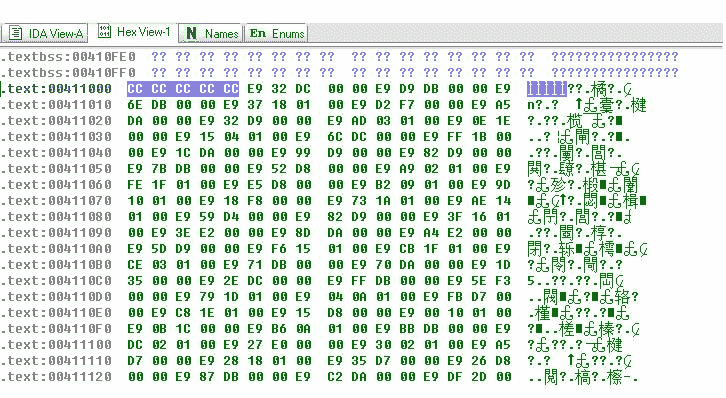
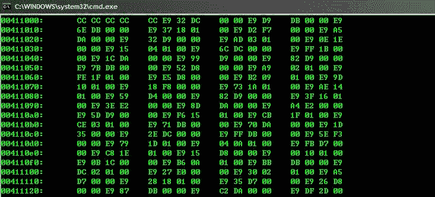

# 发一个读代码段的机器码的工具

> 原文：[`www.pediy.com/kssd/pediy12/138309.html`](https://www.pediy.com/kssd/pediy12/138309.html)

主要意图是为打算写反汇编引擎的朋友量身定做,目的很简单:读到代码段的内容显示出来  
起因:unsigned char code\[\]="\\xD3\\x90";一开始用的这种手工填写,当正确处理的指令变多后给引擎除虫的工作就明显吃力了  
结果:  
回过头看了 PE 结构,大部分参考了 egogg 大牛顺手发的那个,只是这个非常短小,不带输入表输出表,无条件假设代码段叫".text";打印效率原因不显示到 Misc.virtualSize 那么多;头一回发东西,大牛们不要笑 如果觉得有待改进希望能跟帖,细节仍能优化   
代码里分配内存时出现了个+17 本人不解  
  
  
控制台,pe 结构体用的是系统 WinNT.h 里的;附件不让 cpp,请把函数写到 main()里吧;测试程序随意  
与 ida 的对比图如下  

上传的附件
|  || ReadPE.txt  
 |