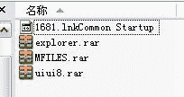

# 记异鬼(Trojan.Win32.Agent.e )uiui8.dll 病毒查杀

> 原文：[`www.pediy.com/kssd/pediy11/120155.html`](https://www.pediy.com/kssd/pediy11/120155.html)

首先。我不太清楚 这里是不是能发布病毒查杀的文章。  
如果不可以 请删贴。 但不要删号啊。。 谢谢了  
  
今天去单位。早上看到同事笔记本要做系统。 于是我问怎么了 然后他告诉我 昨天从朋友那里 copy sql 数据库 时候中毒了。。  
我说我来给你杀毒别做系统了。。  
  
  
病毒的备份。 我收藏了。。今天杀毒利用到的两个工具  
  
于是乎。就开始了今天的杀毒历程  
具体症状 就是桌面出现 4 个 ie 的快捷方式 有淘宝的 有游戏的 反正一共是四个。  
病毒是通过 U 盘传播的。。 他昨天用 U 盘 copy 中的  
开始运行 msconfig 看启动项里没啥特别的项目 于是 看看开始程序 启动。 有一个 1681 的 lkn 快捷方式 删不掉（当时不知道这个就是病毒启动加载的东东）  
我插上我的 U 盘 从里面找了几个小工具。。 没想到 俺的 U 盘也中毒了。。  
症状很普通。。 就是所有的文件夹变成了可执行程序"文件夹名.exe" 文件夹都被隐藏。 于是我用我们老师写的一个 exe 专杀杀掉这个病毒。。  
然后 文件夹还原了。。 但是那个文件夹名.exe 的 n 个程序无法删除。 说程序运行中 无法删除。。  
我用了 n 种删除文件的方法 都没能删掉。。  
到底是什么进程调用了这些文件呢。。 那些 exe 的文件夹名文件 还有桌面的 4 个快捷方式。。  
打开任务管理器 根本看不到有陌生进程 于是乎 利用第二法宝 XueTr （第一法宝是老师写的那个 exe 文件专杀）  
打开 XueTr 发现进程有一个红色的 explorer.exe 看他的路径 竟然在“C:\\Program Files\\Common Files\\Microsoft Shared”  
我们知道正常的这个进程应该是在“C:\\WINDOWS”下。。 于是乎关掉进程 发现 那 4 个桌面的快捷方式可以删掉了 这个 explorer.exe 也被删掉。  
本来以为没问题了。。 后退一个目录“C:\\Program Files\\Common Files”发现 uiui8.dll 和那个 explorer.exe 一样都是隐藏的文件    
这个文件以前没见过 而且敢肯定 不是系统的文件  
凭直觉 就是个恶意 dll 文件。。 于是没废话 直接删掉。  
重启计算机。。 杯具发现了。。 那四个可恶的桌面快捷方式又都出来了。。 喵了个咪的  
打开 XueTr 找到 explorer.exe 进程 然后查看进程句柄 发现了 他调用那 4 个桌面的快捷方式 和一个收藏夹里的快捷方式  
无意间 在 C 盘根目录发现了一个文件夹 隐藏的 而且日期是新的。 名字是 MFILES 里面有一个 winlogon.exe 进程 感觉不对劲额。  
这个进程应该是“C:\\WINDOWS\\system32”目录下的。。 但是 C 盘根目录下咋有这个文件呢。。  
于是 在任务管理器里结束这个。。可是杯具啊 直接蓝屏了。。  
于是重启。。想了半天。进安全模式删 还是杯具。。 安全模式进去也蓝屏 我了个去的。。  
后来实在没辙了。。 用 winpe 吧。。 同事的 U 盘做了个 winpe  
重启电脑 开机把 BIOS 启动项从硬盘改为 usb 启动 插上 U 盘 重启 进 winpe    
删掉 “C:/MFILES”整个目录 还有之前的那个“C:\\Program Files\\Common Files\\Microsoft Shared\\explorer.exe”  
退一个目录删掉“C:\\Program Files\\Common Files\\uiui8.dll”    
接着删除 桌面 4 个快捷方式 还有收藏夹里的一个快捷方式。 对了 还有就是那个启动项。 开始 程序 启动里的 那个 1681 的快捷方式  
  
至此 杀毒完成。。 重启 进系统 那 4 个快捷方式没有了。。收藏夹里的 1 个也没了。  
后来检查 Windows 目录 发现一个 boot 文件夹里面有启动文件的备份。。 于是看到了这个“1681.lnkCommon Startup”  
里面内容是  
L  F? ?p???p???p??   P??i⒇ +00? /C:\\ : 1 ?? MFILES $   锞?E2?? M F I L E S  L 2 ?? winlogon.exe 0   锞???? w i n l o g o n . e x e  E    - D    C:\\MFILES\\winlogon.exe C : \\ M F I L E S \`   user-035a4316f9 h?N?响 2\_lXC? )?~ h?N?响 2\_lXC? )?~   
  
  
我直接用记事本打开看的。。 说明 这个文件调用 C 盘的那个 mfiles 里的 winlogon.exe 然后那个病毒文件会自动释放 2 个文件  
C:\\Program Files\\Common Files\\Microsoft Shared\\explorer.exe 和 C:\\Program Files\\Common Files\\uiui8.dll  
并释放到桌面 4 个快捷方式 和收藏夹的一个快捷方式。。  
大概 这个病毒就是这个原理。。  
  
对了 最后说下。。 这个病毒还会隐藏可执行程序的后缀 exe 但是 我开始修复 可以修复 后来改注册表修复 就是不出来郁闷。。 不过病毒是杀了到。。  
  
估计 我是第一个发布这个病毒查杀的人。 希望有高手跟贴 详细的把这个病毒杀掉。。 感觉这个病毒很 JJ 但是 无论多 JJ 的病毒 都有被攻克的  
  
吼吼 广大的反病毒高手们 我们努力制止这些恶意的病毒吧。。